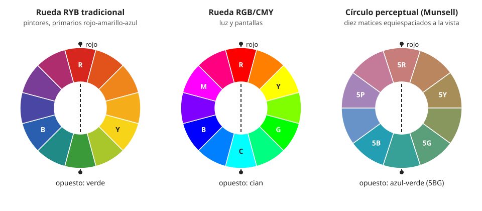

## Comprensión {#layer-2}

### Idea clave
No hay una rueda "verdadera" y otra falsa: la RYB de los artistas, la de la luz (RGB/CMY) y las perceptuales responden a preguntas distintas, y los problemas aparecen al usar una para una pregunta que no es la suya [@munsell-1905, Apéndice al cap. III; @briggs-dimensions, 072.php].

### Explicación
Quien aprende color se encuentra pronto con ruedas que no coinciden: en una el opuesto del rojo es el verde, en otra el cian, en otra el azul verdoso. Este concepto parte de [la rueda de color](color-wheel.md) y de la [visión tricromática](../../light-and-vision/concepts/trichromacy.md).

**1. La rueda RYB (rojo, amarillo, azul) de los artistas.** Se basa en tres primarios históricos, con complementarios rojo-verde, amarillo-violeta y azul-naranja. Descansa en una teoría que se abandonó en la segunda mitad del siglo XIX, pero sigue siendo la base de gran parte de la enseñanza del arte y el diseño [@briggs-dimensions, 072.php]. Sus fallos, según las pruebas con luces de colores y discos de Maxwell, son estos:

- Los pares RYB no se neutralizan en un gris equilibrado, y un círculo completo RYB tiene un exceso de naranja, porque el rojo y el amarillo ocupan demasiado de la circunferencia [@munsell-1905, Apéndice al cap. III].
- Los complementarios que sí se neutralizan son otros: rojo con azul verdoso, verde con rojo-morado y azul violáceo con amarillo [@munsell-1905, Apéndice al cap. III].
- El amarillo no es primario en la visión, porque la luz roja más la verde lo producen; el verde es fundamental y no sale de mezclar amarillo y azul [@munsell-1905, Apéndice al cap. III].
- Los esquemas de Runge y Chevreul ponían el rojo, el amarillo y el azul a la misma distancia, a pesar de que el amarillo es mucho más claro y el azul mucho más oscuro, lo que impedía alinear sus escalas de valor [@munsell-1905, Apéndice al cap. V].

**2. La rueda de la luz (RGB/CMY).** Parte de la mezcla aditiva de luces: tres primarios (rojo, verde y azul) cuya mezcla produce los demás colores, lo que se explica por los tres tipos de cono (véase [visión tricromática](../../light-and-vision/concepts/trichromacy.md)). No hay un conjunto único de primarios: amarillo, verde y azul también sirven [@openstax-college-physics-2e, §26.3]. Entre los primarios quedan el cian, el magenta y el amarillo, y cada uno es el opuesto de un primario: el complementario del rojo es el cian, no el verde, y el del verde es el magenta, no el rojo [@briggs-dimensions, 043.php, 074.php]. Es la rueda de pantallas y cámaras.

**3. Las ruedas perceptuales.** Colocan los matices según lo que ve el ojo, no según los primarios. Hay dos tipos de justificación:

- **Munsell:** diez matices a intervalos iguales, con opuestos elegidos porque, mezclados en disco giratorio, daban gris neutro [@munsell-1905, ¶56, ¶61; @briggs-dimensions, 112.php].
- **Opuestos fisiológicos:** la definición de la CIE de matiz único usa cuatro matices (rojo, verde, amarillo y azul) en dos pares opuestos, que enlazan con los [procesos oponentes](../../light-and-vision/concepts/opponent-process.md) [@cie-e-ilv, 17-22-068]. Hering, con su teoría de la oposición, es la base de este planteamiento y también del sistema NCS; en una comparación de escalas de matiz, la rueda tradicional de Itten resulta perceptualmente irregular [@briggs-dimensions, Google Sites, p. 1; 073.php].

La rueda de luces no sirve, en cambio, para pigmentos. Newton construyó su círculo para mezclar luces, no polvos de pintor, y anotó que mezclar polvos de colores da un resultado oscuro, no brillante, porque absorben parte de la luz [@newton-1704, Libro I, Parte II, Prop. V, Exper. 15; Prop. VI].

### Ejemplo
Con luces espectrales puras, el rojo y el verde dan amarillo. Con pinturas, el bermellón mezclado con verde esmeralda da un gris cálido (pardo). La causa es que ningún pigmento es un ejemplo puro de su matiz dominante: el bermellón emite también algo de verde y de púrpura, y el verde esmeralda algo de azul y de rojo [@munsell-1905, Apéndice al cap. III].

Por eso los pintores usan pigmentos amarillos (aureolina, cadmio, cromato de plomo): la mezcla de rojo y verde no da un buen amarillo [@munsell-1905, Apéndice al cap. III].

### Errores frecuentes
- *"La rueda RYB está probada por la práctica del taller."* El hecho de que un rojo, un amarillo y un azul de pigmento puedan imitar la mayoría de los colores naturales no valida la teoría. La discrepancia entre mezcla de pigmentos y mezcla en la retina se aclara al conocer cómo se comportan las pinturas [@munsell-1905, Apéndice al cap. III]. La mezcla de pigmentos se trata en el ámbito de mezcla de color.

### Las fuentes discrepan
Munsell criticó la RYB con dureza en 1905: aunque el sistema de Brewster se había dejado atrás al comprobarse que la visión del color se apoya en sensaciones de rojo, verde y azul violáceo, en las escuelas se seguía enseñando que rojo, amarillo y azul eran primarios y que los opuestos eran complementarios [@munsell-1905, Apéndice al cap. III]. Briggs, de fiabilidad C, confirma que la RYB sigue siendo la base de gran parte de la enseñanza [@briggs-dimensions, 072.php].

### Para seguir
La capa 3 ayuda a elegir la rueda según la pregunta. Antes, el [sistema Munsell](munsell-system.md) desarrolla la rueda perceptual con valor y croma.

## Profesional {#layer-3}

### Idea clave
La rueda se elige según la pregunta: perceptual para ordenar y comparar matices, RGB/CMY para luces, y ninguna predice del todo la mezcla de pinturas. La RYB sigue en la enseñanza, así que conviene conocer dónde falla [@munsell-1905, Apéndice al cap. III].

### Explicación
Un resumen práctico:

| Pregunta | Rueda adecuada |
|---|---|
| ¿Cómo se ordenan los matices para mirarlos y compararlos? | Perceptual (Munsell o ángulo de matiz de CIELAB) |
| ¿Qué dará la mezcla de luces (pantalla, escena iluminada)? | RGB/CMY, o el círculo de Newton |
| ¿Qué dará la mezcla de pinturas? | Ninguna rueda lo predice del todo; hay que mirar la pintura |

[Resumen propio a partir de las fuentes citadas arriba] [unverified]

La RYB seguirá apareciendo en libros y cursos de pintura, de modo que conviene conocerla y saber en qué falla: predice complementarios que no se neutralizan y un exceso de naranja en el círculo [@munsell-1905, Apéndice al cap. III]. En el taller, los complementarios que se obtienen al mezclar pinturas se parecen más a los pares aditivos que a los de la rueda RYB [@briggs-dimensions, 074.php, 063.php].

"Primario", además, significa cosas distintas en cada sistema. Los primarios psicológicos de los pintores se sitúan cerca de los Munsell 5R, 5Y y 5G, con un azul medio cercano al cobalto (5PB), y dos tradiciones discrepan sobre la polaridad cálido-frío del azul [@briggs-dimensions, 112.php].

Las tablas de fabricante, por su parte, usan sistemas perceptuales, no RYB: la de Williamsburg da el matiz en Munsell y las coordenadas *L*\*, *a*\*, *b*\* [@justpaint-munsell-cielab, tabla Williamsburg].

### Ejemplo
Se quiere apagar una pintura con su opuesto y hay que localizar ese opuesto. Procedimiento:

1. Ir al lado contrario del círculo Munsell; por ejemplo, la pareja que recoge Munsell para el rojo es el azul verdoso [@munsell-1905, ¶61].
2. Comprobar a continuación con una mezcla real, porque el camino de la mezcla de pinturas se curva cerca del eje amarillo-azul violáceo [@briggs-dimensions, 063.php].

Las dos ruedas coinciden en unos casos y no en otros. El opuesto del naranja es el azul tanto en la RYB como en Munsell (amarillo-rojo frente a azul) [@briggs-dimensions, 072.php; @munsell-1905, ¶61-62]. En el rojo difieren: verde en RYB y azul verdoso en Munsell [@briggs-dimensions, 072.php; @munsell-1905, ¶61].

### Las fuentes discrepan
Las observaciones de Briggs sobre complementarios de taller y primarios proceden de una fuente de fiabilidad C, leída solo en fragmentos, pero coinciden con lo que ya decía Munsell en 1905. El equilibrio de áreas y la armonía de contrastes se tratan en el ámbito de armonía del color.

### Para seguir
[CIELAB para pintores](cielab-basics.md) da la alternativa numérica a las ruedas, con el ángulo de matiz como número.
