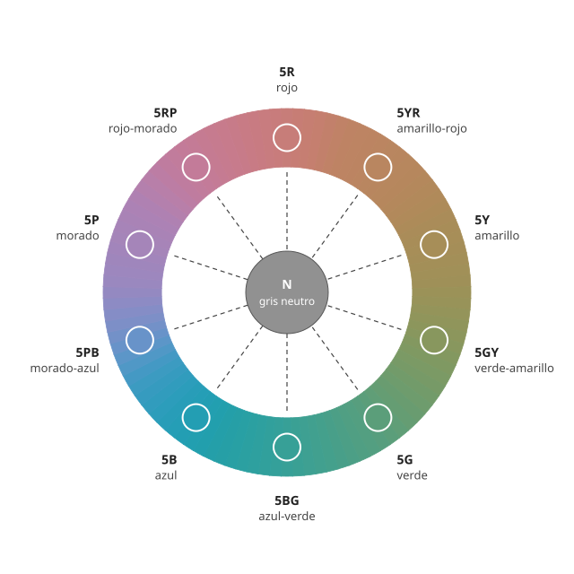

## Fundamentos {#layer-1}

La **rueda de color (color wheel)**, o círculo de matices, es un dibujo que ordena los [matices](hue.md) en un círculo cerrado: pasar del rojo al amarillo, al verde, al azul, al morado y volver al rojo sin saltos [@cleland-1921, pp. ~13-14]. La guía de Konica Minolta lo describe como la disposición en círculo de la sucesión continua de matices [@konica-minolta-pcc, Parte I-4]. Es el modo natural de representar el matiz, porque la CIE define el matiz como un anillo cerrado: los matices intermedios aparecen como mezclas de dos vecinos [@cie-e-ilv, 17-22-067].

**Ejemplo cotidiano.** El arcoíris muestra los matices en fila, de rojo a violeta. La rueda cierra esa fila con los morados y magentas, que no están en el arcoíris, y así queda un círculo en el que cada color tiene dos vecinos.

**Cómo se lee.** Munsell lo propone así: cinco matices principales (rojo, amarillo, verde, azul y morado) repartidos a distancias iguales, y entre cada pareja un matiz intermedio (amarillo-rojo, verde-amarillo, azul-verde, morado-azul y rojo-morado), con lo que quedan diez posiciones [@munsell-1905, ¶56-58]. Dos ideas se leen directamente en el dibujo:

- **Vecinos:** dos matices contiguos, al mezclarse, dan un matiz intermedio que conserva algo de ambos [@munsell-1905, ¶56].
- **Opuestos:** una línea que va de un matiz por el centro hasta el lado contrario encuentra su opuesto. Al mezclar dos opuestos se obtiene un gris, y el centro de la rueda es un gris medio [@munsell-1905, ¶61]. En el círculo de Munsell, el opuesto del rojo es el azul verdoso (*blue-green*) [@munsell-1905, ¶61].

## Comprensión {#layer-2}

**Una rueda es un mapa, no una ley.** Hay muchas ruedas porque se ordenan con criterios distintos (véase [por qué hay varias ruedas](color-wheel-models.md)). Lo que comparten todas es que el matiz se representa como ángulo; lo que cambia es dónde se coloca cada matiz y cuáles son los opuestos. En la rueda de Munsell, la distancia entre matices es la misma entre pasos, y las parejas opuestas se eligieron porque, al hacerlas girar en un disco de Maxwell, se mezclaban en un gris neutro [@munsell-1905, ¶105-116; @briggs-dimensions, 112.php].

**El centro importa: el círculo de Newton.** Newton dibujó un círculo con los siete colores del prisma en la circunferencia y el blanco en el centro. Para saber qué color da una mezcla de luces se calcula el centro de gravedad de las cantidades de cada color; la dirección desde el centro hacia ese punto indica el matiz y la distancia al centro indica la "plenitud o intensidad" del color, es decir, cuánto se aleja del blanco [@newton-1704, Libro I, Parte II, Prop. VI, Prob. II]. En ese círculo, una mezcla situada a mitad de camino entre el borde y el centro equivale al amarillo más intenso diluido con una cantidad igual de blancura [@newton-1704, Libro I, Parte II, Prop. VI, Prob. II]. Esta es la idea de fondo de las ruedas actuales: el ángulo marca el matiz y el radio, cuánto se aleja el color del gris o blanco central (véase [croma](chroma.md)).

**Qué no representa una rueda plana.** Una rueda omite el valor y, en la mayoría de los dibujos, también el croma. Munsell comparaba los diagramas planos que omiten el croma con un mapa de Suiza sin montañas [@munsell-1905, ¶14]. La rueda de matices corresponde a una sola rebanada horizontal a un valor dado, el "ecuador" del sólido de color [@munsell-1905, ¶31].

**Lo que Newton no dijo.** El círculo de Newton sirve para mezclar luces, no polvos de pintor [@newton-1704, Libro I, Parte II, Prop. VI; Prop. V, Exper. 15]. Los polvos de colores, al mezclarse, absorben buena parte de la luz y dan un resultado sucio, gris o pardo [@newton-1704, Libro I, Parte II, Prop. V, Exper. 15].

## Profesional {#layer-3}

**Cuántos matices distinguir.** El número de divisiones de una rueda depende de la finalidad. Munsell consideraba suficientes diez pasos para la enseñanza elemental [@munsell-1905, ¶59-60]. En la versión de Cleland de 1921 cada uno de esos diez pasos principales se subdivide en diez (numerados de 1 a 10), que se considera aproximadamente la menor diferencia que distingue un ojo entrenado; el 5 marca el matiz "simple" y el 10, el compuesto [@cleland-1921, p. ~14]. De ahí salen valores como los 100 matices de una rueda Munsell completa; esa cifra es un cálculo (10 × 10) y no una afirmación de la fuente.

**La rueda como herramienta de decisión al mezclar.** Briggs describe el método de acercarse a un color objetivo: elegir dos pinturas que estén a ambos lados del objetivo en el círculo de matices, igualar el valor y mezclar [@briggs-dimensions, 109.php]. Para encontrar el complementario de una pintura, Briggs indica que, en mezclas de pintura, el complementario más directo de la mayoría de las pinturas está aproximadamente en el lado opuesto del círculo Munsell, salvo cerca del eje que va del amarillo al azul violáceo, donde el camino de la mezcla se curva a través de verdes de croma medio [@briggs-dimensions, 063.php]. Es una fuente de fiabilidad C, de modo que sirve de pista de trabajo y no de regla.

**Un par opuesto solo da gris si está equilibrado.** El propio Munsell avisa de que dos opuestos solo se neutralizan si tienen el mismo valor y un croma equilibrado, y que, si no, queda un tinte que indica cuál de los dos sobra [@munsell-1905, ¶72-77, ¶105-116]. En la práctica de taller: si una mezcla de opuestos no llega a gris, la rueda no está "fallando"; lo que falla es la igualdad de valor y croma entre las dos pinturas.

**Cuándo no basta una rueda.** Si hay que trasladar un color a números (para pedir pintura, comparar lotes o comunicar un color a otra persona), la rueda deja de servir y hace falta una notación como [Munsell](munsell-system.md) o [CIELAB](cielab-basics.md), donde el ángulo de matiz de la rueda pasa a ser un número en una escala.
