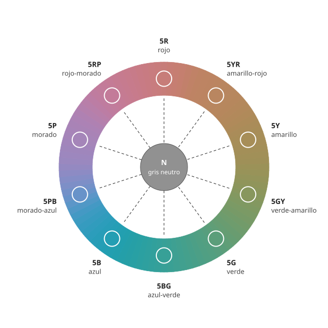

## Fundamentos {#layer-1}

El **matiz (hue)** es lo que nos permite distinguir un color de otro: un rojo de un amarillo, de un verde, de un azul o de un morado [@munsell-1905, ¶21]. La definición oficial de la CIE es parecida: el matiz es el atributo de la percepción por el cual una zona se ve como uno de los colores rojo, amarillo, verde o azul, o como una mezcla de dos de ellos contiguos, dispuestos en un anillo cerrado [@cie-e-ilv, 17-22-067].

Dos ideas importantes de esa definición. Primero, el matiz es una **sensación**, no una propiedad física: la luz tiene longitudes de onda, y lo que vemos es un matiz (véase [luz y espectro visible](../../light-and-vision/concepts/light-spectrum.md)). Segundo, el matiz **no dice nada de lo claro ni de lo fuerte** que es el color [@munsell-1905, ¶21]. "Rojo" puede ser un rosa pálido o un granate oscuro: tienen el mismo matiz y se diferencian en otras dos dimensiones, el [valor](value.md) y el [croma](chroma.md).

**Ejemplo cotidiano.** Un limón maduro, un plátano y una flor de diente de león son "amarillos" aunque uno sea más claro, otro más apagado y otro más vivo. Lo que comparten es el matiz. Por eso el matiz se ordena en un círculo cerrado, la [rueda de color](color-wheel.md): entre el rojo y el amarillo hay matices intermedios (los naranjas), y de nuevo, entre el azul y el rojo, los morados.

## Comprensión {#layer-2}

**Los cuatro matices "únicos".** La CIE llama *matiz único (unique hue)* a un matiz que no se puede describir con nombres de otros matices; son cuatro (rojo, verde, amarillo y azul) y forman dos pares opuestos, rojo-verde y amarillo-azul [@cie-e-ilv, 17-22-068]. Esa estructura de pares opuestos enlaza con los [procesos oponentes](../../light-and-vision/concepts/opponent-process.md) del sistema visual. El naranja o el morado, en cambio, se describen como mezclas de los matices vecinos.

**Por qué el anillo se cierra.** Una idea frecuente es que el matiz equivale a la longitud de onda. Munsell, en 1905, vinculaba el matiz a la longitud de onda y daba como ejemplo que una longitud de onda produce la sensación de verde y otra la de rojo [@munsell-1905, ¶21]. Pero el espectro es una recta con un extremo rojo y otro violeta, mientras que el anillo de matices se cierra porque incluye los morados y magentas, que no son luz de una sola longitud de onda. Newton ya lo notó: si la mezcla cae cerca del segmento que une los extremos rojo y violeta, el resultado no es un color prismático sino un púrpura [@newton-1704, Libro I, Parte II, Prop. VI, Prob. II].

**Un matiz no es una propiedad fija del estímulo.** La CIE define el *color percibido (perceived colour)* como lo que se describe con matiz, claridad (o brillo) y colorido (o saturación o croma), y precisa que depende del espectro, del tamaño, la forma, la estructura y el entorno del estímulo y de la adaptación y la experiencia del observador [@cie-e-ilv, 17-22-040]. Eso implica que el matiz que percibimos puede cambiar con la luz o con lo que rodea al color (véase [el color de la luz](../../light-and-vision/concepts/illuminant-color.md)).

**Matiz, valor y croma son independientes.** Munsell insistía en que un color solo queda definido si se dan las tres cualidades; si falta una, el color queda sin definir [@munsell-1905, ¶8, ¶20]. Otras palabras corrientes mezclan dimensiones, y Munsell criticaba, por ejemplo, que un autor escribiera que un amarillo "pasa" (*shades*) al verde, que es un cambio de matiz, y que hablara de "un tono más brillante" cuando quería decir un croma más fuerte [@munsell-1905, Apéndice al cap. I].

**Los nombres de matiz son culturales y vagos.** Cleland evitaba en su libro "naranja", "rosa" y "violeta" y usaba nombres como "amarillo-rojo", porque los nombres corrientes (ciruela, oliva, ratón) no son precisos [@cleland-1921, pp. ~13, 17-18]. Munsell glosaba amarillo-rojo como "lo que se llama popularmente naranja" y rojo-morado como "ciruela" [@munsell-1905, ¶58].

## Profesional {#layer-3}

**Medir el matiz con un ángulo.** Los instrumentos expresan el matiz como un ángulo. En CIELAB es el ángulo de matiz *h*ab = arctan(*b*\*/*a*\*) [@cie-e-ilv, 17-23-076]; en la guía de Konica Minolta se mide desde el eje +*a*\*: 0° es rojo, 90° amarillo, 180° verde y 270° azul [@konica-minolta-pcc, Parte I-8]. En Munsell, el matiz es la parte de la notación formada por una letra que indica la posición en el círculo [@munsell-1905, ¶40]; ediciones posteriores le anteponen un número, como en 7R [@cleland-1921, p. ~14] (véase [el sistema Munsell](munsell-system.md) y [CIELAB](cielab-basics.md)). Las fichas de los fabricantes dan el matiz con una de esas dos notaciones; por ejemplo, el azul ultramar de Williamsburg figura con matiz 9,01 PB, y el amarillo de cadmio limón, con 9,06 Y [@justpaint-munsell-cielab, tabla Williamsburg].

**Cuándo el matiz deja de tener sentido.** Cuando el croma es casi cero, el matiz es irrelevante: el listado de Golden indica "Black" o "White" en lugar de un matiz para las pinturas acromáticas [@justpaint-munsell-cielab, listado Golden]. La tabla de Williamsburg, en cambio, da un matiz incluso al blanco de titanio (2,7 GY con croma 0,24) y al negro de marfil (5,16 PB con croma 0,08), lo que no debe leerse como un matiz real [@justpaint-munsell-cielab, tabla Williamsburg].

**Al mezclar, el matiz se compara al lado.** Un método que describe Briggs: elegir pinturas a ambos lados del objetivo en el círculo de matices, llevar cada una al valor del objetivo, mezclarlas y, si hace falta, bajar el croma [@briggs-dimensions, 109.php]. Se trata de una guía de taller de una fuente de fiabilidad C, aquí solo como práctica ilustrativa. El ejemplo muestra el orden razonable de decisión: acertar primero el matiz con el valor ya ajustado, y dejar el croma para el final.

**Dónde falla "el matiz es lo que llamo el color".** Dos pinturas con el mismo nombre comercial pueden tener matices distintos. Un caso medido: el amarillo de cadmio medio "genuino" de Golden está en 3,0 Y y el "Hue" (imitación) en 1,5 Y [@justpaint-munsell-cielab, listado Golden]. Las lecturas de matiz también dependen de cómo se aplicó la pintura (espesor de la película, secado), según un resumen de la metodología de esas tablas [unverified].
