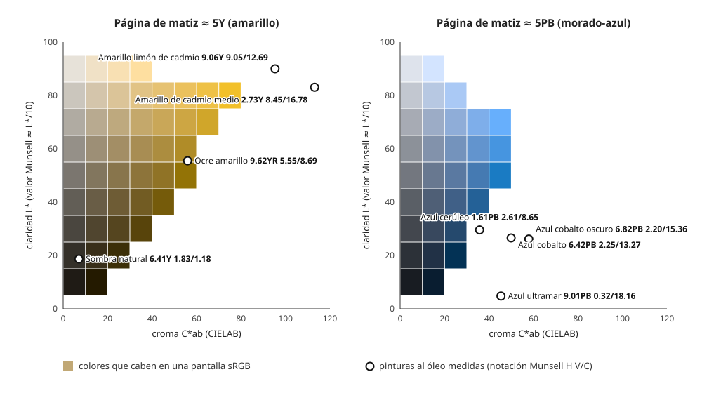

## Comprensión {#layer-2}

El **sistema Munsell (Munsell system)** pone escalas medidas a las tres dimensiones del color que ya conocemos: [matiz](hue.md), [valor](value.md) y [croma](chroma.md). Lo ideó Albert H. Munsell, que lo explicó en *A Color Notation* (1905) para unir las tres cualidades "mediante escalas medidas" [@munsell-1905, ¶24, ¶31]. Es un sistema pensado para pigmentos y papel, no para longitudes de onda de la luz [@cleland-1921, nota, p. ~13].

**La geometría.** Munsell lo explica con una esfera y después con un "árbol". En la esfera, el blanco está en el polo norte y el negro en el sur; el valor es la escala vertical, de negro (0) a blanco (10); el matiz va alrededor del ecuador, y el croma crece hacia afuera desde el eje de grises [@munsell-1905, ¶25, ¶31]. Cualquier perpendicular al eje neutro es una escala de croma, que en la esfera va de 1 a 5 desde el centro a la superficie [@munsell-1905, ¶31]. Ver [la rueda de color](color-wheel.md) para el ecuador.

**La notación.** Un color se escribe con el matiz, el valor y el croma. En 1905 el matiz se escribía con una inicial a la izquierda, el valor con un número sobre una raya y el croma bajo la raya; el ejemplo de Munsell, R 5/9, representa las cualidades del pigmento bermellón [@munsell-1905, ¶40]. La forma con un número delante de la letra del matiz (por ejemplo 7R) aparece en la edición de Cleland de 1921, donde cada paso principal de matiz se subdivide en diez [@cleland-1921, p. ~14]. En esa edición el bermellón figura como R 5/10 [@cleland-1921, Introducción]. La diferencia entre R 5/9 y R 5/10 recuerda que los números dependen de la edición de las muestras; Newhall y colaboradores publicaron en 1943 la reedición (*renotation*) que dio las notaciones del Munsell moderno, lo que aquí solo se señala como lectura adicional [@newhall-1943] [unverified].

**Un sólido irregular.** Los pigmentos no llegan igual de lejos del gris en todos los matices: producen "montañas y valles" en el sólido [@munsell-1905, ¶14, ¶125-126]. Por eso Munsell propuso el *árbol de color (color tree)*: el eje de valor es el tronco y las ramas, horizontales, llevan la escala de croma; las ramas se prolongan hasta croma 6, 7, 8 o 9 y sus extremos marcan los pigmentos más fuertes de la época [@munsell-1905, ¶34]. En el árbol, el amarillo está más cerca del blanco, y luego vienen el verde, el rojo, el azul y el morado, cada vez más cerca del negro [@munsell-1905, ¶34]. Cleland señala que el rojo tiene el camino de croma más largo y el azul verdoso el más corto [@cleland-1921, p. ~16], y que las tintas de imprenta y los tintes pueden pasar los límites de los pigmentos usados para la esfera [@cleland-1921, pp. ~16-17].

**El sistema se usa en la práctica.** En la guía de Konica Minolta, el color se evalúa visualmente comparándolo con fichas de papel (las *Munsell Color Charts*) en las tres escalas, y se escribe H V/C [@konica-minolta-pcc, Parte I-6]. Munsell construyó instrumentos para fijar las escalas: un globo giratorio, un fotómetro para los valores, pigmentos mates permanentes y discos de Maxwell para comprobar equilibrios [@munsell-1905, ¶103-108]. Como patrones de referencia propuso cinco pigmentos esmaltados de valor y croma medios, un "diapasón cromático" [@munsell-1905, ¶28-29, ¶117].

**Malentendido frecuente.**
- *El croma no tiene un tope de 10.* En la esfera de 1905 llegaba a 5, y en el árbol a 9 [@munsell-1905, ¶31, ¶34]; en las tablas actuales de pinturas aparecen valores de 16 a 18 (ver capa 3).

## Profesional {#layer-3}

**Analizar un color con Munsell.** La notación sirve para descomponer un color en tres preguntas separadas: ¿en qué posición del círculo está? (matiz), ¿cuán claro es? (valor), ¿cuán lejos está del gris? (croma). Briggs explica que los pintores trabajan sobre todo con matiz, valor y croma relativos, aunque ve ventajas prácticas en una escala absoluta de valor [@briggs-dimensions, 112.php, 081.php]. Los fabricantes publican tablas con este formato. Dos ejemplos de lectura, con pinturas de Williamsburg (óleo, película de 6 mil) [@justpaint-munsell-cielab, tabla Williamsburg]:

| Pintura | Notación (H V/C) | Lectura |
|---|---|---|
| Azul ultramar | 9,01 PB 0,32/18,16 | matiz azul-morado; muy oscuro; croma muy alto |
| Amarillo de cadmio limón | 9,06 Y 9,05/12,69 | amarillo cercano al verde-amarillo; muy claro; croma alto |
| Rojo de cadmio claro | 9,29 R 5,13/17,97 | rojo; valor medio; croma muy alto |
| Ocre amarillo | 9,62 YR 5,55/8,69 | amarillo-rojo; valor medio; croma medio |
| Sombra natural | 6,41 Y 1,83/1,18 | amarillo; oscuro; casi neutro |

**Qué enseñan esas tablas.** Los cadmios están en el extremo de croma alto, y las tierras, en el de croma bajo y valor bajo o medio [@justpaint-munsell-cielab, tabla Williamsburg]. Un par útil: el azul cobalto (6,42 PB 2,25/13,27) y el azul ultramar (9,01 PB 0,32/18,16) son del mismo "azul" pero con valor y croma distintos [@justpaint-munsell-cielab, tabla Williamsburg]. En las dos tablas de Golden y Williamsburg, ordenar por valor da una paleta de oscuro a claro y por croma, de apagado a vivo (esto es una lectura práctica de la tabla, no una afirmación de las fuentes) [unverified]. Los negros y blancos reales no llegan a 0 ni a 10: el blanco de titanio mide 9,73 y el negro Mars 0,82 [@justpaint-munsell-cielab, tabla Williamsburg].

**Cómo leer las pinturas casi neutras.** Golden indica "Black" o "White" en vez de matiz para las pinturas acromáticas, y sus grises neutros siguen una escala N cuyo número aproxima el valor Munsell (N5 = 5,1; N8 = 7,9) [@justpaint-munsell-cielab, listado Golden]. En la tabla de Williamsburg, en cambio, incluso los casi neutros llevan matiz, aunque no debe tomarse en serio [@justpaint-munsell-cielab, tabla Williamsburg].

**Desconfiar de los datos.** El listado de Golden contiene erratas aparentes (un matiz "73,92" para el rojo de cadmio oscuro, "19,0 YR" para la tierra siena cruda) y debe leerse con cautela [@justpaint-munsell-cielab, listado Golden]. Las lecturas dependen de la película: Golden dice haber usado un espectrofotómetro con interpretación visual [@justpaint-munsell-cielab, listado Golden]; las pinturas poco opacas leen más claras y de más croma en película fina, y las acrílicas se oscurecen y saturan al secar, según un resumen de su metodología [unverified]. La tabla de Williamsburg no indica iluminante ni observador [@justpaint-munsell-cielab, tabla Williamsburg].

**Munsell frente a CIELAB.** Munsell es un sistema de muestras ordenadas por el ojo; CIELAB (ver [CIELAB para pintores](cielab-basics.md)) se calcula a partir de medidas. Las tablas de fabricantes dan los dos para la misma pintura, lo que permite traducir. Briggs señala que el valor Munsell 10 corresponde a un reflector difuso perfecto, así que le corresponde un *L*\* superior a 100 [@briggs-dimensions, 081.php].

**Límites de Munsell para la pintura.** Briggs indica que los acrílicos de croma máximo en mezcla se acercan a la parte superior del sólido de Munsell, y que los verdes y azules llegan a unas 12 unidades de croma frente a 14-16 en muchos rojos, naranjas y amarillos [@briggs-dimensions, páginas sobre la gama de mezclas, localización exacta no capturada]. No obstante, Munsell no sirve para saber cómo se mezclarán dos pinturas: sirve para describir el resultado [unverified].
