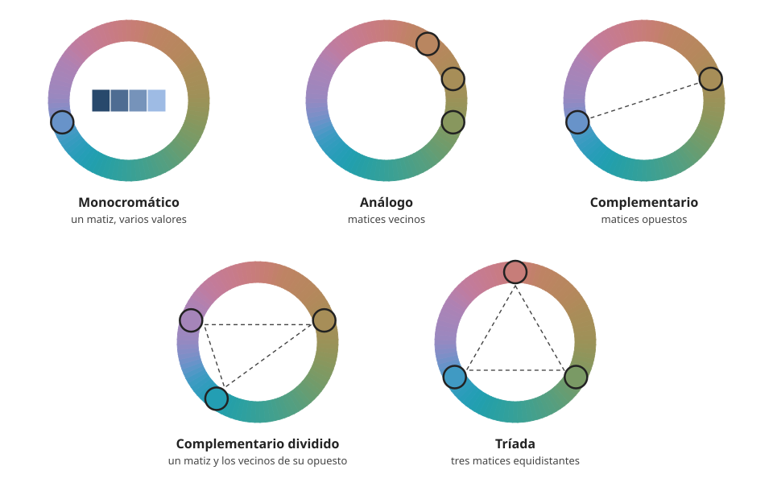

## Fundamentos {#layer-1}

### Idea clave
Un **esquema de color (color scheme)** es una regla sencilla para elegir varios colores según dónde caen en la [rueda de color](../../color-attributes/concepts/color-wheel.md): vecinos, opuestos o repartidos en triángulo. Son convenciones útiles para decidir, no leyes [@gurney-2010, blog 'The Shapes of Color Schemes', 2008-02-03].

### Explicación
Los esquemas son el punto de partida que usan muchos pintores para no empezar con todos los tubos a la vez. Los más habituales son estos:

- **Monocromático (un solo matiz):** se varían el valor y el croma dentro de un mismo [matiz](../../color-attributes/concepts/hue.md); Cleland lo recomienda como fuente de muchos resultados agradables [@cleland-1921, pp. ~23-24].
- **Análogo:** matices vecinos en la rueda. Chevreul lo llama armonía de analogía, y Cleland dice que los matices próximos se llevan bien por cercanía, no por contraste [@chevreul-1890, §180, pp. 69-70; @cleland-1921, p. ~24].
- **Complementario:** dos matices opuestos en la rueda, con el neutro en el centro [@gurney-2010, blog 'The Shapes of Color Schemes', 2008-02-03]. Los [colores complementarios](../../color-mixing/concepts/complementary-colors.md) son su base. Cleland afirma que los matices opuestos dan una armonía fuerte y simple que realza a ambos [@cleland-1921, pp. ~18-19, 23].
- **Complementario dividido (split complementary):** un matiz más los dos vecinos de su opuesto; Gurney lo describe como vibrante pero algo inestable [@gurney-2010, blog 'The Shapes of Color Schemes', 2008-02-03].
- **Tríada:** tres colores; la mayoría de los esquemas se apoyan en tres colores componentes, y el área del triángulo que forman es la gama de colores disponible [@gurney-2010, blog 'The Shapes of Color Schemes', 2008-02-03].

Qué pares cuentan como "complementarios" depende de la rueda que uses: la rueda tradicional del pintor parte de rojo, amarillo y azul, y la digital de cian, magenta y amarillo [@gurney-2010, blog 'The Shapes of Color Schemes', 2008-02-03].

### Ejemplo
Es como vestirse: puedes combinar prendas de tonos vecinos (azul marino con azul cielo), que sería un esquema análogo, o apostar por un contraste (camisa azul con chaqueta naranja), que se acerca al complementario. Los esquemas ponen nombre a esas decisiones.

### Para seguir
[Colores cálidos y fríos](color-temperature.md) añade la otra gran división de la rueda. La capa 2 de este concepto muestra los esquemas como formas sobre la rueda y qué dice la tradición de ellos.

## Comprensión {#layer-2}

### Idea clave
Un esquema puede verse como una forma dibujada sobre la rueda; lo que queda dentro es la paleta del cuadro y el resto se descarta. La tradición (Chevreul, Cleland, Itten, Munsell) los justifica con teorías distintas, ninguna formulada con mediciones estéticas [@gurney-2010, blog 'Part 2: Gamut Masking Method', 2011-09; @palmer-2013, p. 90].

### Explicación
Gurney propone ver cualquier esquema como una forma sobre la rueda, y cada forma tiene su propia "personalidad" con independencia de los colores concretos: una tríada equilátera resulta atmosférica, una máscara casi complementaria suena disonante y una que cubre solo un lado de la rueda sugiere pureza o rareza [@gurney-2010, blog 'The Shapes of Color Schemes', 2008-02-03]. Esa idea se convierte en un método, la *máscara de gama*, que se desarrolla en la planificación de la gama: lo que queda dentro de la forma es la paleta del cuadro y el resto se descarta [@gurney-2010, blog 'Part 2: Gamut Masking Method', 2011-09]. La forma no tiene por qué ser un triángulo; el triángulo es cómodo porque da tres colores de partida [@gurney-2010, blog 'Part 2: Gamut Masking Method', 2011-09].

Antes de las formas, la tradición distinguía dos familias. Chevreul separa armonías de analogía (de escala, de matices y de luz dominante) y armonías de contraste (de escala, de matices y de colores) [@chevreul-1890, §180, pp. 69-70]. Para él, la asociación de complementarios es la única en la que los colores se mejoran y se purifican mutuamente sin salirse de su escala, y sigue funcionando con complementarios inexactos o rotos con gris [@chevreul-1890, Translator's Introduction, p. xl]. Pero el contraste no es siempre mejor: con dos colores cercanos puede ser preferible avanzar hacia la armonía de escala o de matiz [@chevreul-1890, §252-253, pp. 91-92].

Otras teorías explican la armonía de otro modo. Itten sostuvo que los colores son armoniosos si mezclados como pinturas dan un gris neutro; Munsell y Ostwald, que la armonía viene de relaciones regulares en el espacio de color (por ejemplo, matiz y saturación constantes con valor variable) [@palmer-2013, p. 90]. Para Cleland, "armonía de color" es otro nombre de orden de color: pasos regulares de valor, croma y matiz, y con tres o más colores recomienda un campo de matices restringido [@cleland-1921, pp. ~24-25]. Rumford sostenía que dos colores armonizan si juntos suman luz blanca, y Chevreul lo juzga una ocurrencia ingeniosa de poca utilidad para la pintura [@chevreul-1890, §128, p. 40].

Esas teorías son prescripciones de su autor y no se formularon a partir de mediciones estéticas [@palmer-2013, p. 90]. Chevreul avisa de que sus ejemplos con blanco, negro y gris son juicio personal, no deducción rigurosa [@chevreul-1890, §181, p. 70]. Munsell afirma que no hay leyes de armonía asentadas, porque las fórmulas antiguas no definían bien matiz, valor y croma y las analogías musicales no se trasladan bien [@munsell-1905, ¶146-153].

### Ejemplo
Con una paleta de tríada, el esquema se vuelve un procedimiento: se traza el triángulo sobre la rueda, se eligen los tres tubos de los vértices y todo lo demás del cuadro se mezcla a partir de ellos, de modo que lo que queda fuera del triángulo se descarta. Si un vértice se sustituye por un tubo menos saturado (ocre amarillo en lugar de amarillo de cadmio), el triángulo se encoge y con él la gama [@gurney-2010, blog 'The Shapes of Color Schemes', 2008-02-03].

### Errores frecuentes
- *"La rueda tiene una única versión correcta."* Gurney reconoce que su preferencia por la rueda RYB es eso, una preferencia, y que la digital es más útil para pantalla [@gurney-2010, blog 'The Shapes of Color Schemes', 2008-02-03]. Los complementarios por mezcla de pigmentos pueden estar más cerca de rojo/verde que del par digital rojo/cian (comentario suyo, no desarrollado) [@gurney-2010, blog 'How do you choose limited-palette colors?', 2021-02].
- *"Los esquemas están demostrados."* Las teorías clásicas se formularon sin mediciones estéticas [@palmer-2013, p. 90].
- *"Complementario significa más armonioso."* Los datos experimentales con pares de colores no lo respaldan: ni la preferencia ni la armonía suben para los complementarios [@schloss-palmer-2011, Exp. 1, Exp. 2].

### Las fuentes discrepan
Las teorías de Chevreul, Itten, Munsell, Ostwald, Cleland y Rumford proponen criterios incompatibles de qué es armonía (analogía y contraste, gris neutro, orden en el espacio de color, suma de luz blanca). La personalidad de cada forma de esquema es opinión de practicante de Gurney, no un resultado medido. Conviene usar todas como hipótesis de trabajo y no como hechos.

### Para seguir
[Dominante, proporción y acento](dominance-and-accent.md) estudia cuánto de cada color pide un esquema. La capa 3 lleva los esquemas al taller y los compara con la evidencia.

## Profesional {#layer-3}

### Idea clave
En el taller el esquema sirve para limitar opciones y mantener coherencia, no para garantizar armonía: se valora por cómo se comporta el cuadro y no por el nombre de la regla [@gurney-2010, blog 'Part 2: Gamut Masking Method', 2011-09; @schloss-palmer-2011, General Discussion].

### Explicación
La práctica más documentada en las fuentes es la de Gurney: elegir un esquema como forma de máscara y premezclar las "cadenas de color" de esa gama para usar solo esas [@gurney-2010, blog 'Part 2: Gamut Masking Method', 2011-09]. La utilidad es el control: para trabajos secuenciales (ilustración, cómic, concept art, guion de color en cine) mantiene una coherencia que cuesta lograr a ojo [@gurney-2010, blog 'Part 2: Gamut Masking Method', 2011-09]. Con la gama ya cerrada, la armonía queda resuelta y el esfuerzo se desplaza a los acentos (paráfrasis vista solo en un resumen de búsqueda) [@gurney-2010, blog gamut masking posts]; véase [dominante y acento](dominance-and-accent.md).

El método tiene un límite. Un lector señaló, y Gurney lo admitió en una respuesta, que no todos los colores dentro del triángulo se pueden mezclar con los tres tubos de los vértices, porque las mezclas de pigmentos no siguen líneas rectas (visto solo en un resumen de búsqueda) [@gurney-2010, blog gamut masking posts, 2011]. Compáralo con lo que sabes de [mezcla de pigmentos](../../color-mixing/concepts/pigment-mixing-behavior.md).

A veces manda el sujeto y no el esquema. Chevreul distingue entre colores fijados por el tema (carne, pelo) y colores libres (ropajes, fondo); en un retrato, busca el color dominante de la tez y escoge los accesorios que lo hagan resaltar [@chevreul-1890, §343-346, p. 131; §351, p. 132]. Para atraer la mirada recomienda la armonía de contraste, con colores puros o rotos con gris; para menos diversidad, la de escala o de matiz [@chevreul-1890, §348-350, p. 132; §355, p. 133]. Son consejos de un colorista del siglo XIX, útiles como hipótesis de partida.

Para decidir con datos, los experimentos con pares de colores indican que, de media, gustan y parecen más armoniosos los pares de matiz parecido, y que el contraste de matiz mejora sobre todo cómo se ve la figura sobre el fondo [@schloss-palmer-2011, Exp. 1, Exp. 2, Exp. 4]. Esos estudios usan pares de dos colores y no ponen a prueba tríadas ni paletas completas [@schloss-palmer-2011, General Discussion]. El detalle de qué se midió y con qué límites está en [Qué dice la investigación sobre armonía](harmony-research.md).

### Ejemplo
Un ilustrador prepara las páginas de un cómic en un mismo ambiente de color. Decide la forma de la máscara en la rueda, premezcla las cadenas de color de esa gama y pinta todas las páginas solo con ellas. Después comprueba que algún color del triángulo no sale con sus tres tubos y ajusta el tubo del vértice [@gurney-2010, blog 'Part 2: Gamut Masking Method', 2011-09; blog gamut masking posts, 2011]. Si el resultado no funciona, el criterio es cómo se ve el cuadro y no si el esquema tiene nombre.

### Las fuentes discrepan
El blog de Gurney (fiabilidad C, opinión de practicante) recomienda la máscara de gama por su control, mientras que la psicología experimental solo respalda la similitud de matiz en pares. Sobre los tríos, los autores mencionan resultados preliminares, sin publicar, según los cuales la preferencia por un trío se predice a partir de sus pares [@schloss-palmer-2011, General Discussion]. Hasta que haya más datos, usa los esquemas para reducir el problema y no como garantía de armonía.

### Para seguir
[Qué dice la investigación sobre armonía](harmony-research.md) contrasta los esquemas con los experimentos. Como lectura complementaria, Gage (1993) es una historia del color en la cultura occidental, práctica y significado incluidos, aunque aquí solo se conoce su índice y la presentación del editor [@gage-1993].
