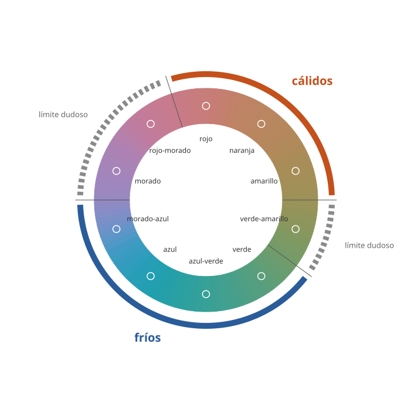

## Fundamentos {#layer-1}

Los pintores dividen los colores en **cálidos (warm)** y **fríos (cool)**. En la práctica corriente, los cálidos son el rojo, el naranja y el amarillo, y los fríos, el verde, el cian y el azul [@palmer-2013, p. 84]. El ejemplo cotidiano son los grifos: rojo para el agua caliente y azul para la fría, una convención de diseño industrial y de interiores muy extendida [@ho-2014, Introduction].

Dos ideas para empezar bien:

1. **No es temperatura física.** Es una asociación entre un matiz (hue) y una sensación de calor o frío. Los experimentos la miden y existe: la gente responde más deprisa cuando rojo va con "cálido" y azul con "frío" que al revés [@ho-2014, Exp. 1].
2. **Es relativa.** Un color es cálido o frío al compararlo con sus vecinos. Gurney insiste en juzgar siempre por comparación y en desconfiar de las reglas fijas [@gurney-2010, blog 'Relative color temperature on skin tones', 2017-07]. Un rojo anaranjado es cálido junto a un rojo violáceo y frío junto a un naranja.

## Comprensión {#layer-2}

**De dónde viene la asociación.** Ho y colaboradores creen que se aprende de correlaciones del entorno: el fuego y el sol son cálidos y el agua y los bosques, fríos; la piel se enrojece cuando se calienta y se vuelve azulada con mucho frío [@ho-2014, Discussion, para. 5]. No parece innata: en algunos países africanos el mapa está invertido (azul caliente, rojo frío) [@ho-2014, Discussion, para. 6], y los autores la describen como una norma cultural poco rígida citando a Morgan y colegas [@ho-2014, Discussion, para. 6]. Es un ejemplo de correspondencia entre sentidos (crossmodal correspondence) [@ho-2014, Discussion, para. 5]. Sobre el origen de las asociaciones en general, véase [Significado y simbolismo del color](color-meaning.md).

**Qué está realmente medido.** El estudio de Ho solo probó rojo y azul, con muestras pequeñas (11, 14 y 17 personas), de modo que la partición completa de la rueda en cálidos y fríos (amarillo, naranja, verde, violeta) no se apoya en esa fuente [@ho-2014, Methods; Discussion]. El efecto además va en una dirección: el color acelera el juicio de temperatura, pero no al revés [@ho-2014, Exp. 2B]. El verde frío se infiere del bosque, no se midió [@ho-2014, Discussion, para. 5].

**Una dimensión de gusto.** Entre adultos estadounidenses y británicos se prefieren, en general, los colores fríos a los cálidos [@palmer-2013, p. 84]. En el modelo de emociones de Ou y colaboradores, frío–cálido es una de tres dimensiones que predicen la preferencia: activo, ligero y frío se prefieren a pasivo, pesado y cálido [@palmer-2013, p. 86]; en los datos de Palmer y Schloss, el modelo explicaba un 55 % de la varianza de la preferencia, y frío–cálido añadía un 26 % sobre el 22 % de activo–pasivo, con preferencia por lo frío [@palmer-schloss-2010, p. 3]. Para objetos como paredes o ropa, los matices preferidos se parecen a los de los cuadrados de color, con lo frío y el azul más queridos que lo cálido, salvo que se rechazan los objetos grandes en rojo, como paredes o sofás [@palmer-2013, p. 89]. En pares de colores, los pares más fríos (más azulados) se prefieren y se juzgan más armoniosos que los más cálidos o amarillentos, y el rojo saturado produce pares particularmente desagradables [@schloss-palmer-2011, Exp. 1, Exp. 2].

**Conceptos erróneos.**

- *"Cálido avanza y frío retrocede."* Esa regla de pintores no aparece en ninguna de las fuentes consultadas: la revisión de Palmer solo trata lo cálido y lo frío como dimensión de preferencia y de emoción, no como profundidad espacial [@palmer-2013, p. 86]. Trátala como convención de taller [unverified].
- *"El verde está claramente en un lado."* Munsell lo sitúa en el centro de su partitura, entre los matices cálidos (amarillo, rojo) y los fríos (azul, morado) [@munsell-1905, ¶136-137].
- *"Hay una temperatura absoluta por matiz."* Ni siquiera la luz es absoluta: la luz de mediodía suele ser neutra, pero junto al cielo parece cálida y junto al fuego, fría [@gurney-2010, blog 'How do you mix a color you're looking at?', 2020-06].

## Profesional {#layer-3}

**Usarla como herramienta relativa.** Gurney propone una versión sencilla de lo cálido y lo frío como un estudio de valores con un primer paso hacia el color: un pigmento cálido puede representar una luz cálida o un color local intrínsecamente cálido (un edificio naranja), y una pareja cálido/fría como ultramar y siena natural puede bastar para obra terminada, con un aire de calma o austeridad [@gurney-2010, blog 'How to Apply the Warm-and-Cool Approach', 2018-06]. Los comentarios de lectores recuerdan sus límites: el valor importa más que la temperatura, y una paleta de dos pigmentos no es lo mismo que un sesgo cálido-frío [@gurney-2010, blog 'How to Apply the Warm-and-Cool Approach', 2018-06] (comentarios de lectores).

**"Luz cálida, sombra fría": regla con excepciones.** La fórmula tradicional no es ley. La luz reflejada cálida puede hacer las sombras más cálidas que las luces; en un estudio con luz del norte las luces pueden ser frías respecto a las sombras [@gurney-2010, blog 'Relative color temperature on skin tones', 2017-07]. Una regla más precisa de Gurney: los planos en sombra que miran hacia arriba son fríos (cielo) y los que miran hacia abajo, cálidos (rebote del suelo), con excepciones, por ejemplo con luz cálida fuerte desde arriba [@gurney-2010, blog 'Color temperature in the shadow out-of-doors', 2014-05]. Una reformulación de un lector: las sombras solo necesitan ser más frías que el lado iluminado, no frías de matiz [@gurney-2010, blog 'How to Apply the Warm-and-Cool Approach', 2018-06] (comentario de lector). Las medias tintas suelen pintarse frías o verdosas en los maestros antiguos [@gurney-2010, blog 'Relative color temperature on skin tones', 2017-07]. Esto se desarrolla en [el color de luces y sombras](../../color-in-painting/concepts/light-and-shadow-color.md).

**Cuidado con la luz.** La variación de la luz natural del día se produce a lo largo del eje azul–amarillo, y por eso los juicios azul–amarillo son los más inciertos [@witzel-2018, §2.2, pp. 480-481]. Para un pintor, eso refuerza juzgar el color de la luz y de las sombras por comparación y no por nombre. Véase [constancia del color](../../color-interaction/concepts/color-constancy.md).

**Cómo decidir.** (1) Decide qué es "cálido" **en tu cuadro**, comparando pares de colores concretos. (2) Si usas la temperatura para sugerir luz, trátala como hipótesis que se comprueba pintando, no como regla; Gurney aconseja "comparar, comparar" [@gurney-2010, blog 'Relative color temperature on skin tones', 2017-07]. (3) Si buscas armonía, recuerda que las parejas frías gustan más de media, pero que esa es una tendencia de grupo, con diferencias individuales [@schloss-palmer-2011, Exp. 2]. (4) Si el cuadro va a un público distinto del tuyo, la asociación rojo–caliente no es universal [@ho-2014, Discussion, para. 6].
