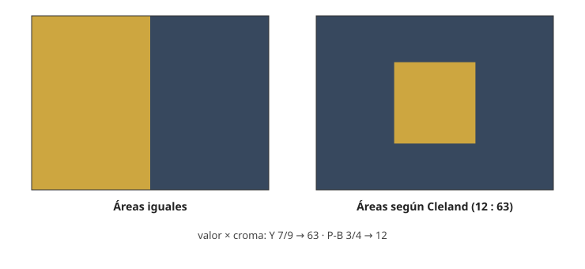

## Comprensión {#layer-2}

### Idea clave
En un cuadro con varios colores no todos pesan igual: un **dominante (dominant)** ocupa la mayor parte y marca el ambiente, los **subordinados** lo acompañan y un **acento (accent)** es una pequeña zona de color distinto, normalmente más intenso, que atrae la mirada. Las reglas de proporción son prescripciones sin respaldo experimental [@cleland-1921, pp. ~21-22; @palmer-2013, pp. 89-93].

### Explicación
Es lo que se decide después de elegir un [esquema](color-schemes.md): qué colores, pero también cuánto de cada uno. La idea clásica es el equilibrio por área. Munsell observó que un color de croma más débil necesita más área para equilibrar a uno más fuerte [@munsell-1905, ¶77, ¶109]. Además, unas manchas pequeñas y fuertes pueden equilibrar campos grandes y débiles; repetidas, los acentos crean ritmo [@munsell-1905, ¶164-166].

Cleland lo convierte en una regla práctica, que es **una prescripción suya**: el color se equilibra en torno al gris medio, un color fuerte necesita menos área y las áreas grandes deben ser más grises; una mancha pequeña de color fuerte puede equilibrar un campo grande de color débil o agrisado, que es la idea de acento (el texto no usa esa palabra) [@cleland-1921, Intro; p. ~20]. Su fórmula multiplica valor por croma de cada color y reparte las áreas en proporción inversa a esos productos [@cleland-1921, pp. ~21-22]. Y prefiere que el área mayor sea la más oscura y débil, y la menor la más clara y fuerte, como orientación y no como exigencia [@cleland-1921, p. ~23].

Estas reglas no se contrastaron con observadores. Munsell mismo advierte que el equilibrio resiste las reglas simples [@munsell-1905, ¶73-77, ¶83-86]. En las fuentes aquí manejadas no hay estudios de proporciones de acento: Palmer solo recoge trabajos sobre figura/fondo y sobre peso visual [@palmer-2013, pp. 89-93]. Una regla numérica popular (como 60-30-10) no aparece en ellas; Gurney, por ejemplo, expresa la proporción sobre todo por el tamaño de la máscara en la rueda y no da cifras [@gurney-2010, blog 'Part 2: Gamut Masking Method', 2011-09].

Algo que sí se ha estudiado es el "peso" que un color da a la composición. Los colores oscuros se comportan como más pesados [@palmer-2013, p. 93]; en cuadrados, el rojo influye más en el equilibrio y el azul menos [@palmer-2013, p. 93, §5.3.2]. En estudios sobre Mondrian, el rojo pesó más, el azul fue intermedio y el amarillo el más ligero, y los cuadros originales se juzgaron más equilibrados que las variantes con colores intercambiados [@palmer-2013, p. 93]. El significado de la imagen puede pesar más que el color: al recortar fotos, el color influyó poco y mandaron los rasgos de significado [@palmer-2013, p. 95].

Gurney traduce dominante y acento a una receta de gama reducida: un matiz dominante a intensidad plena y dos primarios subordinados más débiles [@gurney-2010, blog 'The Shapes of Color Schemes', 2008-02-03]. Chevreul ya hablaba de la armonía de una luz coloreada dominante, como vista a través de un cristal ligeramente teñido [@chevreul-1890, §180, pp. 69-70]. En un retrato, recomienda buscar el color predominante de la tez [@chevreul-1890, §351, p. 132].

Por último, el fondo cuenta más que la figura. En los experimentos de Schloss y Palmer, el color del fondo contó más que el de la figura en la preferencia del par (15 % frente a 6,7 % de la varianza), lo que los autores atribuyen, sin probarlo, a que el fondo cubre más área [@schloss-palmer-2011, Exp. 1]. La preferencia por el color de la figura (preferencia figural) aumenta al disminuir la similitud de matiz con el fondo, lo contrario de la preferencia del par, y esto encaja con el contraste simultáneo, que realza la saturación aparente de la figura [@schloss-palmer-2011, Exp. 4, General discussion]. Un acento funciona, pues, en parte porque el contraste hace verse mejor al color pequeño (conjetura de los autores, aún por contrastar).

### Ejemplo
La receta "estado de ánimo y acento" de Gurney: casi todo el cuadro en un ambiente de color y un solo acento desde el otro lado de la rueda, sin mezclas intermedias. Un acento desplazado (no el complementario exacto) parece menos natural y puede llamar más la atención [@gurney-2010, blog 'The Shapes of Color Schemes', 2008-02-03].

### Errores frecuentes
- *"Existe una proporción matemática correcta."* La de Cleland es una prescripción histórica; las fuentes no ofrecen una proporción contrastada.
- *"El acento es siempre el complementario."* Gurney distingue el complementario exacto del desplazado [@gurney-2010, blog 'The Shapes of Color Schemes', 2008-02-03].
- *"El área grande manda siempre."* Un color fuerte puede dominar a uno débil de igual área [@cleland-1921, p. ~20].

### Las fuentes discrepan
Munsell y Cleland coinciden en el principio (el área compensa la fuerza) pero Munsell avisa de que no se reduce a una regla simple, mientras que Cleland da una fórmula. Un ejemplo de Munsell: el amarillo fuerte YR7/9 y el violeta B3/4 no se equilibran en gris porque el amarillo atrae más atención [@munsell-1905, ¶73-77, ¶83-86].

### Para seguir
[Significado y simbolismo del color](color-meaning.md) cambia de pregunta: de cuánto color a qué dice el color. La capa 3 aplica el cálculo de Cleland con juicio y trata los compromisos de la gama cerrada.

## Profesional {#layer-3}

### Idea clave
Usa el cálculo de Cleland como punto de partida de un boceto, no como medida, y decide en cada cuadro qué contraste hará de acento: no hay datos de acento por proporción de área en pinturas reales [@cleland-1921, pp. ~21-22; @schloss-palmer-2011, Exp. 1, Exp. 4 Methods].

### Explicación
Los valores y límites de croma de Cleland son los de un sistema Munsell de 1921 en pigmentos, distinto del actual [@cleland-1921, Intro]. Para tus pinturas, el equivalente práctico es comprobar el [croma](../../color-attributes/concepts/chroma.md) y el valor reales de cada mezcla. Cleland acepta además el desequilibrio deliberado, que puede dar vida a un diseño si se usa con cuidado [@cleland-1921, Intro].

Las decisiones de acento tienen tres compromisos:

1. *Gama cerrada y acento.* Con una gama reducida la armonía está dada y el esfuerzo se va a los acentos (paráfrasis vista solo en un resumen de búsqueda) [@gurney-2010, blog gamut masking posts]; a cambio, cualquier acento fuera de la gama necesita ser mezclado aparte.
2. *Unidad frente a variedad.* Harold Speed, citado por Gurney, considera de los más bellos los cuadros con unidad de matiz y variedades sutiles, y avisa de no abusar del azul como unificador (visión de Speed, relatada por Gurney) [@gurney-2010, blog 'Harold Speed Discusses Color and Taste', 2016-04].
3. *Acento y valor.* El acento puede apoyarse en el contraste de matiz, en el de valor o en el de croma [unverified]; la investigación indica que el contraste de matiz ayuda sobre todo cuando el de valor es bajo [@schloss-palmer-2011, Exp. 4, summary]. Por eso conviene decidir cuál de los dos contrastes hará el trabajo (véase [estructura de valores](value-structure.md)).

Los estímulos de los experimentos eran cuadrados de igual tamaño y no verdaderos acentos pequeños sobre un campo grande [@schloss-palmer-2011, Exp. 1, Exp. 4 Methods]. La decisión de cuánto acento poner sigue siendo, pues, de criterio.

### Ejemplo
Cleland compara Y 7/9 (producto 63) con P-B 3/4 (producto 12). La fórmula pide unas 12 partes de amarillo por 63 de morado-azul, es decir, mucho morado y poco amarillo [@cleland-1921, pp. ~21-22]. Para llevarlo al cuadro, haz un boceto pequeño con esa proporción, cambia el tamaño del acento y mira cuándo deja de ser acento.

### Para seguir
[Qué dice la investigación sobre armonía](harmony-research.md) reúne la discusión empírica general sobre qué se ha medido de la armonía y qué no.
