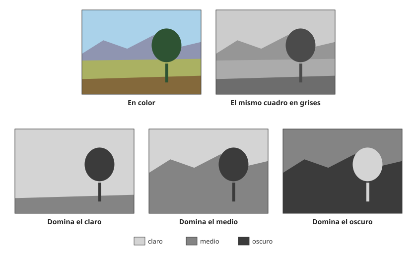

## Comprensión {#layer-2}

### Idea clave
La **estructura de valores (value structure)** es el modo en que las zonas claras y oscuras de un cuadro se agrupan y se reparten, con independencia del matiz. Los pintores la resuelven antes del color porque el color no puede salvar un mal diseño de valores [@gurney-2010, blog 'Value Planning', 2011-03-29].

### Explicación
La estructura parte del [valor](../../color-attributes/concepts/value.md) de cada zona. La **clave tonal (tonal key)** suele nombrar qué parte de la escala domina (cuadro en clave alta, clara, o en clave baja, oscura); esa denominación no figura en las fuentes consultadas [unverified]. Lo que sí documenta Gurney es la idea de fondo: un esquema de pocos tonos en el que uno domina, como el de Loomis con cuatro tonos (blanco, gris claro, gris oscuro y negro) donde se deja que uno mande [@gurney-2010, blog "Loomis's Scheme for Tonal Organization", 2012-06].

Los pintores suelen resolver los valores como paso aparte, normalmente en carbón o lápiz, antes del color. Gurney cita a Rockwell, Cornwell y Lovell y resume: el color añade mucho, pero no puede salvar un mal diseño de valores [@gurney-2010, blog 'Value Planning', 2011-03-29]. Hay una razón perceptiva de fondo: una forma sombreada solo por cambio de color parece plana, mientras que el sombreado por gradiente de luminancia da sensación de volumen, según una reseña divulgativa de Livingstone (fuente secundaria, usada con cautela) [@livingstone-2014, Harvard Magazine article]. La misma fuente cuenta que los artistas construyen la forma con contraste de luminancia desde el siglo XIII [@livingstone-2014, Harvard Magazine article].

Color y valor interactúan. Un matiz puede girar una forma sin cambiar el valor, pero cuando el croma difiere mucho (un naranja intenso junto a un azul gris apagado) el color altera el valor percibido; desaturar la imagen muestra cómo se lee realmente el valor [@gurney-2010, blog 'Value Planning', 2011-03-29]. Es la misma sensibilidad que en el [contraste simultáneo](../../color-interaction/concepts/simultaneous-contrast.md): el valor de una zona se juzga contra sus vecinas.

Para que la estructura lea, conviene agrupar los tonos en pocos grandes grupos. Gurney agrupa los tonos en claros y oscuros, y limitar el rango protege contra el aburrimiento de un cuadro todo en valores medios [@gurney-2010, blog 'Painting Within a Value Gamut', 2015-06]. Cleland, por su parte, trata la vía vertical a través del sólido de color como una de solo valor [@cleland-1921, Intro].

La investigación en pares de colores sobre un monitor añade matices. Los pares más preferidos tienen más contraste de valor (la diferencia de claridad aporta un 4,5 % de la preferencia más allá de la armonía) [@schloss-palmer-2011, Exp. 1, Exp. 2]. También se prefieren figuras claras sobre fondos oscuros y figuras oscuras sobre claros [@schloss-palmer-2011, Exp. 4]. En cambio, la armonía depende poco del contraste de valor: los pares más armoniosos que preferidos tienen poco contraste de claridad [@schloss-palmer-2011, Exp. 2]. Los autores especulan que el gusto por el contraste de valor puede venir de la fluidez de procesamiento o del rechazo de bordes casi isoluminantes (conjeturas sin probar) [@schloss-palmer-2011, General discussion]. Sobre esos bordes, véase la equiluminancia en la capa 3.

### Ejemplo
Para ver la estructura de un cuadro, desatúralo o míralo en grises: un paisaje en color se reduce entonces a tres planes de valor, y si esos planes no se leen, el color no lo arreglará. Es el control que Gurney recomienda antes de pintar [@gurney-2010, blog 'Value Planning', 2011-03-29]. En estos datos, además, un par oscuro de amarillo o naranja (marrones, oliva) desagrada, pero se juzga armonioso si se combina con claros de matiz parecido [@schloss-palmer-2011, Exp. 2].

### Errores frecuentes
- *"Si el color es bueno, el valor se arregla solo."* Sin plan de valores, Gurney lo ve al revés [@gurney-2010, blog 'Value Planning', 2011-03-29].
- *"Más contraste es siempre mejor."* Para la armonía, el contraste de valor pesa poco [@schloss-palmer-2011, Exp. 2].

### Las fuentes discrepan
Gurney opina del esquema de Loomis que cuatro tonos son casi demasiados, y prefiere dos o tres zonas tonales principales; el tono dominante no tiene por qué ser el fondo, y no todo cuadro encaja (nieblas, noches) [@gurney-2010, blog "Loomis's Scheme for Tonal Organization", 2012-06]. Son opiniones de practicante (fiabilidad C), no resultados medidos.

### Para seguir
[Dominante, proporción y acento](dominance-and-accent.md) trata cuánto espacio ocupa cada color. La capa 3 convierte la estructura de valores en un flujo de trabajo y explica por qué el pigmento no llega al rango de la escena.

## Profesional {#layer-3}

### Idea clave
Resuelve los valores antes del color, en pocos escalones, y comprueba la imagen en grises: el pigmento cubre un contraste de unos 20:1 y una escena exterior ronda el 1000:1, así que hay que decidir qué parte de la escala sacrificar [@gurney-2010, blog 'Value Planning', 2011-03-29; @livingstone-2014, Bateman, review; contrast discussion].

### Explicación
El flujo de trabajo que describe Gurney tiene dos pasos: diseño tonal en dos o tres valores y luego un encaje con paleta limitada (ocre amarillo, siena tostada y ultramar) que fija la declaración tonal, las grandes relaciones cálido/frío y el ambiente de color, reservando los oscuros más profundos [@gurney-2010, blog 'Value Planning', 2011-03-29]. Una [paleta limitada](../../paints-and-pigments/concepts/limited-palette.md) exige una estructura de valores fuerte, y por eso se recomienda a pintores avanzados (comentario en el blog) [@gurney-2010, blog 'The Zorn Palette', 2011-07]. Para la gama de colores, véase también [esquemas clásicos](color-schemes.md).

La razón de comprimir es física. El pigmento solo cubre un rango de unos 20:1 de contraste, mientras una escena exterior puede rondar el 1000:1 [@livingstone-2014, Bateman, review; contrast discussion]. Eso obliga a agrupar los valores en pocos escalones para que la composición lea.

Cuando dos colores se tocan con el mismo valor, el sistema visual que organiza el espacio y la profundidad apenas registra el límite [@livingstone-2014]. Es el efecto de la [equiluminancia](../../color-interaction/concepts/equiluminance.md), que se puede usar a propósito (vibración, ambiente) o evitar en un punto de interés [unverified].

La investigación sugiere repartir tareas: el contraste de matiz mejora la figura sobre el fondo sobre todo cuando el contraste de valor es mínimo [@schloss-palmer-2011, Exp. 4, summary]. Esos datos proceden de cuadrados en pantalla, no de cuadros [@schloss-palmer-2011, Exp. 1, Displays].

### Ejemplo
En *Impresión, sol naciente*, de Monet, el sol tiene la misma luminancia que el cielo: parece vibrar y desaparece en una reproducción en grises [@livingstone-2014]. Un pintor que quiere esa vibración lo busca a propósito; uno que quiere que el sol sea el punto de interés debe añadir contraste de valor.

Para decidir entre valor y color:
1. Antes del color, comprueba el cuadro en grises o desaturado para ver si los valores leen [@gurney-2010, blog 'Value Planning', 2011-03-29].
2. Si dos colores se tocan con el mismo valor, decide si quieres esa vibración o si el contraste de matiz debe hacer el trabajo.
3. Recuerda que los datos de laboratorio no son de pintura.

### Las fuentes discrepan
La noción de "clave tonal" y las reglas sobre proporciones de claros y oscuros son convenciones de taller que las fuentes aquí manejadas no ponen a prueba.

### Para seguir
[Dominante, proporción y acento](dominance-and-accent.md) y la capa 3 de [Colores cálidos y fríos](color-temperature.md) completan el reparto de la gama de un cuadro.
