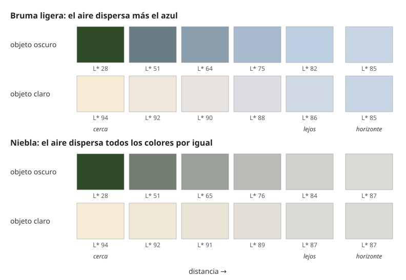

## Comprensión {#layer-2}

### Idea clave
La **perspectiva atmosférica (atmospheric or aerial perspective)** sugiere distancia con el color, el valor y la nitidez, porque el aire se interpone entre el ojo y lo que se mira. Con la distancia, el color de todo converge hacia el color del aire del horizonte [@narasimhan-nayar-2002, pp. 241-242, §6, Eq. 25].

### Explicación
La perspectiva de la pintura tiene tres partes: la disminución del tamaño, la del color y la de la definición con la distancia [@leonardo-1835, cap. CCCIII]. La perspectiva lineal sola no da una sensación completa de distancia sin la perspectiva de los colores [@leonardo-1835, cap. CCLXXXIII].

Físicamente, el aire contiene partículas que dispersan la luz y produce dos efectos [@narasimhan-nayar-2002, pp. 236-237, §3.1-3.2]:

1. **Atenuación (attenuation).** La luz que viene del objeto se pierde por el camino: tras una distancia *d*, queda la luz inicial multiplicada por e^(−βd), una caída exponencial en la que β es el coeficiente de dispersión del aire [@narasimhan-nayar-2002, p. 236, §3.1].
2. **Luz del aire (airlight).** El aire también aporta luz: la luz ambiental (sol directo, cielo, rebote del suelo) que las partículas dispersan hacia el observador. Es cero a distancia cero y tiende al brillo del horizonte según crece la distancia: horizonte × (1 − e^(−βd)) [@narasimhan-nayar-2002, p. 237, §3.2].

El color que llega al ojo es la suma de las dos: el color del objeto atenuado más el color del horizonte. Al aumentar la distancia pesa menos lo primero y más lo segundo, y todo converge hacia el color del aire del horizonte [@narasimhan-nayar-2002, pp. 241-242, §6, Eq. 25]. Los pintores lo ven igual: lo oscuro se aclara y lo más claro que el aire se oscurece, ambos «descoloridos» hacia el valor del aire [@leonardo-1835, cap. CCLXXXVII; cap. CCCXXIII]. Un caso límite lo muestra: las ventanas de interiores oscuros casi no tienen color propio y muestran luz del aire casi pura [@narasimhan-nayar-2002, p. 249, §11].

¿De qué color es ese aire? No siempre es azul. β depende de la longitud de onda como β ∝ λ^(−γ), con γ entre 0 y 4 (el valor 4 corresponde a la ley de Rayleigh para partículas muy pequeñas); en niebla y bruma densa γ es casi 0, de modo que la luz transmitida cambia de brillo pero no de matiz [@narasimhan-nayar-2002, p. 238, §4; p. 241, §6]. La luz del aire de bruma y niebla tiende al gris o al azul claro [@narasimhan-nayar-2002, p. 241, §6]. Distinta cosa es el azul de un paisaje lejano de aire limpio: el artículo solo da la analogía con Rayleigh (γ hasta 4) y no afirma que ese azul se deba a ella [@narasimhan-nayar-2002, p. 238, §4]. Su explicación completa no figura en las fuentes consultadas [unverified]. El caso sí documentado es el cielo: la luz dispersada por las moléculas del aire va como 1/λ⁴, y el cielo del cenit resulta un azul poco saturado, la mezcla de azul espectral y luz blanca. Esa fuente trata solo el cenit y no dice nada de objetos lejanos [@smith-2005, p. 590, Sec. I; p. 594, Sec. III].

En la práctica de taller, lo más oscuro (por naturaleza o por sombra) se ve más azul de lejos, y el verde de los campos azulea antes que el amarillo, el blanco o el rojo [@leonardo-1835, cap. CCXC; cap. CCXCVI; cap. CCCI]. Con la distancia se pierde primero el brillo, luego las luces, luego las sombras principales, hasta dejar una penumbra media; lo pequeño desaparece antes y luego las líneas que cierran las formas, por lo que lo lejano se pinta con detalle inacabado y contornos suaves [@leonardo-1835, cap. CCXCI; cap. CCCV; cap. CCCVI; cap. CCCXIV; cap. CCCXV]. Los contornos fuertes en objetos lejanos los hacen parecer cercanos [@leonardo-1835, cap. CCCV].

El aire también cambia con la altura: es más espeso, blanco y claro cerca del suelo y más fino, oscuro y azul más arriba; el cielo es más blanco en el horizonte, de modo que la base de montañas y torres lejanas es más pálida que la cima [@leonardo-1835, cap. CCLXXXIV; cap. CCCVII; cap. CCCVIII].

### Ejemplo
Un paisaje con edificios a distintas distancias, bajo un aire algo espeso. El procedimiento de taller es este:

1. Pinta el edificio más cercano con su propio color, puro y simple, como el resto del primer término [@leonardo-1835, cap. CCXCV].
2. Pinta cada edificio más lejano menos definido en su contorno y más azul: a cinco veces más lejos, cinco veces más azul [@leonardo-1835, cap. CCCIV].
3. En lo más lejano, toma el color del horizonte en proporción a la distancia [@leonardo-1835, cap. CCXCV].

### Errores frecuentes
- *"Lo lejano es simplemente más oscuro."* Muchos pintores lo hacen así, pero solo es cierto de los objetos blancos [@leonardo-1835, cap. CCXCIX]. Hay un matiz: a distancia media, las caras y otros objetos con detalle se oscurecen porque se pierden las luces pequeñas y quedan las sombras como media tinta general; luego el aire los aclara [@leonardo-1835, cap. CCII; cap. CCLIX].
- *"El valor cambia de forma lineal con la distancia."* Gurney lo supuso durante años y propone en su lugar un modelo geométrico en el que cada capa de aire aclara los oscuros en una proporción fija (10, 5, 2,5, 1,25...); lo presenta como provisional («todavía intento entenderlo») [@gurney-2010, blog 'Atmospheric distance and value', 2013-07]. Es coherente con la exponencial de la física, pero eso es nuestra lectura, no lo dice ninguna de las dos fuentes.
- *"La saturación siempre cae con la distancia."* Es una buena regla general, pero las fuentes de luz como el sol poniente pueden volverse más saturadas con la distancia y las nubes pueden tomar naranja [@gurney-2010, blog 'Atmospheric distance and value', 2013-07].
- *"La atmósfera siempre da azul."* En niebla y bruma densa, el matiz del objeto no cambia; solo baja el brillo y sube la luz grisácea del aire [@narasimhan-nayar-2002, p. 241, §6].

### Las fuentes discrepan
Leonardo explica el azul de lo lejano como mezcla de luz y oscuridad, aire sin color y partículas húmedas iluminadas sobre fondo oscuro. Esa explicación no es fiable: la óptica moderna atribuye el azul del cielo a la dispersión de la luz solar por moléculas del aire, no a una mezcla de negro y blanco [@smith-2005, p. 590, Sec. I]. Lo que se aprovecha es su consecuencia práctica (más azul, más pálido), no su causa [@leonardo-1835, cap. CCCIV].

### Para seguir
La capa 3 enseña a decidir primero el aire del cuadro y a aplicar el procedimiento a un plano concreto. [Luz coloreada y unidad cromática](colored-light-unity.md) muestra cómo el color de la luz teñirá también ese aire.

## Profesional {#layer-3}

### Idea clave
Antes de pintar la lejanía hay que decidir el aire del cuadro: su color y su valor son el destino hacia el que se mueve todo lo lejano. Con luz clara tiende a azul pálido, en niebla a gris, y con sol bajo toma el color del cielo [@leonardo-1835, cap. CCCIV; cap. CCCXLII; @narasimhan-nayar-2002, p. 238, §4].

### Explicación
Con luz del día clara, la tendencia que enseña la práctica es azul y pálido en lo lejano [@leonardo-1835, cap. CCCIV]. Con niebla o bruma densa, la física sugiere que lo lejano converge a gris o blanco con el matiz del objeto casi sin cambiar [@narasimhan-nayar-2002, p. 238, §4]. En niebla, las partes iluminadas son las más nítidas y las no iluminadas quedan confusas y casi del color de la niebla [@leonardo-1835, cap. CCCXVII; cap. CCCXVIII]. Con sol bajo, el color del aire cambia: cuando el sol enrojece las nubes del horizonte, los objetos lejanos azulados toman el rojo y hacen una mezcla agradable de azul y rojo; el propio aire adopta el color [@leonardo-1835, cap. CCCXLII]. Se ha estimado además un tinte de luz del aire más frío que la media de la imagen y más azul por la mañana que por la tarde, atribuido a bruma y niebla matinales [@yu-hurlbert-2024, Results, Fig. 14C-D; General discussion].

Con el aire decidido, el procedimiento es este:

1. Fija el color y el valor del horizonte (el «aire») en el cuadro, que será el destino de todo lo lejano.
2. Para cada plano, mueve el color del objeto hacia él, más cuanto más lejos. Si el modelo físico vale, el cambio sigue la exponencial; si no, usa la proporción como guía.
3. Reduce croma y contraste local con la distancia, y aguanta el detalle en primer término [@leonardo-1835, cap. CCCIX].

Pintores como Hibbard, Wendt y Payne usaron matiz y croma para reforzar la distancia, y Gurney lo considera una herramienta importante [@gurney-2010, blog 'Atmospheric distance and value', 2013-07].

La fórmula describe luz que llega al ojo; cuando mezclas pigmento hacia el color del horizonte, la mezcla de pinturas no es lineal (véase [comportamiento de las mezclas de pigmentos](../../color-mixing/concepts/pigment-mixing-behavior.md)), así que se comprueba con muestras secas. Lo que sirve de modelo es la tendencia, no el cálculo exacto.

Los límites del modelo importan. Los modelos de atenuación y de luz del aire suponen atmósfera homogénea, trayectorias horizontales cerca del suelo, cielo cubierto, sin lluvia ni nieve ni borrosidad por dispersión múltiple, y se validaron con fotos de niebla y bruma bajo cielo cubierto [@narasimhan-nayar-2002, pp. 242-243, §6-7; p. 253, note 1]. Con sol fuerte, la luz del aire depende de la dirección de la mirada [@narasimhan-nayar-2002, p. 239, §5]. Y el artículo no da una fórmula explícita para la pérdida de contraste ni para el alcance visual [@narasimhan-nayar-2002, pp. 236-237]. Para el contraste, hay que recurrir a la práctica: ordenar la pérdida (brillo, luces, sombras, detalle, bordes) y comparar [@leonardo-1835, cap. CCXCI; @gurney-2010, blog 'How do you mix a color you're looking at?', 2020-06].

Quedan dos compromisos. El cielo se aclara del cenit al horizonte porque se mira a través de más atmósfera (solo conocido por un resumen de búsqueda) [@gurney-2010, blog 'Sky Blue', 2008-04]. El cielo es más blanco en el horizonte [@leonardo-1835, cap. CCLXXXIV]. Si el cielo pintado no se aclara hacia el horizonte, el aire de los planos lejanos no cuadrará con él [unverified]. Y si pintas la lejanía muy azul y fría en un cuadro con luz muy cálida, hay que decidir qué manda: la luz del cuadro ([luz coloreada y unidad cromática](colored-light-unity.md)) o la regla de la lejanía.

### Ejemplo
Para obtener los cambios de color y de tamaño con la distancia del fondo de un cuadro, un ejercicio práctico:

1. Elige árboles a intervalos de unas 65 yardas.
2. Traza cada uno con un ojo en un cristal fijo.
3. Compara el trazo con el árbol real y colorea la copia hasta igualarlo.
4. Anota los cambios de color y de tamaño de plano en plano [@leonardo-1835, cap. CCCXLI].

### Las fuentes discrepan
Gurney avisa de que el modelo de aire homogéneo es poco realista según sus lectores [@gurney-2010, blog 'Atmospheric distance and value', 2013-07].

### Para seguir
[Luz coloreada y unidad cromática](colored-light-unity.md) lleva la decisión del aire a la luz de todo el cuadro, y [planificar la gama](gamut-planning.md) reúne luz, aire y paleta en un plan previo.
