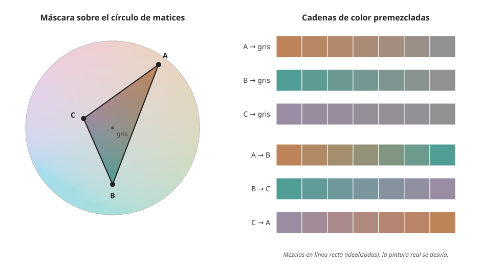

## Profesional {#layer-3}

### Idea clave
Planificar la gama es decidir, antes de mezclar, qué región del espacio de color usará el cuadro y cuál dejará fuera. Una forma sobre la rueda marca la paleta del cuadro y busca la armonía: «no tocar todos los instrumentos a la vez» [@gurney-2010, blog 'Part 2: Gamut Masking Method', 2011-09].

### Explicación
El **gamut** es la gama de matices y saturaciones que una paleta puede mezclar; se ve dibujando los pigmentos sobre una rueda y uniéndolos, y un área encerrada mayor significa más mezclas posibles [@handprint-macevoy, color14, "Gamut"]. La [paleta limitada](../../paints-and-pigments/concepts/limited-palette.md) y los [esquemas clásicos](../../color-harmony/concepts/color-schemes.md) son la versión elemental; aquí se usan con criterio sobre un cuadro concreto, apoyados en [luz coloreada y unidad cromática](colored-light-unity.md) y en el [sistema Munsell](../../color-attributes/concepts/munsell-system.md).

El **enmascarado de gama (gamut masking)** coloca una forma, normalmente un triángulo, sobre la rueda de color: lo que queda dentro es la paleta del cuadro y lo demás se excluye. Se premezclan «cadenas de color» (color strings) a partir de la máscara y solo se usan esas [@gurney-2010, blog 'Part 2: Gamut Masking Method', 2011-09]. Los vértices son «primarios subjetivos», los colores más puros dentro de la gama, no necesariamente de máxima intensidad; una forma más pequeña da un rango más estrecho y una diminuta, un cuadro casi monocromo [@gurney-2010, blog 'Part 2: Gamut Masking Method', 2011-09]. Sirve para obtener un color controlado y consistente en trabajos en serie (ilustración de libros, cómic, concept art, guion de color de cine) [@gurney-2010, blog 'Part 2: Gamut Masking Method', 2011-09]. Omitir sectores de la rueda produce entornos de color limitados y completos, como una escena de pantano de verdes amarillentos apagados y marrones dentro de un triángulo pequeño [@gurney-2010, blog 'Color Wheel Masking Basics', 2022-05].

La máscara no tiene por qué ser un triángulo (valen cuadrados y rombos); el triángulo es cómodo porque da tres colores de partida. Además las gamas son tridimensionales, la rueda es solo un corte y el centro puede ser gris, blanco o negro [@gurney-2010, blog 'Part 2: Gamut Masking Method', 2011-09]. Cualquier esquema se puede ver como una forma sobre la rueda, y cada forma tiene su «personalidad» con independencia de los colores; los esquemas clásicos se tratan como formas de máscara (un rombo largo es, básicamente, el complementario simple) [@gurney-2010, blog 'The Shapes of Color Schemes', 2008-02-03; 'Part 2: Gamut Masking Method', 2011-09].

La máscara es un plan, no una garantía, porque la pintura real tiene cuatro límites:

1. *Los pigmentos no cubren todo.* Las mezclas de cuatro pigmentos de artista no cubren todo el gamut RGB, y hay colores RGB que no se pueden mezclar con ningún pigmento conocido; al revés, algunas mezclas (un turquesa muy saturado de azul y blanco) quedan fuera de sRGB [@sochorova-2021, p. 2, §1; p. 5, §3.1].
2. *El pigmento elegido fija el vértice.* Un ocre amarillo, menos saturado que un amarillo de cadmio, mantiene el vértice más dentro del margen de la rueda y reduce la gama [@gurney-2010, blog 'The Shapes of Color Schemes', 2008-02-03]. Los datos Munsell dan una medida: el amarillo de cadmio medio de Williamsburg mide 8,45 de valor y 16,78 de croma y el ocre amarillo, 5,55 y 8,69 [@justpaint-munsell-cielab, tabla Williamsburg]. Un amarillo de croma alto no sale de un ocre (véase [mezclar un color objetivo](../../color-mixing/concepts/target-color-mixing.md)).
3. *No todo lo de dentro del triángulo se mezcla desde sus vértices.* Las mezclas de pintura no siguen líneas rectas, mientras que las luces sí caen sobre rectas en un diagrama de cromaticidad; las líneas de mezcla de la pintura son «erráticas» y suelen curvarse [@handprint-macevoy, color14, "Mixing Lines"]. El modelo de Kubelka-Munk, usado con coeficientes de absorción y dispersión por pigmento, explica la no linealidad [@sochorova-2021, p. 1, §1; p. 10, Fig. 14]. Véase [comportamiento de las mezclas de pigmentos](../../color-mixing/concepts/pigment-mixing-behavior.md). Un lector lo señaló en el blog de Gurney y este lo aceptó (dato de los comentarios, visto solo en un resumen de búsqueda) [@gurney-2010, blog on gamut masking, 2011].
4. *Lo que parece igual no mezcla igual.* Pinturas del mismo color visual tienen reflectancias distintas y mezclan de otro modo [@handprint-macevoy, color18a, "Substance Uncertainty"].

Conclusión práctica: la gama real se fija con muestras secas de tus propios tubos.

Los cuadros reales dan una pista de qué ejes importan. Las cromaticidades medias de 104 cuadros se alinean con el locus de la luz del día, de azulado a anaranjado, casi siempre un poco hacia el verde (atribuido a la vegetación) [@yu-hurlbert-2024, Image analysis; Intermediate discussion, Fig. 6]. Sus 30 estadísticas son redundantes: las dos primeras componentes principales, una de luminancia y contraste y otra de cromaticidad (saturación, croma), explican el 71,1 % de su varianza, y cinco componentes llegan al 90,4 % [@yu-hurlbert-2024, Results, Image analysis]. Para un planificador, eso sugiere que la gama de un cuadro se define en dos ejes que se pueden fijar antes de pintar: cuánto rango de claros, oscuros y contraste, y cuánto de saturación y de qué matices. Es una lectura nuestra de datos correlacionales: el estudio no dice cómo planean la paleta los pintores [@yu-hurlbert-2024, whole article; Limitations].

Hay alternativas a la premezcla. Veladuras, imprimaturas y filtros de color también comprimen la gama, pero la premezcla da más control y flexibilidad (preferencia de Gurney) [@gurney-2010, blog 'Part 2: Gamut Masking Method', 2011-09]. La paleta limitada de dos colores más blanco es rápida, reduce la decisión a claro-oscuro y cálido-frío, y da combinaciones inesperadas [@gurney-2010, blog 'How do you choose limited-palette colors?', 2021-02]. En el extremo contrario, una gama más amplia permite más variedad: variar los verdes de prados, árboles y piedras en lugar de usar un solo verde [@leonardo-1835, cap. CCCXXXIV]. Las figuras, en cambio, pueden llevar los colores más vivos para que se despeguen a distancia [@leonardo-1835, cap. CCCIII]. Tampoco hay que rehuir las sombras por amor a los colores bonitos [@leonardo-1835, cap. CCLXX].

Para decidir: gamas pequeñas cuando buscas unidad y consistencia (series, ilustración); más grandes cuando el motivo exige variedad (muchos colores locales, luz mixta). Si dudas, compáralo con la luz: una gama que contradiga el color de la luz del cuadro resultará extraña [unverified]. Y no confundas gama con paleta de tubos: la máscara define lo que verás en el cuadro, no lo que hay en la caja.

### Ejemplo
Un orden de trabajo para planificar un cuadro:

1. Plan de valores en dos o tres grupos ([estructura de valores](../../color-harmony/concepts/value-structure.md)). Se hace antes del color porque el color «no puede salvar un mal diseño de valores» [@gurney-2010, blog 'Value Planning', 2011-03-29].
2. Elige la luz del cuadro y su color ([luz coloreada y unidad cromática](colored-light-unity.md)).
3. Elige la máscara y su forma, según la «personalidad» que quieras [@gurney-2010, blog 'The Shapes of Color Schemes', 2008-02-03].
4. Elige pigmentos que cubran los vértices, comprobando su croma [@justpaint-munsell-cielab, tabla Williamsburg]. Mezcla las cadenas en muestras secas.
5. Reserva el acento: con una máscara la armonía está dada y el esfuerzo se va a buscar acentos (paráfrasis vista solo en un resumen de búsqueda) [@gurney-2010, blog on gamut masking]. Un esquema de «ambiente y acento» pone casi todo el cuadro en un ambiente de color y un único acento del otro lado de la rueda, sin mezclas intermedias; un acento desplazado (no el complemento exacto) parece menos natural y puede llamar más la atención [@gurney-2010, blog 'The Shapes of Color Schemes', 2008-02-03].

### Las fuentes discrepan
El enmascarado de gama es el método de Gurney, pintor e ilustrador cuyo blog es una fuente de fiabilidad C (no se ha leído el libro); no es un estándar, y lo respaldado por fuentes mejores son sus ingredientes (límites de los pigmentos, estadísticas de cuadros reales).

La llamada paleta de Zorn (blanco, ocre amarillo, bermellón, negro) se defiende como atajo didáctico, aunque hay críticos que dicen que Zorn usó más colores; la atribución histórica está en disputa [@gurney-2010, blog 'The Zorn Palette', 2011-07]. Y para MacEvoy, el estilo y la técnica pesan más que casi cualquier otra consideración, y los principiantes eligen demasiados colores saturados [@handprint-macevoy, palette2].

### Para seguir
[Ver y juzgar el color al pintar](judging-color.md) enseña a comprobar, ya con el pincel en la mano, si la gama planeada se cumple.
