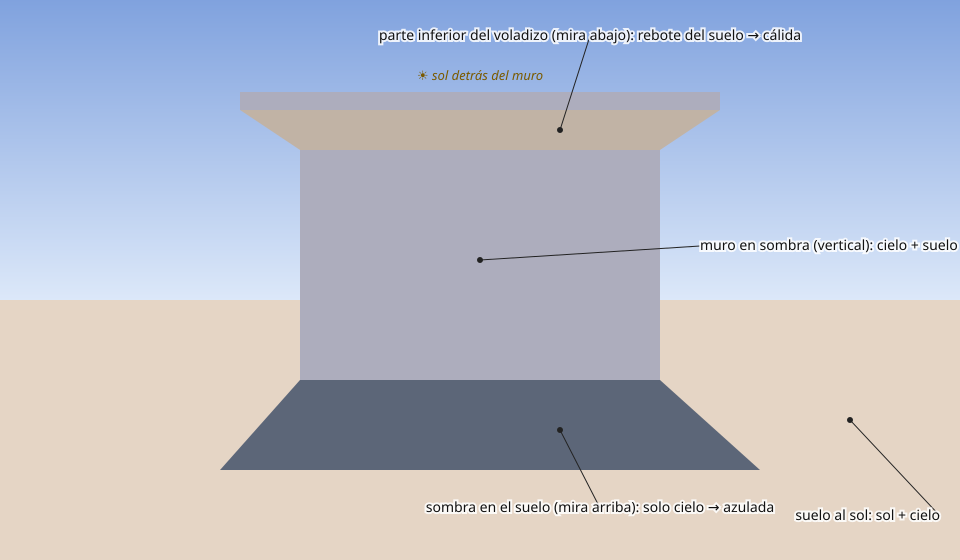
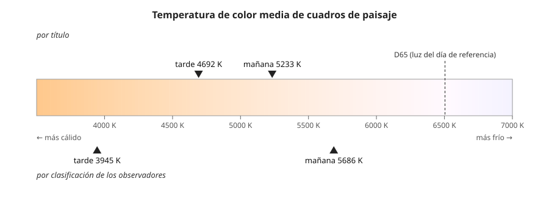

## Comprensión {#layer-2}

**La idea de partida.** El color que se ve en una superficie es una mezcla del color de la superficie y del color de toda la luz que le llega. Una pared blanca en sombra recoge luz del suelo, del cielo y de las superficies iluminadas cercanas; y "arriba" y "abajo" dependen de qué superficies iluminadas mire el plano en cuestión [@gurney-2010, blog 'Color temperature in the shadow out-of-doors', 2014-05]. Este concepto desarrolla [el color percibido](local-vs-perceived-color.md) para el caso de la luz directa, la sombra y el reflejo.

**Luz del sol y luz del cielo.** Sol y cielo no tienen el mismo color. El Sol irradia aproximadamente como un cuerpo negro (Smith ajusta T = 5762 K) y la luz del cielo está desplazada hacia el azul respecto a la del Sol: un modelo sencillo la da como el espectro solar multiplicado por 1/λ⁴, y las medidas siguen esa tendencia [@smith-2005, p. 590, Sec. I; Fig. 1]. Ese resultado de Smith vale para el cenit de un día claro y con el Sol alto; no dice nada de sombras [@smith-2005, p. 590, Sec. I]. Lo que sigue es una inferencia, no una afirmación de la fuente: una zona en sombra que solo recibe luz del cielo debería tener un matiz más azulado que la iluminada por el sol directo. Los pintores lo describen desde antiguo: la sombra de un cuerpo blanco iluminado por el sol o el cielo debe tener un tinte azulado [@leonardo-1835, cap. CCLII], y al ponerse el sol la sombra sobre una pared blanca es azul, porque la parte iluminada recibe el rojo del sol y la sombreada, solo el azul del cielo [@leonardo-1835, cap. CCLVIII]. Leonardo insiste en que el pintor conozca la causa para que el efecto resulte verosímil "o la obra será falsa y absurda" [@leonardo-1835, cap. CCLXII].

**Planos arriba y abajo.** Gurney lo resume: la luz de las sombras es sobre todo rebote cálido del suelo desde abajo y cielo azul desde arriba; los planos en sombra que miran hacia arriba son fríos y los que miran hacia abajo, cálidos, y el cambio puede producirse con valores casi iguales; las superficies soleadas vecinas y el agua añaden tintes [@gurney-2010, blog 'Reflected light in shadow', 2014-11; blog 'Color temperature in the shadow out-of-doors', 2014-05]. Es una regla de práctica, no una ley, y tiene excepciones (véase [colores cálidos y fríos](../../color-harmony/concepts/color-temperature.md)).

**Sol bajo.** Yu y Hurlbert explican (es su explicación física, no un resultado medido por ellos) que la altura del sol es la que más determina la iluminancia y la cromaticidad de la luz natural. Al amanecer y al atardecer la luz es más difusa y menos intensa por el recorrido más largo en la atmósfera y por la ley del coseno sobre las superficies que miran hacia arriba; y la proporción de longitudes de onda cortas frente a largas cae con más dispersión de Rayleigh, de modo que el haz directo se inclina al rojo [@yu-hurlbert-2024, Characteristics of terrestrial illumination]. Gurney, en un resumen de práctica (fiabilidad C), añade que la luz restante es más tenue y cálida, el cielo de arriba es de un azul más rico y las sombras que miran lejos del Sol se ven azuladas [@gurney-2010, blog 'The Golden Hour', 2008-01]. No hay en las fuentes una medida directa del color de las sombras a esa hora.

**La luz cambia el matiz y no solo la claridad.** Según Chevreul, el color de un cuerpo cambia de matiz, y no solo de intensidad, según reciba sol directo, luz difusa del día o luz difusa reflejada, y hay que tenerlo presente al definir colores de objetos [@chevreul-1890, §280, pp. 105-106]. En la parte iluminada, el rojo es más anaranjado y en la sombreada, más carmesí; el amarillo en sombra, más sucio y verdoso; el verde sombreado, más azulado; el azul sombreado, menos verdoso [@chevreul-1890, §272-279, pp. 103-105].

**Reflejos.** El reflejo toma el color del objeto que lo emite y del objeto sobre el que cae, más cuanto más lisa sea la superficie receptora; un color reflejado nunca es simple, sino mezcla de todo lo que allí se refleja [@leonardo-1835, cap. CCLXXV; cap. CCLXXVII]. Los reflejos son más débiles que los colores iluminados directamente [@leonardo-1835, cap. CCLXXIII; cap. CCLXXXII]. Un ejemplo de Leonardo: una figura azul en una habitación verde tiene el lado iluminado de azul brillante y la sombra sucia, estropeada por el reflejo del muro [@leonardo-1835, cap. CCXLI]. Leonardo razona como si los colores reflejados se mezclaran como pigmentos (cuerpo amarillo con reflector azul daría verde sobre el amarillo) [@leonardo-1835, cap. CCLXXVI; cap. CCLXXIX]; la visión actual lo describe más bien como una mezcla de luz y color de superficie, y el resultado no es simplemente "azul más amarillo es verde" (es la idea de Gurney, arriba: el color visto mezcla superficie y luz que la golpea) [@gurney-2010, blog 'Color temperature in the shadow out-of-doors', 2014-05].

**La sombra también engaña al ojo.** Chevreul describe una modificación aparte: en las partes casi sin luz de un color oscuro y sombrío (un abrigo azul nuevo visto a contraluz) aparece el complementario por contraste simultáneo, un gris anaranjado; en los colores vivos (rojo, amarillo, naranja, azul claro) no aparece [@chevreul-1890, §287-290, pp. 108-110]. Rumford observó el mismo efecto: una sombra iluminada por luz blanca junto a otra igual iluminada por luz roja parece verde [@chevreul-1890, §125, pp. 38-39]. Y Chevreul atribuye el tinte verde de las sombras en carnaciones de muchos cuadros al contraste del rosa con el gris [@chevreul-1890, §385, p. 153].

**Lo que el espectador necesita.** Conway y Livingstone recuerdan que las sombras pintadas suelen ser físicamente imposibles para la luz que muestran y aun así se leen como sombras; basta con que la región sea relativamente más oscura y relativamente más desaturada que su entorno local, y su matiz puede ser cualquiera que cumpla esas reglas, como mostraron los fauvistas y confirmaron Kingdom y colaboradores [@conway-livingstone-2007, Fig. 6 paragraph]. Esto da libertad (el matiz de la sombra es una decisión de composición) pero no la elimina: la sombra "creíble" depende del resto del cuadro.

**Conceptos erróneos.**

- *"Sombra = color más negro."* Leonardo da una receta con negro para un azul entre un muro blanco y otro negro (tres cucharas de negro por una de azul para lo más oscuro) [@leonardo-1835, cap. CCXLVII], pero también advierte que el color de la sombra no es puro cuando hay vecinos coloreados [@leonardo-1835, cap. CCXLI], y Chevreul señala que las sombras complementarias salen de colocar un gris normal junto al color del objeto [@chevreul-1890, §338, p. 129]. La receta con negro es el punto de partida; los reflejos y el contraste hacen el resto.
- *"La sombra de un objeto tiene el color de ese objeto en oscuro."* Leonardo ya lo discute: la sombra de un color nunca es pura salvo que el cuerpo vecino tenga el mismo color [@leonardo-1835, cap. CCXLI].
- *"Cada color tiene su zona tonal ideal."* Leonardo indica el negro para las sombras, el blanco para la luz más fuerte, azul y verde para la media tinta, amarillo y rojo para la luz principal [@leonardo-1835, cap. CCXXXIV]; es una opinión de taller y no una regla óptica.

## Profesional {#layer-3}

**Un procedimiento para decidir el color de una zona.** (1) Identifica las fuentes: ¿luz directa del sol, cielo, luz de fuego, rebote del suelo, color de objetos próximos? Leonardo clasifica la luz original (sol, fuego, cielo) y la derivada (reflejada) y recuerda que las superficies oscuras y ásperas, como hierba, arbustos o tejados, casi no reflejan [@leonardo-1835, cap. CCXIV]. (2) Mira hacia dónde mira el plano (arriba, abajo, hacia un vecino coloreado) [@gurney-2010, blog 'Reflected light in shadow', 2014-11]. (3) Decide la intensidad: un reflejo es más débil que la luz directa y más intenso cerca de la fuente [@leonardo-1835, cap. CCLXXIII; cap. CCXVIII]. (4) Comprueba la relación con el entorno inmediato, porque los reflejos se ven más sobre un fondo oscuro que sobre uno claro [@leonardo-1835, cap. CCXV; cap. CCXVII; cap. CCXIX]. (5) Compara siempre contra otros colores de la escena (véase [ver y juzgar el color al pintar](judging-color.md)).

**Cuándo admitir un reflejo.** Leonardo propone admitir una luz reflejada solo si su causa es visible para todos, y describe la práctica como dividida entre pintores y aconseja un término medio [@leonardo-1835, cap. CCXVI]. En carnaciones, los reflejos de otra carne son más rojos y vivos que cualquier otra parte de la figura; aconseja mezclar un poco del color del paño más cercano sin pronunciarlo demasiado salvo que haya motivo [@leonardo-1835, cap. CCLXXX; cap. CCLXXXII]. Hay una advertencia de Gurney sobre el uso de fotografías: las cámaras captan el color de las sombras peor que el ojo, y las escenas de alto contraste queman las luces o aplastan las sombras [@gurney-2010, blog 'Reflected light in shadow', 2014-11].

**Elegir la luz del cuadro.** Los bordes de las sombras dicen qué luz hay: una luz pequeña da sombras grandes y nítidas, una grande las da pequeñas y borrosas; bajo nubes finas los bordes desaparecen [@leonardo-1835, cap. CXCII; cap. CXC]. Bajo el sol, las sombras son oscuras y nítidas y toman matiz del azul del aire, sobre todo en objetos blancos; el lado soleado toma el color del sol, fuertemente rojo al ponerse [@leonardo-1835, cap. CCLXII]. Un error clásico de estudio: dibujar estudios en casa bajo una luz concreta y usarlos en un cuadro de campo abierto con luz general del cielo, donde aparecen sombras y reflejos oscuros que la naturaleza no daría [@leonardo-1835, cap. CLXXXV]. Sobre cómo mantener una sola luz coherente en todo el cuadro, véase [luz coloreada y unidad cromática](colored-light-unity.md).

**Estadísticas de cuadros reales.** Yu y Hurlbert midieron la temperatura de color correlacionada (CCT) ponderada por luminancia en cuadros cuyo título decía "mañana" o "tarde": media de 5233 K en los de mañana y 4692 K en los de tarde; con la clasificación de los observadores (tercio superior de cada clase), 5686 K y 3945 K. Los de mañana se agrupan cerca de D50–D55 (blanco neutro) y los de tarde se reparten más y hacia lo cálido [@yu-hurlbert-2024, Results, Experiment 2, Fig. 14]. Las diferencias de luminancia entre mañana y tarde son sutiles; las de cromaticidad, más significativas [@yu-hurlbert-2024, Results, Fig. 13; Conclusions]. Sirven de orientación, no de receta: el estudio es correlacional, usa reproducciones y no dice cómo mezclaron los pintores [@yu-hurlbert-2024, General discussion]. Los autores proponen para la asimetría mañana-tarde una explicación física (el aire de la tarde, con partículas de agua mayores que dispersan las longitudes largas; el de la mañana, cargado de humedad y partículas más pequeñas, con bruma y luz del aire azulada y lechosa) [@yu-hurlbert-2024, Sunrise–sunset asymmetry]; es propuesta, no demostración.

**Excepciones y trade-offs.** Gurney avisa de que la fórmula "luz cálida, sombra fría" tiene límites: la luz reflejada cálida puede hacer las sombras más cálidas que las luces, y en un estudio con luz del norte las luces pueden ser frías respecto a las sombras [@gurney-2010, blog 'Relative color temperature on skin tones', 2017-07]. La luz reflejada cálida sobre un color local naranja aumenta su croma (según un resumen de búsqueda de una entrada de 2012, sin leer completa) [@gurney-2010, blog 'Chroma in the Shadows', 2012-03]. Decide, por tanto, caso por caso y compara; la regla solo te dice por dónde empezar.

**Ensayo directo con la luz del taller.** Para dar con la sombra correcta de una carnación, Leonardo sostiene un dedo cerca del cuadro para proyectar su sombra, y la iguala acercándolo para colores claros y alejándolo para oscuros [@leonardo-1835, cap. CCLX]. Para pintar del natural con luz estable, un ventanal al norte evita que las luces varíen y, con ventana al sur, conviene usar visillos de papel para que el movimiento del sol no cambie las sombras [@leonardo-1835, cap. CLXXXVI].
