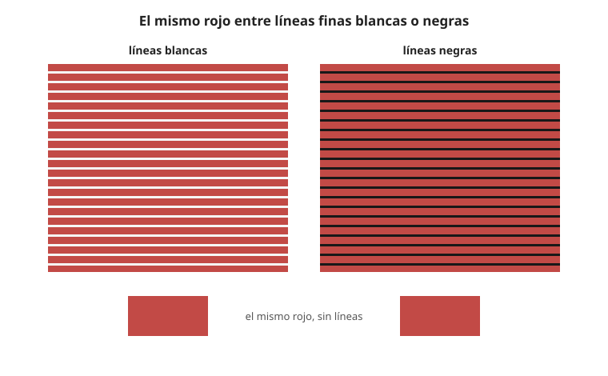

## Comprensión {#layer-2}

### Idea clave
En la **inducción cromática (color induction)** los colores vecinos cambian el color percibido de un objeto. En el contraste se desplaza lejos del color del vecino; en la **asimilación (assimilation)**, hacia él [@otazu-2022, Introducción, párr. 1].

### Explicación
Los artistas explotan la inducción desde hace siglos. El objeto cambia según el inductor (el vecino inmediato): un gris sobre un inductor verde que se ve rojizo es contraste; si se ve verdoso, es asimilación [@otazu-2022, Introducción, párr. 1]. El efecto de Bezold es el nombre con que se conoce en el arte este fenómeno.

Qué efecto aparece depende sobre todo de las propiedades espaciales y cromáticas del objeto y de los inductores: los fondos rayados suelen dar asimilación y los uniformes, contraste [@otazu-2022, Introducción, párr. 1]. Varios autores concluyen que la frecuencia espacial de las rayas es clave y que, cuanto más finas son, más se pasa de contraste a asimilación [@otazu-2022, Discusión, párr. 1]. Un trabajo citado halló asimilación cromática máxima en anillos de 3,3 ciclos por grado [@otazu-2022, Discusión]. No es una regla absoluta: incluso con fondos rayados, algunas condiciones (p. ej. diferencias de luminancia negativas en ciertas direcciones) dieron contraste [@otazu-2022, Resultados].

Otra descripción es que la asimilación es la capacidad generalizadora de la conciencia visual, que funde texturas de varios colores en una sola impresión. Con ella se explica el puntillismo: los puntos de colores se funden por asimilación y no por mezcla física, y el color se ve "por área y no por borde" [@koenderink-2018, Métodos/Discusión; Métodos, color; Resumen].

En cuanto al mecanismo, muchos autores atribuyen la inducción a conexiones laterales en la corteza visual primaria V1, con células de oponencia simple, de doble oponencia (las más importantes para la apariencia del color, con pico en torno a 2 ciclos por grado) y no oponentes [@otazu-2022, Introducción, párr. 3]. En el estudio de Otazu y colaboradores, la asimilación solo apareció cuando la vía de luminancia (magnocelular) estaba activa y dependió más del canal koniocelular (eje s) que del parvocelular (eje l); con las tres vías activas, la inducción cromática disminuye mucho [@otazu-2022, Resumen].

Dos conceptos vecinos no hay que confundirlos con ella:

- *Mezcla óptica.* Si los materiales están tan divididos que el ojo no los distingue, hay una sola impresión (azul más amarillo da verde); si las superficies se ven distintas y a la vez, hay contraste y el azul junto al amarillo se diferencia en lugar de tender al verde [@chevreul-1890, §373-375, p. 144]. Véase [mezcla óptica](../../color-mixing/concepts/optical-mixing.md).
- *Fusión frente a contraste.* Fusión óptica y vibración por contraste son incompatibles: si se percibe contraste, no hay fusión [@gomez-sanchez-2014, n. 4, p. 323]. Véase también [contraste simultáneo](simultaneous-contrast.md).

### Ejemplo
Un rojo cruzado por líneas finas, como en la figura, ya no se comporta como sobre un fondo uniforme: la trama fina empuja hacia el color de las líneas en vez de alejarlo [@otazu-2022, Introducción, párr. 1; Discusión, párr. 1].

### Errores frecuentes
- *"Todo vecino aleja el color."* Depende del patrón: con rayas finas el color se acerca al de la trama [@otazu-2022, Discusión, párr. 1].
- *"Asimilación y mezcla óptica son lo mismo."* En la mezcla el ojo no distingue los elementos; en el contraste, sí [@chevreul-1890, §373-375, p. 144].

### Las fuentes discrepan
El nombre y la base del concepto no coinciden entre las fuentes. El artículo de Otazu cita a von Bezold (1876) en sus referencias pero no usa el término "efecto Bezold" en el texto [@otazu-2022, Referencias]; el libro de Albers le dedica un capítulo, "El efecto Bezold", cuyo contenido no se ha podido leer [@albers-2013]. Chevreul distingue mezcla y contraste, pero no da umbral, no usa la palabra "asimilación" y no describe el efecto moderno en que áreas pequeñas hacen que los colores vecinos se vean *más parecidos* [@chevreul-1890, §374-375, p. 144].

Las condiciones del experimento de Otazu (anillos concéntricos de unos 2 ciclos por grado, 11 participantes, sala oscura) limitan lo que puede generalizarse [@otazu-2022, Métodos].

### Para seguir
La capa 3 lleva la asimilación al cuadro: dónde aparece, cómo cambia con la distancia y la escala de la trama, y qué papel tiene el valor.

## Profesional {#layer-3}

### Idea clave
La asimilación aparece donde hay elementos pequeños y repetidos de un color dentro de otro, y el resultado depende de la distancia, del grosor de la trama y de la diferencia de valor [@otazu-2022, Discusión, párr. 1; Resultados].

### Explicación
Los lugares donde aparece son la trama de pinceladas, el hatching, los estampados de telas y las hojas sobre un fondo. En los tapices de los Gobelinos se trabajaba con mezclas de hilos y con tramas (hatchings), con las que se podían imitar todos los colores de un modelo pintado [@chevreul-1890, §377-379, p. 145]. Con bandas de naranja y azul, según la luz y la posición del observador aparecían franjas violetas, verdes, rojas y amarillas, y con luz fuerte las bandas no se veían separadas: mezcla y contraste interfieren [@chevreul-1890, §380 E, p. 149].

El resultado cambia con la distancia. Visto desde más lejos que la distancia a la que los colores se neutralizan, un hilo amarillo y violeta mezclado parece un violeta apagado, porque el amarillo se debilita [@chevreul-1890, §380 F, p. 149]. De ahí cuatro criterios:

- *Comprueba el cuadro a la distancia de exhibición.* Conviene juzgarlo con la luz de su lugar y a su distancia [@chevreul-1890, §311, p. 119].
- *Ajusta el grosor de la trama.* Cuanto más fina es la trama, más se tiende a la asimilación [@otazu-2022, Discusión, párr. 1]; por tanto, una trama más gruesa deja más sitio al contraste y una más fina empuja hacia el color de la trama [unverified].
- *Cuida el valor.* La asimilación solo apareció donde había diferencias de luminancia; con colores equiluminantes no hubo asimilación y casi no hubo inducción [@otazu-2022, Resultados; Discusión, párr. 3]. Para una trama que tiña lo que hay entre rayas, hace falta alguna diferencia de valor entre la trama y el fondo. Véase [equiluminancia](equiluminance.md).
- *El signo de la diferencia de valor cuenta.* La asimilación depende de la polaridad de la diferencia de luminancia, y un trabajo citado la encontró cuando el objeto era más claro que los inductores [@otazu-2022, Discusión, párr. 2].

### Ejemplo
Los primeros trabajos de Seurat se veían apagados de lejos y vivos de cerca, lo que llevó a artistas posteriores a separar más los puntos [@koenderink-2018, Introducción].

### Las fuentes discrepan
El efecto depende de combinaciones complejas de direcciones de color y de luminancia, hasta el punto de que los autores especulan con influencias de alto nivel y dejan abierta la cuestión [@otazu-2022, Discusión, párr. 6]. Su hipótesis de que habría asimilación a equiluminancia cuando los dos canales cromáticos están activos no se confirmó [@otazu-2022, Conclusiones]. Ninguna de las fuentes consultadas da una regla de grosor de pincelada en milímetros para una distancia dada; esos valores deben salir de probar sobre el propio cuadro [unverified].

### Para seguir
La [equiluminancia](equiluminance.md) examina qué pasa con los efectos de contraste cuando dos colores tienen el mismo valor.
