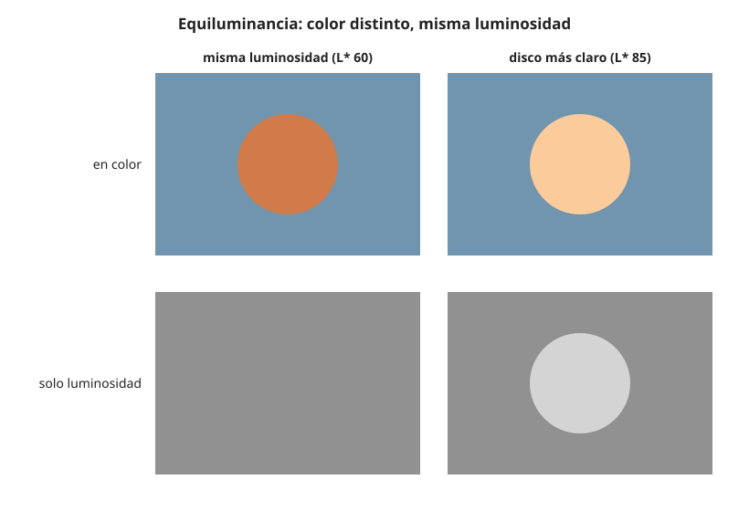

## Profesional {#layer-3}

**Qué es.** Dos colores son **equiluminantes (equiluminant o isoluminant)** cuando tienen la misma luminancia: la misma cantidad de luz efectiva, aunque difieran en matiz. Para un pintor es la situación de dos colores con el mismo [valor](../../color-attributes/concepts/value.md) pero distinto matiz, ya que la luminancia percibida es lo que los artistas llaman valor [@livingstone-2014]. Se mide, no se adivina: Otazu y colaboradores determinaron la equiluminancia de cada observador con el método del borde mínimamente distinto: ajustar la luminancia de un disco de color junto a otro gris hasta que el borde entre ambos sea mínimo; fueron ocho ajustes por color, unas tres horas en tres días, y siempre queda un borde cromático residual [@otazu-2022, Métodos, Medida de equiluminancia]. Equiluminante no es lo mismo que equibrillante: los autores proponen futuros experimentos de equibrillo [@otazu-2022, Discusión, último párr.]. Y los colores saturados difieren mucho en luminancia: Koenderink y colaboradores señalan que el amarillo cardinal tiene una Y de unos 100 y el azul de unos 20, de modo que para igualarlos habría que atenuar el amarillo unas cinco veces [@koenderink-2018, Discusión].

**Por qué se comporta de otra manera.** En las escenas naturales, el contraste cromático y el de luminancia son estadísticamente independientes; los bordes de objetos traen cambios de color independientes de la claridad [@witzel-2018, §2.1, p. 478]. La cromaticidad tiende a señalar objetos, mientras que la luminancia varía también con sombras y sombreado, y coincidir un borde cromático con uno de luminancia ayuda a distinguir contornos de objeto de sombras [@witzel-2018, §2.1, pp. 478-479]. El camuflaje usa contrastes cromáticos que no coinciden con los contornos del objeto [@witzel-2018, §2.1, p. 479]. En la corteza hay células que responden al contraste espectral entre rojo y verde sin contraste de energía: una respuesta grande a una barra verde sobre fondo rojo con contraste de luminancia mínimo [@webvision, Gouras, "Color Vision" §13, Fig. 26; §14, Figs. 27-28]. Estas células de doble oponencia son paralelas a las basadas en energía y probablemente ambas contribuyen a la forma, pero las basadas en energía ocupan más área cortical por su mayor resolución espacial [@webvision, Gouras, "Color Vision" §14, Fig. 29]. Véase [proceso oponente](../../light-and-vision/concepts/opponent-process.md).

**Qué hacen los efectos de contraste a equiluminancia.**

- *El contraste de color no desaparece.* Varios estudios con fondos uniformes apoyaron la tercera ley de Kirschmann: el contraste de color funciona también a equiluminancia [@otazu-2022, Discusión, párr. 1]. Chevreul mismo ponía a prueba el contraste de color con colores "de tono lo más igual posible", para que solo se viera el cambio de matiz, sin tratarlo como un caso especial [@chevreul-1890, §13, p. 9; §15, p. 10].
- *La asimilación sí desaparece.* En un experimento con anillos concéntricos, a equiluminancia no hubo asimilación en ninguna condición y casi ninguna inducción, salvo un caso que dio contraste [@otazu-2022, Resultados]. Véase [asimilación](assimilation.md).
- *El brillo no se iguala solo.* Incluso a equiluminancia, el anillo de prueba se vio más oscuro que 20 cd/m², sobre todo en las condiciones diagonales [@otazu-2022, Resultados, Inducción de brillo].
- *Los bordes siguen viéndose.* Las transiciones equiluminantes de la pintura puntillista se ven aunque los modelos basados en luminancia predigan que serían invisibles; los bordes del puntillismo están definidos sobre todo por diferencias cromáticas, y el contraste cromático puede igualar al de luminancia para hacer distintas dos regiones [@koenderink-2018, Resumen; Discusión].

**El borde vibrante: lo que dice y lo que no se puede afirmar.** En la divulgación de Livingstone (artículo de *Harvard Magazine* y una reseña de su libro, no el libro), la luminancia gobierna la profundidad, el movimiento y la organización espacial, mientras que el sistema sensible al color no; en *Impresión, sol naciente* de Monet el sol tiene la misma luminancia que el cielo, de modo que el sistema "dónde" no puede detectarlo y el sol parece vibrar, y en una reproducción en blanco y negro desaparece [@livingstone-2014]. La reseña atribuye la vibración al conflicto entre ambos sistemas, y señala que una versión con un sol más claro y naturalista la pierde [@livingstone-2014]. Del mismo modo, el *Broadway Boogie Woogie* de Mondrian usaría amarillos y grises casi equiluminantes con el fondo blanquecino, y los cuadrados parecen temblar o moverse [@livingstone-2014]. Estas afirmaciones se citan como atribuidas a ese artículo y reseña, no a páginas del libro. En el libro de Albers existe un capítulo de "bordes vibrantes" ("Vibrating boundaries"), pero lo consultado no dice que trate colores de igual intensidad lumínica, así que no se afirma esa relación [@albers-2013]. Y Gómez Sánchez distingue la vibración por contraste de la fusión óptica, que se excluyen entre sí [@gomez-sanchez-2014, p. 304].

**Cómo decidir.**

- *Comprobar el valor.* Una reproducción en blanco y negro revela si dos colores del cuadro son equiluminantes: si el borde desaparece, lo son (como el sol de Monet en la reproducción en blanco y negro [@livingstone-2014]); usar la conversión a grises como prueba de taller es una inferencia [unverified].
- *Elegir entre vibración y forma.* Si interesa un borde inestable o un acento que no se deje fijar, los colores equiluminantes son una vía [@livingstone-2014]; si interesa modelar volumen, la fuente de Livingstone dice que un sombreado solo por color se ve plano y que los artistas desde el siglo XIII han construido la forma con contraste de luminancia [@livingstone-2014]. La decisión es una compensación entre ambas cosas.
- *El resto de la composición.* Dos colores muy opuestos del mismo tono resultan más agradables, y si se teme crudeza se pasa a tonos claros de sus escalas [@chevreul-1890, §349, p. 132]; la vibración de un borde equiluminante contradice la idea de "agradable", así que depende de la intención [unverified].
- *Pigmentos.* Los pigmentos saturados varían mucho en luminancia (el amarillo muy por encima del azul), por lo que lograr equiluminancia con pinturas puede obligar a aclarar el azul o rebajar el amarillo [@koenderink-2018, Discusión]; qué pinturas concretas lo logran debe comprobarse con la paleta del pintor [unverified].

**Límites.** La definición de equiluminancia y los datos proceden de estudios de laboratorio (con pantallas, observadores individuales y estímulos sencillos) y no de pintura al óleo o acrílico [@otazu-2022, Métodos]. Las afirmaciones sobre Monet y Mondrian son de divulgación y sin acceso a las páginas del libro [@livingstone-2014]. Witzel y Gegenfurtner solo mencionan de pasada un círculo de matices isoluminante, sin definir ni discutir la equiluminancia [@witzel-2018, §4.1, p. 488].
