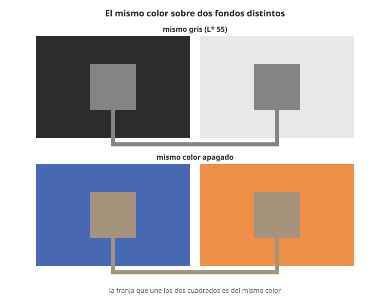

## Fundamentos {#layer-1}

El **contraste simultáneo (simultaneous contrast)** es el cambio de aspecto que sufre un color cuando se ve al lado de otro. La definición de la CIE lo llama *inducción cromática (chromatic induction)*: dos estímulos de color vistos juntos se alteran mutuamente y el efecto es prácticamente instantáneo [@cie-e-ilv, 17-22-075]. Un mismo gris, puesto sobre un fondo oscuro, parece más claro que sobre un fondo claro; y un mismo gris sobre un fondo de color tiende a teñirse con el color opuesto.

Quien describió el fenómeno con orden fue Chevreul, director de tintes de la manufactura de los Gobelinos, a partir de quejas sobre negros "flojos" en las sombras de tapices azules y violetas: el problema no estaba en el tinte, sino en el color vecino [@chevreul-1890, Prefacio del autor, p. x; §386, p. 153]. Su ley dice que dos colores contiguos se ven lo más distintos posible, tanto en composición óptica (matiz) como en altura de tono (valor) [@chevreul-1890, §16, p. 11]. Dos efectos que conviene distinguir desde el principio:

1. **Contraste de tono (valor).** Entre dos grises, el claro parece más claro y el oscuro más oscuro junto a su vecino. Una escala de diez franjas planas, cada una más oscura que la anterior, no se ve plana: cada franja parece aclarada junto a la vecina oscura y oscurecida junto a la clara [@chevreul-1890, §9-11, pp. 7-9].
2. **Contraste de color (matiz).** Dos colores de valor casi igual parecen cambiar de matiz al juntarse: el rojo junto al amarillo se desplaza hacia el violeta y el amarillo hacia el verde [@chevreul-1890, §13 y §15, pp. 9-10].

Chevreul insiste en que no es un cambio físico: los objetos no actúan uno sobre otro, lo que cambia es nuestra percepción de los dos colores vistos juntos [@chevreul-1890, Prefacio del autor, p. xii]. Tampoco depende de qué pigmento sea: el ultramar, el cobalto y el azul de Prusia dan la misma modificación si el color visto es el mismo [@chevreul-1890, §71, pp. 24-25].

**Ejemplo con paleta.** El gris es el mejor "testigo": se ve verdoso junto a un rojo, azulado junto a un naranja, violeta junto a un amarillo y rojizo junto a un verde, y a la vez el color vecino parece más puro y brillante [@chevreul-1890, §63-70, pp. 23-24]. Por eso un gris neutro pintado junto a un naranja parece azulado sin haberle añadido nada de azul.

Albers construyó un curso entero sobre esta idea, pensado para aprenderse mirando (con papeles de color y unos sesenta estudios) y no con sistemas de color fijos; de él solo se conocen el planteamiento y el índice, no su texto [@albers-2013].

## Comprensión {#layer-2}

**La regla de Chevreul como descripción.** Chevreul explica el desplazamiento diciendo que cada color parece recibir añadido el complementario de su vecino: el azul junto al verde se vuelve más azul, el violeta junto al rojo, más rojizo [@chevreul-1890, §17-18, pp. 11-12; §20-37, pp. 13-16]. Como *dirección* de lo que se observa, la regla es útil: el color se aleja del vecino hacia su opuesto. Como *mecanismo* es del siglo XIX y se formula en términos de mezclar rayos de color; el propio Chevreul reconoce que no ofrece una teoría fisiológica completa [@chevreul-1890, §141-142, p. 48]. La explicación actual apunta a procesos de oposición en el sistema visual: Gouras sugiere que si la región que rodea a un punto refuerza el contraste espectral local, el resultado es el contraste simultáneo, y lo enlaza con las células de doble oponencia de la corteza, aunque solo de pasada [@webvision, Gouras, "Color Vision" §7, Fig. 12]. Véase [proceso oponente](../../light-and-vision/concepts/opponent-process.md).

**Cómo se comporta el efecto.**

- Es más fuerte en la línea de contacto y se debilita con la distancia, aunque actúa incluso a través de un hueco [@chevreul-1890, §10, p. 8; §14, p. 9; §132, p. 42].
- Con colores casi complementarios (rojo/verde, naranja/azul) el resultado principal no es un cambio de matiz sino más intensidad y pureza; el desplazamiento de matiz es menor y varía con la luz y la fatiga del ojo [@chevreul-1890, §38-42, pp. 16-18].
- Ningún pigmento es un color puro: todos reflejan rayos de varios tipos, así que no hay dos pigmentos exactamente complementarios [@chevreul-1890, §7, p. 6; §38, p. 16].
- Un mismo color cambia según el vecino: un rojo parece purpúreo junto a un rojo anaranjado y anaranjado junto a un rojo purpúreo [@chevreul-1890, §72-74, pp. 25-26]. Por eso los "primarios" del pintor pasan por yuxtaposición al estado de secundarios [@chevreul-1890, §75, p. 26].
- El contraste de tono y el de matiz se superponen y pueden anularse: un azul muy oscuro junto a un amarillo puede hacer que el amarillo parezca verdoso [@chevreul-1890, §335-340, pp. 128-130]. La traductora o el traductor avisa de que el error más frecuente al aplicar la ley es olvidar el contraste de tono [@chevreul-1890, Prefacio del traductor, p. vi].

**Contraste y asimilación.** El contraste desplaza el aspecto del objeto *lejos* del color vecino; el efecto contrario, que lo acerca, es la [asimilación](assimilation.md). Con fondos uniformes suele darse contraste y con fondos rayados suele darse asimilación [@otazu-2022, Introducción, párr. 1]. Kirschmann sostuvo que el contraste de color funciona también entre colores de igual luminancia, y varios estudios con fondos uniformes lo apoyan [@otazu-2022, Discusión, párr. 1].

**Conceptos vecinos.** Es distinto de la adaptación cromática, que es lenta, mientras que la inducción es casi instantánea [@cie-e-ilv, 17-22-075]. Es además uno de los mecanismos de la [constancia del color](color-constancy.md) [@witzel-2018, §3.1, p. 482]. Cuando el cambio se debe a lo que se miró antes y no al vecino, se habla de [posimágenes y contraste sucesivo](afterimages.md); la CIE agrupa ambos bajo "contraste perceptual" [@cie-e-ilv, 17-22-089].

**Conceptos erróneos.**

- *"El color vecino cambia la pintura."* No: la pintura no cambia, cambia cómo se ve; se puede comprobar aislando el color con un papel recortado [@chevreul-1890, §387, pp. 154-155].
- *"Contraste y mezcla óptica son lo mismo."* Gómez Sánchez sostiene que la fusión óptica y la vibración por contraste se excluyen: si se percibe contraste, la fusión no está ocurriendo [@gomez-sanchez-2014, p. 304; n. 4, p. 323]. Véase [mezcla óptica](../../color-mixing/concepts/optical-mixing.md).

## Profesional {#layer-3}

**Pintar el color local y dejar que el contraste haga el resto.** Chevreul describe el error del pintor que ignora el contraste: copia el naranja aparente que ve en el borde de un rojo y el verde aparente en el borde de un azul y, como el contraste ya los produce, el resultado sale exagerado; debe pintar rojo y azul planos y dejar que el contraste actúe, y un dibujo gris sobre fondo amarillo que parece lila se pinta simplemente gris [@chevreul-1890, §330-332, pp. 126-127]. Lo recíproco también ocurre: para que dos franjas grises se vean planas hay que aclarar la oscura hacia el borde y oscurecer la clara, es decir, copiar el modelo de forma distinta de como se ve [@chevreul-1890, §333, p. 127]. Es una versión temprana de la distinción entre color local y color percibido, que se desarrolla en el ámbito de color y luz en la pintura.

**Sombras y modelados.** Muchas sombras verdosas en las carnaciones de cuadros antiguos vienen del contraste entre el rosa y el gris, no de un verde pintado: basta un gris junto al rosa [@chevreul-1890, §338, p. 129; §385, p. 153]. Del mismo modo, las partes más oscuras de un abrigo azul se ven gris anaranjado por contraste, y solo en colores oscuros, no en rojos, amarillos o azules claros brillantes [@chevreul-1890, §287-290, pp. 108-110].

**Decidir con el cuadro delante.**

- *Aislar el color.* Si hay duda sobre el color verdadero de una zona, se tapa el entorno con un papel recortado y se compara directamente con la muestra [@chevreul-1890, §387, pp. 154-155].
- *Escoger vecinos.* Si los vecinos se eligen según la ley, el efecto de color es mayor que en la pintura con claroscuro [@chevreul-1890, §301, p. 114]. Para atraer la mirada Chevreul recomienda la armonía de contraste, con colores puros o rotos con gris; para menos diversidad, la armonía de escala o de matiz [@chevreul-1890, §348-350, p. 132; §355, p. 133]. Si dos colores muy próximos se perjudican, a veces conviene pasar a armonía de escala o de matiz [@chevreul-1890, §252-253, pp. 91-92].
- *Cuidar el valor.* El contraste de colores opuestos es más agradable si son del mismo tono; si se teme crudeza por exceso de intensidad, se pasa a tonos claros de sus escalas [@chevreul-1890, §349, p. 132].
- *Posición del espectador y luz del lugar.* En el modelo real las modificaciones cambian con el punto de vista, mientras que el cuadro las fija desde el del pintor [@chevreul-1890, §299, p. 112]; el cuadro debe juzgarse con la luz de su lugar previsto y a su distancia [@chevreul-1890, §311, p. 119].

**Límites y compromisos.** La exageración puede ser deliberada: Chevreul admite que un cuadro fiel pero exagerado suele resultar más agradable [@chevreul-1890, §311, p. 119]. Hay que contar también con la fatiga del ojo: mirar demasiado el modelo produce contraste sucesivo y falsea el juicio del color siguiente (véase [posimágenes](afterimages.md)) [@chevreul-1890, §327-328, pp. 124-125]. El contraste solo existe si los colores se ven separados: cuando los elementos son tan pequeños que el ojo no los distingue, entran la mezcla y la [asimilación](assimilation.md) [@chevreul-1890, §373-375, p. 144]. Y entre colores de luminancia igual el efecto cambia de carácter: véase [equiluminancia](equiluminance.md).
