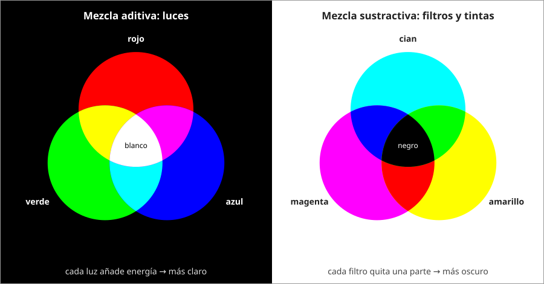

## Fundamentos {#layer-1}

La **mezcla aditiva (additive mixing)** es lo que ocurre cuando se superponen luces de colores: el resultado es la suma de las luces. Luz roja más luz verde se ve amarilla, y las tres luces primarias juntas se ven blancas [@openstax-college-physics-2e, §26.3]. Un televisor en color lo aprovecha: sus puntos de fósforo rojos, verdes y azules, en cantidades iguales, producen toda la gama de matices que vemos [@openstax-college-physics-2e, §26.3]. Newton ya había mostrado que el blanco se compone de todos los colores del espectro [@newton-1704, Prop. V, Exper. 9-13].

**Ejemplo cotidiano.** Una pantalla de móvil vista de cerca solo tiene puntos rojos, verdes y azules; el amarillo que ves en ella no es luz amarilla, sino rojo y verde encendidos a la vez (ver [visión tricromática](../../light-and-vision/concepts/trichromacy.md)).

**Aviso para quien pinta.** Esta regla es de luces, no de pinturas. Con luces, amarillo y azul superpuestos dan blanco, no verde [@handprint-macevoy, color18a, "Additive Color Mixing"]. La pintura sigue otras reglas: véase [mezcla sustractiva](subtractive-mixing.md).

## Comprensión {#layer-2}

**Por qué se suma en el ojo.** El tono resultante depende del patrón de estimulación de los tres tipos de cono, de modo que luces distintas que estimulan los conos igual dan el mismo color [@openstax-college-physics-2e, §26.3]. Un mismo amarillo puede venir de luz amarilla, de rojo más verde o de luz blanca a la que se ha quitado el violeta [@openstax-college-physics-2e, §26.3]. Macevoy lo resume así: la mezcla aditiva describe cómo responde el ojo a luces superpuestas, y cualquier color de luz puede igualarse con, como mucho, tres luces [@handprint-macevoy, color18a, "Additive Color Mixing"]. Esa igualación es lineal: el color de prueba equivale a una suma ponderada de tres primarios, y los pesos son los valores triestímulo [@webvision, "Colour Matches"]. Véanse también [metamería](../../light-and-vision/concepts/metamerism.md) y [color de la luz](../../light-and-vision/concepts/illuminant-color.md).

**Los primarios RGB son una convención.** Los verdaderos "primarios" aditivos son las respuestas de los conos L, M y S, que no se pueden ver como luces [@handprint-macevoy, color18a, "The True Additive Primaries Are Invisible"]. El libro de texto añade que el conjunto no es único: amarillo, verde y azul también valdrían [@openstax-college-physics-2e, §26.3].

**Construcción de Newton.** Para predecir el color de una mezcla de luces, Newton colocaba los colores en un círculo, ponderaba cada uno por la cantidad de rayos y buscaba el centro de gravedad [@newton-1704, Prop. VI]. Es el antecedente geométrico de la [rueda de color](../../color-attributes/concepts/color-wheel.md). Con pigmentos ese método funciona mucho peor: la rueda sirve bien para luces, pero es mucho menos precisa para pintura [@handprint-macevoy, color14, "mixing with a color wheel"].

**Error frecuente.** Programas de dibujo basados en RGB mezclan azul y amarillo en un gris, porque los espectros de las luces se suman linealmente; la pintura real da verde [@sochorova-2021, p. 1, §1]. El modelo aditivo describe el programa, no el tubo.

## Profesional {#layer-3}

**Dónde importa la mezcla aditiva a quien pinta.** (1) En la pantalla: las referencias digitales, las fotos de las obras y las simulaciones de pintura se calculan de forma aditiva, así que sus mezclas no coinciden con las del lienzo. En RGB las mezclas siguen líneas rectas en el espacio RGB, mientras que la pintura sigue trayectorias curvas [@sochorova-2021, p. 10, Fig. 14; p. 11, §6]. (2) En los límites de la paleta: algunos colores de pantalla no pueden mezclarse con ningún pigmento conocido y solo se logran proyectando luz [@sochorova-2021, p. 2, §1], y a la inversa, hay mezclas de pigmentos, como un turquesa muy saturado de azul ftalo con blanco, que una pantalla sRGB no puede mostrar [@sochorova-2021, p. 5, §3.1]. Un pintor que compara su muestra con la pantalla debe saber que la pantalla recorta ese color.

**Promediar no es siempre sumar.** Koenderink y colaboradores midieron que, para juzgar qué tan distintos parecen dos regiones de puntos de color, la distancia euclídea en el cubo RGB sin corregir predecía mejor que modelos basados en luminancia o en CIEDE2000, pero advierten que los promedios no bastan: la estadística de los puntos también cuenta [@koenderink-2018, Results; Discussion, Fig. 22]. Más en [mezcla óptica](optical-mixing.md).

**Criterio.** Usa el razonamiento aditivo para luces, pantallas e iluminación del estudio; no lo uses para predecir una mezcla de pintura. Para la teoría de los sistemas de mezcla de color y la diferencia entre aditiva y sustractiva en tecnología del color, la lectura adicional es Berns, cap. 10 §C [@berns-2019].
