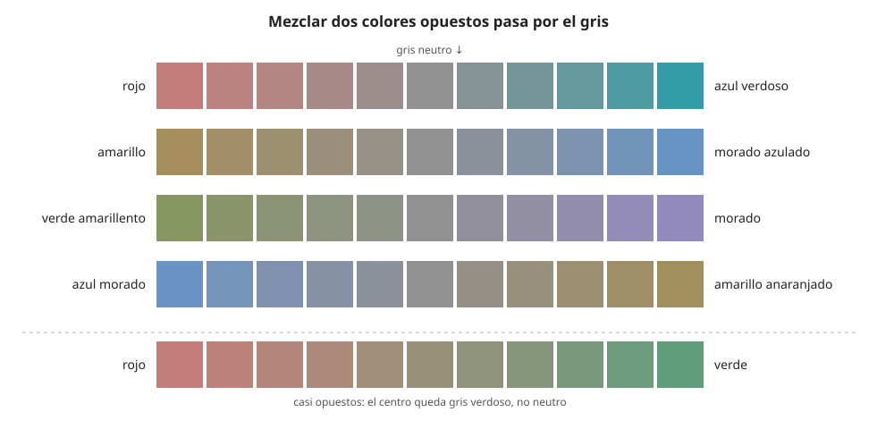

## Fundamentos {#layer-1}

### Idea clave
Dos **colores complementarios (complementary colors)** son dos matices opuestos en la [rueda de color](../../color-attributes/concepts/color-wheel.md). Mezclados en la proporción adecuada se neutralizan y dan un gris, y puestos lado a lado se refuerzan mutuamente [@munsell-1905, ¶61-63].

### Explicación
Los pares que propuso Munsell eran rojo con azul verdoso, amarillo con azul violáceo, verde con púrpura rojizo, azul con naranja amarillento y púrpura con verde amarillento [@munsell-1905, ¶61-62]. Dos matices separados por uno intermedio, en cambio, dan un gris coloreado y no un gris puro [@munsell-1905, ¶64].

### Ejemplo
Una mezcla de pintura roja y verde no da amarillo, sino un gris pardusco: el bermellón mezclado con verde esmeralda da un gris parduzco [@munsell-1905, Apéndice III].

### Las fuentes discrepan
Hay más de una forma de entender "complementario", porque los pares cambian según la rueda que se use. La rueda tradicional RYB empareja rojo con verde, amarillo con violeta y azul con naranja [@briggs-dimensions, 072.php]; Munsell, que eligió los suyos porque se neutralizaban en discos giratorios, propone los de arriba [@munsell-1905, Apéndice III]. Briggs es una fuente de menor fiabilidad que Munsell para esta cuestión.

### Para seguir
[Aclarar, oscurecer y agrisar](tints-shades-tones.md) estudia las otras tres formas de cambiar un color con blanco, negro o gris. La capa 2 de este concepto explica por qué los complementarios se neutralizan y por qué no hay un único par. El motivo de que existan varias ruedas está en [por qué hay varias ruedas](../../color-attributes/concepts/color-wheel-models.md).

## Comprensión {#layer-2}

### Idea clave
Los complementarios se neutralizan porque son colores equidistantes del centro neutro por lados opuestos, y ese centro es el punto natural de equilibrio [@munsell-1905, ¶76]. Con luces el resultado es blanco; con pigmentos, gris [@munsell-1905, ¶92-93].

### Explicación
El croma es la fuerza de una longitud de onda separada de las demás. Al mezclarse otras longitudes de onda, el croma pierde pureza, y una luz con todas las longitudes equilibradas da la sensación de blanco [@munsell-1905, ¶23]. Newton llegó a algo parecido con luces: dos colores opuestos en la proporción adecuada sitúan el centro de gravedad en el blanco o cerca de él, aunque admitía que nunca había logrado un blanco perfecto con solo dos colores primarios [@newton-1704, Prop. VI].

Se puede comprobar si un par está equilibrado igualando el valor y el croma de los dos pigmentos y pintándolos en discos giratorios (discos de Maxwell). Si la mezcla se ve gris, el par está equilibrado, y un matiz residual indica cuál sobra [@munsell-1905, ¶105-116].

La proporción no suele ser mitad y mitad, porque cada pigmento tiene su propio croma; véase el ejemplo [@munsell-1905, Apéndice IV].

Además, no hay un único complementario. Se pueden distinguir complementarios visuales, de mezcla y de posimagen, que a menudo no coinciden, y un matiz puede tener varios complementarios de mezcla, así que no caben todos en un punto de la rueda [@handprint-macevoy, color13, "Mixing Complements"].

Mezclar con el complementario baja el valor y el croma de ambos colores, en una medida que depende de los pigmentos [@briggs-dimensions, 063.php]. Munsell apunta lo mismo con otras palabras: las mezclas de pigmentos pierden croma hacia el eje neutro [@munsell-1905, ¶61, ¶64]. Sobre esa pérdida, véase [croma](../../color-attributes/concepts/chroma.md).

### Ejemplo
El óxido de cromo (azul verdoso) y el sulfuro de mercurio (rojo) son complementarios, pero el primero tiene la mitad de croma que el segundo. Para llegar al gris no se mezclan a partes iguales: no basta "la misma cantidad" de cada uno, y el matiz que sobra en un disco giratorio indica cuál hay que corregir [@munsell-1905, Apéndice IV; ¶105-116].

### Errores frecuentes
- *"Basta mezclar la misma cantidad de cada complementario."* La proporción depende del croma de cada pigmento [@munsell-1905, Apéndice IV].
- *"Cada color tiene un único complementario."* Pueden coincidir o no los visuales, los de mezcla y los de posimagen [@handprint-macevoy, color13, "Mixing Complements"].

### Las fuentes discrepan
Los complementarios de mezcla de pintura se parecen más a los pares aditivos (cian-rojo, magenta-verde) que a la rueda RYB, salvo cerca del eje amarillo-azul violáceo, donde las trayectorias de mezcla se curvan por verdes de croma medio [@briggs-dimensions, 063.php, 074.php]. Briggs es aquí una fuente de menor fiabilidad, así que conviene tomarlo como indicio y no como regla.

### Para seguir
La capa 3 pasa de la teoría al taller: cómo usar los complementarios para apagar un color y por qué hay que aprenderlos pigmento a pigmento.

## Profesional {#layer-3}

### Idea clave
Un complementario de mezcla sirve sobre todo para *apagar* un color de forma controlada y obtener grises coloreados, más vivos que un gris de tubo, pero hay que aprenderlos pigmento a pigmento [@handprint-macevoy, mixtable].

### Explicación
Para grises, se recomienda mezclar tres pinturas que formen un triángulo alrededor del punto neutro. Dos pinturas complementarias son más cómodas y suelen dar neutros más oscuros [@handprint-macevoy, tech17, "Mixing complements"].

La razón de aprenderlos por pigmento es empírica. Más de 1500 mezclas medidas por espectrofotómetro (21 azules y verdes fríos contra 50 pinturas cálidas) dieron más de 170 pares que producen grises puros o casi puros (croma ≤ 2 o ≤ 5). Los pares que neutralizan están repartidos de forma irregular, por lo que una rueda de mezcla consistente es imposible y los complementarios deben definirse por pigmento concreto [@handprint-macevoy, mixtable]. Los resultados son de acuarela; en acrílico u óleo pueden ser distintos [@handprint-macevoy, mixtable].

Las observaciones prácticas (sobre acuarela) son estas: la mayoría de los complementarios de mezcla de azules y azules verdosos son colores cálidos, el amarillo rara vez funciona como tal y algunos complementarios de mezcla contradicen la lógica de la rueda [@handprint-macevoy, tech17]. La siena tostada y el rojo veneciano son neutralizantes de uso habitual, y la sombra natural resulta útil para azules rojizos [@handprint-macevoy, tech17].

### Ejemplo
Para decidir cómo apagar un color saturado:
1. Usa la rueda para saber hacia dónde ir, no para saber cuánto.
2. Haz una carta de muestras de tus propios pigmentos mezclados de dos en dos y déjala secar [unverified].
3. Ten presente el efecto en el entorno: cerca de un color saturado, un casi neutro análogo lo hace parecer más saturado y uno complementario lo hace destacar más [@handprint-macevoy, tech17, "Near neutrals and color design"].

### Para seguir
Ese último efecto enlaza con el contraste simultáneo y la armonía, que se tratan en otros ámbitos. Dentro de este, [mezclar un color objetivo](target-color-mixing.md) integra los complementarios en un procedimiento completo.
