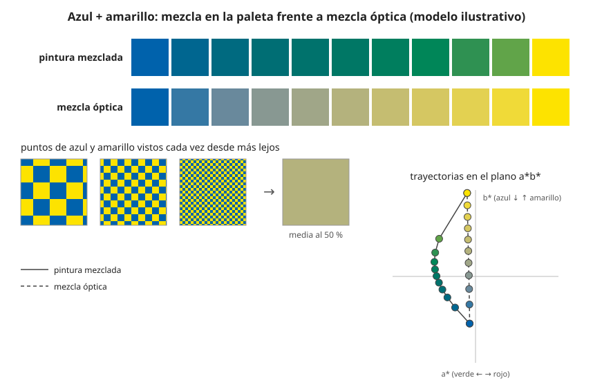

## Comprensión {#layer-2}

**Qué es.** En la **mezcla óptica (optical mixing)**, o mezcla partitiva, los colores no se combinan en la paleta ni en la superficie: se ponen como puntos o pinceladas pequeñas y separadas, y el espectador las "mezcla" al verlas. Gómez Sánchez la define como descomponer un color en sus componentes y hacer que el tono se reconstruya en la retina del espectador [@gomez-sanchez-2014, resumen, p. 301]. Koenderink y colaboradores precisan que es una mezcla "de la mente, no de la luz", que los puntos deben seguir siendo visibles en lugar de fundirse, y que es un efecto de asimilación y no una mezcla física [@koenderink-2018, Introducción; Methods, colour].

**No es aditiva ni sustractiva.** Cuando puntos pequeños se funden visualmente, el ojo *promedia* su reflectancia, no suma luz: puntos de tinta roja y verde fundidos se ven apagados y oscuros [@handprint-macevoy, color18a, "Partitive Mixture"]. Gómez Sánchez recoge además que Fénéon identificaba, a su juicio erróneamente, la síntesis óptica con la aditiva [@gomez-sanchez-2014, n. 3, p. 323; interpretación del autor]. Véase [mezcla aditiva](additive-mixing.md) y [mezcla sustractiva](subtractive-mixing.md). Los demás casos de fusión por distancia o por velocidad están ya en Newton: los colores de las burbujas de jabón, vistos desde lejos, se funden en blanco, y un peine que se mueve deprisa mezcla en blanco los colores que se ven por separado si va despacio [@newton-1704, Prop. V, Exper. 9-14].

**Puntillismo y divisionismo.** Seurat y Signac mostraron sus obras en la octava exposición impresionista de 1886 [@gomez-sanchez-2014, resumen, p. 301]. Fénéon describió la innovación de Seurat como una "división científica del tono": en vez de mezclar en la paleta, el pintor coloca trazos separados (color local, calidad de la luz, reflejos de vecinos, complementarios del ambiente) y "los colores se componen en la retina" [@gomez-sanchez-2014, citado en pp. 306-307]. Signac (1899) afirma que los neoimpresionistas desarrollaron la técnica de la división usando la mezcla óptica de tonos y matices como medio de expresión [@gomez-sanchez-2014, p. 319]. Estos pintores sustituyeron las paletas tonales (de valores) por paletas cromáticas [@koenderink-2018, Introducción].

**El debate: ¿más luminosidad?** La creencia común es que las mezclas en la retina se comportan como rayos de luz y por tanto son más intensas y luminosas que la mezcla física de pigmentos [@gomez-sanchez-2014, p. 303]. Esta fuente la discute, y conviene tomarla como una interpretación del autor, no como un resultado experimental: sostiene que los impresionistas (Monet, Renoir, Sisley, Pissarro) no usaron conscientemente la mezcla óptica y que el vínculo nace tras 1886 [@gomez-sanchez-2014, conclusión, p. 321; tesis del autor]; considera que los divisionistas sí la buscaron de forma programática [@gomez-sanchez-2014, p. 316; interpretación del autor]; y señala que, por definición, la fusión anula el contraste, de modo que si se percibe vibración por contraste no hay fusión [@gomez-sanchez-2014, p. 304 y n. 4, p. 323]. Añade que, a partir de cierta distancia, los toques empiezan a fundirse y el cuadro se ve más apagado, aunque los colores locales saturados y las grandes masas lo compensan [@gomez-sanchez-2014, p. 318; interpretación del autor]. Según Koenderink y colaboradores, los primeros Seurat parecen apagados de lejos y vivos de cerca, lo que llevó a separar más los puntos [@koenderink-2018, Introducción]. El mismo artículo concluye que el color se ve "por áreas más que por bordes" y que la nitidez del borde influye poco en lo distinto que parece una transición [@koenderink-2018, Resumen; Discusión].

**Veladuras (glazes).** Una veladura es una capa transparente que se pinta sobre otra ya seca. Macevoy indica que el cambio de color es mayor cuando se vela oscuro sobre claro, frío sobre cálido o saturado sobre menos saturado [@handprint-macevoy, color18b, "The Relative Effects of Color Mixtures"]. Hasta donde llegan las fuentes: Kubelka y Munk solo tratan la capa transparente sin dispersión (*r* = 0; en la notación del artículo, *s* es la absorción y *r* la dispersión, al revés que en textos posteriores), cuyo albedo es el del fondo multiplicado por exp(−2*sX*), donde *X* es el espesor, de modo que solo oscurece el fondo; el artículo no la describe como mezcla óptica ni analiza veladuras de color sobre fondos de color [@kubelka-munk-1931, p. 7, §5, Eq. 11]. Para la veladura de color, la capa translúcida queda como trabajo futuro en el modelo gráfico [@sochorova-2021, p. 10, §5].

## Profesional {#layer-3}

**Decisiones de oficio con el efecto de distancia.** La fusión depende de lo pequeños que sean los toques para la distancia de contemplación; el experimento de Koenderink y colaboradores se hizo a una sola distancia (57 cm) y no probó variarla [@koenderink-2018, Methods, Figs. 3-7], así que no hay datos de ahí sobre "la distancia correcta". Signac ya veía en 1897 que la fusión retiniana habría estropeado el efecto cromático, como lo hace en mayor grado la mezcla material [@gomez-sanchez-2014, p. 322; interpretación del autor], y era consciente de que un toque muy atomizado, como en *Les Poseuses*, era más un inconveniente que una virtud [@gomez-sanchez-2014, p. 320, citando a Cachin]. El propio Gómez Sánchez deja sin resolver cuánto aplicaron realmente los divisionistas la mezcla óptica [@gomez-sanchez-2014, p. 322].

**Qué ganas y qué pierdes al dividir.** Signac criticaba que las prisas del impresionismo fundían físicamente colores opuestos en un gris "pigmentario" apagado; el neoimpresionista evita "ensuciar" la pureza de los colores con trazos lentos y cuidadosos que mantienen limpio el color en la paleta y en el lienzo [@gomez-sanchez-2014, p. 320]. Es decir, dividir ahorra un tipo de pérdida de croma, que es la de mezclar complementarios en la superficie (véase [complementarios](complementary-colors.md)), a cambio de una dependencia de la distancia. Los toques cruzan bordes y pueden unir regiones en lugar de separarlas [@koenderink-2018, Introducción, "edges and regions"], de modo que la elección de cómo cerrar un borde es una decisión de composición. Los bordes pueden tratarse de manera especial, como el borde de tipo Cornsweet de Signac [@koenderink-2018, Discusión, Fig. 25].

**Qué hacían realmente los maestros.** Francastel observa que los toques de Monet se superponen y no solo se yuxtaponen, y que casi siempre mezclaba dos o tres colores para obtener el tono [@gomez-sanchez-2014, citado p. 314]. Es un argumento de que la práctica real mezcla mucho en la paleta. Quien desee estudiar un cuadro concreto debe recordar que lo que se dice de pintores concretos en esta fuente es interpretación del autor.

**Veladuras en el taller.** Macevoy recomienda el orden de glaseado de claro a oscuro, de cálido a frío y de opaco a transparente [@handprint-macevoy, mix, "Wet-in-wet and glazing"], y avisa de que el orden importa: el amarillo cadmio sobre el verde ftalo da algo más claro y menos saturado que al revés [@handprint-macevoy, color18a, "Other Factors in Material Mixtures"]. Se trata de observaciones sobre acuarela; no es una predicción general. Los cálculos de capas translúcidas (Kubelka-Munk para varias capas) no están en las fuentes de este tema.

**Criterio.** No cuentes con un "extra de luminosidad" automático por dividir el color: la evidencia que hay es contradictoria y depende de la distancia, del tamaño del toque y de si el espectador sigue viendo los puntos. Prueba siempre a la distancia de contemplación real [unverified].
