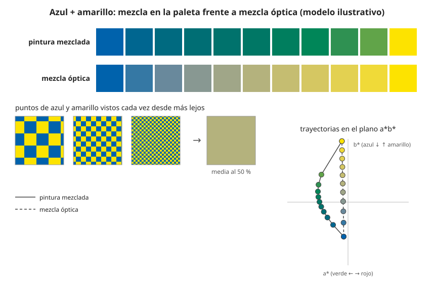

## Comprensión {#layer-2}

**La imagen de partida.** En una pintura, las partículas de pigmento absorben y dispersan la luz de forma compleja, y el resultado de mezclar es muy poco lineal [@sochorova-2021, p. 1, §1]. Azul y amarillo dan verde porque ambas clases de partículas absorben y dispersan la luz repetidas veces dentro de la pintura, dejando salir sobre todo longitudes de onda verdes [@sochorova-2021, p. 2, §2, Fig. 3]. Esto continúa lo que se vio en [mezcla sustractiva](subtractive-mixing.md): ahí la absorción es la parte conocida; aquí entra la dispersión.

**El modelo de Kubelka-Munk.** Describe una capa plana y mate de pintura con dos flujos de luz, uno hacia abajo y otro hacia arriba. Cada rebanada fina quita una fracción fija de luz por absorción (constante *s*) y otra por dispersión (constante *r*; los textos posteriores escriben *K* para la absorción y *S* para la dispersión); la luz dispersada pasa al flujo contrario, la absorbida no vuelve [@kubelka-munk-1931, pp. 1-2, §1]. Para una capa gruesa, el aspecto de una pintura acromática depende solo de la razón entre absorción y dispersión, *s/r*, no de los valores absolutos [@kubelka-munk-1931, p. 3, §2]. Y *r* y el espesor *X* solo aparecen como producto *rX*, lo que coincide con que una pintura se puede aclarar con un aglutinante transparente sin cambiar el albedo de la capa si se aplica sobre la misma superficie [@kubelka-munk-1931, p. 5, §3].

**Cómo se predice una mezcla.** El artículo de 1931 *no* trata mezclas de pigmentos distintos (solo menciona el negro de humo en blanco, donde *s/r* crece en proporción a la cantidad de negro) [@kubelka-munk-1931, p. 3, §2]. La regla de mezcla es posterior: en el modelo usado en gráficos, los coeficientes de absorción *K(λ)* y dispersión *S(λ)* de cada pigmento se miden de antemano y los de la mezcla son la suma ponderada por concentración de los de cada pigmento (atribuida allí a Duncan, 1940) [@sochorova-2021, p. 2, §2, Eq. 1]. La reflectancia se calcula después con la ecuación de Kubelka-Munk para una capa lo bastante gruesa como para ocultar el fondo [@sochorova-2021, p. 3, Eq. 2]. Lo importante: el promedio lineal se hace en *K* y *S*, no en la reflectancia ni en el RGB, así que el color de la mezcla no es el promedio de los colores [@sochorova-2021, p. 3, §2].

**Qué predice bien.** Este modelo coincide con mezclas reales de azul cobalto y amarillo Hansa, mientras que RGB, RYB, el sustractivo y el híbrido no [@sochorova-2021, p. 3, Fig. 5; p. 4, Fig. 6]. También reproduce la ganancia de saturación y el cambio de matiz de los [tintes](tints-shades-tones.md) [@sochorova-2021, p. 3, Fig. 4].

**Líneas de mezcla curvas.** Las luces mezcladas caen sobre líneas rectas de un diagrama de cromaticidad, pero las líneas de mezcla de la pintura son "erráticas" y suelen curvarse en una rueda [@handprint-macevoy, color14, "Mixing Lines"]. En el modelo, los colores mezclados se curvan lejos del gris y conservan saturación, y aparecen matices secundarios; en RGB la trayectoria es una recta [@sochorova-2021, p. 10, Fig. 14; p. 11, §6].

**Errores frecuentes.** (1) "Si dos pinturas se ven iguales, mezclarán igual": las pinturas con el mismo color visual pueden tener curvas de reflectancia distintas y mezclar de otra forma [@handprint-macevoy, color18a, "Substance Uncertainty"]; dos amarillos de reflectancia casi idéntica pueden mezclar distinto por su índice de refracción [@handprint-macevoy, color18a, "Particle size, refractive index and hiding power"]. (2) "Mezclar es promediar colores": ya se ha visto que no. (3) "Las mezclas son estables": la reflectancia cambia al secar y con el espesor [@handprint-macevoy, color18a, "Substance Uncertainty"].

## Profesional {#layer-3}

**Qué costo tiene mezclar.** Macevoy observa que mezclar pinturas muy separadas en la rueda cuesta saturación; las líneas de mezcla de primarios sustractivos se curvan hacia fuera (menos pérdida de croma de la esperada), mientras que las de primarios de tipo aditivo (naranja, verde, violeta) se curvan hacia dentro, con mayores pérdidas de croma y de claridad [@handprint-macevoy, color13 y color14; color18b, "The Relative Effects of Color Mixtures"]. Es una observación de taller sobre acuarelas, no una regla universal.

**Datos y herramientas de los profesionales.** El modelo de dos constantes caracteriza cada colorante con un coeficiente unitario de absorción y otro de dispersión, ajustados por mínimos cuadrados con todas las muestras de una escalera de tintes, razón por la que el blanco forma parte de la caracterización [@zhao-berns-2006, resumen]. Según el resumen, bastan dos muestras por colorante (la pintura pura, o tono en masa (masstone) y una mezcla con blanco) en pinturas acrílicas y al óleo de artista [@zhao-berns-2006, resumen]. Los coeficientes de los acrílicos que usan Sochorova y colaboradores proceden de la base de datos espectral de pinturas de artista de Berns (2016), medidos en 36 longitudes de onda de 380 a 750 nm [@sochorova-2021, p. 7, §3.2]. El libro de Berns tiene un capítulo sobre materiales de pintura, de lectura adicional [@berns-2016].

**Límites que importan al pintar.** (1) El modelo supone una capa gruesa que oculta el fondo y trata la mezcla homogénea de pintura opaca; las capas translúcidas, como las veladuras de acuarela, quedan para trabajo futuro [@sochorova-2021, p. 3, Eq. 2; p. 10, §5]. (2) Los coeficientes proceden de acrílicos brillantes; el brillo enriquece los colores, por lo que el método puede sobrestimar la saturación en un medio más mate, como la acuarela seca [@sochorova-2021, p. 8, §3.3]. (3) Para uso en software, el modelo necesita muchos más canales que tres y costosas integrales espectrales por píxel [@sochorova-2021, p. 2, §1]. (4) Kubelka y Munk precisan que su teoría trata sobre todo capas mates y sin color; las capas coloreadas solo se rozan [@kubelka-munk-1931, p. 1, Introducción; p. 14, §9].

**Consecuencia práctica.** Los profesionales no calculan en el taller; hacen muestras secas con sus propios tubos, porque la visión del tubo no predice la mezcla y las mezclas cambian al secar (se recomienda dejar secar al menos diez minutos antes de juzgar) [@handprint-macevoy, color13 y tech17]. Briggs, fuente de fiabilidad baja, indica que en las mezclas de complementarios el camino se curva por verdes de croma medio cerca del eje amarillo-azul violáceo [@briggs-dimensions, 063.php]. Para llevar esto a una mezcla concreta, véase [mezclar un color objetivo](target-color-mixing.md).
