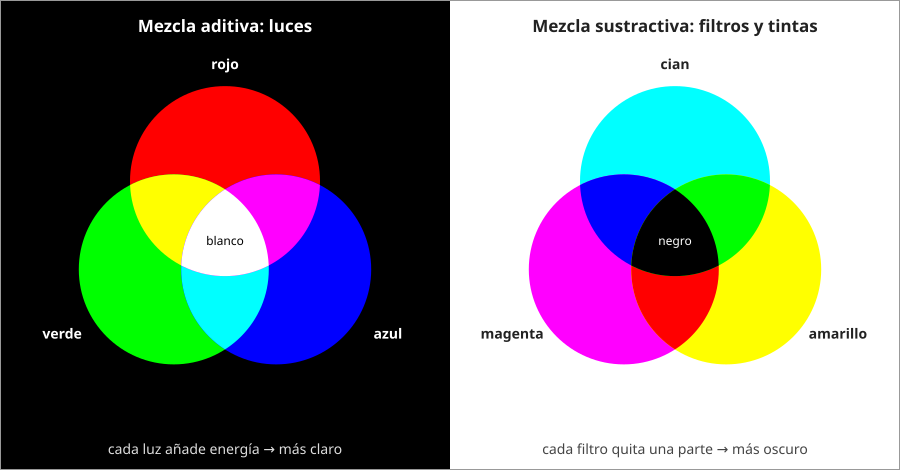

## Fundamentos {#layer-1}

### Idea clave
En la **mezcla sustractiva (subtractive mixing)** cada material que se añade absorbe más luz, de modo que la mezcla absorbe más que cualquiera de sus componentes. Por eso las mezclas de pintura tienden a oscurecerse y a apagarse [@handprint-macevoy, color18a, "Subtractive Mixtures Always Increase Light Absorptance"].

### Explicación
El color de un objeto depende de lo que absorbe y de lo que refleja. Un objeto azul a la luz blanca se ve azul, uno negro absorbe todo, y un objeto azul iluminado solo con luz roja se ve negro porque absorbe el rojo [@openstax-college-physics-2e, §26.3, Fig. 26.12]. Esta idea se explica en [por qué los objetos tienen color](../../light-and-vision/concepts/light-matter-interaction.md).

Newton lo observó con polvos de colores: mezclados no dan un blanco brillante, sino un tono apagado (gris, pardo), porque los polvos absorben buena parte de la luz [@newton-1704, Prop. V, Exper. 15].

Los primarios sustractivos modernos son cian, amarillo y magenta. El trío tradicional rojo-amarillo-azul estaba limitado por los pigmentos que había en cada época [@handprint-macevoy, color18a, "The CYM Subtractive 'Primary' Colors"].

Hay una advertencia importante: la pintura solo es *aproximadamente* sustractiva [@handprint-macevoy, color18a, "Subtractive Color Mixture"]. Un modelo sustractivo puro solo considera absorción, pero en una pintura real las partículas de pigmento también dispersan (scattering) la luz. Por eso ese modelo predice un resultado más oscuro, menos saturado y de otro matiz que la pintura real [@sochorova-2021, pp. 3-4, §2].

### Ejemplo
Amarillo más azul da verde: cada pintura absorbe parte del espectro y lo que queda se ve verde. Al contrario que con luces (ver [mezcla aditiva](additive-mixing.md)), cada ingrediente quita luz en lugar de añadirla.

### Las fuentes discrepan
Macevoy califica la teoría sustractiva de aproximación, no de teoría rigurosa [@handprint-macevoy, color18a, "Subtractive Color Mixture"]. Sochorova y colaboradores coinciden en que el modelo sustractivo puro falla con pintura real [@sochorova-2021, pp. 3-4, §2].

### Para seguir
La capa siguiente de este concepto explica en qué falla exactamente la regla sustractiva simple. Antes, [colores complementarios](complementary-colors.md) muestra la consecuencia más útil de que mezclar quite luz: el gris.

## Comprensión {#layer-2}

### Idea clave
Absorber no es lo mismo que dispersar: la absorción elimina luz de forma permanente y la dispersión solo la redirige. Una pintura contiene las dos, y por eso la regla sustractiva simple no basta [@kubelka-munk-1931, p. 2, §1; nota 6, p. 7].

### Explicación
Kubelka y Munk construyeron su modelo de una capa de pintura sobre esa distinción, y el artículo la presenta como la diferencia central con la visión anterior, que no separaba ambas [@kubelka-munk-1931, p. 2, §1; nota 6, p. 7]. Una teoría de filtros apilados contiene solo absorción; una pintura contiene las dos.

Eso explica por qué falla la regla simple. Con mezclas reales de azul cobalto y amarillo Hansa, el modelo sustractivo puro y el híbrido sustractivo-aditivo no coinciden con la pintura: el híbrido da resultados más claros pero sigue fallando en el matiz, y la interpolación RYB da colores lejanos al comportamiento real [@sochorova-2021, pp. 3-4, §2, Figs. 5-6]. En el modelo que sí coincide, el verde sale de que ambas clases de partículas absorban y dispersen la luz repetidamente dentro de la pintura hasta que emergen sobre todo longitudes de onda verdes [@sochorova-2021, p. 2, §2, Fig. 3].

Aun así, el modelo capta lo esencial. Añadir un absorbente fuerte, como negro de humo en un blanco, sube la absorción en proporción a la cantidad añadida sin cambiar apenas la dispersión [@kubelka-munk-1931, p. 3, §2]. Y un blanco casi perfecto es muy sensible a trazas de colorante [@kubelka-munk-1931, pp. 3-4, §2, Fig. 1].

La diferencia con la mezcla aditiva se ve ya en la luz: la luz espectral recombinada da blanco, mientras que las mezclas de pigmentos dan gris [@munsell-1905, ¶92-93].

### Ejemplo
Dos azules de tubo que se ven iguales pueden dar mezclas distintas con el mismo amarillo, porque las pinturas con el mismo color visual pueden mezclar de otra manera [@handprint-macevoy, color18a, "Substance Uncertainty"].

### Errores frecuentes
- *"La pintura es CMY y punto."* Eso no convierte cada mezcla de tubos en predecible, aunque en impresión las tintas cian, amarillo y magenta se superpongan sustractivamente dentro de cada punto [@handprint-macevoy, color18a, "Partitive Mixture"].
- *"El color visual del tubo basta para predecir la mezcla."* Pinturas con el mismo aspecto mezclan distinto [@handprint-macevoy, color18a, "Substance Uncertainty"].

### Para seguir
[Cómo se mezclan de verdad los pigmentos](pigment-mixing-behavior.md) desarrolla el modelo con absorción y dispersión. La capa 3 de este concepto lo lleva al taller.

## Profesional {#layer-3}

### Idea clave
Para el taller, el modelo sustractivo sirve como brújula, no como calculadora: anticipa la *dirección* (mezclar siempre cuesta luz y croma), no el resultado exacto [@handprint-macevoy, mix].

### Explicación
Cuanto más separados están los colores en la rueda, más croma se paga al mezclarlos [@handprint-macevoy, color13 y color14, "saturation costs"]. Por eso se usa la rueda como guía direccional y no como calculadora [@handprint-macevoy, mix].

Cuando importa la precisión, se miden los coeficientes de absorción y dispersión de cada pigmento y se calcula la mezcla (véase [cómo se mezclan de verdad los pigmentos](pigment-mixing-behavior.md), capa 3). En el taller se comprueba siempre en una muestra seca, porque las mezclas cambian al secar [@handprint-macevoy, color13 y tech17].

### Ejemplo
Al mezclar dos pinturas muy separadas en la rueda, como un amarillo y un azul, se espera perder luz y croma. Cuánto se pierde con los tubos concretos lo decide una muestra seca, no el modelo [@handprint-macevoy, color13 y tech17].

### Para seguir
[Mezclar un color objetivo](target-color-mixing.md) convierte esta brújula en un procedimiento. Como lectura adicional sobre mezcla aditiva y sustractiva en tecnología del color, véase Berns, cap. 10 §C [@berns-2019].
