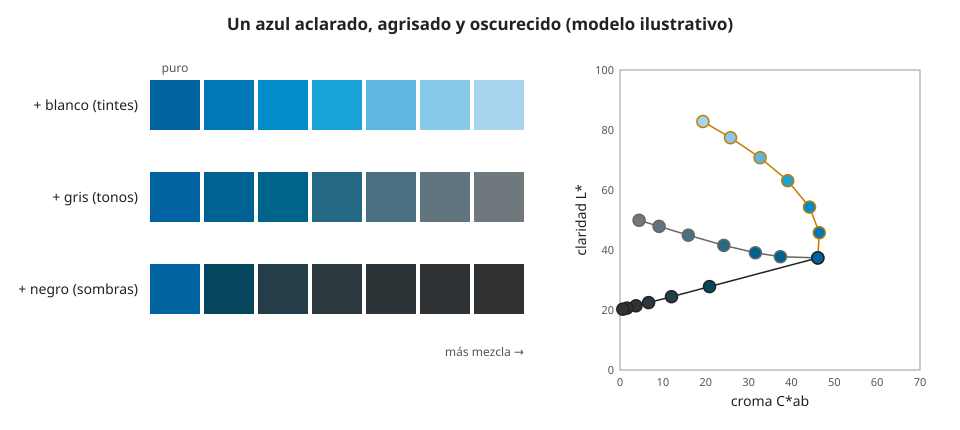

## Fundamentos {#layer-1}

En el uso corriente, un **tinte (tint)** es un color mezclado con blanco, una **sombra (shade)** es un color mezclado con negro y un **tono (tone)** es un color mezclado con gris [unverified]. Briggs, fuente de fiabilidad baja, recoge que esta clasificación popular se apoya en tres cantidades, la blancura, la negrura y la cromaticidad [@briggs-dimensions, Google Sites, p. 1], y define el tinte como un intermedio entre el blanco y el color puro [@briggs-dimensions, 1117.php].

**Ejemplo cotidiano.** Rojo más blanco da rosa (un tinte). Rojo más una pizca de negro da granate (una sombra). Rojo más gris da un rojo apagado, "empolvado" (un tono).

**Qué cambia.** Se mueven dos de las tres dimensiones del color: el [valor](../../color-attributes/concepts/value.md) (lo claro u oscuro) y el [croma](../../color-attributes/concepts/chroma.md) (lo vivo o apagado). Macevoy resume el efecto práctico: el blanco da pasteles y nunca da los colores oscuros y apagados como el marrón o el ocre; el negro baja a la vez la claridad y el croma y es el camino hacia esos colores apagados [@handprint-macevoy, color12, "Unsaturated color zones"].

**Una advertencia de vocabulario.** Munsell consideraba que "tint" y "shade" se usan mal: "shade" debería significar solo un valor oscurecido, y para hablar de lo claro u oscuro el término adecuado es "valor" [@munsell-1905, ¶22, Apéndice I]. Quería sustituir tint, tone, shade, purity e intensity por los términos medidos matiz, valor y croma [@munsell-1905, Apéndice I]. Además, "tone" y "key" vienen de la música y enturbian el lenguaje del color [@munsell-1905, ¶4-6]. Por eso estos tres nombres son cómodos en el taller, pero imprecisos para medir.

## Comprensión {#layer-2}

**Añadir blanco no es simplemente "mover hacia arriba".** En un programa RGB, un color mezclado con blanco pierde saturación de forma directa. En pintura real, el croma sube un poco al principio y el matiz se desplaza: el azul ftalo pasa de púrpura a turquesa al añadir blanco [@sochorova-2021, p. 1, §1; p. 3, Fig. 4]. El modelo de Kubelka-Munk reproduce esa ganancia y ese desplazamiento para el magenta de quinacridona y el azul ftalo, mientras que los degradados RGB hacia el blanco se ven grises y apagados [@sochorova-2021, p. 3, Fig. 4; p. 8, Fig. 11; p. 9, §4]. Sochorova y colaboradores presentan este comportamiento como una propiedad del pigmento ("revela su naturaleza"), no solo del blanco [@sochorova-2021, p. 1, §1].

**El matiz no se queda quieto.** Según Macevoy, el blanco desplaza los naranjas y los amarillos profundos hacia el amarillo y los rojos hacia el violeta; el negro o el gris pueden desplazarlos de otro modo [@handprint-macevoy, color12].

**El negro y el blanco de tubo no son ideales.** En las tablas de pinturas acrílicas, el blanco de titanio mide valor 10 / croma 1,1 y el negro de carbón valor 1 / croma 0,3 [@justpaint-munsell-cielab, listado Golden]: el negro de tubo no es valor 0. Los negros de carbón son en realidad grises oscuros con una reflectancia de unos 20 (según Macevoy) [@handprint-macevoy, color11 y color13].

**Sombras: el croma cae.** "Los colores pierden saturación en las sombras"; para sombras, Macevoy sugiere añadir un neutro oscuro casi neutro, como un tinte neutro o negro marfil o de humo [@handprint-macevoy, color11, "Hue, lightness and saturation"]. Briggs observa que el negro apaga una mezcla más rápido de lo que baja su claridad, aunque la localización de esa afirmación es dudosa [@briggs-dimensions, 101.php]. Diluir también cuenta: la dilución apaga las mezclas saturadas [@handprint-macevoy, color13, "Tints and Shades"].

**Escalas de grises.** Se pueden hacer mezclando negro y blanco, pero el error de mezcla limita a un pintor a unos once valores utilizables [@handprint-macevoy, color11, "Painting values"].

## Profesional {#layer-3}

**Escaleras de tinte como herramienta.** Hacer una escalera de cada pigmento con blanco en concentraciones crecientes es la práctica habitual para construir una base de datos de colorantes, y se ajusta por mínimos cuadrados un coeficiente de absorción y otro de dispersión por colorante [@zhao-berns-2006, resumen]. Según ese resumen, para artistas de acrílico y óleo bastan dos muestras (la pintura pura y una mezcla con blanco, con mejor resultado hacia un 40-60 % de pigmento) en vez de la escalera completa [@zhao-berns-2006, resumen]. Para el taller, la lección es hacer tu propia escalera de cada pigmento con tu blanco, porque muestra su "naturaleza" [@sochorova-2021, p. 1, §1].

**Elegir qué añadir.** Blanco para subir el valor y llegar a pasteles; para ir a marrones, ocres y verdes dorados hay que pasar por el negro, un gris o un complementario, no por el blanco [@handprint-macevoy, color12]. Los pigmentos oscuros y de croma alto son los que más cambian en la escalera: el azul ultramar al óleo mide en masa valor 0,32 y croma 18,16 [@justpaint-munsell-cielab, tabla Williamsburg]. Cuánto sube el valor y qué croma queda con cada proporción de blanco hay que medirlo en la propia muestra, porque no se deduce del color del tubo [unverified].

**Cuidado con la pantalla.** El turquesa más saturado del azul ftalo con blanco queda fuera de lo que muestra un monitor sRGB habitual [@sochorova-2021, p. 5, §3.1]; una foto de la muestra mostrará un color recortado.

**Criterio.** (1) Decide qué dimensión quieres cambiar: solo valor (agua o blanco), valor y croma (negro) o croma sin tocar el valor (un complementario o un neutro del mismo valor; véase [complementarios](complementary-colors.md)). (2) Para un color objetivo, esto se hace en pasos y se mide contra una muestra seca: véase [mezclar un color objetivo](target-color-mixing.md). (3) La fuerza tintórea de cada pigmento, que determina cuánto blanco hace falta, se trata en el ámbito de pinturas y pigmentos.
