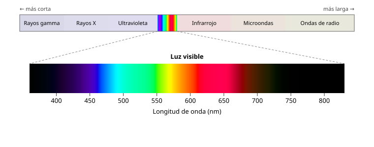

## Fundamentos {#layer-1}

La luz es una forma de radiación electromagnética (electromagnetic radiation); las ondas de radio, el infrarrojo, la luz visible, el ultravioleta y los rayos X son variedades de la misma radiación [@openstax-physics-3, Vol. 3 cap. 1 intro; Vol. 2 §16.1]. Lo que distingue unas de otras es su **longitud de onda (wavelength)**: la distancia entre dos crestas consecutivas de la onda [@openstax-psychology-2e, §5.2]. Longitud de onda y frecuencia van ligadas: a mayor frecuencia, menor longitud de onda [@openstax-college-physics-2e, §24.3].

La parte que vemos es una franja pequeña de ese espectro electromagnético. Se suele dar como aproximadamente 400 a 750 nm [@openstax-college-physics-2e, §24.3], aunque otras fuentes dan 380–740 nm [@openstax-psychology-2e, §5.2]; los límites no son nítidos. La CIE (la comisión internacional de iluminación) lo expresa así: la radiación visible no tiene límites espectrales precisos; el inferior suele situarse entre 360 y 400 nm y el superior entre 760 y 830 nm [@cie-e-ilv, 17-21-003]. Un nanómetro (nm) es una milmillonésima de metro.

Dentro de esa franja, la longitud de onda se asocia al color: las largas se ven rojas, las intermedias verdes y las cortas azules o violetas [@openstax-psychology-2e, §5.2]. El rojo tiene la mayor longitud de onda y la menor frecuencia; el violeta, al revés [@openstax-college-physics-2e, §24.3]. Una luz de una sola longitud de onda se ve como un color único, mientras que la luz blanca es una mezcla bastante uniforme de todas las longitudes de onda visibles [@openstax-college-physics-2e, §25.5].

**Ejemplo cotidiano.** Un arcoíris separa la luz solar en sus colores. Parece tener unos seis (rojo, naranja, amarillo, verde, azul y violeta), pero en realidad es una distribución continua de longitudes de onda, no bandas separadas [@openstax-college-physics-2e, §25.5].

## Comprensión {#layer-2}

**Por qué un prisma separa los colores.** El índice de refracción (refractive index) de un material depende de la longitud de onda y aumenta al disminuir esta; por eso el violeta se desvía más que el rojo [@openstax-college-physics-2e, §25.5; @openstax-physics-3, Vol. 3 §1.5]. Esta separación se llama **dispersión (dispersion)**: la propagación de la luz blanca en todo su espectro [@openstax-college-physics-2e, §25.5]. Ejemplo: en agua, n vale 1,331 para el rojo (660 nm) y 1,342 para el violeta (410 nm) [@openstax-college-physics-2e, §25.5, Tabla 25.2]. En la gota de lluvia la dispersión ocurre solo en las dos refracciones, no en la reflexión interior, porque la ley de la reflexión no depende de la longitud de onda [@openstax-college-physics-2e, §25.5].

**El espectro como especificación.** La CIE define el espectro como la representación o especificación de los componentes monocromáticos de una radiación, que puede ser de líneas, continua o mixta [@cie-e-ilv, 17-21-015]. La distribución espectral (spectral distribution) es la densidad de una magnitud (por ejemplo, flujo radiante) respecto a la longitud de onda [@cie-e-ilv, 17-21-029]; si se divide por un valor de referencia se obtiene la distribución espectral relativa [@cie-e-ilv, 17-21-030]. Esta idea reaparecerá constantemente: un color de luz o de superficie se describe por una curva a lo largo de las longitudes de onda (véase [el color de la luz](illuminant-color.md)).

**Errores frecuentes.**
- Pensar que "luz" y "color" son lo mismo: la longitud de onda es una propiedad física; el color es una sensación que depende del sistema visual (véase [conos y bastones](photoreceptors.md)). La CIE distingue luz como radiación considerada por su capacidad de excitar el sistema visual [@cie-e-ilv, 17-21-012].
- Creer que el espectro tiene siete colores fijos: la figura de siete bandas es una convención y la distribución es continua [@openstax-college-physics-2e, §24.3, §25.5].
- Creer que lo que nosotros vemos es todo lo que hay: otras especies ven distinto (las abejas ven ultravioleta y algunas serpientes detectan infrarrojo) [@openstax-psychology-2e, §5.2].
- Creer que la luz blanca es "sin color": contiene todas las longitudes de onda visibles. La luz solar parece ligeramente amarilla porque es más intensa en el rojo que en el violeta [@openstax-college-physics-2e, §24.3, §25.5].

## Profesional {#layer-3}

**Hablar con precisión.** En la práctica profesional conviene reservar "luz" para la radiación visible: la CIE desaconseja usarla para radiación no visible [@cie-e-ilv, 17-21-012, 17-21-013]. Y cuando se compara una iluminación con otra, lo correcto es hablar de su distribución espectral relativa, no solo de "más cálida" o "más fría" (véase [el color de la luz](illuminant-color.md)) [@cie-e-ilv, 17-23-018].

**Conexión con el taller.** La idea de que la luz es un espectro continuo y el color de un objeto es lo que este hace con ese espectro se desarrolla en [por qué los objetos tienen color](light-matter-interaction.md). Para quien pinta, la consecuencia práctica es que cualquier cambio de la luz de trabajo cambia qué longitudes de onda llegan al cuadro y, con ellas, el aspecto de la pintura; las secciones de [color de la luz](illuminant-color.md) y [metamerismo](metamerism.md) lo concretan. Esta conexión con la práctica pictórica es una inferencia a partir de lo citado y no figura como tal en las fuentes consultadas [unverified].

**Lectura adicional.** Fairchild, *Color Appearance Models*, cap. 3, y Berns, cap. 1 §C ("Light Sources"), tratan fuentes de luz y colorimetría con detalle [@fairchild-2013; @berns-2019].
