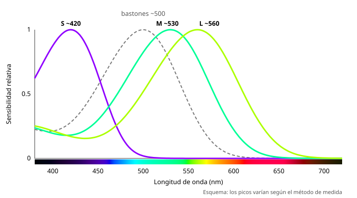

## Fundamentos {#layer-1}

La visión humana del color empieza con tres clases de conos, llamados S, M y L (de sensibilidad a longitudes de onda corta, media y larga), y se describe como visión tricromática o "trivariante" [@webvision, cap. "Color Perception", "Theories of Colour Vision"]. La **teoría tricromática (trichromatic theory)** dice que los tres tipos de cono responden mejor cada uno a un intervalo distinto de longitudes de onda [@openstax-psychology-2e, §5.3] (véase [conos y bastones](photoreceptors.md)).

La versión simplificada de la teoría: los tres "colores primarios" corresponden a los tres tipos de cono y todos los demás matices surgen de combinar su estimulación [@openstax-college-physics-2e, §26.3]. Por ejemplo, luz roja más luz verde se ve amarilla, y las tres juntas se ven blancas; la televisión en color usa puntos fosforescentes rojos, verdes y azules [@openstax-college-physics-2e, §26.3].

**Ejemplo cotidiano.** La pantalla del móvil muestra millones de colores a partir de solo tres tipos de luz. Es posible porque el ojo también tiene solo tres canales de entrada. (La mezcla de luces se desarrolla en la mezcla aditiva, otro ámbito.)

## Comprensión {#layer-2}

**Por qué tres.** Una célula con un solo tipo de pigmento solo responde a la energía que absorbe: la misma energía absorbida da la misma respuesta a cualquier longitud de onda (univarianza, atribuida a Maxwell), así que un único tipo de cono sería ciego al color. Hacen falta al menos dos tipos para comparar longitudes de onda, y tres dan la visión tricromática [@webvision, cap. "Color Vision", §2 y §8]. Según el mismo capítulo, el gen de la opsina L se duplicó, dando origen a M y a un L de mayor longitud de onda [@webvision, cap. "Color Vision", §8]. Los primates somos tricromáticos; la mayoría de los demás mamíferos son dicromáticos [@webvision, cap. "Photoreceptors", "Different types of cone photoreceptor"].

**Igualar colores.** Tres primarios pueden igualar casi cualquier color, y la igualación es lineal: un color de prueba equivale a una suma ponderada de tres primarios, y los pesos son los valores triestímulo (tristimulus values) [@webvision, cap. "Color Perception", "Colour Matches"]. La CIE define un sistema tricromático como un sistema que especifica estímulos de color por valores triestímulo basados en la igualación por mezcla aditiva de tres estímulos de referencia [@cie-e-ilv, 17-23-036, 17-23-038]. Las funciones de igualación de color (colour-matching functions) son los valores triestímulo de estímulos monocromáticos de igual flujo radiante [@cie-e-ilv, 17-23-039]. Esto convierte el color en una especificación de tres números, y es la base del [metamerismo](metamerism.md).

**Historia breve.** Young propuso en 1802 tres receptores principales y Helmholtz desarrolló la idea; Maxwell la apoyó en 1872 [@webvision, cap. "Color Perception", "Young-Helmholtz"; cap. "Color Vision", §18]. Las fechas de Helmholtz difieren entre los dos capítulos (1866 y 1852). Las pruebas fisiológicas llegaron en el siglo XX (densitometría, microespectrofotometría y genética) [@webvision, cap. "Color Perception", "Young-Helmholtz"].

**Matices y límites.**
- No hay un conjunto único de primarios: amarillo, verde y azul también sirven, y estímulos distintos pueden dar el mismo matiz [@openstax-college-physics-2e, §26.3].
- La teoría de los tres conos está bien establecida, pero es incompleta [@openstax-college-physics-2e, §26.3]: por sí sola no explica los cuatro matices únicos ni por qué los dicromáticos ven blanco y amarillo [@webvision, cap. "Color Perception", "Young-Helmholtz"]. Eso lo completan los [procesos oponentes](opponent-process.md).
- La igualación se ve afectada por el pigmento macular, la aberración cromática, la intrusión de los bastones y efectos como el desplazamiento de matiz de Bezold-Brücke [@webvision, cap. "Color Perception", "Colour Matches"].
- Muchos matices cotidianos (marrón, verde azulado, rosa) no son longitudes de onda puras [@openstax-college-physics-2e, §26.3].
- En condiciones ideales se pueden percibir al menos un millón de colores [@webvision, cap. "Color Vision", §16].

## Profesional {#layer-3}

**Tres números, pero no tres pinturas.** El hecho de que el ojo reduzca todo espectro a tres respuestas es lo que permite que pantallas y cámaras reproduzcan color con tres primarios, y es también la causa del [metamerismo](metamerism.md): espectros distintos con los mismos valores triestímulo parecen iguales [@cie-e-ilv, 17-23-006]. Aplicado al taller, esto explica que un color igualado a ojo con otros pigmentos pueda coincidir en una luz y no en otra. La relación causal con la mezcla de pigmentos requiere cuidado: la igualación tricromática describe mezcla de luces, y la mezcla de pigmentos es otro proceso (véase el ámbito de mezcla de color) [unverified].

**Variación entre observadores.** La relación entre conos L y M varía mucho entre personas [@webvision, cap. "Photoreceptors", "Densities of rods and cones in the human retina"], lo que sugiere que dos pintores con visión normal pueden no ver exactamente igual un mismo color. Esa conclusión es una inferencia y no una afirmación de las fuentes [unverified]. Berns trata la variabilidad entre observadores en su cap. 2 §F [@berns-2019].

**Lectura adicional.** Berns, cap. 2 §A "Trichromacy" y cap. 4 (observadores estándar) [@berns-2019]; Fairchild, §3.6 [@fairchild-2013].
