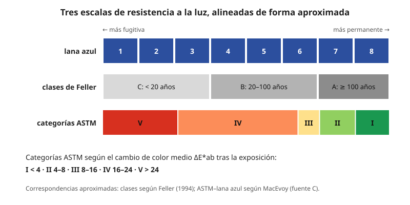

## Comprensión {#layer-2}

### Idea clave
La **resistencia a la luz (lightfastness)** es la resistencia de un color a cambiar bajo la luz; la **permanencia (permanence)** es más amplia e incluye la reacción a contaminantes, al aglutinante y a otros pigmentos [@feller-1986, Introduction, p. 13; Zinc White 3.3-3.4, pp. 173-174]. Se mide con escalas que ordenan materiales, y depende de la pintura entera, no solo del pigmento.

### Explicación
Cuando una pintura se altera, Berrie distingue tres resultados: **desvanecimiento (fading)**, **oscurecimiento (darkening)** y **decoloración (discoloration)**; los tres alteran el equilibrio tonal [@berrie-2025, p. 8]. Solo la radiación que se absorbe puede causar un cambio fotoquímico; pero lo que absorbe puede no ser el colorante visible, y una impureza puede pasar la energía [@feller-1994, p. 45]. La luz cercana al ultravioleta y la visible rara vez rompe enlaces directamente; más a menudo excita las moléculas e inicia cadenas de oxidación [@feller-1994, pp. 47, 51, 55-56].

El daño es irreversible: los fragmentos del colorante se difunden y no se recomponen [@feller-1994, p. 53]. Es proporcional a intensidad por tiempo (principio de reciprocidad: 100 lux durante 1 hora equivale a 1 lux durante 100 horas), aunque es un principio y no una ley estricta [@feller-1994, p. 53]. No existe un umbral de intensidad por debajo del cual el daño cese: la luz baja solo lo hace más lento [@feller-1994, pp. 50, 76-77]. Y es sobre todo un fenómeno de superficie: en pinturas de laca de alizarina y blanco de titanio, la zona descolorida mide solo de 4 a 40 micras [@feller-1994, Fig. 5.4, p. 59].

Qué se altera y cuánto depende de la pintura, no solo del pigmento. Las normas actuales para pigmentos de artista exigen ensayarlos en un aglutinante porque este afecta a la permanencia [@berrie-2025, p. 6]. El bermellón es I en óleo y acrílico, pero III en acuarela [@mitra-astm, p. 2]. La acuarela es en general más sensible porque el óleo y el acrílico dan algo de protección y la acuarela se aplica fina [@mitra-astm, p. 4]. La humedad acelera el desvanecimiento: seis colorantes fugitivos de acuarela en goma arábiga se desvanecieron 3,1 veces más rápido entre 25 y 65 % de humedad relativa [@feller-1994, pp. 123-124]. Y los tintes pueden comportarse de otro modo que el tono de masa (véase [tono de masa y subtono](masstone-undertone.md)).

Para hablar de ello se usan tres escalas:

- *Lana azul (blue wool).* Ocho tiras de lana teñida de 1 (la más fugitiva) a 8 (la más permanente); la clasificación de una pintura es la última referencia que aún no ha cambiado cuando cambia la pintura [@handprint-macevoy, pigmt9, "Lightfastness ratings"]. MITRA da una lectura: 1 muy mala, 2-3 mala, 4-5 regular, 6 muy buena, 7-8 excelente [@mitra-astm, p. 3].
- *Categorías ASTM I-V.* Se asignan según la diferencia de color ΔE*ab en L*a*b* medida con espectrofotómetro antes y después de la exposición. Según MITRA: I Excelente, ΔE medio menor de 4; II Muy buena, de 4 a 8; III Regular, de 8 a 16; IV Pobre, de 16 a 24; V Muy pobre, más de 24 [@mitra-astm, pp. 1-2]. Un ΔE equivale en teoría al cambio más pequeño que distingue un observador normal [@golden-justpaint, JP1, "Evaluating the Results"]. En la D4303 hay cuatro métodos de exposición acelerada que ordenan los colorantes por categorías [@mitra-astm, p. 1; @astm-d4303, página de la tienda ASTM].
- *Clases de Feller.* Clase A (excelente: 100 años o más de uso normal de museo), B (intermedia, 20-100 años) y C (inestable, grave degradación en menos de 20 años), definidas respecto a las lanas azules: aproximadamente C hasta 3, B entre 3 y 6, A por encima de 6 [@feller-1994, pp. 6-7, Table 1.1].

Qué pigmentos suelen envejecer peor es otra pregunta. Los orgánicos tienden a desvanecerse y los inorgánicos a oscurecerse o volverse grises [@handprint-macevoy, pigmt1; pigmt3]. No es una regla absoluta. Los minerales (óxidos de hierro, azul cobalto) son muy sólidos, y las quinacridonas y la ftalocianina de cobre también [@learner-2007, Croll, p. 23]. En cambio, el amarillo de cadmio, el amarillo de cromo y el bermellón son inorgánicos sensibles, y las impurezas de la fabricación suelen actuar de catalizador [@berrie-2025, pp. 10, 17]. Las lacas se prefirieron por su translucidez en óleo aunque se blanquean rápido [@berrie-2025, p. 9]; las lacas de carmín equivalen a lana azul 1-2 [@feller-1986, Carmine 3.3, pp. 264-265].

### Ejemplo
El amarillo indio muestra el peso del aglutinante. Tras 384 h en un Fade-Ometer de xenón, el cambio de color ΔE fue de 10,3 en goma arábiga, 28,2 en acrílico B-72, 34,6 en emulsión acrílica alcalina y 39,1 en emulsión vinílica ácida, frente a 20,8 del control de alizarina [@feller-1986, Indian Yellow 3.3, Table 2, p. 23].

Los efectos pueden llegar a la imagen: un amarillo que se desvanece cambia los verdes hechos con él, y el tapizado de Greuze pasó de verde a azul porque la laca amarilla se desvaneció [@berrie-2025, p. 18].

### Errores frecuentes
1. *"Una clasificación predice los años."* Solo ordena materiales entre sí bajo las condiciones del ensayo; cualquier estimación de años es una conjetura razonada [@feller-1994, p. 8; @golden-justpaint, JP1, comentarios del autor].
2. *"El pigmento tiene un único valor."* Depende del aglutinante, del tinte y de la marca.
3. *"Todo lo mineral dura."* El cadmio antiguo se ennegrecía por azufre libre e impurezas, y se atribuye su mala fama a las impurezas más que al CdS [@feller-1986, Cadmium 3.3, pp. 70-71].

### Las fuentes discrepan
- **Categoría II de la ASTM.** MITRA la llama "Muy buena" (ΔE de 4 a 8); Golden da los tres primeros tramos como I "Excellent" (1-4), II "Good" (4-8) y III "Fair" (8-16) [@mitra-astm, pp. 1-2; @golden-justpaint, JP1, "Evaluating the Results"]. Los números coinciden y cambia el nombre.
- **Escala de referencia de Feller.** La tabla 1.1 rotula la escala como "BS1006" y el texto como "ISO R105"; el libro las trata como la misma escala sin explicarlo [@feller-1994, p. 6; Table 1.1, p. 7].
- **Correspondencia ASTM-lanas azules.** MacEvoy lista una (I superior 7,1-8,0; II buena 6,1-7,0; III regular 5,5-6,0; IV inferior 2,2-5,4; V fugitiva 0-2,1) [@handprint-macevoy, pigmt9]. Es una fuente de menor fiabilidad y esa lista es suya, no de las normas.

### Para seguir
La capa 3 explica cómo se ensaya hoy, por qué desconfiar de una cifra y qué decisiones de taller se derivan. La clasificación se busca por el código de [nombres Colour Index](colour-index-names.md).

## Profesional {#layer-3}

### Idea clave
Una clasificación es una herramienta para ordenar pinturas, no una promesa de años. Para obra pensada para durar se piden las mejores categorías, se verifican marca y medio, y se evitan mezclas problemáticas [@golden-justpaint, JP1; @mitra-astm, p. 2].

### Explicación
La ASTM D4303 clasifica por categorías; Golden detalla su práctica: siete muestras idénticas de cada tinte (una sin exponer, tres al aire libre y tres en cámara acelerada), tintes con blanco hasta un 35-45 % de reflectancia (la acuarela se diluye con agua), color medido en tres puntos antes y después, ΔE en CIELAB [@golden-justpaint, JP1, "Sample Preparation", "Number of Samples"]. La exposición exterior es bajo cristal a 45° en Florida o Arizona, de octubre a marzo, hasta 1260 MJ/m² (unos tres meses), porque esa dosis se correspondía con el desvanecimiento de la alizarina y la rosa madder en pinturas centenarias; la cámara de xenón da la misma dosis de UV en 410 horas [@golden-justpaint, JP1, "Outdoor and Accelerated Indoor Xenon Light Exposure"]. Golden añade tonos de masa y tintes más pálidos, 20:1, que no cuentan para la clasificación ASTM [@golden-justpaint, JP1, "Number of Samples"].

Ese tipo de ensayo tiene límites. La correlación con el envejecimiento natural suele empeorar cuanto mayor es la aceleración; se consideran aceptables unas 5-10 veces y no más de 3 veces el UV solar [@feller-1994, p. 97]. No hay un factor fijo para un aparato [@feller-1994, p. 98]. Un ensayo severo no demuestra por sí solo el fallo en condiciones suaves, y la recomendación del autor es usar varios niveles de severidad con controles [@feller-1994, p. 100]. Los resultados varían mucho entre muestras idénticas y es preferible hablar de la fracción que sobrevive a un tiempo dado, no de un tiempo medio [@feller-1994, p. 9]. Tampoco los materiales de referencia son fijos: el control de laca de alizarina con blanco de titanio vale como estándar secundario porque varía con el fabricante [@feller-1994, p. 42]. Las lanas azules también envejecen según el filtro de luz utilizado y el sustrato [@feller-1994, pp. 92, 176].

Para verificar la cifra del fabricante hay pruebas caseras; la de laboratorio es más precisa, pero la casera sirve para eso [@mitra-astm, pp. 2-3]. MITRA propone exponer muestras a la luz diurna durante meses con un control oscuro, o usar tarjetas de lana azul junto a la muestra y comparar con el escalón de lana que cambia primero [@mitra-astm, p. 3]. Golden sugiere una ventana orientada al sur frente a un cajón de control, comparando a 3, 6 y 12 meses [@golden-justpaint, JP1, comentarios]. MacEvoy propone una prueba rápida con tintes 1:8 bajo cristal, la mitad tapados con cinta de aluminio, cuatro meses en una ventana sur [@handprint-macevoy, pigmt9]. Golden advierte de que los fluorescentes desvanecen deprisa, sobre todo en veladuras finas, y que el UV es el factor más dañino [@golden-justpaint, JP1, comentarios del autor].

Con esos datos, las decisiones de taller son estas:

1. *Qué rating pedir.* Para obra pensada para durar, categoría I o II (en el ejemplo de tres categorías de MITRA, solo la I está sugerida para exterior [@mitra-astm, p. 2]). Verifica la marca, el medio y que la clasificación se refiera al producto y no a un pigmento genérico (véase [nombres Colour Index](colour-index-names.md)).
2. *Los medios.* En óleo se emplea cártamo en blancos para limitar el amarilleo [@learner-2007, Learner, p. 8]; el acrílico es el medio con menos deterioro como grupo en cincuenta años según Golden [@learner-2007, Hayes, Golden and Smith, pp. 62-63].
3. *La exposición.* Reducir luz, evitar el UV, humedad y calor, y los halogenuros [@berrie-2025, pp. 25-26]. Los límites de exposición de museo en luxes-hora no son cifras sin daño, sino de cambio tolerable (el de Krochmann, por ejemplo, es un ΔE apenas perceptible de 1) [@feller-1994, pp. 50, 76-77].
4. *Aceptar el cambio.* Casi todos los pigmentos acaban alterándose o desapareciendo; el ritmo es constante pero la magnitud se frena de forma exponencial al quedar menos material, así que las obras nuevas cambian visiblemente y las viejas siguen cambiando de forma imperceptible [@berrie-2025, pp. 24-25]. Los pintores históricos asumieron compromisos: no había sustituto para las lacas, apreciadas por su translucidez, y el verdigrís, que se oscurece, era indispensable en mezclas verdes [@berrie-2025, p. 9]. Las pruebas de color de Runge (1810) sufrieron alteraciones de pigmento que arruinaron su efecto [@berrie-2025, pp. 24-25].

La preocupación es antigua: el informe de Russell y Abney (1888) clasificó pigmentos por permanencia relativa, y las listas de Church (1890) y de la Sociedad alemana para la Promoción de la Técnica Pictórica Racional (1872) orientaron a fabricantes y artistas [@berrie-2025, pp. 5-6].

### Ejemplo
Algunas mezclas son problemáticas aunque cada pintura sea sólida por separado:
- Los blancos de zinc y de titanio y el sulfuro de cadmio son fotosensibles y pueden generar peróxido de hidrógeno que ataca a lo que tienen al lado [@feller-1994, Appendix B, p. 180].
- Eibner vio que el blanco de zinc acelera el desvanecimiento de algunos orgánicos, como el azul de Prusia, aunque en ensayos del Instituto Doerner, en óleo, el azul de Prusia con blanco de plomo se desvaneció más y con zinc menos [@feller-1986, Zinc White 3.3-3.4, pp. 173-174].
- El cadmio se ennegrece en contacto con plomo o cobre [@feller-1986, Cadmium 3.4, pp. 72-73].
- Los violetas hechos con una laca roja y un azul viran hacia el azul cuando la laca se desvanece [@berrie-2025, p. 20].

### Las fuentes discrepan
Sobre qué fiarse de la clasificación, las posturas difieren. La ASTM permite que un fabricante asigne la clasificación de una tabla de pigmentos ensayados hace décadas, a veces de una sola marca o fuente; Golden sostiene (es parte interesada) que eso es insuficiente porque la calidad del pigmento varía, y por eso ensaya sus productos con regularidad [@golden-justpaint, JP1, "Going Beyond What Is Required"]. Algunos fabricantes emplean escalas propias o la palabra "permanencia" sin equivaler a ASTM [@mitra-astm, p. 2].

Sobre la dilución, MacEvoy critica que el nivel de la ASTM (alrededor del 40 % de reflectancia, calculado) no se parece al de la práctica pictórica, y opina que III e inferiores no son adecuadas para el arte (opinión suya) [@handprint-macevoy, pigmt9]. Golden defiende que los pigmentos son más vulnerables en tinte [@golden-justpaint, JP1].

### Para seguir
[Diseñar una paleta limitada](limited-palette.md) aplica estos criterios para elegir un conjunto de pinturas duraderas y compatibles.
