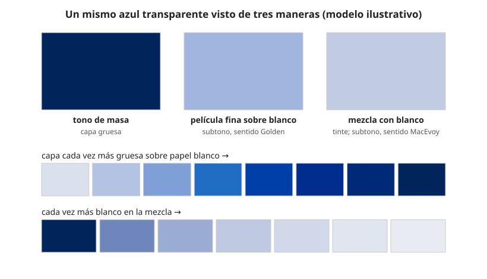

## Comprensión {#layer-2}

### Idea clave
Una misma pintura se ve distinta según se aplique espesa, fina o mezclada con blanco. El **tono de masa (masstone)** es su color a plena concentración [@feller-1986, Appendix, p. 299; Indian Yellow 3.1, p. 21]; el **subtono (undertone)** se usa en dos sentidos distintos según quién escriba.

### Explicación
Golden precisa el tono de masa como el color de la pintura aplicada con espesor suficiente para ocultar lo que hay debajo; el azul ftalo espeso parece casi negro [@golden-justpaint, B, "Masstone"]. MacEvoy lo mide justo debajo de las líneas del ensayo de transparencia y lo toma para el ángulo de matiz y el rango de valor, porque se acerca a la concentración típica de la pintura y suele tener el croma más alto [@handprint-macevoy, pigmt8, "Masstone"].

El color cambia al diluir o mezclar porque, en una capa gruesa, la pintura oculta el fondo, y en una fina deja pasar parte de la luz [@kubelka-munk-1931, pp. 3-5, §§2-3]. Los pigmentos transparentes, como las quinacridonas y los ftalos, pueden tener un subtono notablemente distinto de su tono de masa [@golden-justpaint, B, "Undertone"].

El tono de masa tampoco es una propiedad del pigmento solo. En los cadmios, el rango de color depende sobre todo del tamaño de partícula: las más finas dan tonos más claros [@feller-1986, Cadmium 3.1, p. 70]. En la laca de carmín cambia con el aglutinante (cola animal frente a óleo) [@feller-1986, Carmine 3.1, fig. 8, p. 265]. Y si la película no oculta del todo, el color depende del fondo: las pruebas de carmín sobre papel blanco con cobertura incompleta varían del rojo púrpura al rojo intenso según el matiz [@feller-1986, Carmine 3.1, pp. 263-264].

### Ejemplo
Un azul ftalo en la paleta se comporta como tres colores. En capa gruesa parece casi negro (tono de masa); extendido fino sobre blanco o adelgazado con medio muestra un azul claro (subtono en el sentido de película fina); y mezclado con blanco da un tinte [@golden-justpaint, B, "Masstone"; "Undertone"]. Quien juzgue la pintura solo por el tubo se equivoca de color.

### Errores frecuentes
1. *"El color del tubo es el color de la pintura."* Solo es el tono de masa, y puede ser engañoso (el azul ftalo).
2. *"Subtono significa una sola cosa."* Ya se ha visto que no; véase abajo.
3. *"Si el tono de masa es sólido, el tinte también."* No necesariamente; la capa 3 lo desarrolla.

### Las fuentes discrepan
El subtono significa dos cosas:

1. *Película fina.* Para Golden, es lo que se ve cuando la pintura se extiende o se raspa muy fina sobre blanco, o se adelgaza con medio o agua [@golden-justpaint, B, "Undertone"].
2. *Tinte con blanco o lavado diluido.* Para MacEvoy, es el color de un lavado diluido (un tinte); el *desplazamiento de matiz (hue shift)* es el ángulo de matiz del subtono menos el del tono de masa en el plano CIELAB, positivo si va en sentido antihorario, y da valores como +13 para la siena natural de Daniel Smith o +5 para la sombra natural de W&N [@handprint-macevoy, pigmt8, "Undertone"; "Ratings examples"].

Feller usa "tono de masa" y describe los tintes como mezclas con blanco, pero no emplea la palabra "subtono" en este sentido (en los capítulos leídos) [@feller-1986, Appendix, p. 299; Indian Yellow 3.1, p. 21]. Mayer tiene en su índice una sección sobre "mass tone and undertone" que no se pudo consultar [@mayer-1991, índice, cap. 2]. Cuando leas "subtono" en una ficha, pregúntate cuál de los dos sentidos usa. Las dos situaciones físicas no son idénticas: diluir con medio transparente deja a la luz atravesar el color y rebotar en el fondo, y mezclar con blanco añade partículas que dispersan [unverified].

### Para seguir
[Resistencia a la luz y permanencia](lightfastness.md) muestra por qué distinguir tono de masa y tinte importa para la solidez. La capa 3 desarrolla esa distinción y cómo hacer la muestra completa.

## Profesional {#layer-3}

### Idea clave
La distinción importa sobre todo para la solidez: las clasificaciones ASTM de resistencia a la luz se hacen sobre el tinte, y el tono de masa puede comportarse de otro modo [@golden-justpaint, JP1, "Sample Preparation"].

### Explicación
Las clasificaciones ASTM se hacen siempre sobre el tinte, no sobre el tono de masa, porque los pigmentos suelen ser más vulnerables en un tinte [@golden-justpaint, JP1, "Sample Preparation"]. Pero el comportamiento en masa puede ser distinto, y por eso Golden añade tonos de masa a sus pruebas para un pigmento, proveedor o fórmula nuevos [@golden-justpaint, JP1, "Number of Samples"].

Hacer la muestra completa permite verlo en la propia pintura:
1. Haz una tira que vaya del tono de masa al tinte, sobre una banda negra y una blanca (véase [transparencia y opacidad](transparency-opacity.md)), como hace MacEvoy en sus ensayos de resistencia a la luz [@handprint-macevoy, pigmt9].
2. Deja secar: la reflectancia cambia con el secado y con el espesor [@handprint-macevoy, color18a, "Substance Uncertainty"]. El acrílico seco puede oscurecerse con colores transparentes [@golden-justpaint, B].
3. Anota qué sentido de "subtono" usa la ficha del fabricante.

Para comunicar el color de una muestra, Feller expresa los colores en tono de masa y en mezclas con blanco mediante el Lenguaje Universal del Color (ISCC-NBS), que divide el espacio Munsell en 267 bloques con modificadores de claridad y saturación; añadir blanco lleva de "rojo fuerte" hacia "rosa intenso" [@feller-1986, Appendix, pp. 299-300]. Es un modo de comunicar tanto el tono de masa como el tinte, y se relaciona con [el sistema Munsell](../../color-attributes/concepts/munsell-system.md) y [CIELAB para pintores](../../color-attributes/concepts/cielab-basics.md). Véase también [resistencia a la luz y permanencia](lightfastness.md).

### Ejemplo
Golden y MacEvoy documentan casos en que masa y tinte divergen. En el ensayo exterior de Golden, el rojo pirrol mantuvo el tono de masa mientras el tinte se aclaraba, y el amarillo hansa medio se oscureció en masa pero se blanqueó en tinte [@golden-justpaint, JP1, "Number of Samples" y pie de foto]. MacEvoy observó que PBr7, PR101, PR108, PY35, PY42 y PY184 se alteran en muestras concentradas aunque parecen sólidos diluidos, y que el aureolín se vuelve gris en masa y se desvanece en tintes [@handprint-macevoy, pigmt9].

### Las fuentes discrepan
MacEvoy sostiene (opinión) que las pinturas diluidas suelen ser menos sólidas, y califica cada pintura con dos números, tinte y plena concentración [@handprint-macevoy, pigmt9; pigmt8, "Lightfastness"]. Golden defiende que los pigmentos son más vulnerables en tinte [@golden-justpaint, JP1, "Sample Preparation"]. Conviene tener presentes las dos posturas al leer una ficha.

### Para seguir
[Resistencia a la luz y permanencia](lightfastness.md) amplía cómo se ensaya y se clasifica la solidez. [Diseñar una paleta limitada](limited-palette.md) aplica estos criterios a la elección de pinturas.
