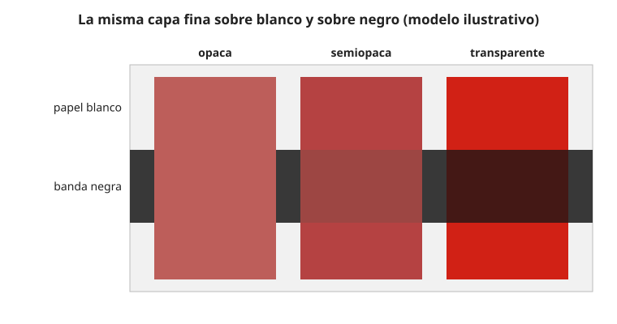

## Fundamentos {#layer-1}

### Idea clave
Una pintura **opaca (opaque)** tapa lo que hay debajo; una **transparente (transparent)** deja ver el fondo a su través. Esa propiedad se llama también **poder cubriente (hiding power)** [@kubelka-munk-1931, p. 1; pp. 6-7, §5].

### Explicación
La cobertura decide cómo se pinta: las pinturas opacas sirven para cubrir y corregir; las transparentes, para veladuras en las que el color de abajo sigue contando [@golden-justpaint, B]. Si un artista trabajó con pinturas esencialmente opacas o transparentes es incluso uno de los rasgos que los estudios de pigmentos buscan describir de su manera de trabajar [@feller-1986, Introduction, p. 12].

Para comprobarla, en la industria de pinturas se aplica la pintura sobre un fondo mitad blanco y mitad negro: si el límite entre las dos mitades no se ve, la cobertura es completa; si se ve, es incompleta [@feller-1986, Carmine 3.1, p. 263]. Golden hace sus muestras con extensiones (*drawdowns*) de espesor fijo, 10 mils para acrílicos y 6 para óleos [@golden-justpaint, JP1, "Sample Preparation"]. No existe una norma industrial para medir opacidad: las clasificaciones son relativas, entre muestras preparadas igual [@golden-justpaint, A, "Opacity / Transparency"].

La transparencia no es una cualidad del pigmento solo: depende también del aglutinante y de [pigmento, aglutinante y medio](paint-composition.md).

### Ejemplo
MacEvoy da como transparentes el amarillo hansa claro, el magenta de quinacridona, el ultramar y el azul ftalo, y como opacos el amarillo y el rojo de cadmio, el cerúleo y el blanco chino [@handprint-macevoy, palette2, "Example palettes"].

### Errores frecuentes
- *"Una pintura transparente siempre se ve transparente."* Puede parecer opaca recién salida del tubo (el azul ftalo en capa gruesa); se ve la transparencia al aplicarla fina o con medio [@golden-justpaint, A].
- *"Las pinturas opacas siempre tapan."* Casi cualquier pintura se vuelve más transparente al diluirse, incluso las opacas [@handprint-macevoy, pigmt1, "Transparency"].

### Para seguir
[Poder tintóreo](tinting-strength.md) y [tono de masa y subtono](masstone-undertone.md) (capa 2) explican otras propiedades que cambian con el espesor. La capa 2 de este concepto explica por qué un pigmento cubre y por qué el medio importa.

## Comprensión {#layer-2}

### Idea clave
Un pigmento cubre porque dispersa la luz más de lo que la absorbe, y la dispersión crece con la diferencia de índice de refracción entre pigmento y aglutinante. Por eso el mismo pigmento puede cubrir de forma distinta en medios distintos [@learner-2007, Croll, pp. 21-22; @feller-1986, Indian Yellow 3.2, p. 22].

### Explicación
Los pigmentos blancos funcionan dispersando la luz, no absorbiéndola, y la dispersión crece con la diferencia de índice de refracción entre pigmento y aglutinante (Fresnel). Croll da: dióxido de titanio 2,76, blanco de plomo 2,0, óxido de zinc 2,0, litopón 1,84, cargas 1,56 y polímero 1,5; por eso el dióxido de titanio rutilo se impuso como blanco y cubre bien en capas finas [@learner-2007, Croll, pp. 21-22]. Las cargas, con índice casi igual al del aglutinante, dispersan muy poco [@learner-2007, Croll, pp. 21-23]. Es el mismo proceso de absorber y dispersar que se vio en [cómo se mezclan de verdad los pigmentos](../../color-mixing/concepts/pigment-mixing-behavior.md).

El modelo de Kubelka y Munk lo formaliza. Una capa se describe por su constante de absorción *s* y de dispersión *r*, y el espesor *X* entra solo en el producto *rX*; con ello se calcula cuánto espesor hace falta para cubrir un fondo [@kubelka-munk-1931, pp. 2-5, §§1-3]. Una capa que solo absorbe (*r* = 0, una veladura pura) tiene la reflectancia del fondo atenuada exponencialmente con el espesor, y por tanto no cubre nunca el fondo en el sentido estricto de contraste entre fondo blanco y negro [@kubelka-munk-1931, pp. 6-7, §5; p. 13, §8].

El modelo da un resultado menos intuitivo: un blanco ideal es el que peor cubre por unidad de pintura. Con los parámetros del artículo (S = 0,01, *r* = 1), el poder cubriente es 10 para H∞ = 1,00 y 124 para H∞ = 0,80, y una pintura de H∞ = 0,8 sigue pareciendo blanca (el blanco de zinc ordinario ronda H∞ ≈ 0,75) [@kubelka-munk-1931, p. 9, §7, Fig. 3 y notas 12-13]. Además el resultado es muy sensible al umbral visual del observador, lo que explica la dispersión de medidas visuales [@kubelka-munk-1931, p. 10, §7].

En pigmentos reales, el tamaño de partícula se suma al índice. En los cadmios, el índice de refracción alto y el tamaño de partícula pequeño dan buena cobertura, y los tonos más claros son algo más opacos por partículas más pequeñas; las versiones de litopón cubren mucho peor porque el sulfato de bario tiene índice bajo [@feller-1986, Cadmium 3.2, p. 71]. Golden atribuye la excelente transparencia de quinacridonas, hansa y ftalos a su tamaño de partícula pequeño [@golden-justpaint, C]. Dice también que los pigmentos orgánicos transmiten la luz casi sin perturbarla, los inorgánicos tienen cobertura moderada o alta y el blanco de zinc es la excepción [@golden-justpaint, B, "Transparency and Opacity"]. MacEvoy añade que partículas más pequeñas y mayor poder tintóreo permiten aplicar la pintura más fina y por tanto más transparente [@handprint-macevoy, pigmt1, "Transparency"].

Como lo que importa es el contraste de índices con el vehículo, el medio cambia la opacidad. El mismo pigmento puede ser translúcido en óleo y opaco en aglutinante acuoso; la razón principal es esa diferencia de índice [@feller-1986, Indian Yellow 3.2, p. 22; Carmine 3.2, p. 264]. El blanco de zinc y el de plomo tienen índices parecidos, pero el de zinc cubre menos en óleo sobre todo porque necesita más aceite y tiene menor concentración volumétrica de pigmento [@feller-1986, Zinc White 3.2 and 3.6, pp. 172-175]. El blanco de titanio sustituyó al de zinc en la paleta por su mayor poder cubriente [@feller-1986, Zinc White 2.2, p. 172].

La concentración de pigmento actúa por otra vía. Por encima de la concentración volumétrica crítica (CPVC) aparecen huecos de aire que dispersan luz y dan opacidad barata, pero debilitan la película; con partículas de dióxido de titanio muy apretadas, cada una dispersa menos [@learner-2007, Croll, pp. 21-24].

### Ejemplo
Tres casos del mismo efecto, en tres pinturas históricas:

- El amarillo indio tiene partículas transparentes con índice cercano al de la resina, que parecen una mancha en el vehículo [@feller-1986, Indian Yellow 3.2, p. 22].
- El carmín es translúcido en barniz u óleo y razonablemente opaco en temple y cola [@feller-1986, Carmine 3.2, p. 264].
- El sulfato de bario cubre poco en óleo, por eso se empleó primero en acuarela [@feller-1986, Barium Sulfate 3.2-3.3, p. 50].

El tratado de Feller no ofrece una fórmula general para predecir estos casos [@feller-1986, Indian Yellow 3.2, p. 22].

### Errores frecuentes
- *"Transparente es lo mismo que pálido o que mancha."* Son propiedades distintas; MacEvoy distingue el teñido del papel, un efecto de superficie, del poder tintóreo, un efecto en el líquido [@handprint-macevoy, palette2, "Criteria"; pigmt8, "Tinting strength"].
- *"Lo orgánico siempre es transparente."* Golden lo presenta como regla general, con el blanco de zinc como excepción entre los inorgánicos, y avisa de que la transparencia solo se aprecia aplicando la pintura fina [@golden-justpaint, B, "Transparency and Opacity"; A].

### Las fuentes discrepan
MacEvoy (opinión) dice que la "obsesión por la transparencia" está inflada, porque casi ningún pigmento moderno es tan transparente como se supone, y rechaza la regla de no mezclar pigmentos teñidores y opacos [@handprint-macevoy, palette2, "Criteria"].

### Para seguir
La capa 3 trata cómo medir y comparar la cobertura, las veladuras y cómo cambia la opacidad con el tiempo. Antes, [tono de masa y subtono](masstone-undertone.md) muestra cómo cambia el color según el espesor.

## Profesional {#layer-3}

### Idea clave
Como no hay norma de opacidad, cada fabricante usa su escala y la comparación entre marcas exige mirar el método. Para decidir hay que probar las propias pinturas sobre una banda negra y una blanca, y recordar que la opacidad cambia con el tiempo [@golden-justpaint, A; JP1, "Sample Preparation"].

### Explicación
Para tus propias pinturas, haz una tira con banda negra y banda blanca, extiende cada pintura en la misma capa y compara (véase [tono de masa y subtono](masstone-undertone.md)). Antes de comparar cifras de dos marcas, mira qué escala y qué espesor usó cada una [@golden-justpaint, A; JP1, "Sample Preparation"].

En las veladuras, las lacas se apreciaban por su translucidez en óleo [@berrie-2025, pp. 9, 18; @feller-1986, Carmine 3.2, p. 264]. MacEvoy recomienda glasear de claro a oscuro, de cálido a frío y de opaco a transparente [@handprint-macevoy, mix, "Wet-in-wet and glazing"]. Van Gogh notó que las veladuras de color transparente pueden "hundirse" y desaparecer si se aplican sobre pintura insuficientemente seca (observación anecdótica) [@berrie-2025, p. 9]. Para el efecto óptico de las veladuras, véase [mezcla óptica](../../color-mixing/concepts/optical-mixing.md).

La cobertura tampoco es fija. Cuando el plomo se transforma en jabones, la pintura se vuelve cada vez más translúcida y pierde color [@berrie-2025, p. 7]. Una pintura que cubría poco en óleo, como el sulfato de bario, pasa con los años a ser aún más translúcida (pentimenti) y tiende a pulverizarse en superficie (*chalking*) [@feller-1986, Barium Sulfate 3.2-3.3, p. 50]. Por eso la capa subyacente puede reaparecer.

### Ejemplo
Se quiere un tinte claro y se duda entre dos blancos.
1. Para tintes claros pero transparentes, el blanco de zinc es una opción; para cubrir, el de titanio, que aumenta la cobertura mientras que el de zinc añade poco (véase [aclarar, oscurecer y agrisar](../../color-mixing/concepts/tints-shades-tones.md)) [@golden-justpaint, B].
2. Si se mezcla una pintura opaca con una transparente, la cobertura debería ser intermedia [unverified].
3. Si el medio es acrílico con colores transparentes, que secan más oscuros, se juzga la muestra seca [@golden-justpaint, B].

### Las fuentes discrepan
Las escalas no coinciden entre sí. Las gráficas de Golden numeran de 1 (la más opaca) a 8 (la más transparente), con las etiquetas opaco, semiopaco, semitransparente y transparente [@golden-justpaint, D]. MacEvoy califica la transparencia por el poder cubriente del tono de masa sobre líneas negras en papel blanco, en una escala 0-4 [@handprint-macevoy, palette2, "Criteria"; pigmt8, "Ratings"]. Son escalas propias de cada autor y no se pueden comparar directamente.

### Para seguir
[Resistencia a la luz y permanencia](lightfastness.md) (capa 2) trata otro cambio de las pinturas con el tiempo. [Diseñar una paleta limitada](limited-palette.md) combina opacas y transparentes al elegir pinturas.
