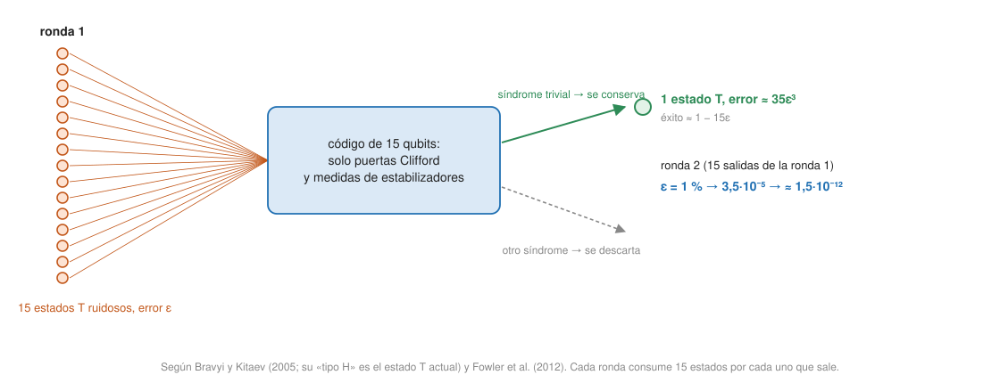

- Se asumen [el código de superficie](surface-code.md) y [los conjuntos universales de puertas](../../qubits-and-circuits/concepts/universal-gate-sets.md) (Clifford+T). Este concepto empieza en la capa profesional.

## Profesional {#layer-3}

**El problema.** Con un qubit lógico guardado en un código, falta poder *computar* con él. Decodificar, aplicar la puerta y volver a codificar deja una ventana sin protección [@de-wolf-2026, §21.5, p. 199 [187]]. Hace falta aplicar la puerta *sobre los datos codificados*, de manera que un fallo en un componente no dañe más qubits de los que el código puede corregir. Watrous formula el diseño: cada preparación, puerta y medida se sustituye por un *gadget* que actúa sobre los qubits físicos de un código, los qubits lógicos nunca quedan expuestos sin protección, y la corrección de errores se aplica repetida y en paralelo [@watrous-2025, L16.1, PDF pp. 474-475].

**Puertas transversales.** Un gadget *transversal (transversal)* es un producto tensorial de operaciones (un circuito de profundidad uno) en el que cada una actúa sobre una sola posición dentro de cada bloque. Las puertas transversales de un qubit no propagan errores; las de dos qubits pueden propagar errores *entre* bloques pero nunca *dentro* de uno, así que un error por bloque sigue siendo corregible [@watrous-2025, L16.2, PDF pp. 477, 479-480]. De Wolf lo ilustra con la CNOT del código de Steane: dos bloques con un error en total quedan con a lo sumo uno por bloque, mientras que un bloque con dos errores no sería corregible [@de-wolf-2026, §21.5, p. 200 [188]]. Ejemplos:

- La CNOT qubit a qubit es transversal en todo código CSS; las puertas de Pauli son transversales en cualquier código estabilizador [@watrous-2025, L16.2, PDF pp. 478-479].
- El código de Steane (y todo código de color) tiene transversales todas las puertas de Clifford: `H` en los 7 qubits y `S†` en los 7 son la `H` y la `S` lógicas [@watrous-2025, L16.2, PDF pp. 478-479].
- En el código `[[8,3,2]]` son transversales `CCZ`, `CZ` y `Z` (mediante rotaciones físicas `T` y `S`) y las CNOT entre bloques; no hay `H` transversal [@bluvstein-2024, pp. 5-6].
- `T` no es transversal en el código de Steane, aunque otros códigos sí lo permiten [@watrous-2025, L16.2, PDF p. 480].

**El teorema que lo limita (Eastin-Knill).** Para cualquier código de distancia al menos 2, las puertas lógicas que se pueden implementar de forma transversal generan un conjunto discreto (salvo fase) y por tanto no universal. La demostración usa grupos de Lie y se omite; la intuición es que una familia continua de operaciones transversales se aproximaría por Paulis de peso bajo, que el código detecta como errores [@watrous-2025, L16.2, PDF p. 480]. Bluvstein y colaboradores lo resumen: ningún código implementa un conjunto universal de forma transversal; los códigos 3D dan puertas no Clifford transversales pero pierden la `H` transversal [@bluvstein-2024, p. 5]. La salida por la que se opta casi siempre es completar con una puerta no Clifford por otra vía.

**Clifford fáciles, `T` difícil.** Las puertas de Clifford (`H`, `S`, CNOT) no son universales y, sobre entradas estabilizadoras, son simulables clásicamente (Gottesman-Knill); añadiendo una sola puerta no Clifford, `T = diag(1, e^{iπ/4})`, se obtiene un conjunto universal [@de-wolf-2026, §20.4, p. 188 [176]; @watrous-2025, L14.3, PDF pp. 428-429]. En el entorno de corrección, las puertas de Clifford suelen ser fáciles y las no Clifford como `T`, difíciles [@de-wolf-2026, §20.4, pp. 188-189 [176-177]]. En el código de superficie, `X` y `Z` lógicas se aplican "en software" (se anotan en el marco de Pauli) y el resto de las Clifford se hacen por trenzado o por cirugía de red (ver [código de superficie](surface-code.md)) [@fowler-2012, p. 18, nota 16; @gidney-2025, §3.2, p. 18]. El código de superficie 2D no admite fácilmente puertas no Clifford y requiere técnicas caras [@bluvstein-2024, pp. 4-5].

**Estados mágicos y teleportación de puertas.** La puerta `T` se puede fabricar con puertas de Clifford, una copia del estado `T|+⟩ = (|0⟩ + e^{iπ/4}|1⟩)/√2`, una medida en la base estándar y una corrección `S` controlada clásicamente: la teleportación de la puerta [@watrous-2025, L16.2, PDF pp. 481-482; @de-wolf-2026, §20.4, p. 189 [177]]. Con `S|+⟩` y una corrección `Z` se hace una puerta `S` [@watrous-2025, L16.2, PDF pp. 481-482]. Ver [teleportación cuántica](../../qubits-and-circuits/concepts/quantum-teleportation.md). La ventaja es que el estado mágico se prepara aparte del cálculo, así que sus errores no se propagan a él, y si el resto de los gadgets de Clifford son tolerantes a fallos, también lo es la puerta `T` [@watrous-2025, L16.2, PDF p. 482]. El coste de las `T` pasa a ser el de producir muchas copias de `|T⟩`, de antemano o en una "fábrica de estados mágicos" (*magic-state factory*) [@de-wolf-2026, §20.4, p. 189 [177]].

En el código de superficie de Fowler: la puerta `S` usa un auxiliar `|Y_L⟩ = (|g⟩ + i|e⟩)/√2` con 2 CNOT y 2 Hadamard; la `T` usa `|A_L⟩ = (|g⟩ + e^{iπ/4}|e⟩)/√2` con una CNOT y una medida `Z` y es probabilística: la mitad de las veces da `T` y la otra `T†`, que una `S` corrige [@fowler-2012, pp. 34-36, Figs. 29-30]. Cada `T` consume un `|A_L⟩` destilado [@fowler-2012, App. M, p. 52]. La inyección de estados ("qubit corto", con una cadena `X_L` de un solo qubit de datos) permite aplicar un `R_z(θ)` arbitrario a ese qubit, pero el estado inyectado es impreciso y el control clásico por sí solo no baja de unos `10⁻¹⁴`; hay que destilar [@fowler-2012, p. 37, Fig. 31, App. K].

**Destilación de estados mágicos (*magic state distillation*).** Es un procedimiento que consume varias copias ruidosas de un estado y, usando solo operaciones ideales de Clifford y Pauli, entrega una de más fidelidad; funciona solo si la fidelidad inicial supera un umbral, y por debajo converge al estado maximamente mezclado [@bravyi-kitaev-2005, §I, p. 3]. Sobre qubits codificados se necesita un estado mágico codificado: el destilador mide todos los bloques de salida salvo uno y se queda con el restante si todos los resultados fueron `0` (si no, se reinicia) [@watrous-2025, L16.2, PDF pp. 483-484]. A diferencia de la corrección de errores, la destilación solo *detecta* errores y descarta los intentos fallidos, y el síndrome se mide sobre un estado producto, lo que permite tolerar un ruido mucho mayor [@bravyi-kitaev-2005, §V, p. 6]. El destilador típico es el codificador de un código estabilizador ejecutado al revés, que solo necesita puertas de Clifford [@watrous-2025, L16.2, PDF p. 484].

*Una aclaración de nombres.* Bravyi y Kitaev (2005) definen dos familias de estados mágicos y las llaman "tipo H" (dirección de Bloch `(x+z)/√2`) y "tipo T" (dirección `(x+y+z)/√3`). Sus etiquetas están invertidas respecto al uso actual: su "tipo H" es el estado que da, tras operaciones de Clifford, la puerta de fase de ángulo `π/4`, que hoy se llama puerta `T`, y se destila con el código de 15 qubits; su "tipo T" da una puerta de fase de ángulo `π/6` [@bravyi-kitaev-2005, Def. 1, §I, p. 3; §III, p. 5; §VI]. En este texto se usan los nombres actuales: el *estado `T`* es el de la puerta `T`, y el protocolo de "15 a 1" es el que destila ese estado.

| Protocolo | Entrada | Error de salida | Probabilidad de éxito | Umbral de entrada |
|---|---|---|---|---|
| 15 a 1 (código de 15 qubits tipo Reed-Muller; estado `T`) | 15 copias con error `ε` | `≈ 35 ε³` | `(1 + 15(1−2ε)⁸)/16`, cercano a 1; rendimiento ≈ 1/15 | punto fijo `ε₀ ≈ 0,141` (ec. 37); el teorema 3 da además la condición de fidelidad > ≈ 0,927 (dos formas de enunciarlo en el artículo; no las comparamos aquí) |
| 5 a 1 (código de 5 qubits; el "tipo T" de 2005, puerta `π/6`) | 5 copias con error `ε` | `≈ 5 ε²` | ≈ 1/6 | `ε ≈ 0,173` (fidelidad > ≈ 0,910) |

[@bravyi-kitaev-2005, pp. 6-9, 13]. El código de 15 qubits tiene una operación no Clifford transversal que actúa como la misma operación sobre el qubit lógico, y por eso encaja con el estado `T` [@bravyi-kitaev-2005, §I p. 4; §VI p. 11]. Fowler, en un lenguaje de código de superficie, da cifras parecidas: para `|A_L⟩` (circuito de Reed-Muller de 15 qubits), error de entrada `p` → `≈ 35 p³`, con éxito `1 − 15p`; para `|Y_L⟩` (código de Steane de 7 qubits), `≈ 7 p³` con éxito `1 − 7p` [@fowler-2012, pp. 37-39].

*Una cuenta con números (leading order).* Con error de entrada `p = 1 %`: una ronda de 15 a 1 da `35 · (0,01)³ = 3,5·10⁻⁵` y tiene éxito con probabilidad `1 − 15 · 0,01 = 0,85`; una segunda ronda da `35 · (3,5·10⁻⁵)³ ≈ 1,5·10⁻¹²`. Cada ronda necesita 15 entradas, luego dos rondas piden `15² = 225` estados brutos por estado de salida, más los reintentos (cálculo propio con las fórmulas citadas). Fowler, con 0,5 % de error de inyección supuesto (no logrado), obtiene `≈ 4·10⁻⁶` tras la primera etapa y `≈ 3·10⁻¹⁵` tras la segunda [@fowler-2012, App. M, p. 52]. Cada ronda baja el error con un exponente 3 (cúbico); en el protocolo recursivo con `n ≈ 15ᵏ` estados brutos, el error de salida decrece como `(√35 ε)^{3ᵏ}/√35` [@bravyi-kitaev-2005, Eq. 39, p. 13].

**Más recientemente.** Gidney (2025, preprint) sustituye la primera etapa de destilación por el cultivo de estados mágicos (*magic state cultivation*), que produce estados `T` con error lógico objetivo de `10⁻⁷`, y a continuación usa una destilación 8T-a-CCZ (Jones 2013) para obtener los estados `CCZ` que alimentan las puertas Toffoli. La destilación 8T-a-CCZ suprime el error como `28 p²`: con `10⁻⁷` de entrada, el error de `CCZ` es menor que `10⁻¹²` (`28 · (10⁻⁷)² = 2,8·10⁻¹³`), despreciable frente a 6500 millones de Toffoli [@gidney-2025, §3.2, pp. 18, 20]. Cultivar un estado `T` de `10⁻⁷` cuesta unos 30 000 qubit-rondas físicos; una fábrica 8T-a-CCZ tarda unas 114,7 rondas por estado `CCZ` (redondeado a 150), y con seis fábricas el período de `CCZ` es de 25 µs, igual al período de cirugía de red con `d = 25` [@gidney-2025, §3.2, p. 20]. Las Toffoli se hacen con estados `CCZ`, y la desconstrucción (*uncomputation*) basada en medida produce correcciones de fase (`CZ`) que se pueden aplazar y combinar [@gidney-2025, §2.4, p. 16]. Las fábricas son más pequeñas que las de 15×8 de Gidney-Ekerå 2019: cada una ocupa una zona de 3×4 parches [@gidney-2025, §3.2, pp. 18-20].

**Por qué las puertas `T` y los estados mágicos dominan el coste.** Este es el punto que une el resto del dominio. Hay cuatro razones en las fuentes:

1. *Las Clifford son baratas y las `T` no.* Las Clifford se simulan en un ordenador clásico y en el código de superficie algunas se hacen en software y otras por trenzado o con parches; una `T` consume un estado destilado [@de-wolf-2026, §20.4, pp. 188-189 [176-177]; @fowler-2012, App. M, p. 52]. Y, a la inversa, el número de `T` mide cuánto se aleja un circuito de lo clásico: el rango estabilizador de `|T⟩^{⊗t}` está acotado por `3^{t/4} ≈ 2^{0,3963 t}`, así que circuitos con `O(log n)` puertas `T` son simulables [@de-wolf-2026, §20.5, p. 190 [178]].
2. *La secuencia de `T` no se comprime.* En el circuito de Shor de Fowler, la secuencia de puertas `T` es esencialmente incompresible y es la parte que más recursos consume [@fowler-2012, App. M, p. 52].
3. *El espacio.* Para el factorizado de 2000 bits, Fowler necesita unos `2·10¹²` estados `|A_L⟩` (`280N³`), con 7 `T` por Toffoli; una fábrica ocupa unos 800 000 qubits físicos, hacen falta unas 1200 en paralelo y suman `≈ 10⁹` qubits, mientras que los 4000 qubits lógicos de cálculo con 14 500 qubits cada uno suman unos 58 millones, menos del 6 % del total [@fowler-2012, pp. 2-3, 52-53]. La destilación es barata en tiempo (seis ciclos de CNOT lógica para `|Y_L⟩`, a lo sumo ocho para `|A_L⟩`) pero cara en espacio [@fowler-2012, p. 37].
4. *El tiempo.* En la estimación de Gidney, el tiempo lo limitan la producción de estados `CCZ` y las rondas de cirugía de red [@gidney-2025, §3.2, p. 20].

Una cautela de Watrous: se afirma que el sobrecoste de los estados mágicos es extremadamente alto y que la mayor parte del trabajo está en la destilación, pero no está claro, porque hay muchas optimizaciones; nombra además la deformación de código y el cambio de código (*code switching*) como gadgets alternativos para puertas no transversales [@watrous-2025, L16.2, PDF p. 484]. En teoría, el coste total es polilogarítmico: simular un circuito con `L` puertas no Clifford requiere unos `log L` estados mágicos por puerta, con error de salida `ε_out ~ 1/(L log L)`, y en total `N ~ L (log L)^{γ+1}` ancillas brutas con `γ = log₃ 15 ≈ 2,5` [@bravyi-kitaev-2005, §IV, pp. 5-6]. Esto es lo que cierra el hueco de por qué importa el número de `T`, que otros ámbitos del curso dejaban abierto (ver [conjuntos universales de puertas](../../qubits-and-circuits/concepts/universal-gate-sets.md)).

**Cómo decidir (criterio propio a partir de lo anterior).**

| Opción | Cuándo | Precio |
|---|---|---|
| Puerta transversal | Cuando el código la admite (CNOT en CSS; Clifford en código de color; `CCZ` en `[[8,3,2]]`) | Limitada por Eastin-Knill; los códigos cambian de propiedades (3D pierde `H`) |
| Estado mágico destilado + Clifford | Código de superficie 2D, `T` o Toffoli | Espacio de fábricas (más del 94 % de los qubits en la estimación de 2012); latencia de decodificación en las correcciones |
| Cultivo de estados mágicos | Cuando el hardware permite una fábrica compacta con `p ≈ 0,1 %` | Preprint; hipótesis del artículo de Gidney |
| Cambio o deformación de código | Alternativa citada | No desarrollada en las fuentes |

Para un programa, la métrica que importa es la cuenta de `T` (o de Toffoli, o de `CCZ`), no solo el número de puertas. Una rotación arbitraria `R_z(θ)` debe aproximarse con puertas Clifford+`T` y el número de `T` crece con la precisión pedida (con `{H, T}`, `O(log(1/ε))` puertas para cualquier unitaria de un qubit [@preskill-ph219, ch.5 §5.4.4, pp. 44-45]); y el tiempo lógico por Toffoli es de 3 tiempos de medida con 7 `T` en la estimación de Fowler [@fowler-2012, pp. 2, 52]. Los cálculos de recursos de [estimación de recursos](resource-estimation.md) son sobre todo contabilidad de estas puertas.

**Qué se ha demostrado en hardware.** Bluvstein y colaboradores muestran puertas transversales (CNOT en superficie `d = 3, 5, 7`; CNOT, `H`, `S` en códigos de color; `CCZ` en `[[8,3,2]]`), pero sus titulares de GHZ y XEB usan detección de errores con poselección, no corrección completa (ver [experimentos con qubits lógicos](logical-qubit-experiments.md)); Saffman lista la primera destilación de estados mágicos como demostrada en 2025, sin más detalle en las notas [@bluvstein-2024, pp. 3-7; @saffman-2025, p. 5]. Google, en cambio, es un resultado de memoria sin puertas lógicas [@google-2025, pp. 3, 7].

**Para seguir.** [Estimación de recursos](resource-estimation.md) usa todo esto para calcular qubits y tiempo de un algoritmo de verdad.
