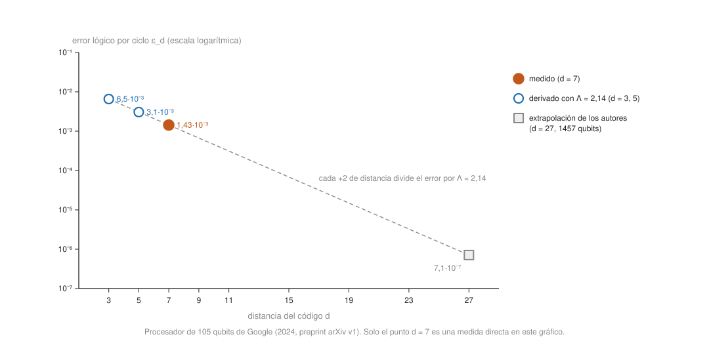

- Se asumen [el código de superficie](surface-code.md), [los qubits superconductores](../../quantum-hardware/concepts/superconducting-qubits.md) y [los qubits de átomos neutros](../../quantum-hardware/concepts/neutral-atom-qubits.md); los dos últimos se resumen aquí solo en lo que afecta a la corrección de errores.

## Comprensión {#layer-2}

**Qué se pretende demostrar.** Un *qubit lógico (logical qubit)* es un qubit codificado en muchos físicos. Un experimento con qubits lógicos pregunta si la codificación realmente protege: si el error lógico es menor que el del mejor qubit físico y si mejora al agrandar el código. Preskill ya lo señalaba en 2018 como el siguiente objetivo: demostrar un qubit con corrección de errores y control mejorado [@preskill-2018, §7, p. 14]. Tres ideas organizan el vocabulario:

- *Error lógico por ciclo.* La probabilidad de que el qubit lógico falle en una ronda de corrección. Se mide con ejecuciones de muchos ciclos [@google-2025, p. 1].
- *Por debajo del umbral y `Λ`.* El error lógico `ε_d` sigue `ε_d ∝ (p/p_th)^((d+1)/2)`, y el *factor de supresión* `Λ = ε_d / ε_{d+2} ≈ p_th / p` mide cuánto baja el error al subir la distancia en 2; `Λ > 1` es estar por debajo del umbral (ver [teorema del umbral](threshold-theorem.md)) [@google-2025, p. 1]. Según los propios autores de Google, ningún procesador había mostrado antes de forma definitiva un rendimiento por debajo del umbral, aunque otras plataformas habían mostrado partes de la corrección [@google-2025, p. 1].
- *Punto de equilibrio (break-even).* El qubit lógico dura más que el mejor qubit físico. Comparar ambos es delicado, porque su ruido es distinto; Google usa una métrica de vida media promediada sobre estados puros [@google-2025, p. 3].

**El experimento de Google (superconductores).** Los autores, todos de Google Quantum AI, informan de dos procesadores de transmones en rejilla cuadrada: uno de 72 qubits (código de distancia 5, códigos de repetición, decodificación en tiempo real) y otro de 105 qubits (distancia 7) [@google-2025, p. 1]. Eisert y Preskill llaman Willow al procesador [@eisert-2025, Sec. III, p. 4]. El texto que se ha consultado es la versión v1 de arXiv; la versión final de Nature puede diferir en detalles [@google-2025, nota de acceso]. Lo que mide:

- *Distancia 7.* 101 qubits (49 de datos, 48 de medida y 4 de eliminación de fuga) y un error lógico de `0,143 % ± 0,003 %` por ciclo de corrección [@google-2025, resumen, p. 1; p. 2].
- *`Λ`.* `2,14 ± 0,02` con decodificador de red neuronal (`ε₇ = 1,43·10⁻³`) y `2,04 ± 0,02` con un conjunto de decodificadores de emparejamiento (`ε₇ = 1,71·10⁻³`) [@google-2025, pp. 1-3]. Eisert y Preskill lo resumen como un factor `Λ ≈ 2` por cada paso de distancia `3 → 5 → 7` [@eisert-2025, Sec. III, p. 4].
- *Más allá del equilibrio.* La vida del qubit lógico de `d = 7` es de `291 ± 6 µs` frente a una mediana de `85 ± 7 µs` y un máximo de `119 ± 13 µs` de los qubits físicos que lo forman: un factor `2,4 ± 0,3` respecto al mejor [@google-2025, p. 3]. (`291/119 ≈ 2,45`, consistente con la cifra.)
- *Duración.* Hasta `10⁶` ciclos sin degradación del rendimiento y repetible durante horas [@google-2025, p. 6].
- *Decodificación en tiempo real* (en el dispositivo de 72 qubits, `d = 5`): latencia media de `63 ± 17 µs` con un ciclo de 1,1 µs (ver [decodificación](decoding.md)) [@google-2025, pp. 1, 6].

Los autores señalan que esto extiende resultados anteriores de punto de equilibrio con códigos bosónicos a códigos de varios qubits, y que es un paso hacia el punto de equilibrio con *operaciones* lógicas, que este trabajo no demuestra: es una memoria [@google-2025, pp. 3, 7].

**El experimento de átomos neutros (Harvard, MIT, NIST, QuEra).** Bluvstein y colaboradores (algunos de la empresa QuEra) usan hasta 280 átomos de rubidio en pinzas ópticas, con una arquitectura de tres zonas (almacenamiento, entrelazamiento y lectura) y puertas transversales con un solo pulso láser global [@bluvstein-2024, pp. 1-3]. Sus titulares son: la CNOT lógica entre códigos de superficie mejora de `d = 3` a `d = 7`; qubits de código de color preparados con una fidelidad por encima del punto de equilibrio; un GHZ lógico tolerante a fallos y teleportación con realimentación; 40 códigos de color en 280 átomos; y circuitos de muestreo con bloques `[[8,3,2]]` de hasta 48 qubits lógicos, 228 puertas lógicas de dos qubits y 48 `CCZ` lógicas [@bluvstein-2024, resumen, p. 1; pp. 3-7]. **Letra pequeña:** los resultados titulares de GHZ y XEB dependen de *detección* de errores con *poselección* (descartar las ejecuciones con errores detectados), no de corrección completa [@bluvstein-2024, pp. 4, 6-7]. Ver la capa profesional.

**Otras plataformas.** Eisert y Preskill citan también 12 qubits lógicos en una trampa de iones de 56 qubits, y 48 en un array Rydberg de 280 [@eisert-2025, Sec. III, p. 4]. Google dice que otras plataformas ya habían mostrado características individuales de la corrección, entre ellas una corrección tolerante a fallos en tiempo real con iones atrapados [@google-2025, p. 1].

**Errores frecuentes.**

- *"Un qubit lógico es un qubit sin errores."* Tiene error lógico: Google obtiene `0,143 %` por ciclo [@google-2025, p. 1].
- *"Quien tiene un qubit lógico ya tiene un ordenador tolerante a fallos."* Los datos de Google son una memoria y no demuestran puertas lógicas [@google-2025, p. 7].
- *"Todo experimento que dice 'corregido' hace corrección completa."* Con poselección se descartan las ejecuciones con errores detectados; Eisert y Preskill lo señalan: pocas rondas de síndrome y un descarte que no escalará [@eisert-2025, Sec. III, p. 4].

## Profesional {#layer-3}

**Cómo leer un titular sobre qubits lógicos.** Un checklist con lo que hay que preguntar a cualquier resultado:

1. *¿Memoria o puertas?* Google: solo memoria [@google-2025, p. 7]. IBM (códigos bicicleta): solo propuesta de memoria, sin experimento [@bravyi-2024, pp. 3, 31]. Bluvstein: puertas transversales sobre códigos pequeños [@bluvstein-2024, pp. 3-7].
2. *¿Cuántas rondas de síndrome?* Google: hasta `10⁶` ciclos [@google-2025, p. 6]. Bluvstein: en el resultado de superficie, una sola ronda de medida de estabilizadores y una lectura final, con un umbral esperado algo menor para síndrome repetido y ruidoso [@bluvstein-2024, pp. 3-4, 8]. Eisert y Preskill: los demostradores atómicos tienen pocas rondas [@eisert-2025, Sec. III, p. 4].
3. *¿Corrección o detección?* Bluvstein: la fidelidad del GHZ lógico tolerante a fallos es del `72(2) %` con decodificación correlacionada y sube al `99,85 %` al poseleccionar sobre todos los estabilizadores lógicos; descartando alrededor del 50 % de los datos se llega a un 90 % [@bluvstein-2024, p. 4, Fig. 3]. El XEB lógico de 12 qubits pasa de `0,156(2)` en bruto a `0,616(7)` con detección completa de errores, y es de unos `0,1` con 48 qubits lógicos [@bluvstein-2024, p. 7]. La preparación del estado no es tolerante a fallos más allá de `d = 3` [@bluvstein-2024, pp. 3-4].
4. *¿Con qué se compara?* Con el mejor qubit físico (Google: `2,4×`) o con una cota de implementaciones físicas (Bluvstein dice que su XEB supera una cota superior estimada para implementaciones con qubits físicos del mismo sistema; los autores son parte interesada) [@google-2025, p. 3; @bluvstein-2024, p. 7]. Los 99,5 % de fidelidad de puerta de dos qubits que usa el artículo de átomos no se midieron allí: se citan de trabajo previo del grupo [@bluvstein-2024, p. 4].
5. *¿Cómo evoluciona con la distancia?* `Λ > 1` y estable. Google lo comprobó 16 veces en 15 horas (`Λ = 2,18 ± 0,07` de media en el dispositivo de 72 qubits) [@google-2025, p. 4, Fig. 2e]. Y qué hay de los suelos: en el código de repetición de distancia 29, la supresión deja de ser exponencial desde `d ≥ 15` con un suelo de `~10⁻¹⁰` por ciclo por ráfagas de errores sin explicar [@google-2025, pp. 4-5]. Un `Λ` bueno con un suelo no entendido no basta para extrapolar [@google-2025, p. 4].
6. *¿Quién lo dice?* Google Quantum AI (empresa, sin conflictos declarados), QuEra y colaboradores (empresa), Eisert y Preskill (perspectiva; Preskill está afiliado a AWS) [@google-2025, p. 7; @bluvstein-2024, nota de acceso; @eisert-2025, nota de acceso]. Es lo normal en este campo, pero hay que atribuir.
7. *¿Revisión por pares?* El texto de Google consultado es un preprint v1 (Nature en 2025; DOI de Nature sin confirmar en las fuentes) y el de Bluvstein, la versión preprint de 2023 (publicado en Nature 626, 2024) [@google-2025, nota de acceso; @bluvstein-2024, nota de acceso].

**Cifras de Google con aritmética.** Con `ε₇ = 1,43·10⁻³` y `Λ = 2,14`, los errores por ciclo que implica el ajuste serían `ε₅ ≈ 1,43·10⁻³ × 2,14 ≈ 3,1·10⁻³` y `ε₃ ≈ 3,1·10⁻³ × 2,14 ≈ 6,5·10⁻³` (derivados con la fórmula de `Λ`; no son medidas de la fuente). Extrapolando, los propios autores dicen que un error lógico de `10⁻⁶` requeriría `d = 27` con 1457 qubits físicos [@google-2025, p. 6]: `1,43·10⁻³ / 2,14¹⁰ ≈ 7,1·10⁻⁷` y `2·27² − 1 = 1457` (comprobación propia). Reducir a la mitad los errores físicos mejoraría a `d = 27` en unos cuatro órdenes de magnitud [@google-2025, p. 7]. Los autores consideran el enfoque actual intensivo en recursos y el suelo de `10⁻¹⁰` un límite para circuitos grandes [@google-2025, pp. 1, 4, 6-7]. Para el objetivo de `10⁻¹²`, el cálculo del [teorema del umbral](threshold-theorem.md) da `d = 63` y 7937 qubits por qubit lógico con esa `Λ`.

**El hueco entre lo demostrado y lo necesario.** Bluvstein y colaboradores dicen que los algoritmos grandes útiles necesitan tasas de error de puerta por debajo de `10⁻¹⁰`, muy por debajo de lo que cualquier dispositivo físico alcanzará, y eso motiva la corrección [@bluvstein-2024, p. 1]. Eisert y Preskill sitúan las máquinas NISQ más capaces por debajo de `10⁴` operaciones de dos qubits y una máquina FASQ útil en unas `10¹²` (un *teraquop*), pasando por el megaquop (`10⁶`) y el gigaquop (`10⁹`) [@eisert-2025, Sec. I, p. 2]. Esperan que más progreso de hardware dé `Λ` mayores y, al final, puertas lógicas de dos qubits mejores que las físicas, lo que llevaría al régimen megaquop [@eisert-2025, Sec. III, pp. 4, 6]. Lo que falta, según los propios autores:

- *Google:* computación lógica (no solo memoria) y escalar la calibración, la decodificación en tiempo real y los compiladores lógicos a operaciones entre varios parches [@google-2025, p. 7].
- *Bluvstein y colaboradores:* corrección repetida de errores, reposición de átomos y bajar el error de espera en almacenamiento (~1 % de decoherencia lógica por ciclo extra de codificación); las puertas de dos qubits deberían bajar al 0,1 % para mejorar la eficiencia [@bluvstein-2024, pp. 5, 8].
- *Átomos en general:* la medida lenta (milisegundos para alta fidelidad) y el ciclo lógico de órdenes de magnitud más lento que en superconductores [@saffman-2025, pp. 17, 21; @eisert-2025, Sec. III, p. 4].

Saffman recoge que hacia 2025 se habían demostrado experimentos de qubits lógicos con transporte de átomos y una primera destilación de estados mágicos (sin detalles en las notas) [@saffman-2025, p. 5].

**Dos modos de uso distintos para quien programa.**

- *Ahora:* los qubits lógicos son un objeto de investigación. En [ejecutar en hardware real](../../qiskit-programming/concepts/running-on-hardware.md) se programa sobre qubits físicos, y para las cargas que fallen se recurre a [mitigación de errores](../../qiskit-programming/concepts/error-mitigation.md), que no usa qubits adicionales pero cuyo coste de muestreo crece exponencialmente con el tamaño del circuito, frente a la corrección, cuyo coste en qubits es alto pero cuya sobrecarga crece de forma polilogarítmica [@eisert-2025, Sec. II, p. 3]. Cai y colaboradores señalan que con residuos de error lógico (era temprana de tolerancia a fallos) las técnicas de mitigación se pueden aplicar a qubits y puertas lógicas, si el resultado es un valor esperado [@cai-2023, Sec. V.B, p. 28]. La era NISQ y sus límites están en [era NISQ](../../qiskit-programming/concepts/nisq-era.md).
- *Después:* el ciclo de trabajo será un modelo de costes (cuántos parches, cuánto de distancia, cuántas fábricas) como el de [estimación de recursos](resource-estimation.md); la variable que aprendes a leer hoy es `Λ`.

**Cuándo creerse una comparación (criterio propio).** Un resultado es más fiable si (1) reporta `Λ` con varias distancias y estabilidad temporal, (2) distingue corrección de detección, (3) dice cuántas rondas, (4) muestra qué decodificador usa y si es de tiempo real, y (5) cita sus propios límites. Con eso se pueden comparar el trabajo de Google y el de Harvard/QuEra sin confundir un titular de GHZ con uno de memoria.

**Para seguir.** [Estimación de recursos](resource-estimation.md) usa esas `Λ` y esos tiempos de ciclo para calcular cuánto costaría un algoritmo real.
