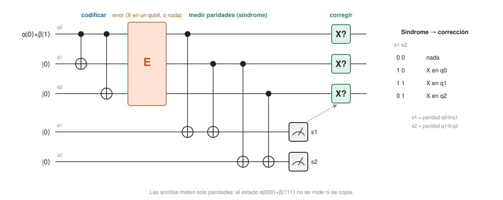

- Se asumen [los circuitos cuánticos](../../qubits-and-circuits/concepts/quantum-circuits.md) (en particular la puerta CNOT); [la no clonación](../../qubits-and-circuits/concepts/no-cloning.md) se explica aquí cuando hace falta.

## Fundamentos {#layer-1}

**La idea clásica: votar.** Para proteger un bit contra volteos accidentales, se guarda tres veces: `0` se escribe `000` y `1` se escribe `111`. Al leer, se decide por mayoría. Si un solo bit se voltea, los otros dos lo delatan y se corrige. Este es el *código de repetición de 3 bits (3-bit repetition code)*, y corrige como mucho un bit volteado [@watrous-2025, L13.1, PDF p. 380].

**¿Cuánto ayuda?** Supón que cada bit se voltea con probabilidad `p`, de forma independiente. El voto falla si se voltean dos o tres bits, con probabilidad `3p²(1−p) + p³ = 3p² − 2p³`. Eso mejora a `p` cuando `p < 1/2` y empeora cuando `p > 1/2` [@watrous-2025, L13.1, PDF p. 381]. Con `p = 0,01`:

- Dos bits volteados: `3 · 0,01² · 0,99 = 0,000297`.
- Tres bits volteados: `0,01³ = 0,000001`.
- Suma: `0,000298`, o `3p² − 2p³ = 0,0003 − 0,000002 = 0,000298`.

El error baja de 1 % a unas 3 centésimas de punto porcentual: unas 33 veces menos. Y cuanto menor es `p`, más rápido mejora, porque el fallo pide *dos* errores a la vez.

**El obstáculo cuántico.** Con un qubit no se puede "guardarlo tres veces": el teorema de [no clonación](../../qubits-and-circuits/concepts/no-cloning.md) prohíbe copiar un estado desconocido. Además, para comprobar si algo falló habría que medir, y medir colapsa la superposición [@de-wolf-2026, §21.3, p. 196 [184]]. Dos ideas lo resuelven.

**Primera idea: codificar sin copiar.** El estado `α|0⟩ + β|1⟩` se transforma en `α|000⟩ + β|111⟩` con dos qubits auxiliares en `|0⟩` y dos puertas CNOT. Ese estado no son tres copias de `α|0⟩ + β|1⟩`: es un solo estado entrelazado repartido en tres qubits [@watrous-2025, L13.1, PDF pp. 382-383]. Este es el *código de bit-flip de 3 qubits (3-qubit bit-flip code)*.

**Segunda idea: preguntar por la paridad, no por el valor.** No se mide ningún qubit de datos. Se mide si los qubits 1 y 2 son iguales o distintos y si los qubits 2 y 3 son iguales o distintos, volcando cada respuesta a un qubit auxiliar (*ancilla*), que es el que se mide. Con dos preguntas de sí/no, el resultado (el *síndrome*, *syndrome*) dice qué qubit falló sin revelar si el dato lógico es `0`, `1` o una superposición [@watrous-2025, L13.1, PDF p. 383]. Si hay a lo sumo un volteo, la tabla es:

| Síndrome (qubits 1-2, qubits 2-3) | Qué pasó | Corrección |
|---|---|---|
| 00 | ningún error | ninguna |
| 10 | volteo en el primer qubit | volver a aplicar `X` al primero |
| 11 | volteo en el qubit del medio | `X` al del medio |
| 01 | volteo en el último qubit | `X` al último |

[@watrous-2025, L13.1, PDF p. 384]



**Una analogía.** Es como comparar tres copias de un documento sin leerlo: preguntas "¿la primera y la segunda coinciden?" y "¿la segunda y la tercera?", y con las dos respuestas sabes cuál está mal, sin haber leído nunca el contenido.

**Lo que este código no hace.** Solo protege contra volteos de bit (`X`). Un volteo de fase (`Z`) en cualquiera de los tres qubits equivale a un `Z` en el qubit original antes de codificar, es decir, a una codificación válida de otro estado, y el síndrome sigue siendo `00` [@watrous-2025, L13.1, PDF p. 386]. La siguiente capa lo explica mejor y muestra la versión simétrica contra volteos de fase.

## Comprensión {#layer-2}

**Por qué medir paridades no destruye el estado.** Medir `Z₁Z₂` (el producto de dos observables) solo pregunta por el valor propio `±1`: en `α|000⟩ + β|111⟩`, los qubits 1 y 2 son siempre iguales, así que la respuesta es `+1` con certeza y la superposición entre `000` y `111` no se toca. Es el mismo mecanismo con el que medir `ZZ` sobre un estado de Bell da `+1` sin colapsar a `|00⟩` o `|11⟩` [@watrous-2025, L14.1, PDF pp. 410-412]. En lenguaje de estabilizadores, el código de repetición es el código estabilizador con generadores `ZZI` e `IZZ`, y las comprobaciones de paridad son medidas no destructivas de esos generadores [@watrous-2025, L14.2, PDF pp. 415-416; L14.3, PDF pp. 422-423]; ver [formalismo de estabilizadores](stabilizer-formalism.md). De Wolf lo plantea de forma equivalente: una unitaria `U` escribe la posición del error en qubits auxiliares frescos; solo estos se miden y se descartan tras cada ronda [@de-wolf-2026, §21.4, pp. 198-199 [186-187]].

**El síndrome nunca toca los datos.** Esto es importante: si midieras los tres qubits en la base estándar para saber si hubo un volteo, destruirías el estado [@watrous-2025, L13.1, PDF p. 383]. La ancilla recibe la información del error y el estado de los datos queda intacto. Tras corregir, el estado es un producto en el que los datos están limpios y la aleatoriedad del ruido está en los síndromes descartados [@watrous-2025, L13.3, PDF p. 404].

**La versión para volteos de fase.** Aplicando una Hadamard a cada qubit después de las dos CNOT, el estado `α|0⟩ + β|1⟩` queda codificado como `α|+++⟩ + β|−−−⟩`. El circuito de detección es el anterior envuelto en Hadamards, con la misma tabla de síndromes pero con correcciones `Z`, y ahora es ciego a los volteos de bit [@watrous-2025, L13.1, PDF pp. 387-389]. Sus generadores son `XXI` e `IXX` [@watrous-2025, L14.3, PDF pp. 422-423]. Para el análisis de errores se necesita dominar [las puertas de dos qubits](../../qubits-and-circuits/concepts/two-qubit-gates.md) y cómo la Hadamard intercambia `X` y `Z` (`HXH = Z`) [@watrous-2025, L14.3, PDF pp. 428-429].

**El coste de ignorar el otro error.** Como cada uno de los tres qubits puede sufrir una `Z`, la probabilidad de un volteo de fase lógico es `3p(1−p)² + p³`, mayor que `p` para `0 < p < 1/2`: el código de bit-flip empeora los errores de fase [@watrous-2025, L13.1, PDF pp. 386-387]. Por eso ninguno de los dos por separado sirve como memoria cuántica, y el [código de Shor](shor-code.md) los anida.

**Detectar no es corregir.** Con dos errores en el mismo bloque, la tabla de síndromes apunta al qubit equivocado y la "corrección" produce un error lógico: `X` en dos qubits más una corrección `X` en el tercero dan `XXX`, que es un `X` lógico (de `000` a `111`). Ese operador de peso 3 conmuta con todas las comprobaciones y no es un estabilizador: es un error no detectable [@watrous-2025, L14.2, PDF p. 420; L14.3, PDF pp. 431-432]. De Wolf contrasta con un código de 4 qubits que solo detecta un volteo de bit y/o de fase: el resultado es el estado original o una señal conocida de "hubo un error" [@de-wolf-2026, ej. 4, p. 201 [189]].

**Concatenar.** Aplicar el código de 3 bits `k` veces (`3ᵏ` bits por bit lógico) da un error aproximado de `(1/3)(3p)^(2ᵏ)`: exponencialmente más bits, pero un error doblemente exponencial menor, mientras `3p < 1` [@de-wolf-2026, §21.2, p. 196 [184]]. Esta es la semilla del [teorema del umbral](threshold-theorem.md): si `p < 1/3` el código reduce el error, y por encima ayuda poco o nada. La condición `p < 1/3` es la que obtiene De Wolf con una cota sencilla; con más trabajo se llega a `p < 1/2` [@de-wolf-2026, §21.2, pp. 195-196 [183-184], nota 1].

**Errores frecuentes.**

- *"El estado codificado es tres copias del original."* No: `α|000⟩ + β|111⟩` es entrelazado, y copiar un estado desconocido es imposible [@watrous-2025, L13.1, PDF pp. 382-383].
- *"El síndrome dice qué valor tiene el qubit."* Solo dice qué paridades se rompieron; no revela `α` ni `β`.
- *"Con el código de bit-flip ya estoy protegido."* Solo contra `X`; contra `Z` el código es peor que no hacer nada [@watrous-2025, L13.1, PDF pp. 386-387].
- *"Si el síndrome es 00, no pasó nada."* Pueden haber ocurrido tres volteos (`XXX`), o una `Z`, y el síndrome sigue siendo 00 [@watrous-2025, L13.1, PDF p. 386; L14.3, PDF pp. 431-432].

## Profesional {#layer-3}

**Simularlo con ruido (código probado).** El siguiente circuito codifica el estado lógico `|1⟩`, aplica un volteo `X` con probabilidad `p` a cada qubit de datos (un modelo de ruido de Aer sobre la puerta identidad), extrae el síndrome con dos ancillas, corrige con una condición clásica (`if_test`) y mide los datos. Se ejecutó con Qiskit 2.6 y `qiskit-aer`; la extracción del síndrome es perfecta, así que solo se prueba la fórmula `3p² − 2p³` y no el ruido de circuito (ver [ruido cuántico](quantum-noise-channels.md)). Para la sintaxis de circuitos dinámicos, ver [circuitos en Qiskit](../../qiskit-programming/concepts/qiskit-circuits.md).

```python
from qiskit import QuantumCircuit, QuantumRegister, ClassicalRegister, transpile
from qiskit_aer import AerSimulator
from qiskit_aer.noise import NoiseModel, pauli_error


def bitflip_code_circuit():
    data = QuantumRegister(3, "q")
    anc = QuantumRegister(2, "a")
    syn = ClassicalRegister(2, "syn")   # syn[0] = paridad q0^q1, syn[1] = paridad q1^q2
    out = ClassicalRegister(3, "out")
    qc = QuantumCircuit(data, anc, syn, out)

    qc.x(data[0])                       # |1> lógico
    qc.cx(data[0], data[1])
    qc.cx(data[0], data[2])             # codificación: |1> -> |111>
    qc.barrier()
    for q in data:
        qc.id(q)                        # lugares ruidosos: el modelo de ruido pone aquí una X
    qc.barrier()
    qc.cx(data[0], anc[0]); qc.cx(data[1], anc[0])    # ancilla 0 = q0 xor q1
    qc.cx(data[1], anc[1]); qc.cx(data[2], anc[1])    # ancilla 1 = q1 xor q2
    qc.measure(anc, syn)                # solo se miden las ancillas
    with qc.if_test((syn, 0b01)):       # síndrome (1,0): volver a voltear q0
        qc.x(data[0])
    with qc.if_test((syn, 0b11)):       # (1,1): q1
        qc.x(data[1])
    with qc.if_test((syn, 0b10)):       # (0,1): q2
        qc.x(data[2])
    qc.measure(data, out)
    return qc


def logical_error_rate(p, shots=100_000, seed=7):
    noise = NoiseModel()
    noise.add_all_qubit_quantum_error(pauli_error([("X", p), ("I", 1 - p)]), ["id"])
    sim = AerSimulator(noise_model=noise, seed_simulator=seed)
    qc = transpile(bitflip_code_circuit(), sim, optimization_level=0)
    counts = sim.run(qc, shots=shots).result().get_counts()
    fails = sum(n for k, n in counts.items() if k.split()[0] != "111")
    return fails / shots


for p in (0.10, 0.01):
    print(f"p = {p:4.2f}  simulado {logical_error_rate(p):.5f}  3p^2-2p^3 = {3*p**2 - 2*p**3:.5f}")
```

Salida obtenida (semilla 7, 100 000 ejecuciones): para `p = 0,10`, `0,02761` simulado frente a `0,02800` teórico; para `p = 0,01`, `0,00031` frente a `0,00030`. Es la prueba de que el fallo necesita dos errores: el error lógico sale del orden de `3p²`, no de `p`. Con `p = 0,01` hay unos 30 fallos en 100 000 ejecuciones, así que la cifra tiene un error estadístico relativo considerable (unos ±20 %); eso es una consecuencia del tamaño de la muestra, no del código.

**Por qué en hardware real se usan códigos de repetición.** Un código de repetición solo corrige un tipo de error, por lo que no sirve de memoria cuántica, pero se puede ejecutar a gran distancia y sirve como sonda del ruido del dispositivo. Google lo usa así: en su código de repetición de distancia 29, la supresión de error entre `d = 5` y `d = 11` es `Λ = 8,4 ± 0,1`, y a partir de `d ≥ 15` se aparta del comportamiento exponencial, con un suelo cercano a 10⁻¹⁰ de error lógico por ciclo; esto se debe a ráfagas de errores correlacionados que no aparecerían en un modelo de errores independientes [@google-2025, pp. 4-5, Fig. 3d]. La lección práctica (criterio propio) es que un código pequeño puede ocultar fallos que solo se ven en un código grande y larguísimo, de forma que conviene correr repeticiones a mucha distancia antes de fiarse del escalado. Con inyección de errores, el código de repetición también reproduce el escalado `O(p^((d+1)/2))`: reducir a la mitad la probabilidad de detección baja 250 veces el error lógico con `d = 15`, en línea con `p⁸` [@google-2025, p. 5, Fig. 3b].

**Por qué la ronda de síndrome debe repetirse.** En un circuito real, la propia medida de paridad puede fallar. Un error de medida aparece como un único cambio en un síndrome que desaparece en el siguiente ciclo, mientras que un error de datos persiste, y esa diferencia espacio-temporal permite distinguirlos [@fowler-2012, pp. 7-8, Fig. 2]. Por eso se repite la medida de paridades muchos ciclos, y el "voto" se hace también en el tiempo. El [código de superficie](surface-code.md) hace lo mismo para los dos tipos de error a la vez, con comprobaciones locales de paridad `X` y `Z` [@fowler-2012, p. 5].

**Cuándo usar qué (criterio propio a partir de lo anterior).**

- *Aprender o depurar un decodificador:* código de repetición con síndrome perfecto; es el caso más pequeño en el que se ve la corrección completa.
- *Diagnosticar el ruido de un procesador:* repetición de gran distancia con muchos ciclos, buscando suelos de error [@google-2025, pp. 4-5].
- *Proteger datos cuánticos en serio:* ni el bit-flip ni el phase-flip valen por separado; hacen falta códigos que protejan ambos ejes ([Shor](shor-code.md), [superficie](surface-code.md)).

**Para seguir.** El siguiente paso es [el código de Shor](shor-code.md), que apila las dos versiones.
