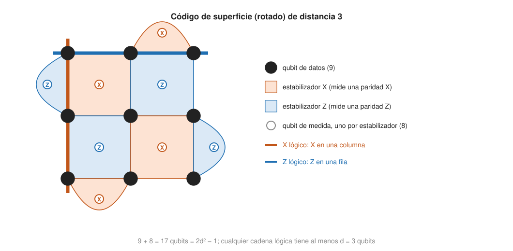

## Comprensión {#layer-2}

### Idea clave
El **código de superficie (surface code)** protege un qubit lógico con comprobaciones de solo cuatro qubits vecinos sobre una rejilla 2D, y alcanza umbrales de cerca del 1 % por operación; el error lógico cae exponencialmente con la distancia `d` si el error físico está por debajo del umbral [@fowler-2012, pp. 2, 11-12].

### Explicación
Se asumen [el formalismo de estabilizadores](stabilizer-formalism.md) y [el teorema del umbral](threshold-theorem.md); aquí se usan los generadores, el síndrome, la distancia `d` y la fórmula `ε_d ≈ A (p/p_th)^((d+1)/2)` sin volver a explicarlos.

Los códigos de [Shor](shor-code.md) o de Steane necesitan comprobaciones que implican a muchos qubits, a veces alejados. El código de superficie usa solo comprobaciones de 4 qubits vecinos sobre una rejilla 2D. Steane y Bacon-Shor en una red 2D de vecinos próximos tienen umbrales de unos `2·10⁻⁵` por paso, frente a cerca del 1 % por operación del código de superficie, unos tres órdenes de magnitud más [@fowler-2012, p. 2].

Su origen es el *código tórico (toric code)* de Kitaev, que vive en una malla `L × L` con condiciones periódicas (un toro), con los qubits en las aristas: `2L²` qubits. Hay un generador `Z` por celda (cuatro `Z`) y un generador `X` por vértice (cuatro `X`), `L²` de cada, todos de peso 4 y locales; cada pareja `Z`-`X` comparte 0 o 2 qubits, así que conmutan [@watrous-2025, L15.2, PDF pp. 451-455]. Como el producto de todos los generadores `Z` es la identidad (y lo mismo con los `X`), hay una redundancia que se elimina, y quedan `2L² − 2(L² − 1) = 2` qubits lógicos [@watrous-2025, L15.2, PDF pp. 455-456]. Cortando un trozo de toro y poniéndolo plano, con bordes "rugosos" arriba y abajo y "lisos" a los lados, se codifica un solo qubit sin quitar ningún generador, y los errores no detectables son cadenas que van de un borde a otro (las de `X` de izquierda a derecha, las de `Z` de arriba abajo) [@watrous-2025, L15.3, PDF pp. 465-466]. La versión plana se debe a Bravyi-Kitaev y Freedman-Meyer [@fowler-2012, pp. 1-2].

La rejilla de trabajo es una matriz 2D de *qubits de datos* (guardan el estado) y *qubits de medida* (extraen paridades). Cada qubit de datos toca dos qubits de medida `Z` y dos de medida `X`; cada qubit de medida toca cuatro de datos (tres en un borde) [@fowler-2012, p. 5, Fig. 1]. Un qubit de medida `Z` mide `Z_aZ_bZ_cZ_d` sobre sus cuatro vecinos y uno `X` mide `X_aX_bX_cX_d` [@fowler-2012, p. 5]. Cada ciclo es: preparar el qubit de medida, cuatro CNOT con los vecinos en un orden fijo y medir; en total 8 pasos, con todos los qubits de medida en sincronía [@fowler-2012, p. 5, Fig. 1b,c]. El tamaño de una malla "rotada" de distancia `d` (en el esquema de Google y de IBM) es `d²` qubits de datos más `d² − 1` de medida: `2d² − 1` [@google-2025, p. 1; @bravyi-2024, p. 2]. La versión original de Fowler, no rotada, usa `(2d−1)²` [@fowler-2012, pp. 8, 12-13]; las versiones rotadas usan menos qubits [@watrous-2025, L15.3, PDF pp. 465-466].

Con esa rejilla, así aparecen los errores. Un error `X` en un qubit de datos voltea los dos qubits de medida `Z` adyacentes; un error `Z` voltea los dos `X` vecinos; un `Y` voltea ambos [@fowler-2012, p. 7, Fig. 2]. Una cadena de errores adyacentes deja `−1` solo en sus dos extremos, así que el síndrome no revela la cadena: el código es muy degenerado [@watrous-2025, L15.2, PDF pp. 457-458]. Lo que sí importa es si, junto con la corrección, la cadena forma un lazo contraíble (inofensivo, producto de estabilizadores) o uno que cruza el toro o va de borde a borde (un error lógico no detectado). Por eso se llama *topológico* [@watrous-2025, L15.2, PDF pp. 458-461]. El error de medida es distinto: aparece como un cambio aislado que desaparece en el siguiente ciclo, y permite distinguirlo de un error de datos [@fowler-2012, pp. 7-8, Fig. 2].

Los operadores lógicos son esas cadenas. `X_L` es una cadena de `X` a través de la matriz entre los dos bordes `X`; `Z_L` es una cadena de `Z` entre los dos bordes `Z`. Anticonmutan porque comparten un único qubit de datos [@fowler-2012, p. 9, Eq. 9]. La distancia `d` es el menor número de volteos físicos `X` o `Z` que forman un operador lógico [@fowler-2012, p. 11]. En el código tórico, el lazo no contraíble más corto mide `L`, así que es un `[[2L², 2, L]]` [@watrous-2025, L15.2, PDF p. 462]. Los qubits lógicos no son un qubit físico especial: son un estado de muchos qubits cuyo valor se lee a través de una cadena de operadores, y ningún qubit de datos guarda por sí solo la información lógica [@fowler-2012, pp. 8-10].

La distancia también cuenta en el tiempo. Los valores de los estabilizadores deben establecerse durante unos `d` ciclos, y las operaciones que activan o desactivan estabilizadores deben espaciarse `d` ciclos [@fowler-2012, pp. 13, 21]. Un parche de distancia `d` protege por `d` en el espacio y en el tiempo, de modo que un cálculo largo es una pila de rondas de síndrome (la decodificación se trata en la capa profesional).

Los errores no se deshacen físicamente: se anotan en el software de control (un *marco de Pauli*, *Pauli frame*) y se aplican a las medidas posteriores. Se prefiere detectar errores más que corregirlos activamente [@fowler-2012, pp. 4, 7].

En su modelo de ruido de circuito, el código tiene un umbral por paso de `p_th = 0,57 %` (aproximadamente un 4 % por ciclo completo), menor que valores publicados antes sobre todo porque incluye más tipos de error; el error lógico cae exponencialmente con `d` por debajo del umbral [@fowler-2012, pp. 11-12, Fig. 4]. Un objetivo razonable es `p ≲ 10⁻³`: con él, un qubit lógico cuesta `10³`-`10⁴` qubits físicos para un error lógico de `10⁻¹⁴`-`10⁻¹⁵` [@fowler-2012, pp. 2, 12-13, Fig. 6]. Para el modelo de errores de la fórmula y su aplicación, ver [teorema del umbral](threshold-theorem.md); Google mide hoy esta supresión en hardware (ver [experimentos con qubits lógicos](logical-qubit-experiments.md)).

### Ejemplo
Contar qubits de una malla de distancia `d`. Rotada: `d²` de datos más `d² − 1` de medida. Con `d = 7`, `2·7² − 1 = 97`; no rotada, `(2·7−1)² = 169` (cálculo propio). Fowler con `d = 5` usa 81 qubits, 41 de datos y 40 de medida [@fowler-2012, pp. 8, 12-13].

### Errores frecuentes
- *"Más qubits siempre protegen mejor."* Solo por debajo del umbral: por encima, el error lógico crece con `d` [@fowler-2012, p. 11].
- *"El código de superficie corrige todo a la vez."* Corrige errores de datos y de medida con rondas repetidas; para puertas no Clifford hacen falta otras herramientas (las puertas tolerantes a fallos se tratan en la capa profesional) [@bluvstein-2024, pp. 4-5].
- *"Los qubits lógicos son un qubit físico especial."* Los operadores lógicos actúan sobre los grados de libertad que los estabilizadores dejan libres, y ningún qubit de datos guarda por sí solo la información lógica [@fowler-2012, pp. 8-10].

### Para seguir
La capa 3 cuenta qubits de parches, compara con los códigos qLDPC y da criterios para elegir. Después, [experimentos con qubits lógicos](logical-qubit-experiments.md) muestra lo demostrado en hardware.

## Profesional {#layer-3}

### Idea clave
El coste de un parche depende del esquema (`2d² − 1` rotado, más con holguras, menos con almacenamiento frío), el hardware decide cuánto de esto es viable, y los códigos qLDPC ofrecen más densidad a cambio de conectividad de largo alcance aún no demostrada [@gidney-2025, §3.2, p. 18; @bravyi-2024, pp. 2-4, 30].

### Explicación
Los esquemas más usados cuestan esto por qubit lógico:

- Rotado, `d`: `2d² − 1` [@google-2025, p. 1].
- Sin rotar (Fowler 2012): `(2d−1)²` [@fowler-2012, pp. 12-13].
- Gidney, almacenamiento "caliente" (con holgura entre parches): `2(d+1)²` [@gidney-2025, §3.2, p. 18].
- Fowler 2012, cómputo con agujeros de doble corte: `2,5 · 1,25 · (2d)²` [@fowler-2012, App. M, p. 52].
- Gidney, almacenamiento "frío" (códigos *yoked*): 430 (a 10⁻¹⁵ por ronda) [@gidney-2025, §3.2, p. 18].

La idea de Gidney es repartir el chip en una región de cálculo, un almacenamiento caliente y otro frío [@gidney-2025, §3.2, p. 18]. Con ese reparto, los 1409 qubits lógicos del pico de su estimación usan 897 864 físicos, y no los `1409 · 1352 ≈ 1,9 millones` de hacerlo todo con parches calientes (cálculo propio). Ver [estimación de recursos](resource-estimation.md) para el desglose.

Las comprobaciones de peso 4 sobre una rejilla de vecinos próximos encajan en un chip de transmones: Google ejecutó un parche de `d = 7` con 49 qubits de datos, 48 de medida y 4 de eliminación de fuga (101 en total) en la variante ZXXZ, con un ciclo de 1,1 µs [@google-2025, pp. 1-2, 5]. Los superconductores ya se señalaban como el mejor candidato [@fowler-2012, pp. 39-40]; ver [qubits superconductores](../../quantum-hardware/concepts/superconducting-qubits.md). En átomos neutros, la conectividad flexible permite otro enfoque: una CNOT lógica transversal entre dos parches de superficie de `d = 3, 5, 7` (26, 74 y 146 átomos por par de Bell) con una sola ronda de medida de estabilizadores; la preparación del estado no es tolerante a fallos más allá de `d = 3`, y se espera un umbral algo menor con síndrome repetido y ruidoso [@bluvstein-2024, pp. 3-4, 8]. Para 100 qubits lógicos con un código de superficie rotado de `d = 10` y error físico `0,0008`, el error lógico ronda `10⁻⁶` con 19 900 qubits físicos (`100 · (2·10² − 1)`) más el coste de los estados mágicos, y un ciclo de unos `1 kHz` [@saffman-2025, pp. 12-18]. La velocidad cuenta: el ciclo de Google es de 1,1 µs [@google-2025, p. 5]. Los sistemas de Rydberg tienen un ciclo lógico de órdenes de magnitud más [@eisert-2025, Sec. III, p. 4]. Ver [átomos neutros](../../quantum-hardware/concepts/neutral-atom-qubits.md).

El parche es una memoria; para computar hay que operar. Fowler construye los qubits lógicos con *agujeros* (defectos): desactivar un qubit de medida `Z` da un agujero de corte `Z`, y uno `X`, de corte `X`; un qubit de "doble corte" usa dos agujeros [@fowler-2012, pp. 15-16, 21]. Mover un agujero alrededor de otro (*trenzado*, *braiding*) es una CNOT lógica [@fowler-2012, pp. 26-30]. Gidney, en cambio, usa cirugía de red (*lattice surgery*) para las operaciones, con cirugía de red codificada temporalmente que corre cada capa en unas `2d/3` rondas en lugar de `d` [@gidney-2025, §3.2, pp. 18-20]. Los detalles (CNOT, Hadamard, `S`, `T`) están en [puertas tolerantes a fallos](fault-tolerant-gates.md). El código de superficie 2D no admite fácilmente puertas no Clifford transversales: esa es la razón de los estados mágicos [@bluvstein-2024, pp. 4-5].

La alternativa que más se discute es qLDPC. El código de superficie tiene `n = d²` datos para `k = 1`: tasa asintóticamente cero y distancia `√n`; un código qLDPC bueno tiene tasa constante y distancia lineal. Con un parche de `d²` datos y `d² − 1` de medida, la tasa neta es `r ≈ 1/(2d²)`, y se vuelve poco práctica cuando `d` debe ser grande [@bravyi-2024, p. 2]. IBM propone códigos bicicleta bivariados con comprobaciones de peso 6 (ver [formalismo de estabilizadores](stabilizer-formalism.md)). Sus números:

- *12 qubits lógicos con 288 qubits físicos* (144 de datos y 144 de comprobación) durante unos `10⁶` ciclos de síndrome con `p = 0,1 %` y el código `[[144,12,12]]`, frente a casi 3000 con 12 parches de superficie para bajar el error lógico de `10⁻³` a `10⁻⁶` [@bravyi-2024, resumen, p. 1; p. 6].
- *Condiciones.* Necesita una conectividad de grado 6 (4 enlaces cortos y 2 de largo alcance en la inmersión en toro), que no se puede dibujar en una rejilla 2D pero tiene grosor 2 (se parte en dos grafos planares disjuntos); requiere un segundo nivel de acopladores de bajas pérdidas y acopladores sintonizables, y las estimaciones de viabilidad son proyecciones de los propios autores, sin demostración de hardware en el artículo [@bravyi-2024, pp. 2-4, 7, 30].
- *Solo memoria.* No ofrece un conjunto universal de puertas lógicas: las que describe (automorfismos de profundidad 4 y un intercambio con Hadamard de profundidad CNOT 132 para `[[144,12,12]]`) dan poca potencia computacional, y el caso general queda abierto [@bravyi-2024, pp. 3, 21-27, 31]. Para escribir/leer cada qubit hay que añadir ancillas de carga y descarga: 1380 qubits más para `[[144,12,12]]`, que se cree reducibles [@bravyi-2024, pp. 22, 29].
- *Umbral y decodificador.* El decodificador es BP-OSD, que puede no ser lo bastante rápido para tiempo real [@bravyi-2024, pp. 5-6, 31]. Sobre el umbral, ver [teorema del umbral](threshold-theorem.md).
- *Distancia efectiva del circuito.* Para el `[[144,12,12]]` es como mucho 10, así que el error lógico a bajo `p` se extrapola con `d_circ` y no con `d`; los valores a `p` bajo (como `8·10⁻¹³` a `10⁻⁴`) son en parte extrapolaciones [@bravyi-2024, pp. 5-6, 16].

Pattison, Krishna y Preskill proponen además concatenar un código LDPC de alta tasa con el de superficie, que aprovecha su umbral y su localidad a costa de muchos qubits [@bravyi-2024, p. 29].

### Ejemplo
Con `d = 25`: `2·25² − 1 = 1249` qubits, o `2·26² = 1352` en el esquema de Gidney, que da un error lógico de `10⁻¹⁵` por parche y ronda [@gidney-2025, §3.2, p. 18]. Fowler con `d = 34` calcula unos 14 500 (`2,5 · 1,25 · 68² = 14 450`) y con `d = 17`, unos 3600 [@fowler-2012, App. M, p. 52]. Para 1000 qubits lógicos con `d = 25` hacen falta del orden de 1,2 millones de qubits (1000 · 1249; cálculo propio). Gidney ahorra pasando a almacenamiento frío: un qubit frío cuesta 430, unas 3 veces menos que uno caliente (1352) [@gidney-2025, §3.2, p. 18].

Cómo decidir (criterio propio a partir de lo anterior):

1. *Hardware plano y rápido, con operaciones lógicas necesarias hoy:* superficie, por su comprobación local, su decodificador de emparejamiento eficiente (la decodificación se trata en la capa profesional) y su conjunto de operaciones bien conocido (trenzado, cirugía de red).
2. *Memoria densa con conectividad de largo alcance disponible:* qLDPC, pero comprobando si la cifra de qubits incluye las ancillas de acceso y si el decodificador es de tiempo real.
3. *Átomos neutros o iones:* la conectividad flexible permite puertas transversales entre parches, pero el ciclo lento y la medida limitan el reloj lógico [@saffman-2025, pp. 12-18].
4. *Siempre:* leer las hipótesis de ruido (ver [ruido cuántico](quantum-noise-channels.md)) y qué se entiende por umbral (ver [teorema del umbral](threshold-theorem.md)).

### Las fuentes discrepan
El ahorro de qubits de IBM frente a la superficie se cuenta como "más de 10 veces" en la introducción y "casi 15 veces" en la conclusión para `p ≥ 0,1 %` [@bravyi-2024, pp. 2, 30]; la comparación de tasa a `d = 13` es `1/338` para la superficie contra `1/24` del bicicleta, un cociente de unas 14 veces (cálculo propio con [@bravyi-2024, pp. 5-6, §8 p. 21]). Hay que citar el intervalo, no una sola cifra.

Las 1380 ancillas de acceso cambian la lectura: `288 + 1380 = 1668`, y el ahorro frente a 3000 baja a unas 1,8 veces (cálculo propio). La lectura prudente del titular de 288 frente a 3000 es que es una comparación de memoria, no de computación. Además, los autores son todos de IBM y requieren un hardware de largo alcance sin demostrar [@bravyi-2024, p. 30].

Sobre la posición general, los qLDPC de alta tasa con conectividad no local en procesadores atómicos podrían recortar el coste en órdenes de magnitud frente a arquitecturas de vecinos próximos, pero sus medidas de síndrome son geométricamente no locales, lo que es difícil en chips de estado sólido [@eisert-2025, Sec. III, p. 4].

### Para seguir
[Decodificación](decoding.md) trata de cómo se calcula la corrección a tiempo; [puertas tolerantes a fallos](fault-tolerant-gates.md), de cómo se computa con los parches; [experimentos con qubits lógicos](logical-qubit-experiments.md), de lo demostrado en hardware.
