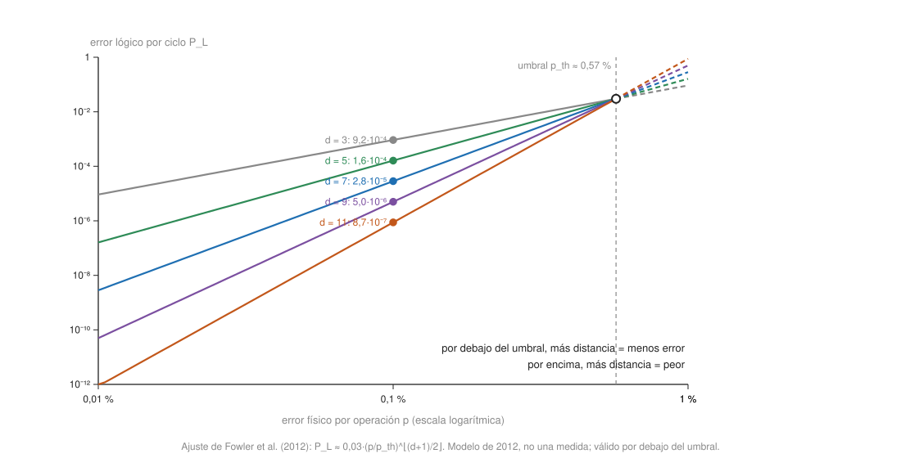

## Comprensión {#layer-2}

### Idea clave
Si la probabilidad de error de cada operación es menor que un valor constante `p_th` (el **umbral**, *threshold*), se puede calcular tanto tiempo como se quiera con una sobrecarga polilogarítmica: el error lógico cae al añadir distancia o niveles de codificación [@watrous-2025, L16.3, PDF pp. 486-487; @eisert-2025, Sec. III, p. 4].

### Explicación
Se asumen [los códigos de repetición](repetition-codes.md) y [el ruido cuántico](quantum-noise-channels.md); aquí se usa el modelo de errores independientes de ese concepto.

La pregunta de partida es si la corrección de errores no se come a sí misma. Un código añade qubits, puertas y medidas, y cada una puede fallar: las rondas de corrección pueden introducir más errores de los que arreglan, como una barca con fugas [@de-wolf-2026, §21.5, p. 199 [187]]. Tras el artículo de Shor de 1994 muchos físicos dudaban; la respuesta de la teoría de la tolerancia a fallos es que sí se puede, siempre que el error por operación sea razonablemente pequeño (se da como ejemplo un 1 %) y los errores en qubits distintos no estén muy correlacionados [@de-wolf-2026, §21.1, p. 195 [183]].

El enunciado informal es este: un circuito de tamaño `N` puede ejecutarse con alta precisión mediante un circuito ruidoso si la probabilidad de error en cada lugar del circuito es menor que un valor fijo `p_th > 0` que no depende de `N`; el circuito ruidoso tiene tamaño `O(N log^c N)` [@watrous-2025, L16.3, PDF pp. 486-487]. Dicho de otro modo, simular `L` puertas lógicas cuesta `O(L polylog L)` puertas físicas [@eisert-2025, Sec. III, p. 4]. Los primeros códigos de corrección son de 1995 y los esquemas tolerantes a fallos de 1996 [@eisert-2025, Sec. III, p. 4].

El umbral sale de una cuenta en dos pasos:

1. Un código que corrige un error y se aplica con ruido necesita que *dos* fallos coincidan para fallar. Con el [código de Steane](stabilizer-formalism.md), un error lógico necesita al menos dos fallos en un bloque, y la tasa de error lógico es como mucho `C p²` por lugar, con `C` que depende del código y de las puertas pero no de `N`. El umbral es entonces `p_th = 1/C` [@watrous-2025, L16.3, PDF pp. 488-489]. La misma idea con `CD` lugares de error por ronda da `p' ≈ (CD)² p²`, de modo que si `p` es menor que `1/(CD)²` cada nivel reduce el error [@de-wolf-2026, §21.6, p. 200 [188]].
2. *Concatenar* (volver a codificar cada qubit del código con el mismo código) `k` veces da un error lógico acotado por `(Cp)^{2ᵏ−1} p`, doblemente exponencial en `k`, mientras que el tamaño del circuito crece solo exponencialmente en `k` [@watrous-2025, L16.3, PDF p. 489]. Para sobrevivir `T = poly(n)` pasos basta `k = O(log log T)` niveles, lo que cuesta una sobrecarga polilogarítmica en qubits y tiempo [@de-wolf-2026, §21.6, p. 200 [188]].

El teorema supone cuatro cosas: (1) ruido estocástico independiente en cada lugar del circuito; (2) se cuentan los fallos de puertas, preparaciones, medidas y esperas; (3) el procesado clásico (por ejemplo, un algoritmo de emparejamiento) se supone perfecto; (4) las rondas de corrección se aplican repetida y paralelamente porque los errores no dejan de acumularse [@watrous-2025, L16 intro, PDF p. 471; L16.1, PDF pp. 472-475]. Además, la corrección de errores en sí no debe propagar errores dentro de un bloque: la corrección de Shor mide los generadores con un estado gato, la de Steane (solo CSS) propaga los errores a un bloque auxiliar que luego se mide, y la de Knill usa teleportación; los circuitos de estimación de fase de la teoría de estabilizadores no son tolerantes a fallos [@watrous-2025, L16.2, PDF pp. 485-487].

De la concatenación se pasa a una fórmula práctica para el código de superficie, donde el error lógico por ciclo escala como

```
ε_d ≈ A · (p / p_th)^((d+1)/2)
```

con `d` la distancia del código, `p` el error físico y `p_th` el umbral efectivo. El exponente se explica porque los fallos dominantes son `(d+1)/2` errores confundidos con `(d−1)/2` errores [@fowler-2012, p. 12, Fig. 5, Eq. 12]. Por debajo del umbral el error lógico cae exponencialmente con `d`; por encima crece con `d` [@fowler-2012, p. 11]. Se define además el *factor de supresión de errores* `Λ = ε_d / ε_{d+2} ≈ p_th / p`: cuánto cae el error lógico al subir la distancia en 2, y `Λ > 1` significa por debajo del umbral [@google-2025, p. 1].



### Ejemplo
Una cuenta con números (valores ilustrativos propios). Toma `C = 1000` (umbral `p_th = 0,1 %`) y un código de 7 qubits como el de Steane. Con `p = 0,01 % = 10⁻⁴`, `Cp = 0,1`:

| Niveles `k` | Qubits por qubit lógico (`7ᵏ`) | Error lógico `(Cp)^{2ᵏ−1} p` |
|---|---|---|
| 1 | 7 | `0,1¹ · 10⁻⁴ = 10⁻⁵` |
| 2 | 49 | `0,1³ · 10⁻⁴ = 10⁻⁷` |
| 3 | 343 | `0,1⁷ · 10⁻⁴ = 10⁻¹¹` |
| 4 | 2401 | `0,1¹⁵ · 10⁻⁴ = 10⁻¹⁹` |

Con `p = 0,2 %`, en cambio, `Cp = 2`, y el nivel 1 da `2¹ · 0,002 = 0,004`, peor que el `0,002` sin codificar: por encima del umbral, codificar empeora. Es la misma conducta que se ve en el [código de Shor](shor-code.md) por encima de su punto de equilibrio [@watrous-2025, L16.1, PDF p. 475]. (Las cifras de `C` y los conteos de qubits son un ejemplo de aula; el recuento de qubits ignora ancillas.)

Con el ajuste de Fowler para el código de superficie, `P_L ≈ 0,03 (p/p_th)^((d+1)/2)` por ciclo con `p_th = 0,57 %` (el exponente se redondea hacia abajo para `d` par), y `p = 0,1 %`, `p/p_th = 0,175` y `Λ = 5,7`; con `d = 3, 5, 7` salen errores por ciclo de unos `9·10⁻⁴`, `1,6·10⁻⁴` y `2,8·10⁻⁵` (cálculo propio a partir del ajuste) [@fowler-2012, p. 11, Eqs. 10-11]. Cerca del umbral, `p = 0,5 %`, la razón es 0,877 y subir de `d = 3` a `d = 11` solo reduce el error de `2,3·10⁻²` a `1,4·10⁻²`: por eso los códigos grandes solo valen la pena bien por debajo del umbral. El número de qubits crece rápido al acercarse `p` a `p_th` [@fowler-2012, pp. 12-13, Fig. 6].

### Errores frecuentes
- *"Umbral significa que por debajo todo funciona."* El teorema dice que existe un umbral y que por debajo se puede suprimir el error; no dice cuánto cuesta. Es un resultado teórico y la demostración habitual no da necesariamente un método práctico [@watrous-2025, L16.3, PDF pp. 487-488].
- *"El umbral es una propiedad del hardware."* Es una propiedad del conjunto código-circuito-decodificador-modelo de ruido [@bravyi-2024, p. 1]; el mismo qubit tiene umbrales distintos con códigos distintos.
- *"Si no se cumple el teorema, la computación cuántica es imposible."* Al revés: si fuese falso sería difícil imaginar la computación cuántica a gran escala, y el teorema es la respuesta principal a los escépticos y uno de los resultados más importantes del campo, aunque "extremadamente difícil" como ingeniería [@watrous-2025, L16.3, PDF pp. 487-488; @de-wolf-2026, §21.6, p. 201 [189]].
- *"Estar por debajo del umbral significa un qubit útil."* Solo significa que añadir distancia ayuda; el tamaño que se necesita depende de cuánto por debajo se esté.

### Las fuentes discrepan
El umbral no es un único número: depende del modelo de ruido, del conjunto de puertas permitido y del código [@de-wolf-2026, §21.6, pp. 200-201 [188-189]]. Valores citados en las fuentes, con su contexto:

- ≈ 0,1 %: mejor cota inferior *rigurosa* con hipótesis razonables de ruido. De Wolf [@de-wolf-2026, §21.6, p. 201 [189]].
- unos pocos %: evidencia numérica de lo que podría tolerarse. De Wolf [@de-wolf-2026, §21.6, p. 201 [189]].
- 0,1 % a 1 %: código de superficie con las mejores construcciones. Watrous [@watrous-2025, L16.3, PDF pp. 489-490].
- ≈ 2·10⁻⁵ por paso: Steane y Bacon-Shor en una red 2D de vecinos próximos (2012). Fowler [@fowler-2012, p. 2].
- 0,57 % por paso: código de superficie en el modelo de ruido de circuito de Fowler. Fowler [@fowler-2012, pp. 11-12].
- ≈ 0,7 % - 0,8 %: códigos bicicleta de IBM; ver nota abajo. Bravyi y colaboradores [@bravyi-2024, p. 1; p. 5; p. 6].
- ≈ 10⁻²: código de superficie, error de puerta de dos qubits. Eisert y Preskill [@eisert-2025, Box 2, p. 5].

Para el código de Steane con destilación de estados mágicos, Watrous dice que el umbral es minúsculo y probablemente inalcanzable, y espera que los umbrales suban y el ruido del hardware baje [@watrous-2025, L16.3, PDF pp. 489-490]. La nota de Eisert y Preskill dice que el 10⁻² es aproximado y basado en simulaciones; ellos usan `P_L ≈ 0,1 (p_phys/p_th)^((d+1)/2)`, mientras que Fowler ajusta el prefactor a 0,03 [@eisert-2025, Box 2, p. 5; @fowler-2012, p. 11]. En Bravyi y colaboradores, el resumen dice 0,8 %, mientras que las tablas dan pseudo-umbrales de 0,0065 y 0,0069 para los códigos de 144 y 288 qubits; el pseudo-umbral (el punto donde `p_L(p) = kp`) es otra cantidad que un umbral asintótico [@bravyi-2024, p. 1; Tabla 1, p. 5; p. 6]. Conviene fijarse en qué cantidad se informa.

### Para seguir
La capa 3 convierte estas fórmulas en un presupuesto de distancia y de qubits. Antes, [el código de superficie](surface-code.md) aplica la fórmula del exponente a un código real.

## Profesional {#layer-3}

### Idea clave
En la práctica la pregunta es qué distancia y cuántos qubits hacen falta para un error lógico objetivo, dado un error físico `p` o un `Λ` medido; hay dos recetas, y ambas dejan de valer si el exponente deja de mantenerse [@eisert-2025, Box 2, p. 5; @google-2025, pp. 1-3].

### Explicación
La receta A parte de la fórmula: se despeja `d` en `A (p/p_th)^((d+1)/2) ≤ P_L` con `A = 0,1` y `p_th = 10⁻²` [@eisert-2025, Box 2, p. 5]. Para `P_L = 10⁻¹¹` (adecuado para 10³ qubits lógicos durante 10⁸ pasos) con `p_phys = 10⁻³`, hace falta `d ≈ 19`, que son unos 10³ qubits físicos por qubit lógico contando ancillas y sobrecarga de puertas, o sea unos 10⁶ qubits en total [@eisert-2025, Box 2, p. 5].

La receta B parte de un `Λ` medido: con un error conocido a una distancia `d₀`, `ε_d = ε_{d₀} / Λ^{(d−d₀)/2}`. El experimento de Google da `ε₇ = 1,43·10⁻³` en `d = 7` y `Λ = 2,14 ± 0,02` con decodificador de red neuronal [@google-2025, pp. 1-3]. Es coherente con su proyección de que reducir a la mitad los errores físicos mejora el rendimiento de `d = 27` en unos cuatro órdenes de magnitud [@google-2025, p. 7]: si `Λ ≈ p_th/p` se duplica, el error cae un factor `2^{(d+1)/2} = 2¹⁴ ≈ 1,6·10⁴` con `d = 27` (comprobación propia). Los propios autores extrapolan que un error lógico de 10⁻⁶ requeriría `d = 27` con 1457 qubits físicos [@google-2025, p. 6]; con las cifras anteriores, `1,43·10⁻³ / 2,14¹⁰ ≈ 7,1·10⁻⁷` y `2·27² − 1 = 1457` (comprobación propia).

Las dos recetas suponen que el exponente se mantiene al ir a distancias mayores, y en los datos hay motivos para dudar:

- Las curvas de inyección de errores se ajustaron a solo un 80 % del exponente ideal `(d+1)/2`, que se atribuye a correlaciones [@google-2025, p. 3, Fig. 2b].
- En el código de repetición de distancia 29 el escalado exponencial se rompe a partir de `d ≥ 15`, con un suelo de unos 10⁻¹⁰ por ciclo debido a ráfagas de errores correlacionados [@google-2025, pp. 4-5].
- `Λ` se midió hasta `d = 7` y se simuló hasta `d = 11` [@google-2025, pp. 2-3].

Una extrapolación a `10⁻¹²` desde `d = 7` es, por tanto, mucho más arriesgada que una a `10⁻⁶`, como las que hacen los propios autores [@google-2025, p. 6].

Para trabajar con el modelo de ruido real:

- *Medir `Λ` y no el "umbral" (criterio propio).* El umbral no se mide directamente en un experimento; `Λ` sí, y es lo que fija el coste. Google lo compara con la simulación de su modelo de ruido, que da `Λ = 2,25 ± 0,02` [@google-2025, pp. 2-3].
- *Vigilar la estabilidad.* En 16 repeticiones a lo largo de 15 horas en el dispositivo de 72 qubits, `Λ` fue `2,18 ± 0,07` de media, con un máximo de `2,31 ± 0,02`; los códigos mayores fueron menos sensibles a qubits fluctuantes [@google-2025, p. 4, Fig. 2e].
- *Comprobar la definición.* Un umbral de un código, de un circuito y de un decodificador no se pueden comparar si no coinciden (el caso de IBM en la tabla de la capa 2).
- *Considerar el modelo de ruido real.* Si domina el borrado, el umbral puede subir casi un orden de magnitud [@saffman-2025, pp. 21-22]; si domina la medida, la pregunta sigue abierta [@bravyi-2024, p. 31].

Los esquemas modernos casi nunca concatenan códigos pequeños: el código de superficie logra umbrales de ≈ 1 % con un decodificador clásico eficiente y conectividad 2D, y la alternativa de IBM, los códigos qLDPC, busca bajar el coste manteniendo un umbral parecido (ver [código de superficie](surface-code.md)) [@bravyi-2024, pp. 1-2]. Otra posibilidad es concatenar un código de alta tasa con el código de superficie, como propusieron Pattison, Krishna y Preskill, que aprovecha la localidad y el umbral del código de superficie pero paga mucha sobrecarga en qubits [@bravyi-2024, p. 29]. Y en la fotónica, la corrección se hace con redes de medidas de fusión, no con un circuito de puertas; el umbral se define frente a borrado y error de fusión [@bartolucci-2023, §I B, p. 2; §VI.C.1, p. 13]. La lección para el programador: "el umbral" siempre tiene apellidos (código, modelo de ruido, decodificador).

### Ejemplo
Receta A, con `P_L = 10⁻¹¹` y `p_phys = 10⁻³`: `0,1 · (10⁻³/10⁻²)^{(d+1)/2} ≤ 10⁻¹¹` pide `0,1^{(d+1)/2} ≤ 10⁻¹⁰`, luego `(d+1)/2 = 10` y `d = 19`. Con `n = d²` datos (más ancillas), el parche de `d = 19` tiene `19² = 361` qubits de datos; con `2d² − 1 = 721` incluye los de medida (ver [código de superficie](surface-code.md)) [@eisert-2025, Box 2, p. 5].

Receta B, con el experimento de Google y un objetivo de `10⁻¹²`: hace falta `Λ^{(d−7)/2} ≥ 1,43·10⁻³ / 10⁻¹² = 1,43·10⁹`.

- Con `Λ = 2,14`: `(d−7)/2 ≥ ln(1,43·10⁹)/ln 2,14 = 21,08/0,761 = 27,7`, es decir 28 pasos y `d = 63`: `2·63² − 1 = 7937` qubits físicos por qubit lógico.
- Con `Λ = 2,00`: `(d−7)/2 ≥ 30,4`, es decir 31 pasos y `d = 69`: `2·69² − 1 = 9521` qubits.
- Con `Λ = 4`: `(d−7)/2 ≥ 15,2`, es decir 16 pasos y `d = 39`: `2·39² − 1 = 3041` qubits.

Pasar de `Λ = 2` a `Λ = 4` divide por 3,1 los qubits por parche (9521/3041; cálculo propio).

El siguiente programa reproduce las dos recetas; se probó con Python estándar:

```python
import math

def min_distance_from_lambda(eps_ref, d_ref, lam, target):
    """Menor d impar con eps_ref / lam**((d - d_ref)/2) <= target."""
    steps = math.ceil(math.log(eps_ref / target) / math.log(lam) - 1e-9)  # tolerancia por redondeo
    return d_ref + 2 * max(steps, 0)

def min_distance_from_formula(p, p_th, target, a=0.1):
    """Menor d impar con a * (p / p_th)**((d + 1) / 2) <= target."""
    half = math.ceil(math.log(target / a) / math.log(p / p_th) - 1e-9)
    return 2 * half - 1

def qubits_rotated_patch(d):
    return 2 * d * d - 1          # d^2 de datos + (d^2 - 1) de medida

for lam in (2.0, 2.14, 4.0):
    d = min_distance_from_lambda(1.43e-3, 7, lam, 1e-12)
    print(f"Lambda={lam}: d={d}, qubits por parche={qubits_rotated_patch(d)}")
d = min_distance_from_formula(1e-3, 1e-2, 1e-11)
print("fórmula: d =", d, "qubits =", qubits_rotated_patch(d))
```

Salida: `Λ=2,0: d=69, 9521`; `Λ=2,14: d=63, 7937`; `Λ=4,0: d=39, 3041`; fórmula: `d=19, 721`. (El `-1e-9` evita que un redondeo de coma flotante, `10.000000000000002`, sume un paso de más.)

### Las fuentes discrepan
La cifra de `Λ` depende del decodificador. Con el decodificador de emparejamiento sintetizado, Google mide `Λ = 2,04 ± 0,02` y `ε₇ = 1,71·10⁻³`, frente a `2,14` y `1,43·10⁻³` con la red neuronal [@google-2025, pp. 1-3]. Con esos valores el mismo cálculo da `ln(1,71·10⁹)/ln 2,04 = 29,8`, 30 pasos, `d = 67` y 8977 qubits: un 13 % más que con `Λ = 2,14` (cálculo propio). Un buen decodificador es parte del presupuesto (ver [decodificación](decoding.md)); conviene leer `Λ` con su incertidumbre y con su decodificador.

### Para seguir
[El código de superficie](surface-code.md) aplica estas fórmulas; [la estimación de recursos](resource-estimation.md) las combina con el coste de las puertas no Clifford.
