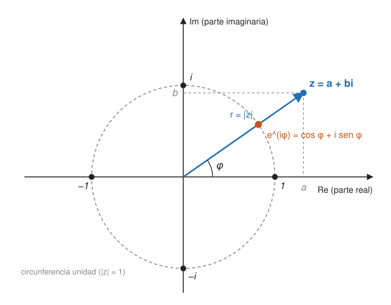

## Fundamentos {#layer-1}

Un **número complejo (complex number)** es un par de reales escrito `a + bi`, donde `i` cumple `i² = -1`. La suma se hace componente a componente y el producto sale de aplicar las reglas usuales con `i² = -1`: `(a+bi)(c+di) = (ac-bd) + (ad+bc)i`. Axler aconseja volver a deducirlo en vez de memorizarlo [@axler-2024, def. 1.1, ex. 1.2, PDF pp. 20-21].

**Ejemplo.** `(1+2i)(3-i) = 3 - i + 6i - 2i² = 3 + 5i + 2 = 5 + 5i`.

Hay tres operaciones que se usan constantemente:

- **Parte real e imaginaria:** de `3+2i`, la parte real es 3 y la imaginaria es 2.
- **Conjugado (complex conjugate):** cambia el signo de la parte imaginaria; el de `3+2i` es `3-2i`.
- **Módulo o valor absoluto (modulus):** `|z| = √((Re z)² + (Im z)²)`; para `3+2i` es `√13` [@axler-2024, def. 4.1-4.3, PDF p. 138].

Si se identifica `z` con el punto `(Re z, Im z)`, `|z|` es la distancia al origen [@axler-2024, §4, PDF p. 138]. Una identidad muy útil: `z · conj(z) = |z|²` [@axler-2024, 4.4, PDF p. 139].

Los números de módulo 1 forman la **circunferencia unidad** y se escriben `e^{iφ} = cos φ + i sin φ`; en general `c = r·e^{iφ}` con `r = |c|` y `φ` el ángulo con el eje horizontal positivo (forma polar) [@de-wolf-2026, App. B.1, p. 211]. El conjugado de `r·e^{iφ}` es `r·e^{-iφ}` [@de-wolf-2026, App. B.1, p. 211].

**Para qué sirve en computación cuántica.** Las **amplitudes (amplitudes)** de un estado cuántico son números complejos [@de-wolf-2026, §1.2.1, p. 15]. Un vector de estado se define por dos propiedades: sus entradas son complejas y la suma de los módulos al cuadrado es 1 [@watrous-2025, L1.2, p. 18]. Por ejemplo, `(1+2i)/3 |0⟩ - (2/3)|1⟩` es un estado válido porque `|1+2i|²/9 + 4/9 = 5/9 + 4/9 = 1` [@watrous-2025, L1.2, pp. 19-20].

## Comprensión {#layer-2}

**Por qué complejos y no solo reales.** El teorema fundamental del álgebra dice que todo polinomio no constante con coeficientes complejos tiene un cero complejo; es falso sobre los reales (`1+x²`), y Axler atribuye a ello las diferencias entre el álgebra lineal real y la compleja [@axler-2024, 4.12, 4.13, PDF pp. 143-145]. La consecuencia que más importa aquí: todo operador sobre un espacio complejo de dimensión finita (no nulo) tiene un valor propio, mientras que una rotación de 90 grados en `R²` no tiene ninguno real pero sí `i` y `-i` sobre `C` [@axler-2024, 5.19, 5.9, PDF pp. 153-161]. Ver [valores y vectores propios](eigenvalues-and-eigenvectors.md).

**Propiedades del conjugado y el módulo** que se usan sin parar: `conj(wz) = conj(w)·conj(z)`, `|wz| = |w||z|`, `|conj(z)| = |z|` y la desigualdad triangular `|w+z| ≤ |w|+|z|` [@axler-2024, 4.4, PDF p. 139]. Un número es real si y solo si es igual a su conjugado [@axler-2024, §4, PDF p. 138]. Una identidad geométrica práctica: `|1 - e^{iθ}| = 2|sin(θ/2)|` [@de-wolf-2026, App. B.1, pp. 211-212].

**Módulo y fase juegan papeles distintos.** La probabilidad de medir un resultado en la base estándar es el módulo al cuadrado de la amplitud (regla de Born), así que un signo o una fase no cambian esas probabilidades; por eso `|+⟩` y `|-⟩` dan ambos 1/2 y 1/2 [@watrous-2025, L1.2, pp. 23-24]. Pero las fases sí cambian el estado: aplicando `H` y midiendo se distingue `|+⟩` de `|-⟩` con certeza [@watrous-2025, L1.2, p. 27].

**Fase global frente a fase relativa.** Si `|φ⟩ = α|ψ⟩` con `|α| = 1` (es decir `α = e^{iθ}`), ambos estados dan las mismas probabilidades y siguen siendo iguales salvo ese factor bajo cualquier unitaria, por lo que se tratan como el mismo estado (ejemplo: `|-⟩` y `-|-⟩`). Una fase aplicada solo a algunas entradas es **relativa** y sí importa: `|+⟩` y `|-⟩` no son equivalentes [@watrous-2025, L3.3, pp. 91-92]. De Wolf lo resume así: una fase global no tiene significado físico [@de-wolf-2026, §1.2.2, p. 16].

**Error típico:** pensar que "la fase no se ve, luego no importa". Solo la fase global es invisible; las fases relativas controlan la interferencia.

**Operación de fase.** `P_θ = diag(1, e^{iθ})` es unitaria; `S = P_{π/2} = diag(1, i)`, `T = P_{π/4}` y `Z = P_π` son casos particulares [@watrous-2025, L1.2, p. 26]. Ver [matrices unitarias y hermíticas](unitary-and-hermitian-matrices.md).

## Profesional {#layer-3}

**Raíces de la unidad y sumas geométricas.** Aparecen en la transformada de Fourier cuántica y en muchos análisis de algoritmos. La suma `Σ_{j=0}^{m-1} z^j` vale `m` si `z = 1` y `(1 - z^m)/(1 - z)` en otro caso; para una raíz de la unidad `z = e^{2πir/N}` con `r ∈ {1,…,N-1}`, la suma sobre `j = 0..N-1` es 0 [@de-wolf-2026, App. B.1, p. 211]. Esa cancelación es la que produce la interferencia destructiva en las amplitudes.

**Cómo razonar con fases en la práctica.**

- Calcula con la forma polar cuando multipliques (los módulos se multiplican y los ángulos se suman) y con la forma cartesiana cuando sumes. Que `|wz| = |w||z|` [@axler-2024, 4.4, PDF p. 139] garantiza que multiplicar por `e^{iφ}` nunca cambia el módulo.
- Al comparar dos estados (por ejemplo, el resultado de dos circuitos supuestamente equivalentes), la igualdad debe entenderse salvo fase global [@watrous-2025, L3.3, pp. 91-92].
- Una puerta de fase `diag(1, e^{iθ})` y la misma multiplicada por `e^{iα}` actúan igual sobre los estados salvo fase global; pero dentro de una puerta *controlada* esa fase pasa a ser relativa. [unverified]

**Uso del análisis complejo.** Axler señala que la estructura de `C` como espacio vectorial es doble: 1-dimensional sobre `C` y 2-dimensional sobre `R` [@axler-2024, §4, PDF p. 138; §2C, PDF p. 63]. Conviene tenerlo presente al contar parámetros reales: un estado de `n` qubits tiene `2^n` amplitudes complejas, es decir `2^{n+1}` reales, antes de imponer normalización y descartar la fase global.

Las fuentes no repasan aritmética compleja más allá de lo citado (Watrous usa conjugado, módulo y fase como herramientas ya conocidas); para más práctica hay que acudir a otro texto.
