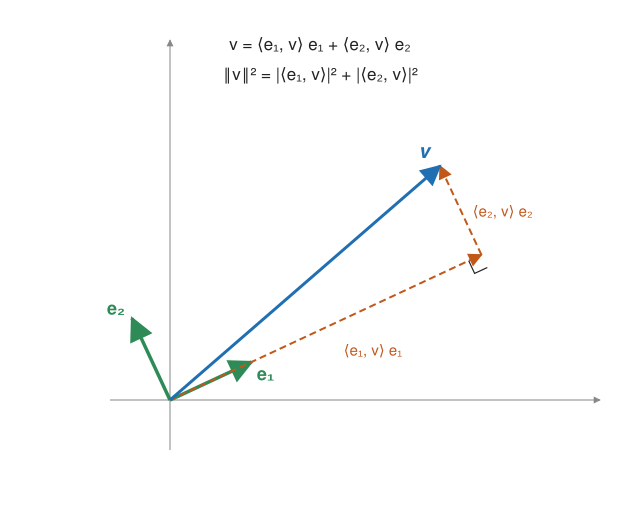

## Fundamentos {#layer-1}

La **norma (norm)** de un vector de `C^n` es la raíz de la suma de los módulos al cuadrado: `‖v‖ = √(Σ|v_i|²)`, la longitud euclídea de siempre [@de-wolf-2026, App. A.3, p. 206]. Los vectores de estado cuánticos son exactamente los vectores de norma 1 [@watrous-2025, L1.2, pp. 18-19].

El **producto interior (inner product)** de dos vectores es `⟨v|w⟩ = Σ_i conj(v_i)·w_i`: la fila conjugada de `v` por la columna `w` [@de-wolf-2026, App. A.3, p. 206; @watrous-2025, L3.2, p. 80]. Se conjuga porque con módulos `‖z‖² = Σ|z_k|²`, y por eso intercambiar los argumentos conjuga el resultado [@axler-2024, §6A, PDF pp. 200-201]. Se cumple `⟨ψ|ψ⟩ = ‖ψ‖²` [@watrous-2025, L3.2, p. 81].

Dos vectores son **ortogonales (orthogonal)** si `⟨v|w⟩ = 0`; son **ortonormales (orthonormal)** si además tienen norma 1 [@de-wolf-2026, App. A.3, p. 206]. En `R²`, `⟨u,v⟩ = ‖u‖‖v‖cos θ`, de ahí que ortogonal signifique perpendicular [@axler-2024, def. 6.10, 6.11, PDF p. 205].

**Ejemplo.**

- `⟨0|1⟩ = 0` y `⟨0|0⟩ = 1`: la base estándar es ortonormal.
- `⟨+|-⟩ = (1/√2)(1/√2) + (1/√2)(-1/√2) = 1/2 - 1/2 = 0`: `|+⟩` y `|-⟩` son ortogonales, y forman otra base ortonormal [@watrous-2025, L3.2, p. 83].
- Con complejos: `ψ = (1, i)ᵀ`, `φ = (1, 1)ᵀ` dan `⟨ψ|φ⟩ = conj(1)·1 + conj(i)·1 = 1 - i`, mientras que `⟨φ|ψ⟩ = 1 + i`; son conjugados entre sí.

**Para qué sirve.** La regla de Born: al medir `|φ⟩ = Σα_j|j⟩` en la base computacional se obtiene `j` con probabilidad `|α_j|²`, por lo que el vector de amplitudes debe tener norma 1 [@de-wolf-2026, §1.2.2, p. 16]. Si se mide en otra base ortonormal `{ψ_j}`, la probabilidad es `|⟨φ|ψ_j⟩|²` [@de-wolf-2026, §1.2.2, p. 17]. En el ejemplo: medir `|+⟩` en la base estándar da `|⟨0|+⟩|² = (1/√2)² = 1/2`.

## Comprensión {#layer-2}

**Propiedades del producto interior.** Es simétrico conjugado, `⟨ψ|φ⟩ = conj(⟨φ|ψ⟩)`, definido positivo (`⟨ψ|ψ⟩ ≥ 0`, con igualdad solo para el vector cero), lineal en un argumento y conjugado-lineal en el otro [@watrous-2025, L3.2, pp. 81-82]. La norma cumple `‖λv‖ = |λ|‖v‖` [@axler-2024, 6.9, PDF p. 204].

**Desigualdades y teoremas básicos.**

- **Pitágoras:** si `u ⊥ v`, entonces `‖u+v‖² = ‖u‖² + ‖v‖²` [@axler-2024, 6.12, PDF p. 205].
- **Cauchy-Schwarz:** `|⟨u,v⟩| ≤ ‖u‖‖v‖`, con igualdad si y solo si un vector es múltiplo del otro; de ella sale la desigualdad triangular [@axler-2024, 6.14, 6.17, PDF pp. 207-208].
- Para vectores unitarios, `Re⟨v|w⟩ = 1 - ½‖v-w‖²`: vectores unitarios cercanos tienen producto interior cercano a 1 [@de-wolf-2026, App. A.3, p. 206].

**Por qué las bases ortonormales son tan cómodas.** Si `e₁..e_n` es una base ortonormal, entonces `v = Σ⟨e_k|v⟩ e_k` en notación de física (en la de Axler, `Σ⟨v,e_k⟩ e_k`) y `‖v‖² = Σ|⟨e_k|v⟩|²` (Parseval): los coeficientes son simples productos interiores, sin resolver ningún sistema lineal [@axler-2024, 6.30, 6.31, PDF pp. 218-219]. Esto es exactamente lo que hace la regla de Born en una base `{ψ_j}`: las amplitudes en esa base son `⟨ψ_j|φ⟩` y la normalización es Parseval.

Una lista ortonormal es automáticamente linealmente independiente, y una de longitud `dim V` es una base ortonormal [@axler-2024, 6.24, 6.25, 6.28, PDF pp. 216-217]. Toda lista ortonormal se puede extender a una base ortonormal, por ejemplo con Gram-Schmidt [@watrous-2025, L3.2, p. 83].

**Descomposición ortogonal.** Para `v ≠ 0`, `u = (⟨u,v⟩/‖v‖²) v + w` con `w` ortogonal a `v` [@axler-2024, 6.13, PDF p. 206]. Es la proyección de `u` sobre `v`; con `v` unitario, `⟨v,u⟩v` en física es `|v⟩⟨v|u⟩`, que es la matriz proyector `|v⟩⟨v|` (ver [matrices unitarias y hermíticas](unitary-and-hermitian-matrices.md)).

**Consecuencia física importante.** Dos estados no ortogonales (`⟨φ|ψ⟩ ≠ 0`) no se pueden distinguir con certeza; los estados perfectamente distinguibles deben ser ortogonales [@watrous-2025, L3.3, p. 95; la demostración continúa más allá de lo leído].

**Error típico.** Olvidar que `⟨v|w⟩` no es simétrico: es `conj(⟨w|v⟩)`. Para una probabilidad da igual, porque se usa el módulo al cuadrado.

## Profesional {#layer-3}

**Trampa de convenciones: en qué argumento se conjuga.** Axler es lineal en el primer argumento y conjugado-lineal en el segundo; señala que muchos físicos usan la convención opuesta [@axler-2024, def. 6.2 y nota posterior, PDF p. 202]. De Wolf conjuga el primero (convención de física; los matemáticos suelen conjugar el segundo) [@de-wolf-2026, App. A.3, p. 206], y Watrous también [@watrous-2025, L3.2, pp. 80-82]. Reglas prácticas:

- Con Axler: `⟨u,v⟩_Axler = Σ u_k conj(v_k) = ⟨v|u⟩_física`. Al traducir un teorema, intercambia los argumentos (el producto euclídeo de Axler es la suma de `w_k` por `conj(z_k)` [@axler-2024, ex. 6.3, PDF p. 202]).
- El adjunto (`⟨Tv,w⟩ = ⟨v,T*w⟩`) es igual en ambas convenciones; lo que cambia es dónde caen los conjugados al expandir en coordenadas.
- Los textos de física escriben `⟨φ|A|ψ⟩`; es el producto interior de `|φ⟩` con `A|ψ⟩`, conjugando `φ`.

**Teorema de Riesz.** En dimensión finita, todo funcional lineal es de la forma `φ(u) = ⟨u,v⟩` para un único `v` [@axler-2024, 6.42, PDF p. 223]. En notación de Dirac, es la correspondencia ket ↔ bra, y de ella sale la existencia del adjunto [@axler-2024, def. 7.1, 7.4, PDF pp. 246-247].

**Gram-Schmidt en la práctica.** Convierte una lista independiente `v₁..v_m` en una ortonormal con el mismo span en cada paso, restando a `v_k` sus componentes sobre los vectores anteriores y normalizando [@axler-2024, 6.32, PDF p. 219]. Garantiza que todo espacio de dimensión finita tiene una base ortonormal y que cualquier lista ortonormal se extiende a una [@axler-2024, 6.35, 6.36, PDF pp. 220-221]. Sirve para completar un conjunto de vectores ortonormales a una matriz unitaria [@watrous-2025, L3.2, p. 85].

**Normas y productos tensoriales.** `‖φ⊗ψ‖ = ‖φ‖‖ψ‖` [@watrous-2025, L2.2, p. 51], y el producto interior se factoriza: `⟨v⊗w, u⊗x⟩ = ⟨v,u⟩⟨w,x⟩` [@axler-2024, 9.80, 9.82, PDF pp. 394-395]. Así, los estados de base de `n` qubits son ortogonales si y solo si difieren en algún bit [@de-wolf-2026, §1.3, p. 19]. Ver [producto tensorial](tensor-products.md).

**Distancia entre estados.** La norma induce la distancia `‖v-w‖` [@de-wolf-2026, App. A.3, p. 206]; junto con la identidad del apartado anterior, justifica usar `|⟨v|w⟩|` como medida de cuán parecidos son dos estados (salvo fase global). Con estados puros, esta cantidad (o su cuadrado) es la que se suele llamar fidelidad [unverified].
