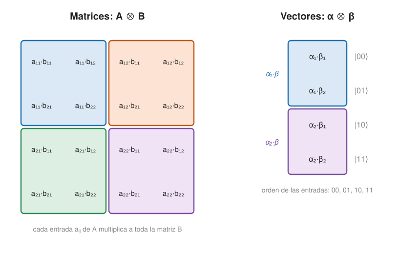

## Fundamentos {#layer-1}

Para describir dos o más sistemas a la vez se usa el **producto tensorial (tensor product)** `⊗`. Los estados clásicos de un sistema conjunto `(X,Y)` son los pares del producto cartesiano `Σ × Γ`, y un estado conjunto es un vector indexado por ellos [@watrous-2025, L2.1, pp. 32-34]. Los pares se ordenan alfabéticamente: `00, 01, 10, 11`, con el símbolo de la izquierda más significativo [@watrous-2025, L2.1, p. 35].

**Producto de dos vectores (Kronecker).** Para columnas, `(α₁..α_m) ⊗ (β₁..β_k)` lista `α₁` por todo `β`, luego `α₂` por `β`, etc. [@watrous-2025, L2.1, pp. 37-38]. Equivale a `|φ⟩⊗|ψ⟩ = Σ α_a β_b |ab⟩`.

**Ejemplos.**

- `|0⟩ ⊗ |1⟩ = (1,0)ᵀ ⊗ (0,1)ᵀ = (0,1,0,0)ᵀ = |01⟩` [@watrous-2025, L2.1, pp. 38-39].
- `(1,2) ⊗ (3,4) = (3,4,6,8)`: primero `1·(3,4)` y luego `2·(3,4)`.
- `|+⟩ ⊗ |0⟩ = (1/√2)(1,0,1,0)ᵀ = (|00⟩+|10⟩)/√2`.

**Para qué sirve.** Un registro de `n` qubits vive en el producto tensorial de `n` espacios de un qubit, con `2^n` estados de base `|b₁⟩⊗…⊗|b_n⟩`, abreviados `|b₁…b_n⟩` [@de-wolf-2026, §1.3, p. 19]. De ahí sale el tamaño exponencial del vector de estado: la dimensión del producto es el producto de las dimensiones [@axler-2024, 9.72, PDF p. 390].

**Producto de matrices.** Para `A` de `m×n` y `B` de `m'×n'`, `A⊗B` es la matriz por bloques de `mm'×nn'` con bloques `A_ij·B` (producto de Kronecker) [@de-wolf-2026, App. A.6, p. 208]. Ejemplo: `H⊗I` es una matriz 4×4 con los bloques `(1/√2)·I`, `(1/√2)·I`, `(1/√2)·I`, `-(1/√2)·I`, es decir `H` actúa sobre el primer qubit y deja intacto el segundo [@watrous-2025, L2.2, pp. 65-66].

## Comprensión {#layer-2}

**Propiedades de `⊗`.** Es bilineal y los escalares se mueven libremente: `α|φ⟩⊗|ψ⟩ = |φ⟩⊗α|ψ⟩` [@watrous-2025, L2.1, pp. 38-39; @axler-2024, 9.73, PDF p. 390]. No es conmutativo: `|φ⟩⊗|π⟩` es en general distinto de `|π⟩⊗|φ⟩`; etiquetar los kets con el nombre del sistema permite reordenarlos al calcular [@watrous-2025, L2.2, p. 60].

Para matrices: `(A⊗B)* = A*⊗B*` (sin cambiar el orden de factores), distributiva, asociativa y la **regla del producto mixto** `(A⊗B)(C⊗D) = (AC)⊗(BD)` [@de-wolf-2026, App. A.6, p. 209]. En términos de entradas, `⟨ac|M⊗N|bd⟩ = ⟨a|M|b⟩⟨c|N|d⟩` [@watrous-2025, L2.1, p. 47]. También `Tr(A⊗B) = Tr(A)Tr(B)` [@de-wolf-2026, App. A.7, p. 209].

**La norma y el producto interior se multiplican.** `‖φ⊗ψ‖ = ‖φ‖‖ψ‖`, de modo que el producto de vectores unitarios es unitario [@watrous-2025, L2.2, p. 51]. Con bases ortonormales `{e_j}`, `{f_k}`, la familia `{e_j⊗f_k}` es una base ortonormal del producto [@axler-2024, 9.83, PDF p. 395].

**Estados producto y estados entrelazados.** Un **estado producto (product state)** es `|φ⟩⊗|ψ⟩`; significa que los dos sistemas "no tienen nada que ver" [@watrous-2025, L2.2, p. 51]. Un vector de estado que no es producto está **entrelazado (entangled)**. Por ejemplo `(|00⟩+|11⟩)/√2` no lo es: si fuese `(a,b)⊗(c,d) = (ac,ad,bc,bd)`, necesitaría `ac ≠ 0`, `bd ≠ 0` y `ad = bc = 0`, imposible. Es la contradicción de Watrous con entradas; el valor `1/√2` no importa, solo que sea no nulo, así que `(3/5)|00⟩ + (4/5)|11⟩` también está entrelazado [@watrous-2025, L2.2, p. 52].

**Contrapartida clásica.** Para probabilidades, independencia significa que el vector conjunto es un producto tensorial de vectores de probabilidad: `(1/6, 1/12, 1/2, 1/4) = (1/4, 3/4) ⊗ (2/3, 1/3)`; `½|00⟩ + ½|11⟩` (bits correlados) no lo es [@watrous-2025, L2.1, pp. 35-37]. Ver [probabilidad básica](probability-basics.md).

**Operaciones sobre una parte.** Una operación `U` sobre el primer sistema es `U⊗I`; sobre el segundo, `I⊗U` [@watrous-2025, L2.2, pp. 65-66]. De igual modo, un observable `A` sobre la primera parte actúa como `A⊗I` [@de-wolf-2026, §1.2.2, p. 17].

**Error típico.** Creer que toda operación sobre dos qubits es un producto `U⊗V`. SWAP y CNOT no se pueden escribir como producto tensorial de unitarias [@watrous-2025, L2.2, p. 66].

## Profesional {#layer-3}

**Estructura parcial del producto tensorial.** No todo elemento de `V⊗W` es de la forma `v⊗w`: si `dim V > 1` y `dim W > 1`, los tensores puros son un subconjunto propio y los elementos generales son sumas finitas de ellos; esa representación no es única [@axler-2024, observación tras 9.74, PDF pp. 391, 394]. En `F^m⊗F^n`, las coordenadas de `v⊗w` en la base `{e_j⊗f_k}` son los productos `v_j w_k`, que se pueden ordenar como la matriz `m×n` de entradas `v_j w_k` [@axler-2024, ex. 9.76, PDF p. 392]. Un vector general de `V⊗W` tiene coordenadas `α_{jk}` arbitrarias, que forman una matriz arbitraria; es producto puro exactamente cuando esa matriz tiene rango 1, de modo que el entrelazamiento se detecta por el rango [unverified].

**Por qué los estados entrelazados no son estados producto.** Un estado producto de dos subsistemas se describe con `m+n` amplitudes (las de cada factor) mientras que un estado general del conjunto tiene `mn` componentes; en un estado entrelazado esa descripción por partes no existe (el recuento es aritmética sobre las dimensiones citadas). Para vectores de estado cuánticos, entrelazado equivale a "no producto"; la fuente advierte que con estados ruidosos (matrices densidad) no es tan simple [@watrous-2025, L2.2, p. 52]. Además, un vector de estado no tiene un análogo del estado reducido de un subsistema; Watrous dice que las matrices densidad de su Lección 9 lo resuelven [@watrous-2025, L2.2, pp. 58-59].

**Medida de una parte.** Escribe `|ψ⟩ = Σ_a |a⟩⊗|φ_a⟩`; el resultado `a` tiene probabilidad `‖φ_a‖²` y el estado pasa a `|a⟩⊗|φ_a⟩/‖φ_a‖`; es la normalización por la norma, análoga a dividir por la suma en el caso probabilístico [@watrous-2025, L2.2, pp. 55-57]. Ejemplo de De Wolf: para `(|00⟩+|11⟩)/√2`, medir `Z` por separado en cada qubit da los valores `+1, +1` o `−1, −1` (es decir, `00` o `11`) y colapsa el estado, mientras que medir `Z⊗Z` no lo perturba [@de-wolf-2026, §1.2.2, p. 17].

**Trampa de convenciones: orden de los qubits en Qiskit.** Qiskit etiqueta los qubits como `(X_{n-1},…,X_0)`, con el índice más alto a la izquierda; en los diagramas el qubit superior es `q₀` y ocupa la posición más a la derecha de la tupla. Watrous lo describe como una inversión de la convención más habitual y fuente frecuente de confusión [@watrous-2025, L2.1, p. 33; L3.1, p. 74]. Consecuencia práctica: `|q₁ q₀⟩` en Qiskit es el vector `|q₁⟩⊗|q₀⟩`, y la matriz de un CNOT cambia según qué sistema sea el control [@watrous-2025, L2.1, pp. 44-45]. Al comparar resultados con textos o con cálculos propios hechos con `⊗`, comprueba siempre el orden de los factores.

**Puertas habituales en forma de producto tensorial.** `SWAP = Σ_{c,d} |c⟩⟨d| ⊗ |d⟩⟨c|`; `Controlada-U = |0⟩⟨0|⊗I + |1⟩⟨1|⊗U` (CNOT con `U = X`); `Toffoli = (|00⟩⟨00| + |01⟩⟨01| + |10⟩⟨10|)⊗I + |11⟩⟨11|⊗X` [@watrous-2025, L2.2, pp. 66-68]. La notación `|v⟩⟨v|⊗|w⟩⟨w| = (|v⟩⊗|w⟩)(⟨v|⊗⟨w|)` y `(|u⟩⊗|v⟩)* = ⟨u|⊗⟨v|` también es útil [@de-wolf-2026, App. A.10, p. 210].

**Paulis de `n` qubits.** Los productos tensoriales de `n` matrices entre `I, X, Y, Z` son `4^n`, ortonormales para el producto de Hilbert-Schmidt normalizado `(1/d)Tr(A*B)` con `d = 2^n`, y toda matriz de `2^n×2^n` es una combinación lineal única de ellos [@de-wolf-2026, App. A.9, p. 210].

**Varios factores.** `V₁⊗…⊗V_m` se define análogamente con funcionales multilineales y su dimensión es el producto de las dimensiones [@axler-2024, 9.85-9.88, PDF pp. 396-397]; el producto de `n` estados se define recursivamente [@watrous-2025, L2.1, pp. 39-40]. Axler solo da definiciones y enunciados aquí y no trata el producto de operadores ni Kronecker [@axler-2024, 9.85-9.88, PDF pp. 396-397].

**Coste de representación.** La dimensión `2^n` del producto es la causa por la que simular clásicamente un registro de `n` qubits exige un vector exponencialmente grande [unverified].
