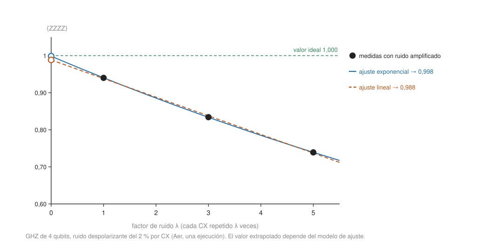

## Profesional {#layer-3}

### Idea clave
La *mitigación de errores (error mitigation)* estima valores esperados más limpios a partir de ejecuciones ruidosas, a costa de más ejecuciones; no reduce el ruido de cada ejecución. Es una familia de técnicas de coste creciente, y su sobrecarga crece de forma exponencial con el tamaño del circuito [@cai-2023, Sec. I, p. 2; Tabla I, p. 26].

### Explicación
Este concepto empieza en el nivel profesional porque exige entender el ruido de un dispositivo ([decoherencia](../../quantum-mechanics/concepts/decoherence.md)) y el flujo de [ejecución en hardware](running-on-hardware.md). Conviene separar tres cosas que se confunden. La documentación de IBM no da definiciones formales, pero usa los términos así: la *supresión de errores (error suppression)* reduce el efecto del ruido durante la ejecución (p. ej., desacoplo dinámico), y la *mitigación de errores* estima resultados más limpios a partir de ejecuciones ruidosas (p. ej., ZNE) [@qiskit-docs, /guides/error-mitigation-overview]. En IBM Quantum Learning se resume igual: la supresión modifica los circuitos en compilación (desacoplo dinámico, twirling de Pauli) y la mitigación modela el ruido y corrige los resultados a costa de sobrecarga cuántica y clásica [@ibm-quantum-learning, "Running quantum circuits"]. La tercera, la *corrección de errores (error correction)*, es otra cosa: codifica la información en [códigos](../../error-correction/index.md) para reducir el ruido en *cada* ejecución.

La revisión de Cai et al. define la mitigación (QEM) como esquemas algorítmicos que reducen el sesgo inducido por el ruido en un valor esperado mediante el postprocesado de salidas de un conjunto de ejecuciones, con circuitos con el mismo nivel de ruido que el original o mayor [@cai-2023, Sec. I, p. 2]. Por ejecución, el ruido sigue igual o aumenta: solo mejora el promedio del conjunto, mientras que la corrección de errores lo reduce en cada ejecución [@cai-2023, Sec. I, p. 2; Sec. IV.D, p. 25]. De ahí dos consecuencias:

- La mitigación apunta a **valores esperados** (promedios de muchas ejecuciones), no a salidas de un solo disparo como la [estimación de fase](../../quantum-algorithms/concepts/phase-estimation.md) o [Shor](../../quantum-algorithms/concepts/shor-algorithm.md) [@cai-2023, Sec. II.A, p. 3]: es una herramienta para el [Estimator](primitives-sampler-estimator.md) y para los [algoritmos variacionales](variational-algorithms.md).
- No hay umbral de error como en la corrección: un error menor simplemente reduce la sobrecarga; el coste de muestreo crece de forma exponencial con el tamaño del circuito [@cai-2023, Tabla I, p. 26].

El coste se mide en términos de sesgo y varianza. El error cuadrático medio es `sesgo² + varianza`. La mitigación reduce el sesgo (el error sistemático que más shots no quitan) pero normalmente aumenta la varianza; el precio es la sobrecarga de muestreo `C = Var[mitigado]/Var[ruidoso]`, es decir, el factor de ejecuciones extra para el mismo ruido de disparo [@cai-2023, Sec. II.A-B, pp. 3-4]. IBM Quantum Learning lo resume igual: más shots (`options.executions.shots`) compensan la varianza, y todo cuesta tiempo [@ibm-quantum-learning, "Cost functions"].

Las técnicas, de la más barata a la más cara:

- **Desacoplo dinámico (dynamical decoupling, DD).** Inserta secuencias de pulsos equivalentes a la identidad sobre qubits ociosos. Ayuda a circuitos con huecos, pero en circuitos densos puede no ayudar e incluso perjudicar [@qiskit-docs, /guides/error-mitigation-and-suppression-techniques]. Refocaliza el ruido coherente y suprime el incoherente a primer orden [@javadi-abhari-2024, §IV.D, p. 11]. Se activa con el pase de transpilación o con `options.dynamical_decoupling.enable` (`sequence_type`, p. ej. `"XY4"`) [@qiskit-docs, /guides/configure-error-mitigation].
- **Twirling de Pauli.** Puertas de Pauli aleatorias alrededor de las puertas de dos qubits generan un conjunto de circuitos con el mismo efecto ideal y convierten el ruido en forma de Pauli [@qiskit-docs, /guides/configure-error-mitigation]. Convertir el ruido coherente en ruido de Pauli es de lo más eficaz, porque el ruido coherente se acumula más rápido que el de Pauli y porque ayuda a ZNE y a PEC [@cai-2023, Sec. V.A, p. 27]. Opción: `options.twirling.enable_gates` (`num_randomizations`, `shots_per_randomization`) [@qiskit-docs, /guides/configure-error-mitigation].
- **Mitigación de lectura (TREX).** Aleatoriza las medidas para diagonalizar la matriz de error de lectura y corrige los valores esperados de observables de Pauli; la sobrecarga es pequeña [@qiskit-docs, /guides/error-mitigation-and-suppression-techniques]. En general, la mitigación de errores de medida está presente en casi todos los experimentos cercanos [@cai-2023, pp. 11, 28]. Invertir la matriz de asignación es un método de cuasi-probabilidades, y por eso crece exponencialmente con la tasa de fallos de la medida [@cai-2023, Sec. III.C, pp. 9-11].
- **Extrapolación a ruido cero (zero-noise extrapolation, ZNE).** Se ejecuta el circuito con ruido amplificado y se extrapola a ruido cero con un ajuste lineal o exponencial; puede quedar sesgada [@qiskit-docs, /guides/configure-error-mitigation]. El ruido se amplifica, por ejemplo, con *plegado digital de puertas (gate folding)*: se insertan secuencias de puertas equivalentes a la identidad; es fácil de calibrar, pero la escala está bien definida sobre todo para ruido despolarizante y puede cambiar el modelo de error [@cai-2023, Sec. III.A, pp. 6-7]. Con `M` puntos, un polinomio da la extrapolación de Richardson con sesgo `O(λᴹ)` y una varianza que se dispara si los ruidos son grandes o muy próximos; el ajuste exponencial describe mejor el régimen de ruido alto, porque el valor esperado de Pauli decae hacia cero [@cai-2023, Sec. III.A, pp. 6-7]. Con los tres factores de ruido por defecto, el coste ronda 3 veces [@qiskit-docs, /guides/configure-error-mitigation].
- **Cancelación probabilística de errores (probabilistic error cancellation, PEC).** Da una estimación sin sesgo muestreando circuitos ruidosos según una descomposición en cuasi-probabilidades; la sobrecarga de muestreo crece como `γ²`, y `γ` crece exponencialmente con la profundidad, así que suele ser más cara que ZNE [@qiskit-docs, /guides/error-mitigation-and-suppression-techniques]. Requiere caracterizar el ruido de las puertas (por ejemplo, con tomografía de conjuntos de puertas, eficiente solo para ruido local) y rinde bien con ruido de Pauli, que se consigue con twirling [@cai-2023, Sec. III.B, pp. 8-9]. En Runtime, `resilience.pec_mitigation` con `max_overhead` [@qiskit-docs, /guides/configure-error-mitigation].
- **Amplificación probabilística de errores (PEA).** Aprende el ruido de cada capa de puertas entrelazantes y lo amplifica de forma probabilística antes de la extrapolación ZNE; necesita ZNE activado (`zne.amplifier = "pea"`) y suele ser la mejor opción para experimentos a escala de utilidad [@qiskit-docs, /guides/error-mitigation-and-suppression-techniques; /guides/estimator-noise-management]. Con las primitivas del lado del cliente (0.50.0+), PEA y PEC necesitan un trabajo aparte de aprendizaje de ruido; `NoiseLearnerV3` (desde 0.47.0) es la herramienta actual y el antiguo `NoiseLearner` está obsoleto desde 0.51.0 [@qiskit-docs, /guides/noise-learning].
- **Otras técnicas de la literatura.** La *verificación de simetrías*: si el ansatz conserva una simetría (número de partículas, espín), los errores la rompen; se mide la simetría y se descartan las ejecuciones que la violan, parecido a la detección de errores; es simple y muy usada en experimentos tipo VQE [@cai-2023, Sec. III.D, pp. 11-13; @cerezo-2021, §IV.C.3, p. 20]. La *destilación virtual*: con `M` copias del estado ruidoso se estiman valores esperados del estado purificado `ρᴹ/Tr ρᴹ`, que converge exponencialmente en `M`; con dos copias ya hay una supresión de órdenes de magnitud en algunos estudios, a costa de más qubits [@cai-2023, Sec. III.E, pp. 13-16]. Los *datos de Clifford (regresión)*: se comparan versiones casi Clifford del circuito, simulables exactamente, con su resultado ruidoso para calibrar la corrección [@cai-2023, Sec. III.H, pp. 18-21; @cerezo-2021, §IV.C.3, p. 20]. Qermit, Mitiq y Qiskit implementan ZNE, PEC y mitigación de medida [@cai-2023, Sec. V, p. 27].



En el Estimator de Runtime, estas técnicas se agrupan en *niveles de resiliencia*: `resilience_level` 0 es ninguna mitigación; 1 (predeterminado) es mitigación de lectura TREX con coste mínimo; 2 añade ZNE y twirling de puertas con coste medio y suele reducir el sesgo sin garantizar cero sesgo. Los niveles están en beta y las opciones explícitas prevalecen sobre el nivel [@qiskit-docs, /guides/estimator-noise-management]. El artículo de arquitectura usa `EstimatorOptions(optimization_level=0, resilience_level=1)` sin definir los niveles [@javadi-abhari-2024, Fig. 4, p. 8; §IV.B, p. 9].

¿Por qué la mitigación no escala indefinidamente? Cai et al. modelan el ruido como fallos de Pauli independientes con probabilidades `p_f`: la probabilidad de que no ocurra ningún fallo es `P₀ = Π(1−p_f) ≈ e^{−λ}`, con `λ = Σ p_f` la media de fallos por ejecución [@cai-2023, Sec. II.C, p. 5]. Incluso la estrategia "mágica" de descartar las ejecuciones con fallos costaría `e^λ` (unos 150 con `λ = 5`, unos 10⁴ con `λ = 9`) [@cai-2023, Sec. II.D, p. 5]. Los valores esperados de Pauli decaen exponencialmente con `λ`, y resolverlos exige `O(e^{βλ})` muestras, también para cualquier combinación lineal de circuitos ruidosos [@cai-2023, Sec. II.D, p. 5]. Hay cotas rigurosas que muestran un crecimiento exponencial con la profundidad bajo ruido despolarizante local [@cai-2023, Sec. IV.B.1, pp. 22-23]. Con PEC y ruido de Pauli, la sobrecarga del circuito es `C ≈ e^{4λ}`, y de forma parcial `e^{4(λ−λ_em)}` para pasar de `λ` a `λ_em` [@cai-2023, Sec. III.B, p. 9, Eq. 18].

La conclusión es la de Cai et al.: la mitigación tiene un tamaño máximo práctico de circuito (profundidad por qubits) para cada hardware, y mejorar el hardware solo amplía ese tamaño [@cai-2023, Sec. I, pp. 2-3]. Por eso no sustituye a la [corrección de errores](../../error-correction/index.md) a gran escala; son complementarias, y la mitigación puede aplicarse sobre qubits lógicos con error residual [@cai-2023, Sec. IV.D, p. 26; Sec. V.B, p. 28].

Con todo esto, un orden de decisión razonable:

1. **Siempre:** transpilación cuidadosa ([transpilación](transpilation.md)) y mitigación de lectura, que es barata y casi universal [@cai-2023, pp. 11, 28; @qiskit-docs, /guides/estimator-noise-management].
2. **Circuitos con huecos:** desacoplo dinámico; en circuitos densos compruébalo, porque puede perjudicar [@qiskit-docs, /guides/error-mitigation-and-suppression-techniques].
3. **Ruido coherente:** twirling antes que cualquier otra cosa, porque lo vuelve ruido de Pauli, con el que funcionan mejor ZNE y PEC [@cai-2023, Sec. V.A, p. 27].
4. **Observable de un valor esperado, circuito moderado:** ZNE (sesgo posible, coste ~3×). Si buscas ausencia de sesgo y el circuito es corto, PEC; si es largo, PEA con ZNE [@qiskit-docs, /guides/error-mitigation-and-suppression-techniques].
5. **Ansatz con simetrías (química, VQE):** verificación de simetrías, que además puede recuperar el estado [@cai-2023, Sec. III.D, pp. 11-13; @cerezo-2021, §IV.C.3, p. 20].
6. **Combinaciones:** los costes se multiplican; ZNE sobre otro método puede tener un escalado de ruido mal definido, y aplicar PEC parcialmente lo evita [@cai-2023, Sec. V.C, p. 29]. Además, la mitigación puede mitigar errores algorítmicos (ansatz limitado, error de Trotter), cosa que la corrección de errores no hace [@cai-2023, Sec. V.C, p. 29].
7. **Simuladores:** las opciones de mitigación de IBM no aplican a los simuladores de referencia ([simuladores](simulators-and-statevectors.md)); para estudiar el mecanismo se implementan a mano, como en el ejemplo [@ibm-quantum-learning, "Cost functions"].

La evidencia experimental es esta: Kim et al. (2023) usaron ZNE con 127 qubits y 60 capas de puertas de dos qubits, con acuerdo con la simulación clásica [@cai-2023, Sec. III.A, p. 7]; es el experimento de "utilidad" de IBM, un circuito de 127 qubits y 60 capas del que se habla en [la era NISQ](nisq-era.md) [@ibm-quantum-learning, "Utility I"; @javadi-abhari-2024, §I, p. 1].

### Ejemplo
Para ver el mecanismo sin cuenta, plegamos cada CX en 1, 3 y 5 repeticiones (un número impar de CX equivale a un CX ideal) y extrapolamos a 0 con un modelo de ruido despolarizante del 2 % en cada `cx`:

```python
import numpy as np
from qiskit import QuantumCircuit
from qiskit.quantum_info import SparsePauliOp
from qiskit_aer.noise import NoiseModel, depolarizing_error
from qiskit_aer.primitives import EstimatorV2

def ghz(n, fold):
    qc = QuantumCircuit(n)
    qc.h(0)
    for i in range(n - 1):
        for _ in range(fold):          # fold = 1, 3, 5 repeticiones de cada CX
            qc.cx(i, i + 1)
    return qc

noise = NoiseModel()
noise.add_all_qubit_quantum_error(depolarizing_error(0.02, 2), ["cx"])
est = EstimatorV2(options={"backend_options": {"noise_model": noise,
                                               "method": "density_matrix"}})
obs = SparsePauliOp("ZZZZ")
factors = np.array([1, 3, 5])
vals = np.array([est.run([(ghz(4, int(f)), obs)], precision=0.005).result()[0].data.evs
                 for f in factors])
print("valores ruidosos:", vals.round(3))
lin = np.polyfit(factors, vals, 1)[1]                    # ordenada en el origen
exp = np.exp(np.polyfit(factors, np.log(vals), 1)[1])    # ajuste a·exp(-b·x) en x=0
print("lineal:", round(float(lin), 3), "exponencial:", round(float(exp), 3), "ideal: 1.0")
```

```text
valores ruidosos: [0.94  0.834 0.739]
lineal: 0.988 exponencial: 0.998
```

El resultado cambia ligeramente entre ejecuciones por el ruido de muestreo. Dos lecciones. Primero, de 0,94 sin mitigar se pasa a casi 1. Segundo, el coste fue 1 + 3 + 5 = 9 veces el número de CX de un solo circuito, y la extrapolación es fiable mientras el ruido sea pequeño: la teoría de los ajustes polinómicos solo vale para `λ` pequeño, aunque algún experimento funcionó con `λ` grande [@cai-2023, Sec. III.A, pp. 6-7]. El plegado digital en IBM es la misma idea (por defecto tres factores de ruido, coste aproximado 3×) [@qiskit-docs, /guides/configure-error-mitigation].

Ahora, los niveles de resiliencia. El siguiente bloque ejecuta localmente un GHZ de 4 qubits, transpilado a un dispositivo falso de 5 qubits, con los tres niveles:

```python
from qiskit import QuantumCircuit
from qiskit.quantum_info import SparsePauliOp
from qiskit.transpiler import generate_preset_pass_manager
from qiskit_ibm_runtime.executor_estimator import Estimator
from qiskit_ibm_runtime.fake_provider import FakeManilaV2

backend = FakeManilaV2()
qc = QuantumCircuit(4)
qc.h(0)
for i in range(3):
    qc.cx(i, i + 1)                      # GHZ de 4 qubits: <ZZZZ> ideal = 1
isa = generate_preset_pass_manager(optimization_level=3, backend=backend,
                                   seed_transpiler=3).run(qc)
obs = SparsePauliOp("ZZZZ").apply_layout(isa.layout)

est = Estimator(mode=backend)
est.options.default_shots = 4000
for level in (0, 1, 2):
    est.options.resilience_level = level
    r = est.run([(isa, obs)]).result()[0]
    print("resilience_level", level, round(float(r.data.evs), 3))
```

```text
resilience_level 0 0.705
resilience_level 1 0.946
resilience_level 2 0.971
```

Con otra ejecución salen, por ejemplo, 0,705 / 0,962 / 0,978. La lectura sube del 0,70 al 0,95 con el nivel 1, y la ZNE con twirling del nivel 2 recupera algo más.

Por último, el coste de mitigar según el tamaño del circuito. Con la hipótesis (nuestra) de un 0,5 % de probabilidad de fallo por puerta de dos qubits, de modo que `λ = 0,005·G`, las fórmulas de la explicación dan:

| Puertas de dos qubits | `λ` | `e^λ` (descartar) | `e^{4λ}` (PEC) |
|---|---|---|---|
| 17 | 0,085 | 1,1 | 1,4 |
| 170 | 0,85 | 2,3 | 30 |
| 1000 | 5 | ≈150 | ≈4,9·10⁸ |

Un circuito con 17 puertas se mitiga casi gratis; con 170 todavía es viable; con 1000 PEC es inviable, aunque descartar ejecuciones con fallos todavía "solo" costaría ~150.

### Las fuentes discrepan
- **Modo local y mitigación.** La documentación consultada decía que el modo local no aplicaba la mitigación en versiones anteriores; en nuestras pruebas con `qiskit-ibm-runtime` 0.51.0 sí la aplicó. Por eso el ejemplo de los niveles de resiliencia sirve para ver el efecto cualitativo, no como medida del hardware real.
- **El argumento `e^λ`.** Es, según los propios autores de la revisión, una intuición y no una cota rigurosa; las cotas rigurosas existen para familias concretas de ruido y circuitos [@cai-2023, Sec. II.D, p. 5; Sec. IV.B.1, pp. 22-23].
- **Mesetas áridas inducidas por ruido.** En los [algoritmos variacionales](variational-algorithms.md), los resultados de mesetas áridas inducidas por ruido no tienen en cuenta la mitigación, y su alcance es una pregunta abierta [@cerezo-2021, §IV.C.1, pp. 18-19].

### Para seguir
[Algoritmos variacionales](variational-algorithms.md) muestra dónde se aplica esta mitigación en un bucle híbrido. El ámbito de [corrección de errores](../../error-correction/index.md) explica la alternativa de fondo que este concepto solo complementa.
