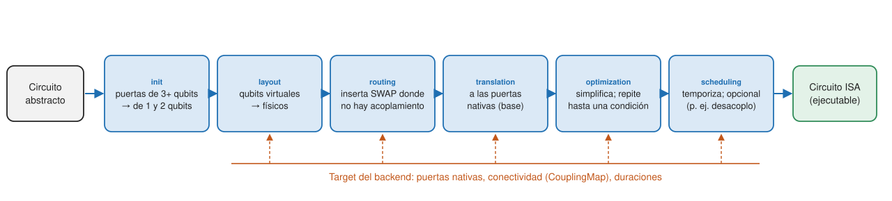
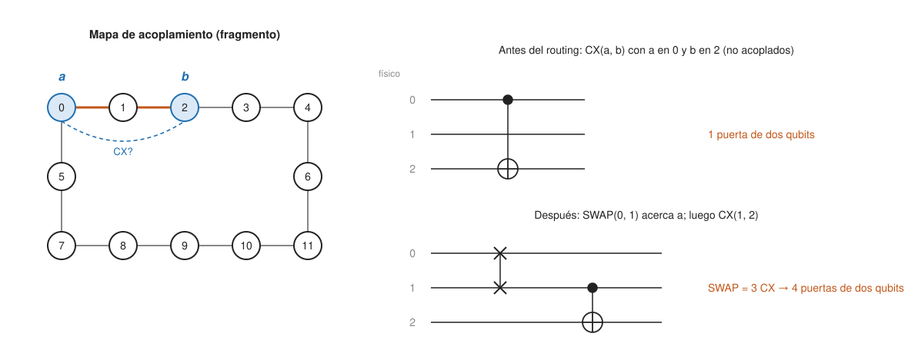

## Comprensión {#layer-2}

**El problema.** Un circuito escrito para un algoritmo usa las puertas que te convienen entre qubits cualesquiera. Un dispositivo solo ejecuta ciertas puertas nativas y solo sobre ciertos pares de qubits. La *transpilación (transpilation)* reescribe el circuito para que quepa en un dispositivo concreto y lo optimiza para hardware ruidoso [@qiskit-docs, /guides/transpile]. Se dice "transpilador" y no "compilador" porque su entrada y salida son circuitos; la generación de código para el controlador ocurre después, en el runtime, aunque puede verse como un compilador optimizador [@javadi-abhari-2024, §II, p. 1; Fig. 2, p. 5].

**El circuito ISA.** Un circuito ISA (de la *arquitectura del conjunto de instrucciones, instruction set architecture*) usa solo instrucciones del `Target` del dispositivo (puertas base, medidas, reinicios, control de flujo) y respeta su `CouplingMap` (qué pares de qubits están conectados). Los circuitos enviados a dispositivos de IBM deben ser ISA [@qiskit-docs, /guides/transpile; /guides/intro-to-patterns]. La ISA es la capa de abstracción clave entre hardware y software: en qubits superconductores puede incluir CNOT, `√X` y `RZ(θ)`; para máquinas lógicas podría incluir medidas de Pauli conjuntas o destilación de estados mágicos [@javadi-abhari-2024, §II, p. 1]. Un ejemplo concreto es la ISA de Heron: `RZ(θ)`, `SX`, `X`, `CZ`, medida, reinicio, retardo y control de flujo, con `CZ` solo sobre las aristas del grafo de conectividad [@javadi-abhari-2024, App. B, Tabla I, p. 18]. La razón de que un conjunto pequeño de puertas baste es que hay [conjuntos universales de puertas](../../qubits-and-circuits/concepts/universal-gate-sets.md); traducir a la base del dispositivo es aprovechar eso, aunque puede alargar el circuito [@ibm-quantum-learning, "Quantum circuit optimization"].

**Las seis etapas.** El transpilador por defecto encadena seis etapas [@qiskit-docs, /guides/transpile; @ibm-quantum-learning, "Quantum circuit optimization"]:

1. `init`: valida el circuito y descompone puertas de varios qubits en puertas de uno y dos.
2. `layout`: asigna qubits virtuales (los del circuito) a qubits físicos (los del chip).
3. `routing`: inserta `SWAP`s para que las puertas de dos qubits caigan sobre pares conectados.
4. `translation`: convierte a las puertas base.
5. `optimization`: repite pasadas hasta cumplir una condición (por ejemplo, una profundidad objetivo).
6. `scheduling`: sensible al hardware y al tiempo de espera de los qubits; solo se aplica si se indica un método [@qiskit-docs, /guides/transpile].



**Layout y routing.** En un chip, los qubits están conectados en una red (en los procesadores de IBM, una red *heavy-hex* de transmones [@ibm-quantum-learning, "Running quantum circuits"]). Si el algoritmo necesita una puerta entre dos qubits no adyacentes, el transpilador mueve el estado con `SWAP`s, que añaden puertas de dos qubits, las más ruidosas (ver más abajo). Un GHZ "en estrella" (un qubit conectado a todos) sobre una red heavy-hex necesita muchos `SWAP`s, mientras que reescribirlo con conectividad lineal da un circuito más superficial [@ibm-quantum-learning, "Quantum circuit optimization"]. Los pases que eligen el layout incluyen `TrivialLayout`, `VF2Layout` y `SabreLayout` [@ibm-quantum-learning, "Quantum circuit optimization"].



**Niveles de optimización.** `optimization_level` toma 0, 1, 2 o 3: los niveles altos dan mejores circuitos pero tardan más en compilar [@qiskit-docs, /guides/transpile]. El 0 hace solo lo necesario para poder ejecutar, el 1 es el predeterminado y el 2 y el 3 añaden optimización de bloques de dos qubits [@ibm-quantum-learning, "Quantum circuit optimization"].

**La forma moderna de usarlo.** La entrada recomendada es `generate_preset_pass_manager(backend=..., optimization_level=...)` de `qiskit.transpiler`, que devuelve un `StagedPassManager`; `pm.run(circuito)` devuelve el circuito ISA. Se prefiere a la función `transpile()` [@qiskit-docs, /guides/transpile; /guides/hello-world]. Tras transpilar, los observables deben pasar al layout físico con `observable.apply_layout(isa_circuit.layout)` [@qiskit-docs, /guides/hello-world].

**Caso trabajado: un GHZ de 10 qubits en un dispositivo falso.** Construimos un GHZ "en estrella" (un `H` y 9 CX desde el qubit 0), con medidas, y lo transpilamos con `FakeSherbrooke` (127 qubits, puertas base `ecr`, `rz`, `sx`, `x`) y con `FakeTorino` (133 qubits, puerta de dos qubits `cz`), en los niveles 0 y 3:

```python
from qiskit import QuantumCircuit
from qiskit.transpiler import generate_preset_pass_manager
from qiskit_ibm_runtime.fake_provider import FakeSherbrooke, FakeTorino

n = 10
ghz = QuantumCircuit(n)
ghz.h(0)
for i in range(1, n):
    ghz.cx(0, i)                  # GHZ "en estrella": el qubit 0 habla con todos
ghz.measure_all()

for backend in (FakeSherbrooke(), FakeTorino()):
    print(backend.name, backend.num_qubits)
    for level in (0, 3):
        pm = generate_preset_pass_manager(optimization_level=level, backend=backend,
                                          seed_transpiler=7)
        isa = pm.run(ghz)
        ops = isa.count_ops()
        twoq = sum(v for k, v in ops.items() if k in ("ecr", "cz", "cx", "swap"))
        print(f"  nivel {level}: profundidad={isa.depth()}, puertas de 2 qubits={twoq}")
```

```text
fake_sherbrooke 127
  nivel 0: profundidad=236, puertas de 2 qubits=42
  nivel 3: profundidad=81, puertas de 2 qubits=17
fake_torino 133
  nivel 0: profundidad=118, puertas de 2 qubits=42
  nivel 3: profundidad=61, puertas de 2 qubits=30
```

El circuito original tiene solo 9 CX; los demás vienen del routing. Con la semilla fijada la salida se reproduce en el mismo entorno; con otra semilla o versión los números cambian, porque el transpilador es heurístico. Lo importante es la comparación: el nivel 3 reduce la profundidad a menos de la mitad y las puertas de dos qubits a menos de la mitad en Sherbrooke (de 42 a 17). La diferencia entre los dos dispositivos muestra que el resultado depende de la topología y de la puerta nativa. Nuestra hipótesis es que el nivel 0 deja la asignación de qubits casi como viene y paga muchos `SWAP`s [unverified]; las fuentes solo dicen que el nivel 0 hace lo mínimo necesario.

**Por qué importan las puertas de dos qubits.** El objetivo del transpilador es reducir profundidad y complejidad para limitar el efecto del ruido [@qiskit-docs, /guides/transpile]. La documentación de mitigación añade que la mayoría de los errores de hardware ocurren en las puertas de dos qubits [@qiskit-docs, /guides/configure-error-mitigation]; en la misma línea, un ejemplo de dispositivo Eagle resume errores medianos del orden de 2,3·10⁻⁴ para `SX` y 6,9·10⁻³ para `ECR`, con errores de lectura mayores que los de dos qubits y estos mayores que los de un qubit [@ibm-quantum-learning, "Hardware"]. Si cada puerta de dos qubits falla con probabilidad `p`, la probabilidad de que ninguna falle en `G` puertas es `(1−p)^G`. En el `FakeSherbrooke` el error mediano de `ecr` (calculado con `target`) es 0,0078, así que 17 puertas dan una fidelidad aproximada de 0,88 y 42 puertas de 0,72: el nivel 3 sube bastante la probabilidad de un circuito sin fallos (cálculo orientativo: solo cuenta puertas de dos qubits y supone fallos independientes).

```python
import numpy as np
from qiskit_ibm_runtime.fake_provider import FakeSherbrooke

target = FakeSherbrooke().target
errs = [p.error for p in target["ecr"].values() if p is not None and p.error is not None]
e = float(np.median(errs))
print(len(errs), "pares dirigidos; error mediano de ecr:", round(e, 4))
print("17 puertas:", round((1 - e) ** 17, 2), " 42 puertas:", round((1 - e) ** 42, 2))
```

```text
144 pares dirigidos; error mediano de ecr: 0.0078
17 puertas: 0.88  42 puertas: 0.72
```

**Errores frecuentes.**

- *"A más optimización, mejor resultado siempre."* Los niveles altos son heurísticos: más esfuerzo no siempre da mejor circuito [@ibm-quantum-learning, "Quantum circuit optimization"].
- *"Puedo pasar `basis_gates` y `coupling_map` sueltos."* Desde 2.0 el transpilador no acepta `backend_properties`, `instruction_durations`, `timing_constraints`, `inst_map` ni `basis_gates` personalizados: se usa un `target`, un backend o `Target.from_configuration`; pasar `coupling_map` o `basis_gates` junto con `backend` avisa [@qiskit-docs, /guides/qiskit-2.0].
- *"Transpilo con un dispositivo y ejecuto en otro."* El backend debe elegirse antes de transpilar porque la optimización depende del procesador [@ibm-quantum-learning, "Utility-scale QAOA"].

## Profesional {#layer-3}

**Arquitectura: pases y gestores de pases.** El transpilador es una colección de pases de traducción y optimización sobre un marco para describir, componer y ejecutar tuberías de transformaciones que preservan la semántica, con lógica que puede dirigir el flujo según propiedades del dispositivo, del circuito o intermedias; recuerda a infraestructuras como LLVM [@javadi-abhari-2024, §III.B, p. 6]. Qiskit estandariza las etapas, que sirven de puntos de enganche para *plugins* y como base para comparar tuberías completas [@javadi-abhari-2024, §III.B, pp. 6-7]. El código de rendimiento crítico está escrito en Rust (alrededor del 6 % del código) con pruebas de referencia en el tiempo, y el grafo se maneja con RustworkX [@javadi-abhari-2024, §II.2, p. 3; §IV.B, p. 7].

**Personalizar.** Se puede añadir pases a una etapa; por ejemplo, para insertar *desacoplo dinámico (dynamical decoupling)* se añaden pases de planificación ALAP y de relleno con DD a la etapa de `scheduling`, y se puede fijar `initial_layout` [@javadi-abhari-2024, §IV.B, §IV.D, pp. 9, 11]. Con ese enfoque, el tutorial VQE de IBM usa `optimization_level=3` junto con planificación ALAP y desacoplo dinámico [@qiskit-docs, /tutorials/variational-quantum-eigensolver]. Las interfaces de plugin permiten métodos externos de síntesis y optimización, incluidos algoritmos alternativos de mapeo y de routing y síntesis con SAT [@javadi-abhari-2024, §II.1, p. 3; §V, p. 11].

**Retargeting: conjuntos de puertas no estándar.** Si añades al `Target` una puerta parcial `RZX` con su duración y su error, el transpilador resintetiza interacciones `ZZ(θ)` como `ZX(φ)` y acorta los circuitos; la nueva puerta no necesita estar calibrada en todas las aristas, se usa de manera oportunista [@javadi-abhari-2024, §IV.C, pp. 9-10]. Las optimizaciones locales ayudan mucho: una optimización de mirilla (*peephole*) redujo un subcircuito de profundidad CNOT 26 a 12 en un ejemplo del artículo [@javadi-abhari-2024, Fig. 1, p. 2].

**Routing con circuitos dinámicos.** Mapear una red hexagonal sobre un chip heavy-hex mediante el transpilador requiere `SWAP`s; una alternativa con ancillas, medidas a mitad de circuito y retroalimentación dio menos profundidad y resultados algo mejores [@javadi-abhari-2024, §IV.D, pp. 10-11]. Es un recordatorio de que el transpilador no sustituye pensar en la topología al diseñar el circuito.

**Decisiones de ingeniería.**

- *Qué nivel usar.* Las lecciones de IBM recomiendan `optimization_level=3` para la mayoría de los casos y muestran en una prueba simulada que el nivel 3 sigue la curva ideal mejor que el 0 [@ibm-quantum-learning, "Cost functions"]. El tiempo de compilación crece con el nivel [@qiskit-docs, /guides/transpile].
- *Varias semillas.* Como la transpilación es heurística, transpilar varias veces con distintas semillas y quedarse con el circuito con menos puertas de dos qubits es una práctica razonable [unverified]. `mapomatic` se menciona como herramienta para sugerir layouts [@ibm-quantum-learning, "Running quantum circuits"].
- *Transpilar una vez los circuitos parametrizados.* Se transpilan a nivel 3 una vez y se asignan los valores muchas veces [@qiskit-docs, /guides/construct-circuits]:

```python
import numpy as np
from qiskit.circuit.library import efficient_su2
from qiskit.quantum_info import SparsePauliOp
from qiskit.transpiler import generate_preset_pass_manager
from qiskit_ibm_runtime.fake_provider import FakeSherbrooke

backend = FakeSherbrooke()
ansatz = efficient_su2(4, reps=2)                    # 24 parámetros libres
pm = generate_preset_pass_manager(optimization_level=3, backend=backend, seed_transpiler=1)
isa = pm.run(ansatz)                                 # se transpila UNA vez
print(isa.num_parameters, dict(isa.count_ops()))
obs = SparsePauliOp("ZZZZ").apply_layout(isa.layout)  # el observable sigue el layout
bound = isa.assign_parameters(np.zeros(isa.num_parameters))   # barato: sin transpilar
print(bound.num_parameters)
```

```text
24 {'rz': 42, 'sx': 30, 'ecr': 6}
0
```

- *Coste de compilar frente a coste de ejecutar.* En un bucle variacional de cientos de iteraciones, repetir la transpilación en cada paso sería un despilfarro; en un circuito que se ejecuta una vez en hardware caro, compilar a nivel 3 con varias semillas sale a cuenta. Ambos casos se discuten en [algoritmos variacionales](variational-algorithms.md) y [ejecutar en hardware real](running-on-hardware.md).

**Lo que la transpilación no puede arreglar.** Si el algoritmo necesita muchas más puertas de dos qubits de las que el dispositivo soporta (ver el límite del orden de `1/p` puertas de [la era NISQ](nisq-era.md)), ningún nivel de optimización lo salva; hay que replantear el circuito (otro ansatz, otra codificación) o mitigar errores ([mitigación de errores](error-mitigation.md)). Y el circuito transpilado es otro circuito: puedes inspeccionarlo, dibujarlo y contar sus puertas con las mismas herramientas con que lo construiste [@javadi-abhari-2024, §III.B, p. 6].
