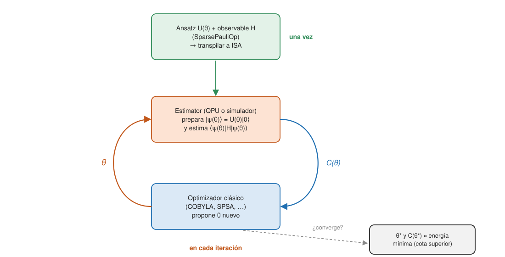

## Comprensión {#layer-2}

**La idea.** Un *algoritmo cuántico variacional (variational quantum algorithm, VQA)* reparte el trabajo entre dos máquinas. Una función de coste `C(θ)` codifica el problema; un *ansatz* (un circuito parametrizado) prepara un estado según los parámetros `θ`; el ordenador cuántico estima el coste, y un optimizador clásico actualiza `θ`, hasta resolver `θ* = argmin C(θ)` [@cerezo-2021, §II, p. 2, Fig. 1]. Es el bucle híbrido clásico-cuántico: el QPU prepara un estado de `n` qubits, se miden todos, el optimizador clásico usa los resultados para ajustar la preparación, y se repite hasta converger [@preskill-2018, §6.1, p. 8].



**Por qué existen.** La [estimación de fase](../../quantum-algorithms/concepts/phase-estimation.md) da el valor propio con coste `O(1/p)` operaciones cuánticas, pero necesita evolución totalmente coherente, que Peruzzo et al. consideraban muy por encima de las decenas a centenares de puertas alcanzables a corto plazo [@peruzzo-2014, p. 1]. Su alternativa cambia una evolución larga coherente por muchas cortas: coherencia `O(1)` por medida, a cambio de `O(1/p²)` repeticiones por término [@peruzzo-2014, p. 2]. Cerezo et al. dan la misma cuenta: VQE necesita `O(1/ε²)` medidas para precisión `ε`, frente a `O(log(1/ε))` de la estimación de fase [@cerezo-2021, §III.A.7, p. 9]. Es un intercambio de circuitos profundos por muchos circuitos cortos: justo lo que encaja con hardware ruidoso ([la era NISQ](nisq-era.md)).

**VQE.** El *resolutor propio variacional (variational quantum eigensolver, VQE)* busca el estado de menor energía de un hamiltoniano `H`. Su coste es `C(θ) = ⟨ψ(θ)|H|ψ(θ)⟩`; por el principio variacional de Rayleigh-Ritz, `C ≥ E_G` (energía del estado fundamental) con igualdad solo en ese estado, de modo que el coste es "fiel" [@cerezo-2021, §III.A, pp. 8-9]. IBM Quantum Learning lo enuncia así: cualquier estado normalizado tiene una energía esperada como mínimo la del fundamental [@ibm-quantum-learning, "Variational algorithms"]. `H` se escribe como combinación lineal de cadenas de Pauli, de modo que el coste es una suma de valores esperados de Pauli [@cerezo-2021, §III.A, pp. 8-9; @peruzzo-2014, Eqs. 1-2, p. 1]: justo el trabajo del [Estimator](primitives-sampler-estimator.md). El nombre VQE aparece en fuentes posteriores [@preskill-2018, §6.1, p. 8; @cerezo-2021, §III.A, pp. 8-9]; el artículo original de Peruzzo et al. no emplea esas siglas, aunque describe el esquema [@peruzzo-2014, texto completo]. Peruzzo lo demostró con el ion molecular HeH⁺ en un chip fotónico de silicio: un hamiltoniano de 2 qubits, 79 valores de la distancia de enlace y más del 96 % de los puntos dentro de la precisión química respecto a la curva exacta [@peruzzo-2014, Figs. 2-4, pp. 3-5].

**Tu primer VQE.** Un hamiltoniano de juguete de 2 qubits (modelo de Ising con campo transversal; no es una molécula), un ansatz `efficient_su2` y el optimizador COBYLA de SciPy. Para comprobar, se calcula la energía exacta diagonalizando la matriz:

```python
import numpy as np
from scipy.optimize import minimize
from qiskit.circuit.library import efficient_su2
from qiskit.primitives import StatevectorEstimator
from qiskit.quantum_info import SparsePauliOp

H = SparsePauliOp.from_list([("ZZ", -1.0), ("XI", -0.5), ("IX", -0.5)])
ansatz = efficient_su2(2, reps=1)            # circuito con 8 parámetros
estimator = StatevectorEstimator()
history = []

def cost(theta):
    e = float(estimator.run([(ansatz, H, theta)]).result()[0].data.evs)
    history.append(e)
    return e

rng = np.random.default_rng(0)
x0 = rng.uniform(0, 2 * np.pi, ansatz.num_parameters)
res = minimize(cost, x0, method="COBYLA", options={"maxiter": 200})
exact = np.linalg.eigvalsh(H.to_matrix())[0]
print(f"VQE: {res.fun:.6f}  exacto: {exact:.6f}  evaluaciones: {len(history)}")
```

```text
VQE: -1.414213  exacto: -1.414214  evaluaciones: 200
```

Todo el programa son tres decisiones: el hamiltoniano (la física), el ansatz (qué estados puede explorar el circuito) y el optimizador. La función `efficient_su2` es la forma actual; la clase `EfficientSU2` está obsoleta desde Qiskit 2.1 (en nuestras pruebas emite un `DeprecationWarning`). El ansatz `efficient_su2` es un ansatz heurístico de capas de rotaciones y CX [@ibm-quantum-learning, "Ansaetze and variational forms"].

**El ansatz: el compromiso central.** Un ansatz puede ser *inspirado por el problema* o *agnóstico* [@cerezo-2021, §II.B, p. 3]:

- *Eficiente en hardware (hardware-efficient):* usa las puertas nativas y la conectividad del dispositivo para evitar el sobrecoste de compilar; sirve para hamiltonianos parecidos a las interacciones del dispositivo, pero los de capas aleatorias pueden tener problemas de entrenabilidad [@cerezo-2021, §II.B.1, p. 3].
- *Cúmulo acoplado unitario (UCC):* para estados fundamentales en química; excita un estado de referencia (normalmente Hartree-Fock) con excitaciones simples y dobles [@cerezo-2021, §II.B.2, pp. 3-4; @peruzzo-2014, p. 3].
- *Ansatz de QAOA:* capas alternas de un unitario del problema y un mezclador [@cerezo-2021, §II.B, p. 4].
- *Estructura variable:* ADAPT-VQE añade un término cada vez de forma voraz [@cerezo-2021, §II.B.5, p. 4].

Peruzzo ya planteaba las dos estrategias: ansatz motivado por la química, o un "ansatz de dispositivo", el conjunto de estados que el hardware puede preparar, con profundidad limitada por la coherencia [@peruzzo-2014, p. 5]. El compromiso de un ansatz heurístico es entre velocidad (espacio de búsqueda pequeño), precisión (puede excluir la solución) y ruido (más profundidad, más ruido) [@ibm-quantum-learning, "Ansaetze and variational forms"]. La *expresividad (expressibility)* mide si un ansatz explora uniformemente el espacio de estados (se compara con la distribución de Haar); la capacidad de entrelazamiento es otra cualidad aparte [@cerezo-2021, §II.B.9, p. 5].

**QAOA.** El *algoritmo de optimización aproximada cuántica (quantum approximate optimization algorithm, QAOA)* de Farhi, Goldstone y Gutmann es el mismo bucle aplicado a problemas combinatorios [@preskill-2018, §6.1, p. 8]. Se define sobre `n` bits con una función objetivo `C(z)` que cuenta cláusulas satisfechas [@farhi-2014, §I, p. 2]:

- Operador de separación de fase `U(C,γ) = e^{−iγC}`, producto de términos que comutan [@farhi-2014, §I, p. 2, ec. 2].
- Mezclador `B` = suma de `σₓ` por qubit; `U(B,β) = e^{−iβB}` [@farhi-2014, §I, p. 2, ecs. 3-4].
- Estado inicial `|s⟩`, la superposición uniforme (producto de estados `|+⟩`) [@farhi-2014, §I, p. 2, ec. 5].
- Para profundidad `p`, se alternan `U(C,γ₁), U(B,β₁), …, U(C,γ_p), U(B,β_p)` sobre `|s⟩`: hay `2p` ángulos [@farhi-2014, §I, p. 3, ec. 6]. El coste es `F_p(γ,β) = ⟨γ,β|C|γ,β⟩` y `M_p` su máximo [@farhi-2014, §I, p. 3, ecs. 7-8].
- `M_p ≥ M_{p−1}`, y `M_p` tiende al máximo verdadero de `C` cuando `p → ∞` (la prueba usa la evolución adiabática trotterizada: las capas alternas son exactamente una aproximación de [Trotter](../../quantum-algorithms/concepts/hamiltonian-simulation.md) de ese camino) [@farhi-2014, §I, p. 3; §VI, pp. 10-11].

Para *MaxCut* (partir los nodos de un grafo en dos grupos maximizando las aristas cortadas) cada arista contribuye `C_jk = (1 − Z_jZ_k)/2` [@farhi-2014, §II, pp. 4-5]. Minimizar `Σ ZZ` equivale a maximizar el corte. Un caso pequeño: un anillo de 4 nodos con una diagonal (5 aristas, corte máximo 4), `qaoa_ansatz` con 2 capas y COBYLA:

```python
import numpy as np
from scipy.optimize import minimize
from qiskit.circuit.library import qaoa_ansatz
from qiskit.primitives import StatevectorEstimator, StatevectorSampler
from qiskit.quantum_info import SparsePauliOp

edges = [(0, 1), (1, 2), (2, 3), (3, 0), (0, 2)]          # 4 nodos, 5 aristas
H = SparsePauliOp.from_sparse_list([("ZZ", e, 1.0) for e in edges], num_qubits=4)
# corte(z) = (5 - <suma Z_i Z_j>)/2  ->  maximizar el corte = minimizar <H>
qaoa = qaoa_ansatz(H, reps=2)                              # 2p = 4 parámetros (β, γ)
est = StatevectorEstimator()
f = lambda x: float(est.run([(qaoa, H, x)]).result()[0].data.evs)

x0 = np.array([0.1, 0.1, 0.2, 0.2])                        # inicio fijo: reproducible
res = minimize(f, x0, method="COBYLA")
print("<corte> =", round((len(edges) - res.fun) / 2, 3), "(corte máximo = 4)")

meas = qaoa.assign_parameters(res.x); meas.measure_all()
counts = StatevectorSampler(seed=3).run([meas], shots=2000).result()[0].data.meas.get_counts()
best = max(counts, key=counts.get)
print(best, counts[best], dict(sorted(counts.items(), key=lambda kv: -kv[1])[:4]))
```

```text
<corte> = 3.742 (corte máximo = 4)
0101 861 {'0101': 861, '1010': 853, '1100': 43, '0011': 42}
```

Con 2 capas el corte medio es 3,74 de 4, y las dos cadenas óptimas `0101` y `1010` (el mismo corte con los grupos intercambiados) concentran unas 1714 de las 2000 muestras. Observa que usamos los dos primitivos: el Estimator para optimizar y el Sampler para leer la respuesta (la cadena de bits). La función `qaoa_ansatz` es la actual: la clase `QAOAAnsatz`, que usa IBM Quantum Learning [@ibm-quantum-learning, "Examples and applications"], emite en 2.6.1 un `DeprecationWarning` en nuestras pruebas. Los parámetros se ordenan alfabéticamente, `β` antes que `γ`.

**Optimizadores.** Con gradiente (descenso de gradiente estocástico, Adam, gradiente natural cuántico) o sin él (SPSA, COBYLA, Nelder-Mead) [@cerezo-2021, §II.D.1-2, pp. 6-7]. La *regla de desplazamiento de parámetros (parameter-shift rule)* da el gradiente analítico de puertas `e^{iθσ}` como una diferencia de dos evaluaciones del coste, con precisión óptima en `α = π/4` [@cerezo-2021, §II.C.1, pp. 5-6]. Los métodos sin gradiente (COBYLA) son más robustos con gradientes ruidosos o difíciles pero requieren más evaluaciones en alta dimensión; un optimizador local converge rápido y depende del punto de partida; uno global explora más y es más lento [@ibm-quantum-learning, "Optimization loops"]. Peruzzo usó Nelder-Mead porque el descenso de gradiente no convergió con el ruido de su experimento [@peruzzo-2014, Apéndice, p. 8].

**Errores frecuentes.**

- *"VQE da la energía exacta."* Da una cota superior (aproximada) al estado fundamental y depende del ansatz; un ansatz que no contenga el estado no puede alcanzarlo [@ibm-quantum-learning, "Ansaetze and variational forms"; @cerezo-2021, §III.A, pp. 8-9].
- *"QAOA con más capas siempre es mejor en la práctica."* En teoría `M_p` no decrece con `p` [@farhi-2014, §I, p. 3], pero más capas mejoran la calidad a mayor coste [@ibm-quantum-learning, "Utility-scale QAOA"], con circuitos más profundos que sufren más ruido [@ibm-quantum-learning, "Ansaetze and variational forms"], y `p` puede tener que crecer exponencialmente con `n` [@farhi-2014, §VI, p. 11].
- *"El optimizador siempre encuentra el mínimo."* El paisaje de coste no es convexo y optimizar suele ser NP-difícil en general [@cerezo-2021, §II.D, p. 6].
- *"VQE y QAOA son nombres de la librería."* Son algoritmos; el módulo `algorithms` de Qiskit se eliminó en 1.0 [@qiskit-docs, /guides/qiskit-1.0-features]: el bucle se escribe a mano, como arriba.

## Profesional {#layer-3}

**Trabajar sobre hardware.** El esquema es el de los cuatro pasos de [ejecutar en hardware real](running-on-hardware.md) con un bucle externo. El tutorial VQE de IBM usa un ansatz `efficient_su2` de 10 qubits (`reps=2`), un hamiltoniano de Heisenberg de 10 espines como `SparsePauliOp`, y un `EstimatorV2` que devuelve `data.evs`; sigue los cuatro pasos (mapear, optimizar con `optimization_level=3` más planificación ALAP y desacoplo dinámico, ejecutar en una sesión, postprocesar) [@qiskit-docs, /tutorials/variational-quantum-eigensolver]. El optimizador del tutorial es un SPSA propio, que necesita dos evaluaciones del coste por iteración; con `maxiter=50` hizo 101 evaluaciones y llegó a unos −3,038 [@qiskit-docs, /tutorials/variational-quantum-eigensolver]. La `Session` suele ser la elección para estos bucles, pues permite el intercambio frecuente clásico-cuántico [@qiskit-docs, /guides/run-jobs-session]. Decisiones prácticas:

- **Transpila una vez**, con el ansatz parametrizado, y reasigna los parámetros en cada paso ([transpilación](transpilation.md)); y recuerda `observable.apply_layout(isa.layout)` [@qiskit-docs, /guides/construct-circuits; /guides/hello-world].
- **Precisión del Estimator frente al optimizador.** Un hardware ruidoso da evaluaciones no deterministas del coste, que pueden detener la convergencia de un optimizador [@ibm-quantum-learning, "Cost functions"]. Peruzzo eligió Nelder-Mead precisamente por su robustez al ruido de las evaluaciones [@peruzzo-2014, Apéndice, p. 8]; el optimizador y el número de shots por evaluación son los parámetros a ajustar.
- **Compara con un simulador.** En un ejemplo de IBM Quantum Learning de H₂, la energía del estado fundamental fue ≈ −1,857 Ha en simulador y ≈ −1,83 en hardware [@ibm-quantum-learning, "Examples and applications"]. Una diferencia de este orden obliga a decidir si hace falta [mitigación](error-mitigation.md).
- **Aprovecha las simetrías.** Si el problema conserva una simetría, la verificación de simetrías es barata y se usa mucho en experimentos tipo VQE [@cai-2023, Sec. III.D, pp. 11-13].

**Trainability: mesetas áridas (barren plateaus).** Las derivadas parciales del coste se anulan exponencialmente con el tamaño del sistema en promedio, de modo que el paisaje es plano y hacen falta exponencialmente muchos shots para decidir una dirección de descenso, tanto con métodos de gradiente como sin él; eso puede borrar una ventaja cuántica potencial [@cerezo-2021, §IV.A.1, p. 15]. Causas y remedios [@cerezo-2021, §IV.A.1-2, pp. 15-17]:

| Causa | Remedio |
|---|---|
| Ansatz profundo, aleatorio y poco estructurado (se acerca a un 2-diseño) | ansatz estructurado y inspirado en el problema (UCC, QAOA), inicialización con patrones conocidos, entrenamiento capa a capa |
| Función de coste global | costes locales (el gradiente decae solo polinomialmente si la profundidad es a lo sumo logarítmica en `n`) |
| Ruido (empuja hacia el estado maximalmente mezclado cuando la profundidad crece al menos linealmente) | menos profundidad; mitigación; el efecto no tiene en cuenta la mitigación, y su alcance es una pregunta abierta |

IBM Quantum Learning sugiere además *bootstrapping*, ansatz eficiente en hardware, supresión y mitigación de errores y optimizadores sin gradiente [@ibm-quantum-learning, "Optimization loops"].

**Ruido y sesgo.** El ruido ralentiza el entrenamiento, sesga el paisaje (el óptimo ruidoso puede no ser el ideal) y corrompe el coste final [@cerezo-2021, §IV.C.1, p. 18]. El ruido no importa igual para todos los usos: bajo ruido de Pauli local el coste se concentra exponencialmente en la profundidad hacia el valor del estado maximalmente mezclado, lo que no afecta a QAOA (el coste se calcula clásicamente tras muestrear) pero sí a la precisión de la energía de VQE, lo que motiva la mitigación [@cerezo-2021, §IV.C.1, pp. 18-19]. Y hay una resiliencia al ruido coherente: como el optimizador solo ve observables muestreados, un error coherente `U(θ+δ)` puede compensarse sobre la marcha; se vio en qubits superconductores con errores reducidos más de un orden de magnitud, siempre que se optimice más rápido que la deriva de la calibración [@cerezo-2021, §IV.C.2, p. 19].

**Coste de medida.** Aun sin mesetas áridas, estimar valores esperados no es necesariamente eficiente: las primeras estimaciones para química dieron cifras astronómicas de medidas [@cerezo-2021, §IV.B, p. 17]. Un hamiltoniano químico tiene del orden de `n⁴` cadenas de Pauli [@cerezo-2021, §IV.B, p. 17]. Reduce el coste agrupando términos que comutan, asignando shots proporcionalmente a `|cᵢ|·σᵢ` y, si procede, con sombras clásicas [@cerezo-2021, §IV.B.1-3, pp. 17-18]; el detalle está en [primitivas](primitives-sampler-estimator.md).

**Extensiones.** Estados excitados: VQE con restricción de ortogonalidad (término de penalización sobre el solapamiento), VQD (solapamientos con penalización), SSVQE (varios estados de referencia ortogonales) y expansión de subespacios [@cerezo-2021, §III.A.2-5, pp. 8-9; @ibm-quantum-learning, "Instances and extensions"]. Peruzzo usó el método del espectro plegado, repitiendo el procedimiento con `(H−λ)²`, a coste polinómico [@peruzzo-2014, Apéndice, p. 8]. Los VQA se aplican además a dinámica con circuitos poco profundos que evitan el crecimiento de profundidad de los productos de Trotter-Suzuki [@cerezo-2021, §III.A, p. 9].

**¿Aporta ventaja? Dos advertencias.** Primero, nadie sabe si QAOA y VQE en hardware NISQ superarán a los buenos métodos clásicos aproximados [@preskill-2018, §6.1, p. 8]. Cerezo et al. sostienen que los VQA son la estrategia más prometedora para ventaja práctica a corto plazo ("aparecen como la mejor esperanza"), pero es la opinión de los autores y no un resultado establecido, y la propia revisión enumera problemas sin resolver de entrenabilidad, precisión y eficiencia [@cerezo-2021, resumen, p. 1; §IV]. Una condición implícita: el coste no debe poder calcularse eficientemente de forma clásica, o no hay ventaja [@cerezo-2021, §II.A, p. 3]. Segundo, para QAOA hay resultados concretos de cautela: con `p = 1` en grafos 3-regulares conexos el peor caso garantiza una razón de aproximación de al menos 0,6924, peor que los algoritmos clásicos conocidos [@farhi-2014, §V, p. 10]; para `p` fijo y grado acotado, `F_p` se puede calcular clásicamente con un espacio de Hilbert que no crece con `n` (aunque quizá en espacio doblemente exponencial en `p`) [@farhi-2014, §II, p. 6]; y la garantía de `p → ∞` puede engañar, porque `p` puede necesitar ser exponencial en `n` [@farhi-2014, §VI, p. 11]. Argumentos a favor de QAOA: garantías demostrables con `p = 1` y que `p = 1` no se simula eficientemente de forma clásica [@cerezo-2021, §V.C.1, p. 22]. Ambas posiciones están en la literatura; conviene leer las hipótesis de cada una.

**Criterios de decisión.**

1. ¿El problema tiene un coste expresable como suma de Paulis, con número de términos polinómico? Si no, el Estimator no es eficiente [@ibm-quantum-learning, "Cost functions"; @peruzzo-2014, p. 1].
2. ¿Cabe el circuito en el presupuesto de puertas del dispositivo ([la era NISQ](nisq-era.md))? Un ansatz eficiente en hardware ayuda, pero puede perder entrenabilidad.
3. ¿Hay un punto de partida? Reutilizar parámetros de una instancia previa o un estado de referencia razonable acelera la convergencia [@ibm-quantum-learning, "Reference states"; "Optimization loops"].
4. ¿Cuánto cuesta cada evaluación en shots y en tiempo de cola? Si la respuesta es "mucho", sesión y mitigación selectiva.
5. ¿Qué haría un método clásico bueno con el mismo problema? Es el contraste que exige Preskill: la ventaja se mide frente al mejor hardware y algoritmo clásicos [@preskill-2018, §6, p. 7].

IBM ofrece además *Qiskit Functions* de optimización y química (por ejemplo HI-VQE) en su catálogo para quien no quiera escribir el bucle [@qiskit-docs, /guides].
