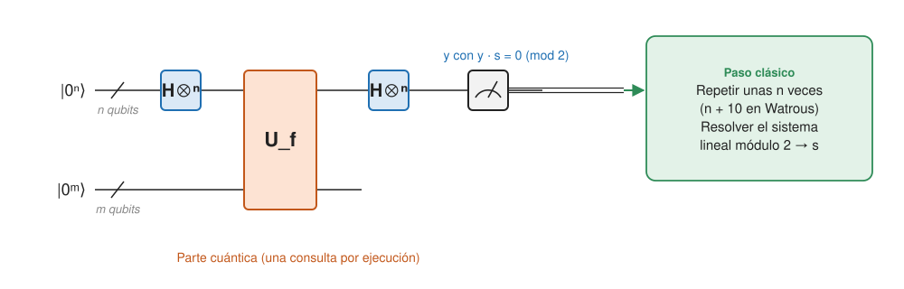

## Comprensión {#layer-2}

Estos dos algoritmos reutilizan el circuito de [Deutsch-Jozsa](deutsch-jozsa.md) para extraer *estructura oculta* de una caja negra. Bernstein-Vazirani recupera una cadena secreta; Simon recupera un "periodo" XOR, y es el antecesor directo del [algoritmo de Shor](shor-algorithm.md).

### Bernstein-Vazirani

**Producto escalar binario.** `x·y = x_{n−1}y_{n−1} ⊕ … ⊕ x₀y₀`: la paridad de los bits de `x` en las posiciones donde `y` vale 1; es simétrico [@watrous-2025, L5.3, PDF p. 148].

**Problema.** Se promete que `f: {0,1}ⁿ → {0,1}` cumple `f(x) = s·x` para una cadena oculta `s`; hay que dar `s`. Se conoce también como problema de *muestreo de Fourier (Fourier sampling)* [@watrous-2025, L5.3, PDF pp. 148-149; @de-wolf-2026, §2.4.2, p. 31].

**Algoritmo.** Es exactamente el circuito de Deutsch-Jozsa (sin el postproceso con `OR`). Tras la consulta el estado es `|−⟩ ⊗ 2^{−n/2} Σ_x (−1)^{s·x}|x⟩`; la capa final de Hadamards lo lleva a `|−⟩ ⊗ |s⟩` y la medida da `s` con una sola consulta [@watrous-2025, L5.3, PDF pp. 149-151; @de-wolf-2026, §2.4.2, p. 31].

**Por qué.** Se usa que `(s·x) ⊕ (y·x) = (s⊕y)·x` y que `2^{−n} Σ_x (−1)^{z·x}` vale 1 si `z = 0ⁿ` y 0 en caso contrario (para `z ≠ 0ⁿ`, el producto escalar es 0 exactamente para la mitad de los `x`) [@watrous-2025, L5.3, PDF pp. 150-151]. En palabras de Aaronson: solo para la salida `s` apuntan en el mismo sentido las `2ⁿ` contribuciones; para el resto interfieren destructivamente, y se puede contar una historia parecida para casi todos los algoritmos cuánticos [@aaronson-2018, Lec18, pp. 1-2].

**Cuánto se gana.** Clásicamente hacen falta `n` consultas, porque cada una da un bit y `s` tiene `n` [@watrous-2025, L5.3, PDF p. 151; @de-wolf-2026, §2.4.2, p. 31]; basta con consultar las `n` cadenas con un solo 1. Es una ventaja polinómica, 1 frente a `n`, no exponencial [@de-wolf-2026, §2.4.2, p. 31]. Watrous señala que en el fondo es el algoritmo de Deutsch-Jozsa, aunque suela llamarse "de Bernstein-Vazirani" [@watrous-2025, L5.3, PDF pp. 151-152].

**Versión recursiva.** Bernstein y Vazirani definieron el *muestreo de Fourier recursivo (recursive Fourier sampling)*, el primer problema de consultas con ventaja super-polinómica sobre algoritmos probabilísticos; lo difícil es demostrar la cota clásica [@watrous-2025, L5.3, PDF pp. 151-152]. Una versión recursiva se resuelve exactamente con `poly(n)` pasos cuánticos, pero requiere `n^{Ω(log n)}` consultas clásicas aleatorias [@de-wolf-2026, §2.4.2, p. 31].

### Simon

**Problema.** `f: {0,1}ⁿ → {0,1}ᵐ` con la promesa de que existe una cadena `s` tal que `f(x) = f(y)` si y solo si `x = y` o `x ⊕ s = y`. Hay que dar `s`. Si `s = 0ⁿ`, `f` es inyectiva; si no, es 2 a 1 y las dos entradas de cada salida son de la forma `w` y `w⊕s` [@watrous-2025, L5.4, PDF p. 153; @de-wolf-2026, §3.1, p. 35]. Watrous lo califica de artificial, "hecho a medida" para ser fácil cuánticamente y difícil clásicamente [@watrous-2025, L5.4, PDF p. 153].

**Circuito.** `n` qubits con Hadamard, los `m` inferiores (en `|0⟩`) entran en `U_f`, Hadamard sobre los `n` primeros y medida de estos; el estado antes de medir es `2^{−n} Σ_x Σ_y (−1)^{x·y}|f(x)⟩|y⟩` [@watrous-2025, L5.4, PDF pp. 154-155].

**Qué se mide.** Con `s ≠ 0ⁿ`, el resultado `y` es uniforme sobre las `2^{n−1}` cadenas con `y·s = 0` y nunca cumple `y·s = 1`; con `s = 0ⁿ`, `y` es uniforme sobre todas [@watrous-2025, L5.4, PDF pp. 156-158]. Intuitivamente (de-wolf): medir el segundo registro colapsa el primero a `(|i⟩+|i⊕s⟩)/√2`, y las amplitudes tras la Hadamard son proporcionales a `(−1)^{i·j}(1+(−1)^{s·j})`, que se anulan si `s·j = 1` [@de-wolf-2026, §3.2, pp. 35-36]. Medir directamente el primer registro daría solo una de las dos entradas, que no dice nada [@aaronson-2018, Lec18, pp. 5-6].

**Postproceso clásico.** Cada ejecución da una ecuación lineal `y·s = 0 (mod 2)`. Se repite `k = n + 10` veces, se forma la matriz binaria `M` de `k×n` y se calcula su espacio nulo módulo 2 por eliminación gaussiana; con `k = n + r` ejecuciones, el espacio nulo contiene solo `0ⁿ` y `s` con probabilidad al menos `1 − 2^{−r}` [@watrous-2025, L5.4, PDF pp. 158-160]. Si ya hay un subespacio de tamaño `2^k` con `k < n−1`, la siguiente ejecución da un `j` nuevo con probabilidad `≥ 1/2`; esperado `O(n)` consultas y `O(n³)` puertas clásicas [@de-wolf-2026, §3.2, p. 36]. Un detalle: sobre `Z₂` un vector puede ser perpendicular a sí mismo, cosa que no pasa en `R` o `C` [@shor-mit-2022, L18, p. 4].

**Cuánto se gana.** Cuántico: lineal en `n`. Clásico: un algoritmo aleatorio necesita `Ω(√(2ⁿ))` consultas, y la cota se alcanza con una paradoja del cumpleaños (se espera una colisión tras `≈ √(2^{n+1})` consultas) [@de-wolf-2026, §3.3, pp. 36-38; @watrous-2025, L5.4, PDF p. 160]. Es la primera separación exponencial demostrada entre algoritmos cuánticos y clásicos de error acotado, pero solo en el modelo de consultas, no en el de circuitos [@de-wolf-2026, cap. 3 intro, p. 35; §3.3.2, p. 37].

**Por qué importa.** El algoritmo de Simon inspiró el de Shor [@watrous-2025, L5.4, PDF p. 152; @de-wolf-2026, cap. 3 intro, p. 35]. Anécdota: el artículo de Simon fue rechazado, pero Shor vio que un cambio daba cálculo de periodos [@aaronson-2018, Lec18, p. 7]. La estructura es la misma: Hadamard-consulta-Hadamard en Simon y Fourier-evaluación-Fourier en Shor [@de-wolf-2026, §5.3, footnote 2, p. 51].

**Errores frecuentes.**

- *"Simon resuelve un problema útil."* No se conoce una aplicación natural: si la caja negra es una función concreta, como una matriz booleana de rango `n−1`, un algoritmo clásico que conozca la matriz calcula su espacio nulo en tiempo polinómico [@aaronson-2018, Lec18, p. 7].
- *"Medir `y` da `s`."* Cada `y` es solo una ecuación; hacen falta unas `n` [@aaronson-2018, Lec18, pp. 6-7].
- *"Bernstein-Vazirani y Deutsch-Jozsa son algoritmos distintos."* Es el mismo circuito con otra promesa [@watrous-2025, L5.3, PDF pp. 151-152].

## Profesional {#layer-3}

**El marco general: subgrupo oculto abeliano (HSP).** Simon es el problema del subgrupo oculto (*hidden subgroup problem*) con `G = Z₂ⁿ` y `H = {0, s}`; `H^{⊗n}` es la [transformada cuántica de Fourier](quantum-fourier-transform.md) de `Z₂ⁿ`, y las `j` muestreadas están en `H^⊥ = {j : j·s = 0}` [@de-wolf-2026, §6.1.2, p. 58; §6.2.2, p. 61; @childs-qa, §4.1, p. 17; §5.3, p. 22]. El algoritmo estándar para un grupo abeliano cualquiera generaliza a Simon: superponer sobre `G`, calcular `f`, descartar la salida para obtener un estado de coclase, aplicar la QFT de `G` y medir un carácter trivial sobre `H`; la intersección de los núcleos de `O(log|G|)` muestras recupera `H` [@childs-qa, §6.1, pp. 25-27]. Una cota de probabilidad `≥ 1/2` por muestra sobre el candidato `K ≠ H` en curso es lo que da el recuento `O(log|G|)` [@childs-qa, §6.1, p. 27]. Por qué funciona: la mezcla de estados de coclase es invariante bajo la representación regular de `G`, así que tras la QFT es diagonal y medir no pierde información [@childs-qa, §6.1, p. 26]. [Shor](shor-algorithm.md) es el caso `G = Z_{φ(N)}`, y el logaritmo discreto, `G = Z_N × Z_N` [@de-wolf-2026, §6.1.2, p. 58; §6.2.2, p. 61].

**Cuándo hay una ventaja clásica del HSP.**

- Clásicamente, con rango sin estructura, nada supera a las consultas aleatorias hasta ver una colisión, y eso cuesta `Ω(√(|G|/|H|))` por la paradoja del cumpleaños [@childs-qa, §5.3, p. 22]. El teorema 5.1: si `G` tiene `N` subgrupos cuya única intersección es la identidad, cualquier algoritmo clásico determinista necesita `Ω(√N)` consultas [@childs-qa, §5.3, pp. 22-23].
- Si `G` tiene pocos subgrupos (por ejemplo `Z_p`, o `Z_{2ⁿ}` con `n+1`), los algoritmos clásicos bastan [@childs-qa, §5.3, p. 23].

**Más allá del caso abeliano.** Para grupos no abelianos (isomorfismo de grafos vía el grupo simétrico, problema del vector más corto vía el diedro) no hay algoritmo general eficiente: se conocen algoritmos eficientes en consultas (`polylog|G|`), pero no necesariamente en puertas, y casos especiales (subgrupos normales, grupos resolubles) [@de-wolf-2026, §6.3, pp. 62-63; @childs-qa, §10.1, p. 44; §10.3, pp. 45-46]. Un HSP diedral eficiente rompería los criptosistemas de retículos (Regev); ver [criptografía poscuántica](post-quantum-cryptography.md) [@childs-qa, §10.1, pp. 43-44]. Para el isomorfismo de grafos, Babai (2016) dio un algoritmo clásico cuasi-polinómico, que quita la expectativa de ventaja exponencial cuántica ahí [@aaronson-2018, Lec21, pp. 3-4].

**Criterios para el diseño.**

1. *¿Hay estructura algebraica oculta?* Simon, Shor y el logaritmo discreto son del mismo molde: hay una función cuyo "periodo" vive en un grupo abeliano. Aaronson lo resume como "encontrar estructura oculta en grupos abelianos" y señala que casi todos los criptosistemas de clave pública usados hoy dependen de ella [@aaronson-2018, Lec21, p. 3].
2. *¿El oráculo es real?* En Simon, el modelo de caja negra es la fuente de la ventaja demostrada; para un problema concreto hay que preguntarse si un algoritmo clásico que vea el código la pierde (ver arriba) [@aaronson-2018, Lec18, p. 7].
3. *Coste de la parte clásica.* Eliminación gaussiana módulo 2: polinómica (`O(n³)`) y barata frente a la consulta [@de-wolf-2026, §3.2, p. 36].
4. *Usos históricos.* Simon se empleó después para romper algunos criptosistemas clásicos [@de-wolf-2026, cap. 3 intro, p. 35].

**Para seguir.** Para ver el mismo molde con un grupo cíclico y números, [Shor](shor-algorithm.md); para la lectura "qué es la Fourier de `Z₂ⁿ`", [QFT](quantum-fourier-transform.md).
