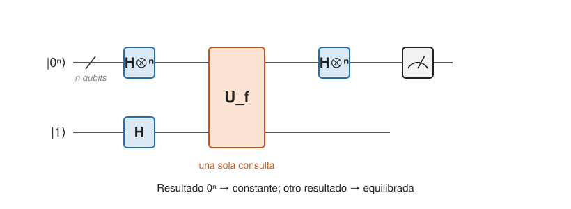

## Fundamentos {#layer-1}

### Idea clave
Deutsch-Jozsa decide con **una** consulta cuántica si una caja negra `f: {0,1}ⁿ → {0,1}` es constante o equilibrada, mientras que un algoritmo clásico determinista necesita `2^{n−1} + 1` consultas en el peor caso [@watrous-2025, L5.3, PDF pp. 144-148]. La ventaja desaparece casi por completo frente a algoritmos aleatorios [@watrous-2025, L5.3, PDF p. 148].

### Explicación
Se empieza por el problema más pequeño, el de Deutsch. Te dan una caja negra `f: {0,1} → {0,1}` (ver [modelo de consultas](query-model-and-oracles.md)). Hay que decir si `f` es *constante* (`f(0) = f(1)`) o *equilibrada (balanced)* (da 0 en una entrada y 1 en la otra). Es el problema de la paridad con `n = 1`: el XOR de `f(0)` y `f(1)` [@watrous-2025, L5.2, PDF pp. 139-140]. Clásicamente hacen falta dos consultas, porque conocer un solo bit no dice nada de la paridad; cuánticamente basta una, y la respuesta es correcta con probabilidad 1 [@watrous-2025, L5.2, PDF pp. 140-142]. Watrous lo califica de ventaja "modesta" (una consulta frente a dos), pero cuantificable [@watrous-2025, L5.2, PDF p. 140].

El problema general sube a `f: {0,1}ⁿ → {0,1}`, con la *promesa* de que es constante o equilibrada (valor 1 exactamente en la mitad de las entradas). Hay que decir cuál. Cualquier otra función (por ejemplo, una que valga 1 en una sola de cuatro entradas) es una entrada "no importa" [@watrous-2025, L5.3, PDF pp. 144-145].

El circuito usa `n` qubits en `|0⟩` y uno auxiliar en `|1⟩`; Hadamard en todos; **una** consulta `U_f`; Hadamard en los `n` primeros; medir esos `n`. Si todos los resultados son 0, la función es constante; si no, equilibrada [@watrous-2025, L5.3, PDF pp. 144-145].

La ganancia es exponencial frente a los clásicos deterministas. Un algoritmo clásico determinista necesita `2^{n−1} + 1` consultas en el peor caso: tras ver `2^{n−1}` valores iguales todavía son posibles "constante" y "equilibrada" [@watrous-2025, L5.3, PDF pp. 147-148]. El cuántico usa una.

Pero un algoritmo clásico *aleatorio* que consulta `k` cadenas al azar y responde "constante" si todos los valores coinciden acierta siempre en funciones constantes y falla en las equilibradas con probabilidad solo `2^{−k+1}`; con `k = 11` acierta con probabilidad superior al 99,9 % [@watrous-2025, L5.3, PDF p. 148]. Por eso la ventaja frente a los algoritmos probabilísticos es modesta.

### Ejemplo
El circuito de Deutsch (`n = 1`) paso a paso: objetivo en `|1⟩` y control en `|0⟩`, Hadamard en ambos, una consulta `U_f`, Hadamard en el control y medida. El resultado 0 significa "constante" y 1 "equilibrada" [@watrous-2025, L5.2, PDF pp. 140-142].

### Errores frecuentes
- *"Si veo una salida distinta de `0ⁿ` sé qué función es."* Solo sabes que es equilibrada; no hay más información [@watrous-2025, L5.3, PDF pp. 144-145].

### Las fuentes discrepan
Shor lo dice sin rodeos: no es una prueba convincente de ventaja cuántica; su importancia es que condujo al algoritmo de Simon [@shor-mit-2022, L16, p. 4]. Watrous, en cambio, subraya la separación exponencial frente a los deterministas y avisa de que frente a los probabilísticos es modesta [@watrous-2025, L5.3, PDF pp. 147-148].

### Para seguir
La capa 2 explica por qué el circuito acierta, con la interferencia de las `2ⁿ` amplitudes. Antes, si quieres ver el patrón en otros problemas, mira el [modelo de consultas](query-model-and-oracles.md).

## Comprensión {#layer-2}

### Idea clave
Una capa de Hadamard sobre `n` qubits actúa como `H^{⊗n}|x⟩ = 2^{−n/2} Σ_y (−1)^{x·y}|y⟩`; con ello, la amplitud de `|0ⁿ⟩` tras el circuito es `2^{−n} Σ_x (−1)^{f(x)}`, que vale `±1` si `f` es constante y 0 si es equilibrada [@watrous-2025, L5.3, PDF pp. 146-147; @de-wolf-2026, §2.4.1, pp. 30-31].

### Explicación
Aquí `x·y` es el producto escalar binario [@watrous-2025, L5.3, PDF p. 146; @shor-mit-2022, L16, pp. 1-2]. El análisis tiene tres pasos:

1. Tras la primera capa, el estado es la superposición uniforme de las `2ⁿ` cadenas [@de-wolf-2026, §2.4.1, pp. 30-31].
2. La consulta, con el auxiliar en `|−⟩`, usa el [retroceso de fase](phase-kickback.md): deja `|−⟩ ⊗ 2^{−n/2} Σ_x (−1)^{f(x)}|x⟩` [@watrous-2025, L5.3, PDF pp. 146-147].
3. La segunda capa vuelve a hacer una Hadamard; la amplitud de `|0ⁿ⟩` es `2^{−n} Σ_x (−1)^{f(x)}` [@de-wolf-2026, §2.4.1, pp. 30-31; @shor-mit-2022, L16, pp. 3-4].

La regla que resume Aaronson es: poner todo en superposición con Hadamards, consultar como oráculo de fase, cambiar de base con otra ronda de Hadamards y medir; "si no sabes qué hacer a continuación, una ronda de Hadamards es siempre una buena apuesta" [@aaronson-2018, Lec17, p. 7].

El coste es una consulta cuántica y `O(n)` operaciones más, con certeza [@de-wolf-2026, §2.4.1, p. 31]. La solución original de Deutsch-Jozsa usaba dos consultas; la de una consulta se atribuye a Cleve y colaboradores [@de-wolf-2026, §2.4.1, p. 31].

Hay una diferencia de enfoque entre con error y sin él. El clásico necesita `N/2 + 1` consultas deterministas, con `N = 2ⁿ`. Pero un clásico aleatorio que mira dos posiciones al azar y dice "constante" si coinciden acierta siempre en constantes y la mitad de las veces en equilibradas: al permitir error, la separación desaparece. La separación vale solo frente a algoritmos clásicos *sin error* [@de-wolf-2026, §2.4.1, p. 31].

El mismo circuito, sin el postproceso con `OR`, resuelve el problema de [Bernstein-Vazirani](bernstein-vazirani-and-simon.md) [@watrous-2025, L5.3, PDF pp. 149-151]. Deutsch-Jozsa con `n = 1` es una instancia del problema del subgrupo oculto [@de-wolf-2026, ej. 6.1, p. 63].

### Ejemplo
Qué ocurre con la amplitud de `|0ⁿ⟩` en los dos casos de la promesa:

- Si `f` es constante, la suma vale `±2ⁿ` y la amplitud es `±1`: se mide `0ⁿ` con certeza.
- Si `f` es equilibrada, los términos `+1` y `−1` se cancelan y la amplitud es 0: nunca se mide `0ⁿ`.

Por tanto el algoritmo acierta siempre cuando se cumple la promesa [@watrous-2025, L5.3, PDF p. 147].

### Errores frecuentes
- *"Deutsch-Jozsa prueba que lo cuántico es exponencialmente más rápido."* Solo frente a clásicos deterministas exactos, en un modelo de consultas y con promesa [@watrous-2025, L5.3, PDF p. 148; @shor-mit-2022, L16, p. 4].
- *"Se prueban todas las entradas a la vez."* La consulta es una sola; la ventaja viene de que las `2ⁿ` contribuciones interfieran. Ver [circuitos cuánticos](../../qubits-and-circuits/concepts/quantum-circuits.md), donde se explica que medir una superposición da una sola salida.

### Las fuentes discrepan
Hay cifras inconsistentes en la literatura: unas notas dicen que el mejor clásico determinista necesita `2^{n−1}+1` consultas y, más abajo, "alrededor de `2^{n/2}`"; la cifra exacta derivada es la primera [@shor-mit-2022, L16, pp. 2, 4].

### Para seguir
La capa 3 evalúa cuándo la ventaja de Deutsch-Jozsa es real y cómo reutilizar su plantilla. Para verla en un problema con estructura, [Bernstein-Vazirani y Simon](bernstein-vazirani-and-simon.md).

## Profesional {#layer-3}

### Idea clave
Ningún problema real se parece a "constante o equilibrada": es un algoritmo pedagógico y una plantilla *Hadamard, oráculo de fase, Hadamard, medir* que reaparece en otros algoritmos [@watrous-2025, L5.3-L5.4, PDF pp. 144-160; L8.2, PDF p. 242].

### Explicación
La plantilla aparece de nuevo en [Bernstein-Vazirani](bernstein-vazirani-and-simon.md), en Simon y, con otro papel de la segunda capa, en [Grover](grover-search.md) [@watrous-2025, L5.3-L5.4, PDF pp. 144-160; L8.2, PDF p. 242]. El mensaje que conviene retener es de método: ¿qué patrón de signos `(−1)^{g(x)}` produce el oráculo y qué cambio de base lo convierte en un resultado legible?

Para evaluar la ventaja hay tres preguntas:

- *Frente a qué clásico:* exacto (determinista), aleatorio con error pequeño o la mejor solución conocida. La ventaja de Deutsch-Jozsa existe solo en el primer caso; un aleatorio con 20-30 consultas ya falla con probabilidad ínfima [@shor-mit-2022, L16, p. 4]. Aaronson añade que, por esa razón, hasta 1994 casi nadie se interesó por la computación cuántica [@aaronson-2018, Lec17, pp. 6-7].
- *Exactitud cuántica:* "sin error" depende del conjunto de puertas. La clase `EQP` (tiempo polinómico cuántico exacto) se considera poco interesante precisamente por eso [@de-wolf-2026, §13.2, pp. 122-123].
- *Modelo:* es una separación de consultas, no de circuitos [@de-wolf-2026, §2.4, p. 29]. Ver [complejidad cuántica](quantum-complexity.md).

Un caso donde el truco cuántico da poco es la paridad. La de `n` bits se obtiene con `n/2` consultas dividiendo la entrada en bloques de 2 bits, aplicando Deutsch a cada bloque y combinando clásicamente [@aaronson-2018, Lec17, p. 6]. Esto es óptimo: `Parity` necesita `≥ n/2` consultas incluso con error acotado [@childs-qa, §21.5, pp. 99-100]. Es un ejemplo de problema en el que el truco cuántico da solo un factor 2.

### Ejemplo
Un buen ejercicio de programación es construir el oráculo `U_f` para una `f` constante y para otra equilibrada, y comprobar que el circuito da `0ⁿ` solo en el primer caso. Los detalles de código están en [programación con Qiskit](../../qiskit-programming/index.md).

### Para seguir
[Bernstein-Vazirani y Simon](bernstein-vazirani-and-simon.md) reutilizan la plantilla para extraer estructura oculta. [Complejidad cuántica](quantum-complexity.md) discute el alcance de estas separaciones.
