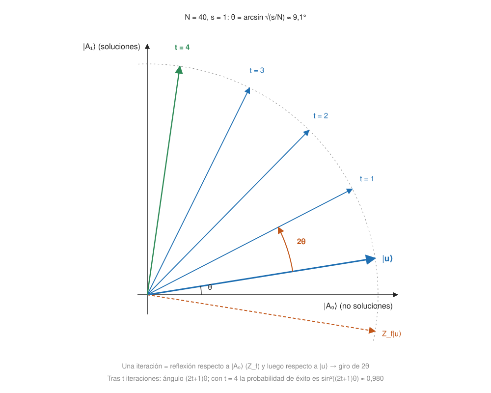
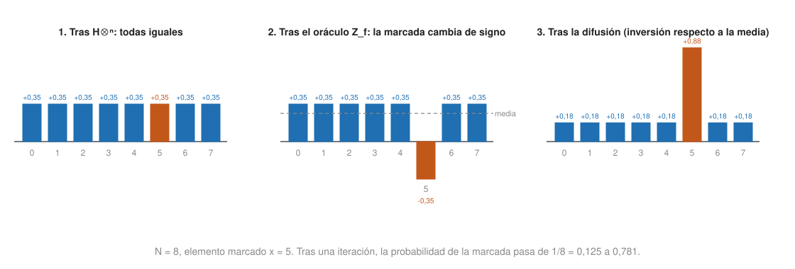

## Fundamentos {#layer-1}

### Idea clave
El algoritmo de Grover busca una entrada `x` con `f(x) = 1` en una función arbitraria con `O(√N)` evaluaciones, frente a las `O(N)` que se daban por necesarias [@grover-1996, resumen, p. 1; §1.1, p. 2]. Es una ventaja *cuadrática*, no exponencial [@watrous-2025, L8.1, PDF pp. 238-239].

### Explicación
El problema es la "aguja en un pajar". Tienes una función `f: {0,1}ⁿ → {0,1}` que sabes calcular pero que, por lo demás, es arbitraria, y buscas una *solución* (una entrada con `f(x) = 1`) o saber que no existe [@watrous-2025, L8.1, PDF pp. 238-240]. Con `N = 2ⁿ` candidatos, un algoritmo clásico determinista necesita `N` evaluaciones, y uno probabilístico `O(N)` para tener alta probabilidad de éxito [@watrous-2025, L8.1, PDF pp. 238-239].

Que la ventaja sea cuadrática significa pasar de un millón de pasos a mil, no de un millón a veinte. Y Watrous es franco: parece improbable que dé una ventaja práctica pronto, porque el hardware clásico es mucho más rápido [@watrous-2025, L8 intro, PDF pp. 237-238].

La receta tiene tres pasos:

1. Empezar con `n` qubits en `|0ⁿ⟩` y aplicar Hadamard a cada uno: se obtiene la superposición uniforme `|u⟩`.
2. Repetir `t` veces la operación de Grover: *oráculo de fase* (invierte el signo de las soluciones) seguido de la *difusión* (invierte las amplitudes respecto a su media).
3. Medir en la base estándar.

[@watrous-2025, L8.2, PDF p. 242; @grover-1996, §3, p. 3]. Después se consulta `f` con la salida: si `f(x) = 1`, se devuelve `x`; si no, se repite [@watrous-2025, L8.2, PDF p. 243].

La intuición está en las amplitudes. Con una sola solución, su amplitud empieza en `1/√N`. El oráculo la vuelve `−1/√N`; al invertir respecto a la media (≈ `1/√N`) pasa a ≈ `3/√N`; tras `k` iteraciones es ≈ `(2k+1)/√N`, de modo que bastan unas `√N` vueltas [@shor-mit-2022, L24, p. 3; @aaronson-2018, Lec22, pp. 2-4]. La clave del cuadrado es que las amplitudes son raíces de probabilidades, y cada consulta suma ≈ `1/√N` de amplitud en vez de `1/N` de probabilidad. Clásicamente, tras `t` consultas la probabilidad de éxito es `t/N`; en Grover es del orden de `t²/N` [@aaronson-2018, Lec22, p. 4].

Hay que parar a tiempo. Si se itera de más, la probabilidad de éxito baja otra vez, como un soufflé que sube y se hunde [@aaronson-2018, Lec22, pp. 6-7; @de-wolf-2026, §7.2, p. 68]. El número de iteraciones ronda `(π/4)√(N/M)`, con `M` el número de soluciones [@shor-mit-2022, L24, p. 5].

### Ejemplo
Con `N = 4` y una solución, una sola iteración da probabilidad de éxito exactamente 1 [@watrous-2025, L8.4, PDF pp. 252-254]. En general, con `t = N/4` soluciones, una iteración basta con certeza [@de-wolf-2026, §7.2, p. 67; ej. 7.3, p. 71].

### Errores frecuentes
- *"Más iteraciones, más probabilidad."* La probabilidad sube y vuelve a bajar [@aaronson-2018, Lec22, pp. 6-7].
- *"Grover da una ventaja exponencial."* Es cuadrática, y Watrous duda de que sea práctica pronto [@watrous-2025, L8 intro, PDF pp. 237-238].

### Para seguir
La capa 2 explica por qué las iteraciones son una rotación y cuántas hacen falta según el número de soluciones. Allí también se ve que la ventaja cuadrática es óptima.

## Comprensión {#layer-2}

### Idea clave
Cada iteración de Grover es el producto de dos reflexiones, que equivale a una **rotación** de `2θ` en un plano; la probabilidad de medir una solución tras `t` iteraciones es `sin²((2t+1)θ)` [@watrous-2025, L8.3-8.4, PDF pp. 249, 251-252; @de-wolf-2026, §7.2, pp. 66-67]. Ningún algoritmo de consultas lo mejora asintóticamente [@watrous-2025, L8.5, PDF p. 258].

### Explicación
Las dos reflexiones salen del oráculo de fase y la difusión. Se define `Z_f|x⟩ = (−1)^{f(x)}|x⟩`, que cuesta una consulta (ver [oráculo de fase](query-model-and-oracles.md) y [retroceso de fase](phase-kickback.md)). Se define también `Z_OR|x⟩ = |x⟩` si `x = 0ⁿ` y `−|x⟩` en otro caso: no cuesta consultas y es independiente de `f`. Como `Z_OR = 2|0ⁿ⟩⟨0ⁿ| − I`, se tiene `H^{⊗n} Z_OR H^{⊗n} = 2|u⟩⟨u| − I` [@watrous-2025, L8.2-8.3, PDF pp. 241-242, 246]. La operación de Grover es `G = H^{⊗n} Z_OR H^{⊗n} Z_f`.

La difusión se implementa como producto de tres transiciones "locales" (Walsh-Hadamard, desfase, Walsh-Hadamard) [@grover-1996, §3, p. 3; §5, p. 5]. Grover la ve como "inversión respecto a la media": con `A` la media de las componentes, el componente `i` pasa a `A + (A − v_i)` [@grover-1996, §4, p. 4].

La geometría explica el resto. Sea `A₁ = {x : f(x)=1}` y `A₀` su complemento, con `|A₀⟩`, `|A₁⟩` las superposiciones uniformes. Entonces `|u⟩ = cos θ |A₀⟩ + sin θ |A₁⟩` con `θ = arcsin √(|A₁|/N)`, y el estado permanece en el plano real que generan [@watrous-2025, L8.3, PDF pp. 244-249]. `Z_f` es una reflexión en ese plano y `2|u⟩⟨u| − I` es otra; el producto de dos reflexiones es una rotación del doble del ángulo entre sus ejes, aquí `2θ` [@watrous-2025, L8.3, PDF pp. 246, 249-251]. Resultado:

```
G^t |u⟩ = cos((2t+1)θ) |A₀⟩ + sin((2t+1)θ) |A₁⟩
```





Para elegir `t` hay que acercar `(2t+1)θ` a `π/2`, luego `t ≈ π/(4θ) − 1/2`; el valor recomendado es `t = ⌊π/(4θ)⌋`, que depende del número de soluciones `s` [@watrous-2025, L8.4, PDF pp. 251-252]. Con `s = 1`, `θ = arcsin(1/√N) ≈ 1/√N` y `t = ⌊π√N/4⌋`; la probabilidad de éxito supera el 99 % desde `N = 32` y se cumple `p(N,1) ≥ 1 − 1/N` (afirmado sin demostración), pero no es monótona en `N` [@watrous-2025, L8.4, PDF pp. 252-254]. Con `s` soluciones, `t ≤ (π/4)√(N/s)` consultas [@watrous-2025, L8.4, PDF p. 256; @de-wolf-2026, §7.2, p. 67].

Si no se sabe `s`, hay dos opciones. La primera es elegir `t` al azar en `{1,…,⌊π√N/4⌋}`, lo que da una solución con probabilidad superior al 40 %. La segunda es hacer crecer exponencialmente la cota `T` (`T → ⌈5T/4⌉` funciona, duplicar no): `O(√(N/s))` consultas si `s ≥ 1` y `O(√N)` para detectar que `s = 0` [@watrous-2025, L8.4, PDF p. 257; @de-wolf-2026, §7.2, p. 68; @shor-mit-2022, L24, p. 5]. Basta una probabilidad `≥ 1/2` por ejecución, porque la salida se comprueba con una consulta; tras `m` ejecuciones el fallo es como mucho `2^{−m}`, con `O(m√N)` consultas [@watrous-2025, L8.4, PDF p. 254].

Hay tres casos triviales:

- Si `f` es constante, `G|u⟩ = ±|u⟩` y siempre sale una cadena uniforme al azar [@watrous-2025, L8.4, PDF pp. 257-258].
- Sustituir `f` por `NOT f` solo cambia una fase global: Grover no sabe cuáles son las soluciones, solo que las distingue [@watrous-2025, L8.3, PDF p. 245].
- Si no hay soluciones, el estado se queda uniforme; tras `O(1)` repeticiones sin éxito se concluye con alta confianza que no hay [@aaronson-2018, Lec22, p. 8].

Por último, el algoritmo es óptimo: ningún algoritmo de consultas puede usar asintóticamente menos de `O(√N)` consultas, ni siquiera para la búsqueda única. La cota inferior se conocía antes que el algoritmo (Bennett, Bernstein, Brassard y Vazirani, 1994) [@watrous-2025, L8.5, PDF p. 258; @aaronson-2018, Lec23, p. 1; @grover-1996, §6, p. 7]. Consecuencia: cualquier enfoque que trate un problema NP como caja negra solo puede obtener la ventaja de Grover [@aaronson-2018, Lec24, p. 5; Lec25, p. 1].

### Ejemplo
Usar el `t` calculado para `s = 1` cuando en realidad `s = 4` es catastrófico: el estado gira el doble de rápido y se pasa hacia `−|A₀⟩`, con un éxito que tiende a 0 al crecer `N` [@watrous-2025, L8.4, PDF pp. 254-256].

### Errores frecuentes
- *"Grover resuelve NP-completos en tiempo polinómico."* Da como mucho una ventaja cuadrática, y para problemas como el viajante hay algoritmos clásicos mejores (Bellman-Held-Karp) que Grover aplicado a la fuerza bruta [@de-wolf-2026, §7.4, p. 70].
- *"Más iteraciones, más probabilidad."* La probabilidad es `sin²((2t+1)θ)`: oscila [@aaronson-2018, Lec22, pp. 6-7].
- *"La búsqueda en una base de datos física se acelera tal cual."* Haría falta una memoria cuántica de acceso aleatorio [@aaronson-2018, Lec22, p. 2].

### Para seguir
La capa 3 generaliza el truco de las dos reflexiones a cualquier subrutina (amplificación de amplitud) y reúne las aplicaciones y los costes reales.

## Profesional {#layer-3}

### Idea clave
El truco de componer dos reflexiones sirve para cualquier algoritmo unitario `A` con probabilidad de éxito `p` y comprobación eficiente: la **amplificación de amplitud (amplitude amplification)** lo sube hasta casi 1 con `O(1/√p)` ejecuciones, frente a `O(1/p)` clásicas [@de-wolf-2026, §7.3, p. 70].

### Explicación
Sea `A` una unitaria sin medidas con `A|0^m⟩ = √p |ψ₁⟩ + √(1−p) |ψ₀⟩` (buenos y malos ortogonales). Se refleja respecto del estado malo con `R_G` (por ejemplo una `Z` sobre un qubit bandera) y respecto de `|U⟩ = A|0^m⟩` con `A R₀ A⁻¹`. Cada par de reflexiones rota `2θ` con `θ = arcsin √p`, y `O(1/√p)` rondas bastan [@de-wolf-2026, §7.3, pp. 68-69]. Grover es el caso `A = H^{⊗n}`, `p = t/N` [@de-wolf-2026, §7.3, p. 69].

Alrededor de esa idea hay varios matices:

- *Requisito:* `A` debe ser unitaria, sin medidas, porque hace falta `A⁻¹`. Si `p` es desconocida, se prueba con conjeturas decrecientes de forma exponencial [@de-wolf-2026, §7.3, p. 69].
- *Error `ε` sin conocer `t`:* `O(√(N log(1/ε)))` consultas, mejor que las `O(√N log(1/ε))` de repetir [@de-wolf-2026, §7.2, p. 68; ej. 7.6, p. 72].
- *Versión exacta:* si se conoce `t` exactamente se puede ajustar el ángulo para caer sobre el estado bueno [@de-wolf-2026, §7.2, p. 68; ej. 7.5, p. 71]; la `OR` exacta general requiere `≥ N/2` consultas, sin ventaja de raíz cuadrada [@de-wolf-2026, §11.2, p. 104].
- *Variante "oblivious":* se aplica a un operador con bloque codificado cuando el estado de entrada es desconocido, y se usa dentro de la simulación por combinación lineal de unitarias; ver [simulación de hamiltonianos](hamiltonian-simulation.md) [@childs-qa, §28.3, p. 142].
- *Conteo cuántico:* estimación de fase sobre la cadena cuantizada de Grover ([estimación de fase](phase-estimation.md)) estima `|M|` con precisión multiplicativa `ρ` en `O(√(N/|M|)/ρ)` [@childs-qa, §19.3, pp. 88-89].

La primera aplicación son los problemas NP con oráculo de circuito. Con `N = 2ⁿ` y `f(x) = φ(x)` para una fórmula `φ`, el tiempo es ≈ `2^{n/2} poly(n)`: ventaja conjetural (si `P = NP` perdería sentido) y como mucho cuadrática [@aaronson-2018, Lec22, pp. 1-2]. Para CircuitSAT nada supera la fuerza bruta clásica, pero en 3SAT los algoritmos clásicos (≈ `1,3ⁿ`) la superan, así que hay que combinar Grover con trucos clásicos [@aaronson-2018, Lec22, pp. 1-2]. El oráculo se construye como `U_φ`, `Z` sobre el qubit de respuesta y `U_φ⁻¹` para limpiar el espacio de trabajo [@de-wolf-2026, §7.4, p. 70]. Grover sugirió combinarlo con algoritmos que exploten estructura, como el de Shor [@grover-1996, §8, obs. 2, p. 7].

La segunda son las variantes estructuradas:

- *OR de AND* (en una tabla cuadrada, ¿hay una fila toda a 1?): clásicamente ≈ `N`; con Grover anidado ≈ `√N`, con cota inferior probada por el método de Ambainis. Generalizado a árboles de juegos: cualquier árbol con `N` hojas se evalúa en `O(√N)`, óptimo [@aaronson-2018, Lec23, pp. 4-6].
- *Colisiones* (dada una `f` 2 a 1, hallar `x ≠ y` con `f(x) = f(y)`): `Θ(n^{1/3})` consultas cuánticas frente a `Θ(√n)` clásicas: se consultan ≈ `n^{1/3}` elementos y luego se busca con Grover una repetición [@childs-qa, cap. 22, pp. 103-105; @aaronson-2018, Lec24, pp. 1-2]. Es el ejemplo de que una estructura modesta da solo una ganancia polinómica [@childs-qa, cap. 22, p. 103].
- *Distinción de elementos:* ≈ `N^{3/4}` con Grover por bloques; ≈ `N^{2/3}` con paseos cuánticos, óptimo, a costa de ≈ `N^{2/3}` qubits de memoria [@aaronson-2018, Lec24, pp. 2-4].
- *Búsqueda en grafos con restricciones de localidad:* en expansores `O(√N)`; en una malla de dimensión `d`, `O(√N)` para `d ≥ 3`, `O(√N log N)` para `d = 2` y sin ventaja para `d = 1` [@childs-qa, §19.4, pp. 89-90].
- *Estimar el peso de Hamming* dentro de `±εn`: ≈ `1/ε²` muestras clásicas frente a ≈ `1/ε` consultas cuánticas [@aaronson-2018, Lec24, p. 5].

Para decidir si compensa usar Grover hay que mirar cinco cosas:

1. *Oráculo.* Grover funciona con cualquier `f` con circuito booleano, usando qubits de trabajo que empiezan y acaban en `|0⟩` [@watrous-2025, L8.2, PDF p. 239]. El circuito completo usa `O(√N)` consultas, `O(log N)` qubits y ≈ `√N log N` puertas [@aaronson-2018, Lec22, p. 1; @de-wolf-2026, §7.1, p. 65].
2. *Constantes.* Si las puertas cuánticas son mucho más caras (constante `C ≫ c`), una ventaja cuadrática solo compensa para `N` grande [@de-wolf-2026, ej. 7.2, p. 71]. Watrous recuerda que la FFT y la ordenación rápida ofrecen algo menos que una ventaja cuadrática sobre los métodos ingenuos y son muy importantes [@watrous-2025, L8 intro, PDF pp. 237-238].
3. *Acceso cuántico.* Hace falta acceso cuántico a `f` como unitaria; en Grover esto sí importa [@aaronson-2018, Lec22, p. 1].
4. *Límites de lo demostrable.* La cota `Ω(√N)` se prueba con el método polinómico (el grado del polinomio inducido es al menos `Ω(√N)`, luego `T = Ω(√N)`), con el del adversario (`√(m₀m₁/(ℓ₀ℓ₁)) = √N`) y con el método híbrido [@de-wolf-2026, §11.2-11.3, pp. 102-106; ej. 11.12, p. 108; @childs-qa, §21.6, pp. 100-101; §23.3, p. 113; @shor-mit-2022, L25, pp. 1-3]. Grover encuentra la solución única con probabilidad `1−o(1)` en `(π/4)√n + o(1)` consultas [@childs-qa, §23.3, p. 113].
5. *Cuándo usar Grover.* Cuando existe una comprobación eficiente y *no* hay estructura que aprovechar. Si hay estructura, un clásico bien elegido suele ganar (TSP con Held-Karp: `2ⁿ·poly`) [@de-wolf-2026, §7.4, p. 70]. Para claves simétricas, ver [criptografía poscuántica](post-quantum-cryptography.md).

### Ejemplo
Buscar tres enteros cuyos cubos sumen 42. Booker y Sutherland lo resolvieron con un algoritmo clásico astuto en ≈ un millón de horas de ordenador. La fuerza bruta sobre `x, y` de 17 cifras serían ≈ `10³⁴` candidatos y Grover ≈ `10¹⁷`. Shor añade que se pueden combinar técnicas clásicas con ideas de Grover [@shor-mit-2022, L24, p. 1].

### Las fuentes discrepan
Sobre claves simétricas, Aaronson plantea una historia de ejecutar Grover sobre todas las claves de descifrado, como ventaja cuadrática en búsqueda de claves; la regla de "duplicar la longitud de clave" no se enuncia en ese texto [@aaronson-2018, Lec22, pp. 1, 7].

### Para seguir
[Complejidad cuántica](quantum-complexity.md) sitúa la ventaja cuadrática de Grover frente a la de Shor. Para el uso en criptografía de clave simétrica, [criptografía poscuántica](post-quantum-cryptography.md).
