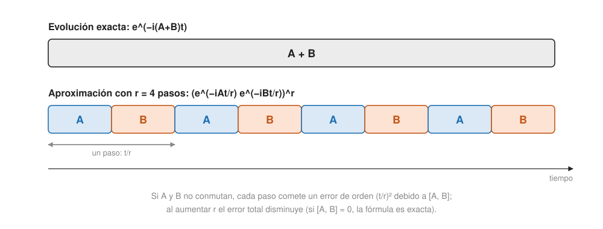

## Profesional {#layer-3}

Este concepto empieza directamente en la capa profesional: da por sabida la [evolución unitaria](../../quantum-mechanics/concepts/unitary-time-evolution.md) y la [estimación de fase](phase-estimation.md).

### El problema

**Por qué se simula.** El hamiltoniano `H` es el observable de energía; la ecuación de Schrödinger da la unitaria `U = e^{−iHt}` (con `H` independiente del tiempo). Simular sistemas cuánticos (química cuántica, materiales) es difícil para un ordenador clásico porque el número de amplitudes es exponencial en el número de partículas; este fue el motivo principal por el que Feynman propuso los ordenadores cuánticos [@de-wolf-2026, §9.1, pp. 83-84; @childs-qa, cap. 27 intro, p. 133]. Un hamiltoniano es hermítico (`H = H†`), pero a diferencia de una matriz de densidad no tiene por qué ser positivo ni de traza 1 [@aaronson-2018, Lec25, p. 2]. La solución `|ψ(t)⟩ = e^{−iHt}|ψ(0)⟩` sale de pedir dinámica lineal de primer orden y conservación de la norma, que fuerza `A† = −A`, es decir `H = iA` hermítico [@shor-mit-2022, L26, pp. 1-2]. Sumar un múltiplo de la identidad a `H` solo añade una fase global [@shor-mit-2022, L26, p. 2].

**Enunciado.** Dados `H`, un tiempo `t` y una precisión `ε`, hay que encontrar un circuito pequeño `Ũ` a distancia `ε` (en norma de operador) de `e^{iHt}` (se omite el signo menos), válido para cualquier estado de entrada; el sistema se supone de `n` qubits y otros espacios de Hilbert se codifican en binario, lo que es "buena parte del arte" de la química cuántica [@de-wolf-2026, §9.1, p. 84]. Un `H` es *eficientemente simulable* si para todo `t, ε` hay un circuito con `poly(n, t, 1/ε)` puertas [@childs-qa, §§27.1-27.2, p. 133].

**Qué no promete.**

- Simular hamiltonianos generales es `BQP`-difícil (es *promise-BQP-completo* incluso con restricciones naturales) [@childs-qa, §27.2, p. 133]. Ver [complejidad cuántica](quantum-complexity.md).
- Hallar la energía del estado fundamental de un hamiltoniano es `QMA`-difícil incluso para hamiltonianos 2-locales, luego se cree difícil incluso para un ordenador cuántico [@de-wolf-2026, §9.1, footnote 2, p. 84]. Para sumas de términos de pocos qubits es `NP`-difícil: se codifica una instancia de 3SAT con un término de penalización por cláusula violada, y la dificultad no tiene nada que ver con la mecánica cuántica [@aaronson-2018, Lec25, pp. 9-10].
- Si la factorización es difícil clásicamente, Shor implica que los ordenadores cuánticos no se pueden simular en tiempo polinómico clásicamente [@de-wolf-2026, §9.1, footnote 3, p. 84].

### Hamiltonianos estructurados

Dos formas con las que se trabaja:

- *Suma de términos locales:* `H = Σ_{j=1}^m H_j`, con `m = poly(n)` y cada `H_j` actuando sobre pocos qubits (2-local = sobre dos). Cada `e^{iH_j t}` es entonces una puerta de dos qubits [@de-wolf-2026, §9.2, p. 85]. Ejemplo: el modelo de Ising transversal `H = Σ σᶻ_j σᶻ_{j+1} − g Σ σˣ_j` se parte en `A + B` con todos los términos de `A` conmutando entre sí y los de `B` también [@shor-mit-2022, L26, p. 3].
- *Hamiltonianos dispersos (sparse):* `s` entradas no nulas como mucho por columna, con acceso eficiente; la localidad implica en líneas generales dispersión [@de-wolf-2026, §9.2, p. 85, nota 5; @childs-qa, §27.4, p. 135].

También son fáciles: un número constante de qubits (coste `poly(log 1/ε)` por Solovay-Kitaev), reescalados, cambios de base `U H U†`, y hamiltonianos diagonales en la base de cómputo con entradas calculables [@childs-qa, §27.2, p. 134].

### Métodos

**1. Fórmulas de producto (Trotter-Suzuki).** Si los `H_j` conmutan, `e^{iHt} = Π e^{iH_j t}` y se aplican en cualquier orden [@shor-mit-2022, L26, p. 3]. En general `e^{A+B} ≠ e^A e^B` [@aaronson-2018, Lec25, p. 8]; el error es de orden `t²` por el conmutador `[A,B]` [@shor-mit-2022, L26, pp. 3-4]. Se parte el tiempo en `r` trozos:

```
U ≈ ( e^{iH₁t/r} ··· e^{iH_m t/r} )^r
```

- *Primer orden (Lloyd):* error por paso `O(m²t²/r²)`; error total `≤ ε` con `r = O(m²t²/ε)`, es decir `O(m³t²/ε)` puertas de dos qubits (para `m = 2`, `O(t²/ε)`). Los errores de un producto de unitarias se suman como mucho linealmente [@de-wolf-2026, §9.2, p. 85; @shor-mit-2022, L26, p. 4].
- *Segundo orden (simétrica):* `e^{iηA/2} e^{iηB} e^{iηA/2}` tiene error `O(η³)` y da `O(t^{1,5}/√ε)` puertas [@de-wolf-2026, §9.2, p. 85; ej. 9.4, p. 91; @shor-mit-2022, L26, pp. 4-5].
- *Órdenes mayores:* coste `O(t^{1+δ})` para cualquier `δ > 0` fijo, a cambio de más complejidad [@childs-qa, §27.3, p. 135].
- *Observación práctica:* aunque Trotter tiene peores cotas teóricas en `t` y `ε` que los demás métodos, en la práctica es bastante competitivo, es simple y no necesita qubits auxiliares [@de-wolf-2026, §9.2, nota 7, pp. 85-86].

**2. Combinación lineal de unitarias (LCU, Taylor).** Se escribe `H = Σ α_j V_j` con `V_j` unitarias (por ejemplo, cadenas de Pauli; un término 2-local son como mucho 16) y se trunca la serie de Taylor de `e^{iHt}` en `K = O(t + log(1/ε))` (más finamente, `K = O(log(‖H‖t/ε)/loglog(‖H‖t/ε))`) [@de-wolf-2026, §9.3, pp. 86-88; @childs-qa, §28.3, pp. 140-142]. El paso básico: con `W|0⟩ = Σ √(α_j/‖α‖₁)|j⟩` y `select-V = Σ |j⟩⟨j|⊗V_j`, aplicar `W`, `V`, `W⁻¹` da `(1/‖α‖₁)|0⟩M|ψ⟩` más un resto con el primer registro distinto de 0 [@de-wolf-2026, §9.3, pp. 86-87]. Como la entrada es desconocida hace falta amplificación de amplitud oblivious (`W R W† R`); con `s = 2` la amplitud `1/2` pasa a 1, igual que Grover con un marcado entre cuatro [@childs-qa, §28.3, pp. 140-142]. Coste: `O(t‖α‖₁ log(t‖α‖₁/ε)) = O(mt log(mt/ε))` aplicaciones de `select-V`, lineal en `t` y logarítmico en `1/ε` [@de-wolf-2026, §9.3, pp. 86-88].

**3. Codificación en bloques y procesamiento de señal cuántica (QSP, qubitización).** Una unitaria `U` *codifica en bloque (block-encodes)* `A` si `A = (⟨0|⊗I) U (|0⟩⊗I)`, con `‖A‖ ≤ 1` (se puede reescalar `A/α`); las matrices dispersas calculables se codifican en bloque, y la clase es cerrada para productos y sumas [@childs-qa, §29.1, pp. 143-144]. La *qubitización* descompone el espacio en subespacios invariantes 2D donde `U` actúa como una reflexión `R(λ)`; con fases `e^{iθ(2Π−1)}` se aplica QSP en cada uno y se obtiene una codificación en bloque de `P(A)`: para un polinomio `f` de grado `d` con `|f| ≤ 1/2`, un circuito con `d` usos de `U, U†` y un `U` controlado [@childs-qa, §§29.2-29.3, pp. 144-147; @de-wolf-2026, §9.4, pp. 88-90]. Para simular se usa la expansión de Jacobi-Anger de `e^{it cos θ}` truncada en `K = O(t + ln(1/ε)/ln(e + ln(1/ε)/t))` (enunciada como ajustada), más amplificación robusta con sobrecoste constante: **optimalidad en consultas tanto en `t` como en `ε`** para hamiltonianos dispersos [@childs-qa, §29.4, pp. 147-148]. En la formulación de De Wolf, para `H` `s`-disperso: `O(st + log(1/ε))` consultas a `H` y `O(n(st + log(1/ε)))` puertas de dos qubits, aditivo en `t` y `log(1/ε)` [@de-wolf-2026, §9.4, pp. 88-90].

**4. Paseos cuánticos (para dispersos).** Se construye un paseo cuyos valores propios son `e^{±i arccos(λ/X)}`, se hace estimación de fase, se aplica la fase `e^{−iλt}` y se deshace. Coste lineal en `t` y polinómico en `1/ε`; refinado: `O(‖H‖t/√ε + d‖H‖_max t)` consultas para `H` `d`-disperso, que iguala la cota inferior `Ω(t)` [@childs-qa, §28.2, p. 140]. Otro método para dispersos: hacer bipartito el grafo simulando `σˣ⊗H`, colorear las aristas (lema 27.1: `d²` colores, calculables localmente), simular cada color y combinar con una fórmula de producto [@childs-qa, §27.4, pp. 135-136].

### Comparación y cuándo elegir cada método

| Método | Dependencia de `t` | Dependencia de `1/ε` | Qubits auxiliares | Fuente |
|---|---|---|---|---|
| Trotter 1.er orden | `t²` | polinómica | no | [@de-wolf-2026, §9.2, p. 85] |
| Trotter orden alto | `t^{1+δ}` | polinómica | no | [@childs-qa, §27.3, p. 135] |
| LCU (Taylor) | lineal (casi) | `polylog` | sí | [@de-wolf-2026, §9.3, pp. 86-88; @childs-qa, §28.3, pp. 140-142] |
| Qubitización / QSP | aditiva | `log(1/ε)` | sí | [@childs-qa, §29.4, pp. 147-148; @de-wolf-2026, §9.4, pp. 88-90] |

**Lo que no se puede mejorar.** La dependencia en `t` no puede ser sublineal en general: no existe "avance rápido" (*fast-forwarding*). Para hamiltonianos dispersos es imposible con `o(t)` consultas, por reducción desde la paridad (`Ω(n)` consultas) con un hamiltoniano 2-disperso en camino cuyas entradas son `√(i(n−i+1)/n)`, donde `|0,0⟩` alcanza `|n, paridad⟩` en tiempo `O(n)` [@childs-qa, §28.1, p. 139; §27.2, p. 133]. Por eso se normaliza `‖H‖ ≤ 1` al hablar de coste: con `H' = 100H` se obtiene la misma unitaria 100 veces más rápido en tiempo físico [@de-wolf-2026, ej. 9.2, p. 91].

**Cómo decidir.**

1. *Hamiltoniano local, hardware escaso (pocos qubits, sin auxiliares):* Trotter, simple y con buen comportamiento práctico [@de-wolf-2026, §9.2, nota 7, pp. 85-86]. Los órdenes altos acercan la dependencia en `t` a lineal [@childs-qa, §27.3, p. 135].
2. *Se exige coste asintóticamente óptimo en `t` y `ε`, o se conoce un acceso disperso:* QSP o qubitización [@childs-qa, §29.4, pp. 147-148].
3. *Necesitas el resultado con precisión logarítmica pero la entrada es una suma de unitarias:* LCU [@childs-qa, §28.3, p. 141].
4. *Receta para un sistema físico:* (1) discretizar los grados de libertad que no lo son, (2) escribir el hamiltoniano como suma de términos simples sobre una o dos partículas, (3) aplicar Trotter para obtener un producto de unitarias simples [@aaronson-2018, Lec25, p. 8].



### Para qué sirve después

- *Estimación de energías:* simulación + estimación de fase + amplificación de amplitud dan la caja de herramientas de HHL (inversión de valores propios mediante `e^{iA}`), y QSVT da versiones mejoradas [@de-wolf-2026, §10.2, p. 96]. La energía del fundamental se obtiene con estimación de fase si el estado inicial tiene buen solapamiento con él [@de-wolf-2026, ej. 9.13, p. 94].
- *Paseos cuánticos continuos y algoritmos adiabáticos:* la simulación es su motor [@childs-qa, cap. 27 intro, p. 133]. Un ejemplo: el problema de los árboles pegados (*glued trees*) lo recorre un paseo cuántico continuo en tiempo polinómico, mientras que ningún clásico puede; es una separación exponencial de consultas [@childs-qa, §§17.4-17.5, pp. 75-77]. El algoritmo adiabático (Farhi-Goldstone-Gutmann-Sipser) busca aprovechar la estructura de problemas NP-completos, pero no tiene garantía rigurosa de velocidad para todos los casos y no siempre es rápido; su valor práctico se desconoce hasta que haya ordenadores grandes [@aaronson-2018, Lec25, p. 1].

### Errores frecuentes

- *Confundir el signo:* las fuentes usan `e^{−iHt}` o `e^{iHt}`; De Wolf omite el signo menos al enunciar el problema [@de-wolf-2026, §9.1, p. 84]. Los apuntes de Shor tienen erratas de signo y de factor `i` que no cambian la conclusión [@shor-mit-2022, L26, pp. 3-4].
- *Creer que simular es "cuántico gratis".* Hace falta un modelo de coste: puertas, `t`, `ε`, y descomposición de `H` en términos; y la dependencia en `t` está acotada inferiormente (arriba).
- *Suponer que `e^{−iHt}` solo conecta vecinos.* Para un `t` cualquiera, `e^{−iHt}` tiene efectos entre todos los qubits, decayendo exponencialmente con la distancia; Aaronson lo resuelve señalando que la imagen no relativista es solo una aproximación [@aaronson-2018, Lec25, pp. 8-9].
