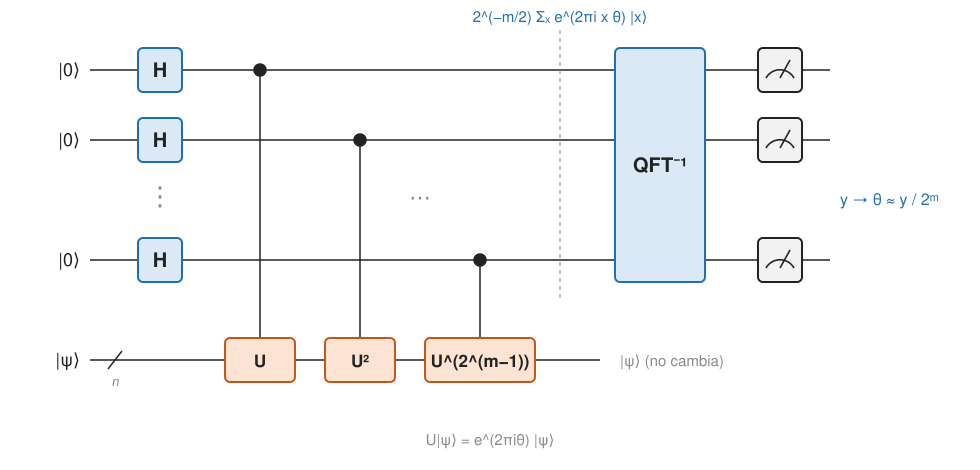

## Comprensión {#layer-2}

### Idea clave
La estimación de fase aproxima `θ` en `U|ψ⟩ = e^{2πiθ}|ψ⟩` usando retroceso de fase sobre `m` qubits de control y una [QFT](quantum-fourier-transform.md) inversa: si `θ` cabe en `m` bits, la medida da `θ` con probabilidad 1 [@watrous-2025, L7.2, PDF pp. 216-217; @de-wolf-2026, §4.6, p. 46].

### Explicación
El problema es este. Te dan un circuito para una unitaria `U` de `n` qubits y un estado `|ψ⟩` del que se promete que es **vector propio (eigenvector)** de `U`: `U|ψ⟩ = e^{2πiθ}|ψ⟩`. Hay que dar una aproximación de `θ ∈ [0,1)` (con `θ = 1` identificado con `θ = 0`) [@watrous-2025, L7.1, PDF pp. 195-196]. La entrada incluye un estado cuántico. Los valores propios de una unitaria tienen módulo 1 (están en la circunferencia unidad) porque las unitarias conservan la norma [@watrous-2025, L7.1, PDF p. 194]. La estimación de fase suele ser un subproblema dentro de algo mayor, como la factorización [@watrous-2025, L7.1, PDF p. 195]. Se debe a Kitaev, situada en un contexto más amplio por Cleve y colaboradores [@de-wolf-2026, §4.6, pp. 45-46].

Con un solo qubit de control el circuito es: Hadamard en el control, `controlled-U`, Hadamard en el control, medida. Aquí actúa el [retroceso de fase](phase-kickback.md): `controlled-U` sobre `|ψ⟩` y un control en `|+⟩` deja `(|0⟩ + e^{2πiθ}|1⟩)/√2` en el control. Las probabilidades de salida son `p₀ = cos²(πθ)` y `p₁ = sin²(πθ)`: da un bit de precisión y es exacta si `θ` vale 0 o 1/2 [@watrous-2025, L7.2, PDF pp. 197-199].

Para más precisión se usan potencias de `U`. `controlled-U²` (dos puertas) equivale a doblar `θ` a `2θ`, lo que desplaza la coma binaria y da información sobre el segundo dígito [@watrous-2025, L7.2, PDF pp. 200-201]. Generalizando, el circuito con `m` bits pone `m` qubits de control en `|0^m⟩`, aplica Hadamard a cada uno, `controlled-U^{2^k}` sobre el control `k` (`k = 0, …, m−1`), una QFT inversa de `2^m` dimensiones sobre los controles y mide. El registro de `|ψ⟩` no cambia [@watrous-2025, L7.2, PDF pp. 215-216; @de-wolf-2026, §4.6, p. 46].

Funciona porque, antes de la QFT inversa, los controles contienen `2^{−m/2} Σ_x e^{2πixθ}|x⟩`. Si `θ = y/2^m` exactamente, ese estado es `QFT_{2^m}|y⟩`, de modo que la QFT inversa da `|y⟩` y la medida revela `y` con probabilidad 1 [@watrous-2025, L7.2, PDF pp. 216-217; @de-wolf-2026, §4.6, p. 46]. Es decir: las Hadamard iniciales preparan la superposición sobre la que actúa el retroceso, y la QFT inversa convierte la fase codificada en las amplitudes en un resultado en la base estándar [@watrous-2025, L7.2, PDF pp. 199-200, 205].

Si `θ` no cabe en `m` bits, la probabilidad del resultado `y` es `p_y = |2^{−m} Σ_x e^{2πix(θ − y/2^m)}|²`, una serie geométrica [@watrous-2025, L7.2, PDF pp. 217-218]. Hay dos cotas:

- Si `y/2^m` es una de las dos mejores aproximaciones de `m` bits de `θ` (`|θ − y/2^m| ≤ 2^{−(m+1)}`), entonces `p_y ≥ 4/π² ≈ 0,405`, para todo `m` [@watrous-2025, L7.2, PDF pp. 218-219; @childs-qa, §4.3, p. 19].
- Si `|θ − y/2^m| ≥ 2^{−m}` (y como mucho 1/2), `p_y ≤ 1/4`. Watrous la llama cota cruda: lo normal es que sea mucho menor [@watrous-2025, L7.2, PDF p. 219].

En resumen, las aproximaciones cercanas son probables (más del 40 %) y las que se alejan más de `2^{−m}` son improbables. Repitiendo y tomando el resultado más común se obtiene una aproximación a `1/2^m` con error que decrece exponencialmente con el número de repeticiones; el vector propio no se perturba, así que puede reutilizarse [@watrous-2025, L7.2, PDF p. 220].

El coste son `1 + 2 + … + 2^{m−1} = 2^m − 1` aplicaciones controladas de `U`; para error `±ε` hacen falta `m = ⌈log(1/ε)⌉` bits, es decir, `O(1/ε)` aplicaciones de `U` [@de-wolf-2026, §4.6, p. 46]. Si `U^k` se construye repitiendo `U`, la precisión cuesta exponencialmente en `m`, salvo que `U^k` tenga un circuito más eficiente, como en Shor, donde la exponenciación modular lo da [@watrous-2025, L7.2, PDF pp. 215-216].

### Ejemplo
Con dos controles, `U` en el primero y `U²` en el segundo, el registro de control queda en `2^{−1} Σ_{x=0}^{3} e^{2πixθ}|x⟩`. Si `θ = y/4`, esos cuatro estados forman una base ortonormal; aplicar la inversa de `QFT₄` y medir da `y` sin error. Para otros `θ`, el resultado más probable es el `y/4` más cercano, con probabilidad algo superior al 40 % [@watrous-2025, L7.2, PDF pp. 202-206].

### Errores frecuentes
- *"Hace falta un vector propio exacto."* Si la entrada no es vector propio, el resultado corresponde a un vector propio aleatorio de la descomposición de la entrada. Se usa así en [Shor](shor-algorithm.md), con `|1⟩` como entrada [@watrous-2025, L7.3, PDF p. 232].
- *"Estima el valor propio `e^{2πiθ}` directamente."* Estima `θ`, el exponente [@watrous-2025, L7.1, PDF pp. 195-196].
- *"Medir los controles sin deshacer la fase daría `θ`."* En el circuito de un solo bit, antes del segundo Hadamard medir da 0 y 1 con probabilidad 1/2 y nada sobre `θ` [@watrous-2025, L7.2, PDF p. 200].

### Las fuentes discrepan
Las notas de Watrous dan la cota `4/π²`; las de De Wolf solo dicen "con alta probabilidad" y omiten el cálculo [@de-wolf-2026, §4.6, p. 46]. La notación también difiere: Watrous escribe `e^{2πiθ}`, Childs `e^{iφ}` [@childs-qa, §4.3, p. 19].

### Para seguir
La capa 3 recoge dónde reaparece la estimación de fase y las decisiones de diseño. Con ella ya se puede leer [Shor](shor-algorithm.md), que la aplica a la multiplicación modular.

## Profesional {#layer-3}

### Idea clave
La estimación de fase es la rutina de lectura de valores propios de muchos algoritmos; el diseño depende de cuántos qubits de control usar, cómo preparar el vector propio y cómo implementar `U^{2^k}` [@watrous-2025, L7.2, PDF pp. 215-216; L7.3, PDF pp. 226-233].

### Explicación
Se reutiliza en:

- *Shor y logaritmo discreto:* ver [algoritmo de Shor](shor-algorithm.md) [@shor-mit-2022, L20, p. 1; L23, pp. 2-4].
- *QFT sobre `Z_N` general:* estimación de fase sobre "sumar 1 módulo `N`" [@childs-qa, §4.4, pp. 19-20].
- *Conteo cuántico:* estimación de fase sobre la cadena cuantizada de [Grover](grover-search.md), con valores propios `±arccos(1−p) ≈ ±√(2p)`; estima `p` con precisión `ν` en `O(√p/ν)` pasos y `|M|` con precisión multiplicativa `ρ` en `O(√(N/|M|)/ρ)`; el conteo exacto exige `Ω(N)` consultas [@childs-qa, §19.3, p. 89].
- *Estimación de amplitud:* una rotación en `2θ` tiene fase propia relacionada con `√a` [@de-wolf-2026, ej. 7.8, pp. 72-73].
- *HHL (sistemas lineales):* inversión de valores propios mediante `e^{iA}` [@de-wolf-2026, §10.2, p. 96].
- *Energía del estado fundamental:* con un estado inicial de buen solapamiento con el fundamental, ver [simulación de hamiltonianos](hamiltonian-simulation.md) [@de-wolf-2026, ej. 9.13, p. 94].
- *Simulación hamiltoniana por paseos cuánticos:* estimación de fase sobre un paseo cuyos valores propios son `e^{±i arccos(λ/X)}` [@childs-qa, §28.2, p. 140].

En cada uso hay tres decisiones de diseño:

1. *¿Cuántos qubits de control?* `m` fija la precisión (`2^{−m}`), y el coste de la estimación pura crece como `2^m` aplicaciones de `U` salvo que haya potencias eficientes [@de-wolf-2026, §4.6, p. 46; @watrous-2025, L7.2, PDF pp. 215-216]. Para precisión `μ` cuesta `O(1/μ)` aplicaciones de `U` [@childs-qa, §19.3, p. 89]. En Shor, `m = 2 lg N + 1` da alta probabilidad de éxito, y `m = 2 lg N` al menos el 40 % [@watrous-2025, L7.3, PDF pp. 229-230].
2. *¿Cómo se prepara el vector propio?* Es la parte difícil en general. Shor la evita: ejecuta la estimación sobre `|1⟩ = r^{−1/2} Σ_k |ψ_k⟩`, que equivale a tomar `k` al azar y estimar `k/r` [@watrous-2025, L7.3, PDF pp. 230-233]. Para la energía del fundamental de un hamiltoniano se necesita un estado inicial con buen solapamiento [@de-wolf-2026, ej. 9.13, p. 94].
3. *¿Cómo se implementa `U^{2^k}`?* Para una `U` general, repitiendo; para la multiplicación modular, calculando clásicamente `b = a^{2^k} mod N` y usando el circuito de `M_b`; "para una `U` general ese truco no existiría" [@watrous-2025, L7.3, PDF pp. 226-228]. Esta diferencia es la que hace polinómico a Shor.

Una lectura alternativa: la estimación de fase es una medida de von Neumann, pues `|ψ⟩|z⟩ → U^z|ψ⟩|z⟩` coincide con la evolución bajo `H⊗p` para un puntero en la base de momentos. Sirve para razonar sobre medir un operador que se sabe simular eficientemente [@childs-qa, §27.5, p. 137].

### Ejemplo
Qué hacer en la práctica:

1. Elegir el número de bits `m` según el error objetivo.
2. Repetir el circuito unas pocas veces y quedarse con el resultado más frecuente, aprovechando que el vector propio no se perturba [@watrous-2025, L7.2, PDF p. 220].
3. Si la entrada solo es aproximadamente un vector propio, esperar un resultado aleatorio de entre los valores propios con peso en ella [@watrous-2025, L7.3, PDF p. 232].

### Para seguir
[Shor](shor-algorithm.md) es la aplicación estrella de estos tres criterios, y [simulación de hamiltonianos](hamiltonian-simulation.md) la más usada en química.
