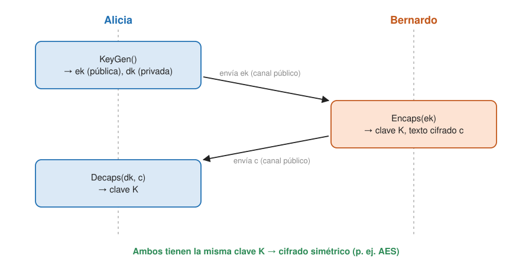

## Fundamentos {#layer-1}

### Idea clave
La criptografía de clave pública actual (RSA, Diffie-Hellman, curva elíptica) se apoya en factorizar y en el logaritmo discreto, y el [algoritmo de Shor](shor-algorithm.md) resuelve ambos en tiempo polinómico; un ordenador cuántico suficientemente grande la rompería [@de-wolf-2026, §18.1, p. 167; @nist-ir-8547, §2.1.1-2.1.2, pp. 3-4]. La respuesta es la criptografía poscuántica, que corre en ordenadores clásicos [@nist-ir-8547, §1, p. 1].

### Explicación
Hoy se usan dos problemas que se suponen difíciles para los ordenadores clásicos: *factorizar* un entero (RSA) y calcular un *logaritmo discreto* (intercambio de claves Diffie-Hellman y criptografía de curva elíptica). Shor resuelve ambos en un ordenador cuántico, de modo que un ordenador suficientemente grande rompería RSA y Diffie-Hellman [@de-wolf-2026, §18.1, p. 167; @shor-mit-2022, L21, p. 1; L23, pp. 1-2]. También rompe la criptografía de curva elíptica, la principal competidora de RSA; solo cambian detalles de implementación, no hacen falta ideas cuánticas nuevas [@childs-qa, cap. 7 intro, p. 29; §7.3, p. 32].

NIST (el organismo de estándares de EE. UU.) afirma que las firmas ECDSA, EdDSA y RSA, y los esquemas de establecimiento de claves basados en Diffie-Hellman y RSA, son vulnerables al algoritmo de Shor en un ordenador cuántico criptográficamente relevante [@nist-ir-8547, §2.1.1-2.1.2, pp. 3-4]. Un *ordenador cuántico criptográficamente relevante* es el capaz de atacar sistemas reales de forma inviable para un ordenador clásico; la transición empieza antes de que exista [@nist-ir-8547, §1, p. 1; glosario, p. 25].

No todo está en juego. Los estándares simétricos (funciones hash, cifrados de bloque como AES, etc.) son "significativamente menos vulnerables" a los ataques cuánticos conocidos que los de clave pública [@nist-ir-8547, §4.1.3, p. 18]. Todas las primitivas simétricas aprobadas por NIST con al menos 128 bits de seguridad clásica se creen al menos de categoría 1 (la de AES-128), y NIST no prevé abandonarlas por la migración [@nist-ir-8547, §2.1.3, p. 5; §4.1.3, p. 18]. Contra una búsqueda de claves por fuerza bruta, [Grover](grover-search.md) solo da una ventaja cuadrática [@aaronson-2018, Lec22, pp. 1, 7]; el informe de NIST no nombra a Grover y trata la cuestión mediante las categorías de seguridad (se explican en la capa 2).

La **criptografía poscuántica (PQC)** son los métodos clásicos, que corren en ordenadores normales, diseñados para resistir tanto a ordenadores clásicos como cuánticos [@nist-ir-8547, §1, p. 1]. De Wolf la describe, algo confusamente, como parte de la criptografía clásica: sistemas cuya dureza supuesta no se basa en factorizar ni en el logaritmo discreto, sino en otros problemas, por ejemplo hallar vectores cortos en retículos (aprendizaje con errores, LWE) [@de-wolf-2026, §18.1, p. 167].

El primer estándar es ML-KEM. El estándar FIPS 203 (13 de agosto de 2024) define ML-KEM, un mecanismo de encapsulación de claves derivado de CRYSTALS-Kyber [@nist-fips-203, §1.1-1.2, p. 1]. Un *KEM* (key-encapsulation mechanism) es un conjunto de algoritmos (`KeyGen`, `Encaps`, `Decaps`) con los que dos partes establecen una clave secreta compartida por un canal público; esa clave se usa luego con cifrado simétrico [@nist-fips-203, §3.1, p. 12]. La clave compartida mide siempre 256 bits [@nist-fips-203, §3.3, p. 16].

NIST deprecará la criptografía de clave pública vulnerable (ECDSA, EdDSA, RSA, DH de cuerpos finitos y de curva elíptica) después de 2030 y la prohibirá después de 2035 [@nist-ir-8547, §4, p. 13]. Cuándo existirá el ordenador que necesita el ataque no está resuelto: hoy no existe. Gidney estima, en un preprint sin revisión por pares y bajo hipótesis que se enumeran en [Shor](shor-algorithm.md), que RSA-2048 caería con menos de un millón de qubits físicos ruidosos en menos de una semana [@gidney-2025, resumen, p. 1].

### Ejemplo
El flujo de un KEM. Alicia genera una clave de encapsulación (pública) y otra de desencapsulación (privada); Bernardo usa la primera en `Encaps` y obtiene una clave `K` y un texto cifrado, que envía a Alicia; ella ejecuta `Decaps` y obtiene `K` [@nist-fips-203, §3.1, p. 13, fig. 1].

### Errores frecuentes
- *"PQC es criptografía cuántica."* No: la criptografía cuántica usa efectos cuánticos y exige que incluso los usuarios honrados tengan un ordenador cuántico sencillo, mientras que PQC corre en ordenadores clásicos [@de-wolf-2026, §18.1, p. 167; @nist-ir-8547, §1, p. 1].

### Para seguir
La capa 2 explica por qué Shor rompe cada esquema, por qué los simétricos y los hashes no caen igual y cómo funciona ML-KEM por dentro.

## Comprensión {#layer-2}

### Idea clave
Shor rompe cualquier esquema que dependa de estructura oculta en grupos abelianos, lo que incluye casi toda la clave pública actual [@aaronson-2018, Lec21, p. 3]. Los simétricos y los hashes no caen igual, y ML-KEM se apoya en el problema *Module Learning With Errors*, que no se sabe romper [@nist-fips-203, §3.2, p. 13].

### Explicación
Empezando por RSA: quien factorice el módulo `N` obtiene `φ(N)` y puede descifrar (ver el ejemplo) [@de-wolf-2026, ej. 5.3, pp. 54-55; @aaronson-2018, Lec19, p. 1]. En Diffie-Hellman hay un primo público `p` y un generador `γ`; Alicia envía `γ^a`, Bernardo `γ^b`, y la clave compartida es `K = γ^{ab}`. Un adversario que calcule logaritmos discretos obtiene `K` [@de-wolf-2026, ej. 6.3, pp. 63-64; @shor-mit-2022, L23, pp. 1-2]. No se ha demostrado que romper DH sea equivalente al logaritmo discreto, pero casi todos los criptógrafos lo creen [@shor-mit-2022, L23, p. 2; @childs-qa, §5.2, pp. 21-22].

La curva elíptica cae por la misma razón: la seguridad de DH y ECC descansa en la dureza clásica supuesta del logaritmo discreto [@de-wolf-2026, §6.1.2, p. 58]. ECC se considera más segura que RSA por tamaño de clave, porque los mejores ataques clásicos son genéricos (por ejemplo Pollard rho, `O(√p)`), así que usa claves más pequeñas; pero Shor necesita un número comparable de pasos en ambos, aunque las operaciones de grupo de la curva sean más caras [@childs-qa, §7.2-7.3, p. 32]. La regla general es que Shor sirve para cualquier problema de encontrar estructura oculta en grupos abelianos, y casi todos los esquemas de clave pública usados hoy dependen de ella [@aaronson-2018, Lec21, p. 3].

Los esquemas simétricos y los hashes no caen igual. En el cifrado simétrico, con Grover buscar una clave pasa de `N` a `O(√N)` consultas (cuadrática, óptima) [@watrous-2025, L8.1, PDF pp. 238-239; L8.5, PDF p. 258]. Lo que dice NIST es que los estándares simétricos con ≥ 128 bits siguen valiendo, y que solo los de 112 bits de fuerza se deshabilitarán en 2030 [@nist-ir-8547, §4.1.3, p. 18]. Las funciones unidireccionales genéricas tampoco parecen amenazadas: los ordenadores cuánticos rompen algunas funciones unidireccionales supuestas (basadas en factorización o logaritmo discreto), pero hay muchas otras, menos estructuradas, que no se ven amenazadas [@aaronson-2018, Lec17, p. 4]. En los hashes, clásicamente el ataque del cumpleaños necesita ≈ la raíz cuadrada del tamaño del rango; en el modelo de caja negra, el algoritmo cuántico BHT halla colisiones con ≈ `N^{1/3}` consultas [@aaronson-2018, Lec18, p. 3; Lec24, pp. 1-2].

Por eso NIST describe la seguridad poscuántica con cinco categorías en vez de bits de seguridad, dada la incertidumbre al predecir costes, velocidad y memoria de los futuros ordenadores cuánticos. Las referencias son búsqueda de claves de AES-128 (cat. 1), colisión de SHA-256 (cat. 2), AES-192 (cat. 3), SHA3-384 (cat. 4) y AES-256 (cat. 5) [@nist-ir-8547, §4.1, pp. 14-15; tabla 1, p. 15].

ML-KEM por dentro, en visión de conjunto:

- Su seguridad descansa en la dureza supuesta del problema *Module Learning With Errors* (MLWE), una generalización del LWE de Regev (2005), cuya dureza a su vez está ligada a la de ciertos problemas en retículos de módulos [@nist-fips-203, §3.2, p. 13].
- LWE, en esquema: se dan ecuaciones lineales "ruidosas" con un vector secreto `x` sobre `Z_q^n` y hay que recuperar `x`; el ruido hace intratables métodos como la eliminación gaussiana. Publicar muchas ecuaciones ruidosas permite cifrar, y de ahí sale un esquema asimétrico [@nist-fips-203, §3.2, p. 13]. En MLWE, `Z_q^n` se sustituye por un módulo `R_q^k` sobre `R_q = Z_q[X]/(X^256 + 1)`, con `n = 256` y `q = 3329` [@nist-fips-203, §2.3, p. 5; §3.2, p. 13].
- Construcción: primero un esquema de cifrado de clave pública (`K-PKE`) a partir de MLWE; luego la transformada de Fujisaki-Okamoto lo convierte en un KEM que se cree seguro IND-CCA2. `K-PKE` por sí solo no es IND-CCA2 y no debe usarse aislado [@nist-fips-203, §3.2-3.3, pp. 13-15]. La transformada teórico-numérica (*number-theoretic transform*, NTT) acelera la multiplicación de polinomios [@nist-fips-203, §3.2, p. 14].
- Es una **creencia**, no una prueba: el resumen del estándar dice que ML-KEM se "cree" seguro incluso frente a adversarios con ordenador cuántico [@nist-fips-203, resumen, p. iii].
- Los criptosistemas de retículos podrían romperse con un ordenador cuántico si se generalizara el algoritmo de Shor al grupo diedral (Regev 2005); nadie lo ha logrado [@aaronson-2018, Lec21, p. 4; @childs-qa, §10.1, p. 44].

Hay una defensa alternativa, la criptografía cuántica. El protocolo BB84 distribuye claves enviando bits en bases aleatorias; la seguridad es teórica de la información, pero necesita un canal clásico autenticado y se tardó más de doce años en demostrarse [@de-wolf-2026, §18.2, pp. 168-169]. La distribución cuántica de claves es mucho más fácil de realizar que un ordenador cuántico general y está disponible comercialmente, aunque las implementaciones han explotado agujeros [@de-wolf-2026, §18.5, p. 173]. El cifrado de un solo uso es seguro teóricamente; el problema es distribuir la clave [@de-wolf-2026, §18.2, pp. 167-168].

### Ejemplo
RSA paso a paso. La clave pública es `N = pq` (con `p, q` primos grandes, por ejemplo `N` de 2048 bits) y `(e, N)`; la privada `d` cumple `de ≡ 1 mod φ(N)`. Se cifra con `m^e mod N` y se descifra con `c^d mod N`. Quien factorice `N` obtiene `φ(N)`, calcula `d` y puede descifrar [@de-wolf-2026, ej. 5.3, pp. 54-55; @aaronson-2018, Lec19, p. 1].

### Errores frecuentes
- *"Un ordenador cuántico rompe todo el cifrado."* No: rompe sobre todo el de clave pública basado en estructura abeliana; los simétricos con ≥ 128 bits no se tocan [@aaronson-2018, Lec21, p. 3; @nist-ir-8547, §4.1.3, p. 18].
- *"Hay que migrar solo cuando exista el ordenador."* El riesgo de *recolectar ahora, descifrar después* obliga a empezar antes (se explica en la capa 3).

### Las fuentes discrepan
Sobre la longitud de las claves simétricas, las fuentes de este dominio no enuncian una regla "hay que duplicar la longitud de la clave" [unverified]; lo que sí dice NIST está arriba.

### Para seguir
La capa 3 trata los plazos de migración (HNDL, teorema de Mosca), los estándares aprobados y cómo decidir.

## Profesional {#layer-3}

### Idea clave
Los datos que deben seguir secretos años después pueden recolectarse hoy y descifrarse cuando exista el ordenador, así que la migración debe empezar antes de que `X + Y` supere a `Z` (teorema de Mosca) [@nist-ir-8547, §1, p. 1; §3, p. 8].

### Explicación
En *harvest now, decrypt later* (HNDL, "recolectar ahora y descifrar después") un adversario guarda hoy comunicaciones cifradas para descifrarlas cuando madure la tecnología; como los datos sensibles mantienen su valor años, es un motivo principal de urgencia [@nist-ir-8547, §1, p. 1]. El teorema de Mosca dice que, si `X` = años que el dato debe seguir secreto, `Y` = años que dura la transición y `Z` = años hasta el ordenador cuántico criptográficamente relevante, hay que empezar a migrar antes de que `X + Y` supere a `Z` [@nist-ir-8547, §3, p. 8]. Las transiciones criptográficas pasadas tardaron de 10 a 20 años desde el estándar hasta la integración completa [@nist-ir-8547, §1, p. 1; §3, p. 8].

El orden de migración empieza por la confidencialidad:

- *Confidencialidad primero.* El establecimiento de claves protege confidencialidad y está sujeto a HNDL; hay que tenerlo en cuenta para programar la migración, y las aplicaciones (TLS, IKE) pueden exigir migrar antes de 2035 [@nist-ir-8547, §3.1.3, p. 9; §4.1.2, p. 17]. El cifrado de correo y documentos (S/MIME, OpenPGP) está sujeto a HNDL como cualquier confidencialidad [@nist-ir-8547, §3.1.4, p. 10]. TLS 1.3 ofrece una vía a corto plazo, con intercambio de claves híbrido ML-KEM + clásico [@nist-ir-8547, §4.1.2, p. 17; §4.2, p. 20].
- *Firmas y autenticación después.* Las firmas no son vulnerables a HNDL, pero su migración sigue siendo urgente por lo larga y compleja que es la coordinación [@nist-ir-8547, §3, p. 8]. La autenticación sigue segura mientras los algoritmos y claves lo sean en el momento de autenticar: se puede seguir con algoritmos vulnerables hasta que aparezca un ordenador capaz, y entonces cambiar de inmediato [@nist-ir-8547, §3.1.2, p. 9].
- *Dispositivos con vida larga.* Los que no puedan actualizar su verificación de firmas deben diseñarse para exigir firmas resistentes si pueden sobrevivir a un ordenador relevante; además, las claves y firmas PQC son más grandes y afectan a protocolos, bibliotecas, HSM/TPM y PKI [@nist-ir-8547, §3.1.1, p. 8; §2.2, pp. 5-6].
- *Hoja de ruta de NIST.* Los primeros pasos recomendados: inventarios criptográficos, planes de migración y despliegue temprano de productos PQC [@nist-ir-8547, §1, p. 1]. NIST pide además construir *agilidad criptográfica* a largo plazo (poder cambiar de algoritmo sin rehacer la infraestructura) [@nist-ir-8547, §1.1, p. 2].
- *Plazos federales de EE. UU.:* sistemas de alto valor o alto impacto deben adoptar PQC en establecimiento de claves antes del 31 de diciembre de 2030 y en firmas antes del 31 de diciembre de 2031 (EO 14412 y OMB M-26-15), con TLS 1.3 soportado como tarde el 2 de enero de 2030; el objetivo de NSM-10 de completar la migración federal en 2035 se mantiene [@nist-ir-8547, §1, p. 1; §4, p. 13].

Los estándares disponibles a fecha del informe son estos:

| Estándar | Función | Notas |
|---|---|---|
| FIPS 203, ML-KEM | encapsulación de claves | de CRYSTALS-Kyber; única opción PQ aprobada para establecimiento de claves [@nist-ir-8547, §2.1.2, p. 4; §4.1.2, p. 17] |
| FIPS 204, ML-DSA | firma digital | de CRYSTALS-Dilithium [@nist-ir-8547, §2.1.1, p. 3] |
| FIPS 205, SLH-DSA | firma digital basada en hash sin estado | de SPHINCS+ [@nist-ir-8547, §2.1.1, p. 3] |
| SP 800-208 (LMS/HSS, XMSS) | firmas basadas en hash con estado | resistentes, pero cada clave de un solo uso y hay que seguir el estado: no de uso general [@nist-ir-8547, §2.1.1, p. 3] |
| HQC | KEM alternativo | seleccionado tras la cuarta ronda; FIPS en preparación [@nist-ir-8547, §2.1.2, p. 4] |
| Derivado de FALCON | firma alternativa | FIPS en preparación [@nist-ir-8547, §2.1.1, p. 4] |

Para elegir parámetros de ML-KEM:

| Conjunto | Categoría | Clave de encapsulación | Clave de desencapsulación | Texto cifrado |
|---|---|---|---|---|
| ML-KEM-512 | 1 | 800 B | 1632 B | 768 B |
| ML-KEM-768 | 3 | 1184 B | 2400 B | 1088 B |
| ML-KEM-1024 | 5 | 1568 B | 3168 B | 1568 B |

[@nist-fips-203, §8, pp. 39-40; tabla 3, p. 39]. La clave compartida es siempre de 32 B. NIST recomienda ML-KEM-768 por defecto, con gran margen de seguridad a coste razonable; al proteger datos por primera vez conviene usar el conjunto más fuerte posible para evitar transiciones costosas [@nist-fips-203, §8, p. 40; @nist-ir-8547, §4.1.2, p. 17]. La probabilidad de fallo de desencapsulación es `2^{−138,8}` (512), `2^{−164,8}` (768) y `2^{−174,8}` (1024) [@nist-fips-203, §3.2, pp. 14-15, tabla 1]. La fuerza de seguridad no se da como un número de bits: cada conjunto es al menos tan difícil de romper como un cifrado de bloque o hash genérico de cierto tamaño [@nist-fips-203, §8, pp. 39-40].

Qué puede salir mal:

- *Cumplir el estándar no basta.* Las garantías de seguridad de un KEM solo valen bajo las condiciones de SP 800-227 (aleatoriedad, claves privadas y clave compartida secretas) [@nist-fips-203, anuncio, punto 13, p. iii].
- *Combinar KEM.* Un KEM combinado que incluya ML-KEM podría no ser IND-CCA2; hay que evaluar la seguridad de cualquier procedimiento que aplique la derivación de SP 800-56C a ML-KEM combinado con otro método [@nist-fips-203, §3.3, p. 16].
- *Híbridos.* Combinan algoritmos resistentes con otros vulnerables (o varios PQC con supuestos distintos) y se mantienen seguros si al menos uno lo es. Motivos: cobertura frente a fallos de un componente y compatibilidad con normas que aún exigen algoritmos heredados. Costes: complejidad, coste y riesgo, y se espera que sean temporales (una segunda transición hacia PQC puro). Negociar un algoritmo por sesión no es un híbrido [@nist-ir-8547, §3.2, p. 10]. Para claves: SP 800-56C concatena secretos (`Z' = Z||T`) [@nist-ir-8547, §3.2.1, p. 11]; para firmas, firmas duales o compuestas donde todas deben verificar, válidas si al menos un componente es de NIST [@nist-ir-8547, §3.2.2, pp. 11-12].
- *Revisión.* NIST reevaluará FIPS 203 cada cinco años, y antes si aparece un avance tecnológico o un punto débil matemático [@nist-fips-203, anuncio, punto 13, p. iii].

Conviene conectarlo con las estimaciones de ataque. Gidney (preprint) rebaja el coste estimado de romper RSA-2048 de 20 millones de qubits ruidosos y 8 horas (Gidney-Ekerå 2019) a menos de un millón y menos de una semana, bajo las mismas hipótesis de hardware [@gidney-2025, resumen, p. 1; §4, p. 21]. Su conclusión práctica es que respalda los plazos de NIST (deprecar tras 2030, prohibir tras 2035) no porque espere el ordenador en 2030, sino porque la seguridad no debe depender de un progreso lento [@gidney-2025, §4, p. 21]. Es una estimación bajo supuestos, con heurísticas sin demostrar, y de una variante (Ekerå-Håstad) que vale solo para enteros RSA; para otros casos criptográficos el autor espera extenderlo [@gidney-2025, §2.1-2.3, pp. 6, 12-14; §5, p. 21]. Consulta [estimación de recursos](../../error-correction/concepts/resource-estimation.md) para ver cómo se construyen estas cifras.

### Ejemplo
Criterios para decidir una migración:

1. *¿Cuánto debe durar el secreto?* Aplica `X + Y` frente a `Z` (Mosca) [@nist-ir-8547, §3, p. 8].
2. *¿Confidencialidad o autenticación?* La primera corre más prisa (HNDL) [@nist-ir-8547, §1, p. 1; §3, p. 8].
3. *¿Quién controla las actualizaciones?* Dispositivos con firmware inmutable: exigir PQC desde el diseño [@nist-ir-8547, §3.1.1, p. 8].
4. *¿Puedes cambiar de algoritmo sin rehacerlo todo?* Agilidad criptográfica y, si hace falta, híbridos temporales [@nist-ir-8547, §1.1, p. 2; §3.2, p. 10].
5. *¿Qué parámetros?* Por defecto ML-KEM-768; los tamaños (≈ 1 KB de clave y texto cifrado) afectan a protocolos y dispositivos con poco ancho de banda [@nist-fips-203, tabla 3, p. 39; @nist-ir-8547, §2.2, pp. 5-6].

### Las fuentes discrepan
Los plazos han cambiado entre documentos: antes, SP 800-57 proyectaba prohibir esquemas de clave pública de 112 bits el 1 de enero de 2031; NIST lo sustituyó por el plan 2030/2035 [@nist-ir-8547, §4.1.1, p. 15]. Además, el informe de NIST no menciona a Grover ni explica el mecanismo de Shor, así que para esos puntos conviene acudir a las fuentes técnicas de [Shor](shor-algorithm.md) y [Grover](grover-search.md) [@nist-ir-8547, §2.1.1, p. 3].

### Para seguir
Para las estimaciones de recursos del ataque, [estimación de recursos](../../error-correction/concepts/resource-estimation.md). Dentro de este ámbito, [complejidad cuántica](quantum-complexity.md) sitúa estos riesgos entre lo demostrado y lo conjeturado.
