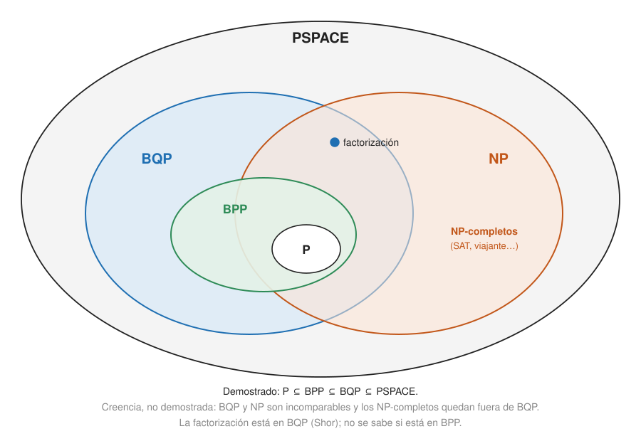

## Comprensión {#layer-2}

**Qué significa "eficiente".** Convencionalmente, eficiente es tiempo polinómico en la longitud `n` de la entrada. Es un criterio imperfecto: `n²⁴` es impracticable y el símplex es exponencial en el peor caso pero rápido en la práctica [@shor-mit-2022, L17, p. 1]. Se mide el coste en operaciones elementales de un circuito como función de la longitud de la entrada; como los circuitos tienen tamaño fijo, un algoritmo es una *familia* de circuitos `{C_n}` con coste `t(n) = tamaño(C_n)` [@watrous-2025, L6.2, PDF pp. 168-174]. La familia debe ser *uniforme*: fácil de describir, o el tamaño polinómico no significaría eficiencia [@watrous-2025, L6.2, PDF pp. 182-183; @shor-1997, §2, p. 8].

### Las clases

| Clase | Qué es | Fuente |
|---|---|---|
| `P` | decisión resoluble en tiempo polinómico determinista | [@de-wolf-2026, §13.2, pp. 122-123] |
| `BPP` | tiempo polinómico aleatorizado, error `≤ 1/3` | [@de-wolf-2026, §13.2, pp. 122-123] |
| `NP` | los "sí" se verifican en tiempo polinómico con un testigo; ejemplos de `NP`-completos: SAT, viajante, coloración | [@de-wolf-2026, §13.2, pp. 122-123; @shor-mit-2022, L17, pp. 1-2] |
| `PSPACE` | espacio polinómico | [@de-wolf-2026, §13.2, pp. 122-123] |
| `BQP` | tiempo polinómico en un ordenador cuántico, error `≤ 1/3` en toda entrada | [@de-wolf-2026, §13.2, p. 123 y nota 1; §2.1.2, pp. 27-28] |

`BQP` es la formalización aceptada de "eficientemente resoluble por ordenadores cuánticos": una familia uniforme de circuitos de tamaño polinómico [@de-wolf-2026, §13.2, p. 123, nota 1]. La versión con error acotado es la natural porque la computación cuántica es intrínsecamente probabilística; las clases cuánticas deterministas dependen de detalles del modelo [@shor-mit-2022, L17, p. 1]. El error se puede reducir a cualquier constante repitiendo `O(log(1/ε))` veces y votando por mayoría [@de-wolf-2026, §13.2, p. 123].

### Qué se sabe y qué se cree

- **`P ⊆ BPP ⊆ BQP ⊆ PSPACE`.** `BPP ⊆ BQP` porque un ordenador cuántico genera las monedas con Hadamards [@de-wolf-2026, §13.2, p. 123]. `P ⊆ BQP` también, porque las Toffoli simulan cómputo clásico [@aaronson-2018, Lec24, p. 5]. Se cree que `P = BPP` y que las demás inclusiones son estrictas [@de-wolf-2026, §13.2, p. 123].
- **`BQP ⊆ PSPACE`** (Bernstein-Vazirani). Con puertas Hadamard y Toffoli, cada amplitud es una suma sobre todos los estados intermedios de productos de entradas de matriz (como una integral de caminos), calculable con espacio polinómico pero tiempo exponencial reutilizando espacio [@de-wolf-2026, §13.3, pp. 124-125; @aaronson-2018, Lec24, p. 6]. Además, el `PSPACE` cuántico es igual al clásico: lo cuántico no reduce el espacio más que un factor polinómico [@shor-mit-2022, L17, p. 3].
- **Por qué es difícil separarlas.** Probar `BQP ≠ BPP` (por ejemplo que factorizar no está en `BPP`) implicaría `P ≠ PSPACE`, un problema abierto desde los años sesenta; probar `P ≠ BQP` tampoco es más fácil que `P ≠ NP` [@de-wolf-2026, §13.2, pp. 123-124; @aaronson-2018, Lec24, p. 6]. Entre las clases de un diagrama habitual solo se puede demostrar `P ≠ EXPTIME` [@shor-mit-2022, L17, p. 3].
- **Factorización.** La versión de decisión está en `BQP` por Shor y no se sabe que esté en `BPP`. Si no estuviera, sería el primer contraejemplo a la tesis fuerte de Church-Turing [@de-wolf-2026, §5.1, p. 49; §13.2, p. 123]. Esa tesis dice que cualquier dispositivo físico de cómputo se simula con una máquina de Turing con sobrecoste polinómico [@shor-1997, §1, p. 2].
- **`NP` frente a `BQP`.** Se cree que los problemas `NP`-completos no están en `BQP` y que `BQP` y `NP` son incomparables; la evidencia principal es la cota inferior de [Grover](grover-search.md) (la fuerza bruta solo gana una raíz cuadrada). No es una prueba: podría haber métodos que exploten estructura, aunque no se conoce ninguno ni clásica ni cuánticamente para SAT general [@de-wolf-2026, §13.2, p. 124; @shor-mit-2022, L17, p. 3]. No se sabe si `NP ⊆ BQP`; tampoco si `BQP ⊆ NP` (podría haber problemas fáciles cuánticamente sin prueba corta comprobable clásicamente, pero no se conoce ejemplo) [@aaronson-2018, Lec24, pp. 5-6].

### Por qué la ventaja es limitada

**La potencia no viene de una sola propiedad.** Un número enorme de amplitudes, interferencia, entrelazamiento y operaciones fuera del formalismo de estabilizadores: quitando cualquiera de ellos, la mecánica cuántica es fácil de simular clásicamente; juntos, no [@aaronson-2018, Lec17, p. 1].

**Lo que prueban los algoritmos de consultas.** Resumen de la lección 5 de Watrous:

| Algoritmo | Cuánto se gana | Fuente |
|---|---|---|
| [Deutsch-Jozsa](deutsch-jozsa.md) | exponencial frente a determinista; modesta frente a aleatorio | [@watrous-2025, L5.3, PDF pp. 147-148] |
| [Bernstein-Vazirani](bernstein-vazirani-and-simon.md) | 1 frente a `n` | [@watrous-2025, L5.3, PDF p. 151] |
| Muestreo de Fourier recursivo | primera separación super-polinómica frente a probabilísticos | [@watrous-2025, L5.3, PDF pp. 151-152] |
| [Simon](bernstein-vazirani-and-simon.md) | exponencial incluso frente a probabilísticos | [@watrous-2025, L5.4, PDF p. 160] |
| [Grover](grover-search.md) | cuadrática, óptima | [@watrous-2025, L8.5, PDF p. 258] |

Estas son separaciones de *complejidad de consultas*, y las propias notas de De Wolf insisten en que no separan por sí solas las clases del modelo de circuitos: la separación exponencial de Simon frente a los aleatorios de error acotado está demostrada para consultas, no para `BQP` frente a `BPP` [@de-wolf-2026, §2.4, p. 29; §3.3.2, p. 37]. Ver [modelo de consultas](query-model-and-oracles.md). Esto mismo explica que Watrous busque ventajas "al menos super-polinómicas", y que describa las polinómicas como interesantes pero menos convincentes dada la brecha tecnológica entre cuántico y clásico; hoy solo se conocen unos pocos ejemplos [@watrous-2025, L6.2, PDF p. 182]. El principal ejemplo de un algoritmo cuántico de coste polinómico para un problema sin algoritmo clásico polinómico conocido es [Shor](shor-algorithm.md) [@watrous-2025, L6 intro, PDF p. 161].

**Errores frecuentes.**

- *"Los ordenadores cuánticos resuelven los `NP`-completos en tiempo polinómico."* Todo enfoque que ignore la estructura del problema obtiene solo la ventaja de Grover; muchos artículos de arXiv que afirman lo contrario violan ese teorema [@aaronson-2018, Lec25, p. 1].
- *"La ventaja de Shor está demostrada."* Lo que está demostrado es la aceleración del cálculo de periodos frente a algoritmos clásicos que pasan por una caja negra; la ventaja para factorizar en sí es conjetural [@aaronson-2018, Lec20, p. 1].
- *"Si es cuántico es exponencialmente mejor."* Para `Parity` hay solo un factor 2; y para todas las funciones totales a lo sumo potencia 6 [@childs-qa, §21.5, pp. 99-100; @de-wolf-2026, §11.2, p. 104].
- *"Probar todas las posibilidades en paralelo."* No: el problema es la interferencia [@aaronson-2018, Lec21, p. 3].

## Profesional {#layer-3}

**Cómo leer un anuncio de "ventaja cuántica".** Lista de comprobación:

1. *¿En qué modelo?* Consultas, circuito o hardware real. Las ventajas de consultas "no se trasladan automáticamente": el modelo estándar da las entradas explícitas y es mucho más difícil demostrar ventajas [@watrous-2025, L6 intro, PDF p. 161; @de-wolf-2026, §2.4, p. 29].
2. *¿Frente a qué clásico?* El mejor conocido, no el ingenuo. Ejemplos: Grover frente a fuerza bruta en el viajante pierde frente a Held-Karp [@de-wolf-2026, §7.4, p. 70]; el isomorfismo de grafos dejó de ser candidato a ventaja exponencial cuántica cuando Babai (2016) dio un algoritmo clásico cuasi-polinómico [@aaronson-2018, Lec21, pp. 3-4].
3. *¿Demostrada o conjeturada?* El coste de la mejor criba clásica de factorización es una creencia, no está demostrado [@watrous-2025, L6.1, PDF pp. 163-164]; Watrous insiste en que nada impide un algoritmo clásico rápido salvo no haberlo encontrado [@watrous-2025, L6.1, PDF p. 166].
4. *¿Qué estructura se explota?* Sin estructura, ventaja a lo sumo cuadrática (Grover/BBBV) [@childs-qa, §22.1, p. 103]; con estructura de grupo abeliano, exponencial (HSP). Con estructura modesta, polinómica: el problema de colisión da `Θ(n^{1/3})` cuánticas frente a `Θ(√n)` clásicas [@childs-qa, cap. 22, pp. 103-105]. Para toda función total, a lo sumo potencia 6 (y cuadrática si es simétrica); los problemas con promesa quedan fuera [@de-wolf-2026, §11.2, p. 104].
5. *¿Cuál es el sobrecoste de las constantes?* La ventaja cuadrática solo compensa a partir de cierto tamaño si las puertas cuánticas son mucho más caras [@de-wolf-2026, ej. 7.2, p. 71].
6. *¿Se supone tolerancia a fallos?* Childs asume el teorema del umbral (ruido por debajo de ≈ `10⁻³`–`10⁻⁴` según el modelo) en todo su texto [@childs-qa, §1.7, p. 4]. Shor ya señalaba en 1997 que bastan puertas con precisión `O(1/t)` para `t` pasos y decoherencia polinómicamente pequeña [@shor-1997, §7, p. 24]. Ver [teorema del umbral](../../error-correction/concepts/threshold-theorem.md).

**Robustez de la definición.**

- *Elección del conjunto de puertas:* por Solovay-Kitaev solo cambia el coste en factores polilogarítmicos, de modo que incluso las ventajas polinómicas son robustas al conjunto de puertas; el error se acumula como mucho linealmente con el número de puertas [@childs-qa, teorema 2.1, cap. 2, p. 7; lema 2.2, p. 7].
- *Conteo:* casi todas las funciones booleanas necesitan complejidad de circuito cercana a `2ⁿ`, incluso cuánticas [@de-wolf-2026, §13.1, p. 121]; la mayoría de las unitarias de `n` qubits requieren circuitos exponenciales [@childs-qa, §1.3, p. 2].
- *Clases exactas:* `EQP` depende del conjunto de puertas y se considera poco interesante; `QMA` es el análogo cuántico robusto de `NP` (con error `≤ 1/3`) [@de-wolf-2026, §13.2, pp. 122-123].

**Más allá de `BQP`.**

- Cadena `NP ⊆ MA ⊆ QCMA ⊆ QMA`; se cree `MA = NP`, pero `QMA` estrictamente mayor que `NP`; el problema de energía del fundamental para hamiltonianos 2-locales es `QMA`-completo [@de-wolf-2026, §14.1, p. 128; §13.2, p. 123].
- `BQP ⊆ PP` [@de-wolf-2026, ej. 13.4, p. 126].
- La simulación de hamiltonianos generales es `BQP`-difícil: ver [simulación de hamiltonianos](hamiltonian-simulation.md) [@childs-qa, §27.2, p. 133].
- *Complejidad de consultas frente a cómputo:* el HSP no abeliano tiene complejidad de consultas polinómica (`poly(log|G|)`, Ettinger-Høyer-Knill) pero eso no implica algoritmo eficiente, porque el postproceso puede ser ineficiente [@childs-qa, §10.3, pp. 45-46]. Los algoritmos eficientes de HSP se conocen para todos los grupos abelianos y solo para unos pocos no abelianos [@childs-qa, §5.3, p. 22; §10.1, p. 44].

**Dos puntos de práctica.**

- *Los límites guían la criptografía.* Los criptosistemas de retículos son de los pocos que no se sabe romper ni con un ordenador cuántico, y las funciones unidireccionales genéricas no parecen amenazadas [@aaronson-2018, Lec21, p. 4; Lec17, p. 4]. Son creencias basadas en no haber encontrado ataques, no teoremas; ver [criptografía poscuántica](post-quantum-cryptography.md).
- *Precisión como recurso.* Shor identifica la precisión como un tercer recurso para los ordenadores cuánticos: con precisión constante no se conoce nada fuera de `BPP`; con precisión creciente polinómicamente (bits logarítmicos) parecen más potentes [@shor-1997, §1, p. 3].
