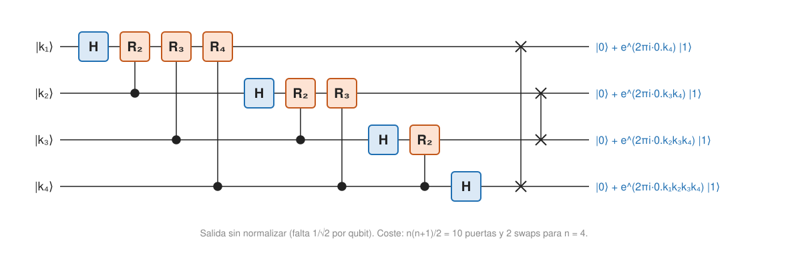

## Comprensión {#layer-2}

**Qué es.** La *transformada cuántica de Fourier (quantum Fourier transform, QFT)* es la transformada discreta de Fourier (DFT) vista como una operación unitaria sobre un sistema cuántico: actúa sobre las **amplitudes** del estado [@watrous-2025, L7.2, PDF p. 207; @shor-mit-2022, L19, p. 1]. Para `N` dimensiones, con `ω_N = e^{2πi/N}`:

```
QFT_N |x⟩ = N^{−1/2} Σ_y ω_N^{xy} |y⟩        (entrada (y,x) de la matriz: ω_N^{xy} / √N)
```

[@watrous-2025, L7.2, PDF p. 208; @de-wolf-2026, §4.4, p. 43]. El factor `1/√N` la hace unitaria. Se define para cualquier `N`, aunque con `N = 2^m` basta para la mayoría de usos; `QFT₂` es la puerta Hadamard [@watrous-2025, L7.2, PDF pp. 206, 208-209]. Como ejemplo, con `ω₄ = i` la matriz de `QFT₄` es

```
          1  [ 1   1   1   1 ]
QFT₄ =   ―― [ 1   i  −1  −i ]
          2  [ 1  −1   1  −1 ]
             [ 1  −i  −1   i ]
```

(calculada con la definición; Watrous da las matrices para `N = 1, 2, 3, 4, 8` [@watrous-2025, L7.2, PDF pp. 208-209]).

**Por qué es unitaria.** El producto interno de dos columnas es una serie geométrica: vale 1 si las columnas son la misma y 0 si no, porque puntos repartidos por la circunferencia unidad se cancelan [@watrous-2025, L7.2, PDF pp. 209-210; @de-wolf-2026, §4.1, p. 41]. Como la matriz es simétrica, la inversa solo cambia el signo del exponente [@de-wolf-2026, §4.1, p. 41].

**Intuición: relojes y chinchetas.** Para alguien con un día de 26 horas, un reloj con ese periodo (o un divisor) mueve la chincheta siempre en el mismo sentido (interferencia constructiva); los demás se cancelan. La QFT es lo mismo con amplitudes [@aaronson-2018, Lec20, pp. 1-2]. Por eso aparece siempre que se busca un periodo.

**Ni es la FFT ni la reemplaza.** La FFT clásica de Cooley-Tukey calcula la DFT en `O(N log N)` pasos frente a `O(N²)` del producto matriz-vector, dividiendo en dos transformadas de tamaño `N/2` sobre las entradas pares e impares [@de-wolf-2026, §4.2, p. 42]. La QFT hace algo distinto: no escribe las entradas en ninguna parte; el resultado existe solo como amplitudes del estado resultante [@de-wolf-2026, §4.4, pp. 43-44]. A cambio, necesita `O(n²) = O((log N)²)` puertas, exponencialmente menos que `O(2ⁿ n)` de la FFT [@de-wolf-2026, §4.4, p. 44; §4.5, p. 45]. Es menos ambicioso (no hay lista de salida) y más ambicioso (coste polilogarítmico) a la vez [@aaronson-2018, Lec20, p. 5].

**El circuito.** El estado `QFT|k⟩` es un estado producto: cada qubit lleva `(|0⟩ + e^{2πi·0.k…}|1⟩)/√2`, con una fracción binaria como fase [@de-wolf-2026, §4.5, pp. 44-45; @shor-mit-2022, L19, p. 2]. Eso se construye con Hadamards y puertas de fase controlada `R_s = diag(1, e^{2πi/2^s})` (`R₁ = Z`, `R₂ = diag(1, i)`), seguidas de swaps que invierten el orden de los qubits [@de-wolf-2026, §4.5, pp. 44-45]. En la versión recursiva de Watrous: (1) una `QFT_{2^{m−1}}` sobre los `m−1` qubits inferiores, (2) puertas de fase controlada con el qubit superior como control y ángulos de `π/2` a `π/2^{m−1}`, (3) una Hadamard en el qubit superior, (4) una permutación de qubits; el caso base `m = 1` es una Hadamard [@watrous-2025, L7.2, PDF pp. 211-213]. Mientras el qubit `s` se procesa, los siguientes deben seguir disponibles, y los qubits salen en orden inverso [@shor-mit-2022, L19, pp. 2-3].



**Coste.** Con `n` qubits y como mucho `n` puertas por qubit hay como mucho `n²` puertas [@de-wolf-2026, §4.5, p. 45]; la recurrencia de Watrous da `s_m = s_{m−1} + (2m−1)`, `s_m = m²` [@watrous-2025, L7.2, PDF pp. 214-215]. El circuito inverso se obtiene invirtiendo el orden y sustituyendo cada puerta por su inversa [@watrous-2025, L7.2, PDF p. 212].

**Por qué las fases son correctas.** La corrección se apoya en la identidad `(−1)^{ab} ω_{2^{m−1}}^{xy} ω_{2^m}^{ay} = ω_{2^m}^{(2x+a)(2^{m−1}b+y)}` [@watrous-2025, L7.2, PDF pp. 213-214]; en la versión de Shor, los factores `1/√2` se multiplican hasta `1/√q`, las puertas de dos qubits solo cambian fases y la fase total sobre cada camino reproduce `2πac/q` salvo múltiplos de `2π` [@shor-1997, §4, pp. 14-15].

**Errores frecuentes.**

- *"La QFT me da los coeficientes de Fourier."* Solo aparecen como amplitudes; al medir se obtiene una muestra [@de-wolf-2026, §4.4, pp. 43-44].
- *"La QFT de `Z₂ⁿ` y la de `Z_{2ⁿ}` son lo mismo."* No: sobre `Z₂ⁿ` la QFT es `H^{⊗n}`, muy distinta de la QFT sobre `Z_{2ⁿ}` [@de-wolf-2026, §6.2.1, pp. 59-60]; en las notas de Watrous solo se afirma `QFT₂ = H` [@watrous-2025, L7.2, PDF p. 208]. Ver [Simon](bernstein-vazirani-and-simon.md).
- *"Las puertas de fase minúsculas son un problema irresoluble."* Pueden omitirse; ver abajo.

## Profesional {#layer-3}

**QFT aproximada.** Las puertas `R_s` con `s` grande aplican fases diminutas, difíciles de realizar con precisión; `P_α` está muy cerca de la identidad para `α` pequeño. Omitir las `R_s` con `s ≫ log n` (Coppersmith) deja `O(log n)` puertas por qubit y `O(n log n)` en total, con error pequeño [@watrous-2025, L7.2, PDF p. 215; @de-wolf-2026, §4.5, p. 45; ej. 4.4, p. 47; @childs-qa, §4.2, p. 18; @shor-1997, §4, p. 15]. Aaronson cita este resultado como respuesta a la objeción de que Shor es "no físico" por exigir rotaciones minúsculas [@aaronson-2018, Lec20, p. 5]. La precisión resultante es `1/poly(n)` [@childs-qa, §4.2, p. 18].

**Orden de los qubits.** El circuito produce la salida con los bits invertidos; se pueden revertir con más cómputo (swaps) o leer en orden inverso [@shor-1997, §4, p. 14]. Al programar, esto choca con la convención de orden de Qiskit; ver la [nota sobre convenciones](../../qubits-and-circuits/index.md).

**Más allá de `N = 2^m`.**

- Para `N` general, la QFT sobre `Z_N` se implementa aproximadamente con [estimación de fase](phase-estimation.md) sobre la operación "sumar 1 módulo `N`", cuyos vectores propios son la base de Fourier; basta precisión de `n = O(log N)` bits, y se borra el registro auxiliar corriendo el cálculo al revés [@childs-qa, §4.4, pp. 19-20].
- Sobre un grupo abeliano finito cualquiera, la QFT es el producto tensorial de las QFT de sus factores cíclicos [@childs-qa, §4.4, p. 20].
- La QFT abeliana es `F_G = |G|^{−1/2} Σ χ_y(x)|y⟩⟨x|` sobre un conjunto completo de caracteres; las columnas de `F_N` son los caracteres de `Z_N` [@childs-qa, §4.1, p. 17; @de-wolf-2026, §6.2.1, pp. 59-60].
- La versión de 1994 del artículo de Shor solo trataba valores suaves de `q`; Coppersmith y Deutsch (con Ekert-Jozsa) la obtuvieron para `q = 2^l` de forma independiente; Cleve la extendió a `q` suaves con factores primos como mucho `O(log n)` [@shor-1997, §4, p. 13].

**Dónde se usa y qué decide el diseño.**

- *Estimación de fase* (QFT inversa), *Shor* y logaritmo discreto: la QFT convierte la fase codificada en las amplitudes en un resultado medible [@watrous-2025, L7.2, PDF pp. 199-200, 205; @shor-mit-2022, L19, p. 1].
- *Subrutina, no producto final.* Como el resultado solo existe como amplitudes, se usa siempre dentro de un algoritmo más grande; su coste (`O(n²)` puertas, o `O(n log n)` aproximada) es despreciable frente al resto, por ejemplo la exponenciación modular de Shor, que domina [@watrous-2025, L7.3, PDF p. 233].
- *Elección entre exacta y aproximada:* la exacta es sencilla y de depuración fácil [unverified]; la aproximada omite las puertas de fase controlada de ángulo diminuto [@watrous-2025, L7.2, PDF p. 215; @de-wolf-2026, §4.5, p. 45], que son puertas de dos qubits, y las puertas de dos qubits son las más propensas a error en hardware real: en iones, sus errores son al menos un orden de magnitud mayores que los de un qubit [@bruzewicz-2019, p. 20], en espines ocurre lo mismo [@stano-2022, §IV.B, p. 11] y en Sycamore la mediana era de 2 a 4 veces peor [@arute-2019, Tabla II, p. 22]. Ver [coherencia y fidelidad](../../quantum-hardware/concepts/coherence-and-fidelity.md).
- *Prueba de corrección:* `F_N⁴ = I` es una comprobación útil para tests de una implementación propia [@de-wolf-2026, ej. 4.6b, p. 48].
