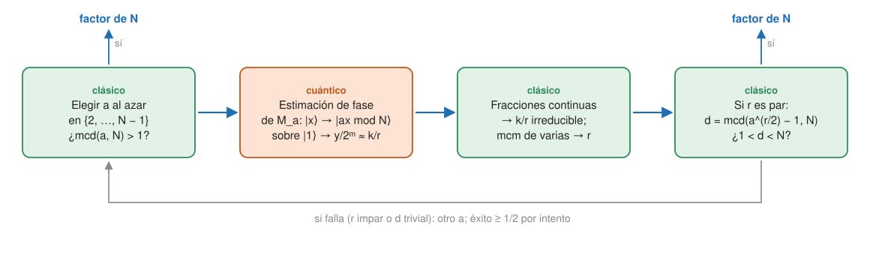

## Fundamentos {#layer-1}

### Idea clave
El algoritmo de Shor factoriza un entero `N` en un número de pasos polinómico en sus dígitos, y también resuelve el *logaritmo discreto (discrete logarithm)*, ambos considerados difíciles para los ordenadores clásicos [@shor-1997, resumen, p. 1]. Reduce factorizar a hallar el orden de un número, y esto último lo hace la parte cuántica [@watrous-2025, L7.3, PDF pp. 220-222].

### Explicación
Importa porque la seguridad de la criptografía de clave pública, por ejemplo RSA, depende de que factorizar sea difícil [@shor-mit-2022, L21, p. 1; @aaronson-2018, Lec19, p. 1]. Ver [impacto en la criptografía](post-quantum-cryptography.md).

Clásicamente es difícil. La división por tanteo cuesta `O(n² 2^{n/2})` para un `N` de `n` bits. El mejor algoritmo clásico conocido, la criba general del cuerpo de números (*number field sieve*), cuesta (se cree, no está demostrado) `2^{O(n^{1/3} (lg n)^{2/3})}`, que sigue siendo de tipo exponencial. RSA-1024 (309 cifras) sigue sin factorizar, y RSA-250 se factorizó en 2020 con miles de años-núcleo de CPU [@watrous-2025, L6.1, PDF pp. 163-164; L6.2, PDF pp. 180-181]. El algoritmo cuántico cuesta del orden de `O(n³)` con aritmética estándar [@watrous-2025, L7.3, PDF p. 233].

La idea tiene dos partes. Shor reduce la factorización a un problema más simple, el **cálculo del orden (order finding)**, y resuelve este último con un algoritmo cuántico [@watrous-2025, L7.3, PDF pp. 220-222].

- *Parte clásica:* convertir "factorizar `N`" en "hallar el orden de un número `a` módulo `N`".
- *Parte cuántica:* hallar el orden usando estimación de fase y la transformada cuántica de Fourier (las verás en la capa 2).

Watrous aclara que Shor no lo describió con estimación de fase, pero que es una forma "natural e intuitiva" de explicarlo [@watrous-2025, L7.3, PDF pp. 220-222].

Con `a` coprimo con `N` (`mcd(a,N) = 1`), el **orden** de `a` módulo `N` es el menor `r > 0` con `a^r ≡ 1 (mod N)` [@watrous-2025, L7.3, PDF pp. 223-224]. La sucesión `a^k mod N` es periódica, con periodo `r` [@aaronson-2018, Lec19, p. 4].

### Ejemplo
Con `N = 33` y `a = 5` el orden es `r = 10` (`5^10 ≡ 1 mod 33`). Como `r` es par, `5^5 = 3125 ≡ 23 (mod 33)`, y `mcd(23−1, 33) = mcd(22, 33) = 11` y `mcd(23+1, 33) = mcd(24, 33) = 3`: ya se tienen los factores 11 y 3. Con `a = 2` el orden también es 10, pero `2^5 + 1 = 33`, así que falla y se prueba otro `a` [@shor-mit-2022, L21, p. 2; L22, p. 1].

### Errores frecuentes
- *"Shor prueba todos los divisores en paralelo."* Es una idea de divulgación errónea. El algoritmo es más sutil y explota la interferencia [@aaronson-2018, Lec21, p. 3].

### Para seguir
La capa 2 detalla la reducción clásica y la parte cuántica; necesita [estimación de fase](phase-estimation.md) y la [transformada cuántica de Fourier](quantum-fourier-transform.md). Si te interesa el impacto, lee [criptografía poscuántica](post-quantum-cryptography.md).

## Comprensión {#layer-2}

### Idea clave
Shor convierte factorizar en hallar el orden `r` de `a` módulo `N`; el orden se obtiene aplicando [estimación de fase](phase-estimation.md) a la multiplicación modular `M_a` y recuperando `r` con fracciones continuas. El coste total es `O(n³)` [@watrous-2025, L7.3, PDF pp. 224-233].

### Explicación
**Reducción clásica.** Se supone `N` impar y no potencia de un primo (las pares y las potencias perfectas se separan fácilmente con métodos clásicos) [@watrous-2025, L7.3, PDF pp. 233-234]. El procedimiento es este: elegir `a` al azar en `{2,…,N−1}`; si `d = mcd(a,N) > 1`, se tiene el factor `d`; si no, hallar el orden `r` de `a`; si `r` es par, calcular `d = mcd(a^{r/2} − 1, N)` y, si `d > 1`, devolver `d` y `N/d`; si no, fallar y repetir [@watrous-2025, L7.3, PDF p. 234].

Funciona porque `(a^{r/2} − 1)(a^{r/2} + 1) = a^r − 1`, que es múltiplo de `N`. Los factores primos de `N` dividen a uno u otro; sale un factor no trivial salvo que todos dividan al mismo [@watrous-2025, L7.3, PDF p. 235]. Equivale a hallar `A, B` con `A² ≡ B² (mod N)` pero `A ≢ ±B`, que es también lo que hace la criba cuadrática [@shor-mit-2022, L21, p. 1]. Falla si `r` es impar o si `r` es par y `mcd(a^{r/2} − 1, N) = 1`. Para `a` aleatorio, la probabilidad de fallo es como mucho `2^{−(m−1)}`, con `m` el número de factores primos distintos, luego como mucho 1/2 por intento; tras `t` intentos, el éxito es al menos `1 − 2^{−t}` [@watrous-2025, L7.3, PDF pp. 234-235; @de-wolf-2026, §5.2, p. 50; @shor-1997, §5, p. 16].

**Una unitaria con el orden escondido.** Falta hallar `r`. La multiplicación `M_a|x⟩ = |ax mod N⟩` es una matriz de permutación, luego unitaria; su inversa es `M_{a^{−1}}`, que se calcula con Euclides extendido [@watrous-2025, L7.3, PDF p. 224]. Sus vectores propios son

```
|ψ_j⟩ = r^{−1/2} Σ_k ω_r^{−jk} |a^k mod N⟩,     M_a|ψ_j⟩ = ω_r^j |ψ_j⟩,     j = 0, …, r−1
```

con valor propio `1` para `j = 0` y `e^{2πi/r}` para `j = 1` [@watrous-2025, L7.3, PDF pp. 225-226]. Aplicar estimación de fase a `M_a` con `|ψ₁⟩` da `θ = 1/r`; se toma el inverso de la estimación y se redondea [@watrous-2025, L7.3, PDF pp. 226-229].

`|ψ₁⟩` es difícil de preparar, pero `|1⟩ = r^{−1/2} Σ_k |ψ_k⟩`. Ejecutar la estimación sobre `|1⟩` equivale a tomar `k ∈ {0,…,r−1}` al azar y estimar `k/r` [@watrous-2025, L7.3, PDF pp. 230-233].

**Precisión y fracciones continuas.** Basta con `|y/2^m − 1/r| < 1/(2r(r+1))`; como `r < N`, un error de `1/(2N²)` sirve. Con `m = 2 lg N + 1` hay alta probabilidad de éxito [@watrous-2025, L7.3, PDF pp. 229-230]. Por eso se usan unos `2L` qubits de control para un `N` de `L` bits [@shor-mit-2022, L21, p. 3].

Dado `α ∈ (0,1)`, existe como mucho una fracción `u/v` (con `0 ≤ u,v < N`, `mcd(u,v)=1`) con `|α − u/v| < 1/(2N²)`, y el algoritmo de fracciones continuas la encuentra con un circuito booleano de tamaño `O((lg N)³)` [@watrous-2025, L7.3, PDF p. 231]. Resulta `k/r` en forma irreducible, así que solo se aprende un divisor de `r` (nada si `k = 0`); el mínimo común múltiplo de los denominadores de unas pocas ejecuciones da `r` con alta probabilidad, con fallo decreciente exponencialmente [@watrous-2025, L7.3, PDF pp. 231-232; @aaronson-2018, Lec21, pp. 2-3].

**Exponenciación modular y coste.** Para `M_a^{2^k}` no se itera `M_a`: se calcula clásicamente `b = a^{2^k} mod N` por cuadrados repetidos y se usa el circuito de `M_b`; este se construye con multiplicación y división reversibles sin basura, con coste `O(n²)` [@watrous-2025, L7.3, PDF pp. 226-228; @shor-mit-2022, L21, pp. 2-3]. En el artículo original, esta exponenciación modular es el cuello de botella en tiempo y espacio [@shor-1997, §3, p. 10]. Cada `M_a^{2^k}` controlada cuesta `O(n²)` y hay `m = O(n)`; la QFT inversa añade `O(n²)`, luego dominan las operaciones controladas: `O(n³)`. Las partes clásicas (potencias modulares, fracciones continuas) son también `O(n³)`. Con aritmética asintóticamente más rápida baja a `O((log N)² (log log N)² log log log N)` [@watrous-2025, L7.3, PDF p. 233; @de-wolf-2026, §5.2, pp. 50-51; @shor-1997, §5, p. 15].

**La versión original (muestreo de Fourier).** La versión directa, la de De Wolf y la del artículo original, no habla de estimación de fase. Se elige `q = 2^ℓ` con `N² < q ≤ 2N²`; se prepara la superposición uniforme en el primer registro, se calcula `f(a) = x^a mod N` en el segundo, se mide el segundo (queda `Σ_j |jr+s⟩`), se aplica la QFT `F_q` al primero y se mide [@de-wolf-2026, §5.3, pp. 51-52; @shor-1997, §5, pp. 16-17]. Si `r | q`, la `b` medida es un múltiplo aleatorio `c·q/r`, con `c` coprimo con `r` con probabilidad `Ω(1/log log N)`; si `r ∤ q`, con probabilidad `≥ 4/π²` se tiene `|b/q − c/r| ≤ 1/(2q)`, y `c/r` es la única fracción de denominador `≤ N` en ese entorno [@de-wolf-2026, §5.3, pp. 52-53]. La estructura (Fourier, evaluación de `f`, Fourier) imita a la de Simon (Hadamard, consulta, Hadamard) [@de-wolf-2026, §5.3, footnote 2, p. 51]; ver [Bernstein-Vazirani y Simon](bernstein-vazirani-and-simon.md).



**Logaritmo discreto.** Dado un generador `g` de un grupo cíclico y un `x`, hay que hallar el menor `α ≥ 0` con `g^α = x`. Calcular `g^α` es eficiente (cuadrados repetidos), pero no se conoce un algoritmo clásico polinómico para invertirlo [@childs-qa, §5.1, p. 21]. Los mejores algoritmos clásicos para primos arbitrarios son una adaptación de la criba del cuerpo de números, con tiempo `exp(O((log p)^{1/3} (log log p)^{2/3}))` [@shor-1997, §6, p. 20]. Shor lo resuelve con tres registros, dos exponenciaciones modulares y dos QFT [@shor-1997, §6, p. 20]. En la versión por estimación de fase, `U_g|y⟩ = |gy⟩` tiene vectores propios `|v_k⟩`; una segunda estimación sobre `|v_k⟩` (que también es vector propio de `U_h`, con `h = g^x`) da `kx mod (P−1)`, y si `mcd(k, P−1) = 1`, `x = k^{−1}(kx)` [@shor-mit-2022, L23, pp. 2-4]. No hay una reducción formal entre factorizar y calcular logaritmos discretos, pero cada mejora en uno ha tenido un análogo en el otro [@shor-mit-2022, L23, p. 1].

### Ejemplo
Dos casos numéricos de la parte cuántica:

- *Estimación con `r = 6`.* Con `m = 5` se obtiene `y = 5` (probabilidad ≈ 68 %), `32/5 = 6,4`, que se redondea a 6. Con `m = 4` la mejor aproximación `3/16` da `5,33` y un valor erróneo, 5 [@watrous-2025, L7.3, PDF pp. 226-229].
- *Fracciones continuas con `N = 33`.* `615/2048` tiene términos `3,3,33,1,5` y convergentes `1/3`, `3/10`, `100/333`; como `333` es demasiado grande para `N = 33`, sale `3/10`, luego `r = 10` [@shor-mit-2022, L22, pp. 3-4].

### Errores frecuentes
- *"Shor ha demostrado que la factorización es más fácil cuánticamente."* Lo que se demuestra es la aceleración del cálculo de periodos en el modelo de consultas y frente a algoritmos clásicos que pasan por una caja negra de cálculo de periodos; la aceleración para factorizar en sí es conjetural, porque no se ha demostrado `P ≠ NP` y los mejores métodos clásicos explotan estructura extra [@aaronson-2018, Lec20, p. 1].
- *"Basta con medir tras la exponenciación."* Medir directamente el estado `|r⟩ + |r+s⟩ + …` da un desfase aleatorio y no informa; se necesita la QFT [@aaronson-2018, Lec19, p. 6].
- *"El orden es `φ(N)`."* El periodo de `a^x mod N` solo divide a `φ(N)`; saber `φ(N)` sí daría `p` y `q` resolviendo una cuadrática, pero no es lo que se calcula [@aaronson-2018, Lec19, p. 4].

### Para seguir
La capa 3 sitúa a Shor dentro del marco del subgrupo oculto y estima los recursos reales que exigiría. Antes, [complejidad cuántica](quantum-complexity.md) explica qué demuestra y qué no este resultado.

## Profesional {#layer-3}

### Idea clave
El cálculo de periodos y el logaritmo discreto son casos del mismo marco de subgrupo oculto abeliano, y la estimación actual de recursos para RSA-2048 ronda el millón de qubits físicos ruidosos con hipótesis explícitas [@de-wolf-2026, §6.1.2, p. 58; @gidney-2025, resumen, p. 1].

### Explicación
**Marco general: subgrupo oculto abeliano.** El cálculo de periodos es el HSP en `G = Z_{φ(N)}` con `H = ⟨r⟩`; el logaritmo discreto es el HSP en `G = Z_N × Z_N` con `f(x,y) = γ^x A^{−y}` y subgrupo oculto `H = ⟨(a,1)⟩`: el muestreo da `(c, −ac)` y se recupera `a` si `mcd(c,N) = 1` [@de-wolf-2026, §6.1.2, p. 58; §6.2.2, p. 61]. Childs obtiene lo mismo con `f(α,β) = x^α g^β`; la probabilidad de éxito por intento es `φ(N)/N = Ω(1/log log N)`. Funciona en cualquier grupo cíclico con representación única y multiplicación eficiente; el orden `N` se supone conocido (si no, se aprende con cálculo de periodos) [@childs-qa, §5.4, pp. 23-24]. Factorizar se reduce a un logaritmo discreto en `Z_N^×`, pero esto requiere conocer `φ(N)`, tan difícil como factorizar [@childs-qa, §5.4, p. 23]. Con eso se resuelven también las ecuaciones de Pell (Hallgren), el grupo de unidades de `Z[√d]` y la descomposición de grupos abelianos: todo es la misma plantilla de HSP [@childs-qa, caps. 6, 8, 9; @de-wolf-2026, §6.2, p. 59].

**Periodo sobre `Z`.** El orden no divide un `N` conocido, así que se trabaja con entradas `{0,…,N−1}` y muestreo de Fourier sobre `Z_N`; si no se conoce una cota de `r`, se empieza en `M = 2` y se duplica, con solo un sobrecoste `poly(log r)` [@childs-qa, §9.1, p. 37]. Para el caso general, la probabilidad de medir el entero más cercano a `jN/r` es `≥ c/r` con `c ≈ 4/π²` para `n` grande, y `j/r` es una convergente si `r² < N` (Hardy-Wright, Teorema 184) [@childs-qa, §9.1, pp. 38-39].

**Mejoras prácticas del artículo original.** (1) Probar valores próximos a `c`, como `c ± 1`; (2) probar pequeños múltiplos del candidato `r'`, hasta `(log n)^{1+ε}`, lo que baja los ensayos esperados de `O(log log n)` a `O(1)` en el peor caso; (3) tomar el mcm de dos órdenes candidatos [@shor-1997, §5, p. 19]. Como `φ(r)/r > δ/log log r`, bastan `O(log log r)` repeticiones [@shor-1997, §5, p. 19]. El algoritmo usa pocas propiedades de la multiplicación módulo `n`: sirve para cualquier permutación cuya `k`-ésima iterada se calcule en tiempo polinómico en `log n` y `log k` [@shor-1997, §5, p. 19].

**Recursos: qué cuesta ejecutarlo.** Gidney llega a su estimación con aritmética de residuos aproximada, códigos de superficie "enyugados" (*yoked*) para qubits inactivos y cultivo de estados mágicos (*magic state cultivation*) [@gidney-2025, resumen, p. 1; §4, p. 21]. Para `n = 2048`, la tabla 5 da `6,5·10⁹` Toffoli esperadas y 1399 qubits lógicos (pico 1409) [@gidney-2025, §3.1, pp. 16-18]. Pasar de lógicos a físicos cuesta unos cientos de qubits físicos por lógico [@gidney-2025, §3.2, pp. 18-20]; ver [estimación de recursos](../../error-correction/concepts/resource-estimation.md) y [código de superficie](../../error-correction/concepts/surface-code.md).

Cómo leer la estimación:

- *Es una estimación, no una máquina.* Depende de las hipótesis de hardware de la tabla de abajo, de heurísticas no demostradas (supuestos 1 y 2) y de una aproximación en el análisis aleatorio; el rendimiento del almacenamiento frío bajo el trabajo en flujo no se simuló en detalle [@gidney-2025, §2.1-2.2, pp. 6, 12; §3.2, p. 20].
- *Variante Ekerå-Håstad.* Usa `n/2 + n/s` qubits de entrada y solo vale para enteros RSA (dos primos de tamaño parecido); necesita `s+1` ejecuciones [@gidney-2025, §2.3, pp. 13-14]. El autor espera extenderlo a otros casos criptográficos [@gidney-2025, §5, p. 21].
- *Conclusión del autor:* no ve forma de recortar otro orden de magnitud con las mismas hipótesis ni puede afirmar que 100 000 qubits ruidosos bastasen [@gidney-2025, §4, p. 21]. También considera que "los ataques siempre mejoran", lo que ha ocurrido en la última década para la factorización cuántica [@gidney-2025, §4, p. 21].

**Límites del enfoque.** Factorizar y el logaritmo discreto no son problemas generalmente útiles en sí; importan por la criptografía de clave pública. Shor llegó a plantear que, si fuesen los únicos usos, la computación cuántica quedaría como una técnica de propósito especial cuya razón de ser sería frustrar la criptografía de clave pública [@shor-1997, §7, p. 24]. La generalización a grupos abelianos no cíclicos (Boneh-Lipton) y a la curva elíptica funciona; el HSP no abeliano, no [@shor-1997, §6, pp. 23-24; @aaronson-2018, Lec21, pp. 3-4; @de-wolf-2026, §6.3, pp. 62-63]. Más sobre qué se puede y qué no esperar de lo cuántico en [complejidad cuántica](quantum-complexity.md).

**En código.** Una implementación didáctica separa las tres capas (reducción clásica, circuito de estimación de fase con la exponenciación modular, postproceso con fracciones continuas); el paso que dominaría el coste real es el aritmético [@shor-1997, §3, p. 10; @gidney-2025, §3.1, pp. 16-18]. Para las herramientas, ver [programación con Qiskit](../../qiskit-programming/index.md).

### Ejemplo
¿Cuándo se vuelve relevante? Para planificar una migración criptográfica no hace falta fijar una fecha, sino acotar el coste del ataque; Gidney presenta su estimación como una "señal de referencia" del estado del arte [@gidney-2025, §4, p. 21]. Apoya los plazos del borrador de NIST (deprecar tras 2030 y prohibir tras 2035) no porque espere ordenadores suficientemente grandes en 2030, sino porque la seguridad no debe depender de que el progreso sea lento [@gidney-2025, §4, p. 21]. Ver [criptografía poscuántica](post-quantum-cryptography.md).

### Las fuentes discrepan
Las estimaciones de recursos difieren según las hipótesis:

| Fuente | Qué estima | Supuestos |
|---|---|---|
| De Wolf (apuntes) | `≈ 3 log N` qubits (`2 log N` + `⌈log N⌉`), reducibles a algo más de `2 log N`: poco más de 4096 qubits *perfectos* para 2048 bits | Qubits sin ruido [@de-wolf-2026, §5.3, footnote 2, p. 51; §6.2.2, footnote 5, p. 61] |
| Gidney 2025 (preprint, sin revisión por pares) | RSA-2048 con menos de un millón de qubits físicos ruidosos en menos de una semana (cálculo detallado: 897 864 qubits, ≈ 4,96 días) | Rejilla cuadrada con vecinos próximos, tasa de error de puerta 0,1 %, ciclo del código de superficie de 1 µs, tiempo de reacción del control de 10 µs [@gidney-2025, resumen, p. 1; §3.2, pp. 18-20] |
| Gidney-Ekerå 2019 (citado en Gidney) | 8 horas con 20 millones de qubits ruidosos | Mismas hipótesis [@gidney-2025, resumen, p. 1; §4, p. 21] |

Las cifras han cambiado deprisa: antes de 2024 se creía que hacían falta al menos ≈ `1,5n` qubits lógicos; el trabajo de Chevignard-Fouque-Schrottenloher mostró que bastan ≈ `(0,5+ε)n` con ≈ dos billones de Toffoli (≈ 1000× más) [@gidney-2025, §1, p. 3]. Conviene tratar cualquier cifra como provisional.

### Para seguir
[Impacto en la criptografía y criptografía poscuántica](post-quantum-cryptography.md) traduce estas estimaciones en decisiones de migración. [Corrección de errores](../../error-correction/index.md) explica cómo se llegaría a esa escala.
