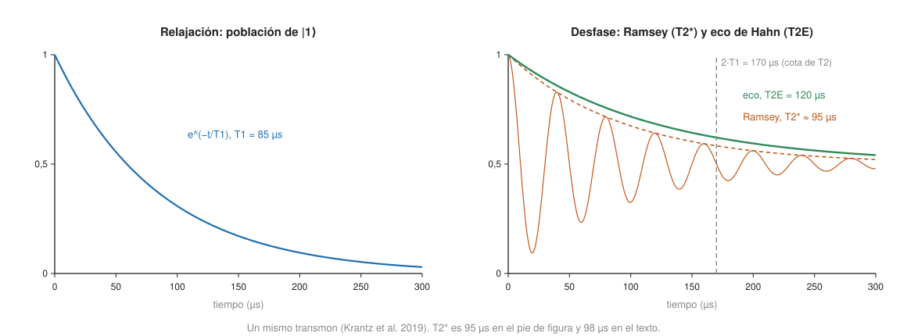

## Fundamentos {#layer-1}

Todo qubit físico se estropea con el tiempo y con cada operación. Para hablar de cuánto, el hardware usa tres familias de números: **cuánto aguanta** el qubit (T1, T2), **cuánto dura** una operación, y **cuánto se acerca** el resultado a lo ideal (fidelidad). Esta página los presenta de uno en uno; la causa física general es la [decoherencia](../../quantum-mechanics/concepts/decoherence.md).

**T1: cuánto tarda en olvidar si era 0 o 1.** El *tiempo de relajación (T1)* mide cuánto tarda un qubit en perder su energía y caer al estado `|0⟩`; es la escala del decaimiento "longitudinal" [@krantz-2019, pp. 13-14; @stano-2022, p. 3]. Se mide así: se prepara `|1⟩` con un pulso, se espera un tiempo `τ` y se mide [@krantz-2019, p. 15]. Imagina una pelota en lo alto de una cuesta que baja sola: T1 es el tiempo típico que tarda en llegar abajo.

**T2: cuánto tarda en olvidar la fase.** El *tiempo de coherencia (T2)* mide cuánto dura la fase relativa de una superposición, es decir, la escala del decaimiento "transversal" [@krantz-2019, pp. 13-14; @stano-2022, p. 3]. Sigue con la imagen: dos relojes que arrancan sincronizados y poco a poco se desfasan; T2 es lo que tardan en dejar de marcar la misma hora. Siempre se cumple `T2 ≤ 2·T1`, con igualdad cuando no hay desfase puro [@krantz-2019, p. 17].



**Fidelidad: cuánto se acerca al resultado ideal.** La *fidelidad (fidelity)* `F` es un número entre 0 y 1 que mide lo cerca que está el estado producido del esperado; con `F = 99,5 %`, hay un 0,5 % de probabilidad de un resultado no deseado [@henriet-2020, p. 9]. Se usa para tres cosas distintas:

- la fidelidad de una *puerta de un qubit*,
- la de una *puerta de dos qubits*,
- la de la *lectura* (qué parte de las veces el 0 se lee 0 y el 1 se lee 1).

**El número que importa es un cociente.** Un qubit que aguanta un segundo no es "mejor" si sus puertas tardan un segundo. DiVincenzo ya lo planteó como una razón entre el tiempo de decoherencia y el de la puerta, no como un tiempo absoluto [@divincenzo-2000, p. 4] (ver [criterios de DiVincenzo](divincenzo-criteria.md)). Stano y colaboradores lo dicen sin rodeos: un tiempo de coherencia o de puerta aislado dice poco, y de ahí la fidelidad y el factor de calidad [@stano-2022, p. 7].

**Ejemplo de orden de magnitud.** Con una puerta de dos qubits de 12 ns y una T1 mediana de 15,5 µs (el chip Sycamore de Google, 2019) caben unas 1300 puertas en un T1 [@arute-2019, Tabla II, p. 22; VI C 1, p. 15]; el cálculo es 15,54 µs / 12 ns. La [capa profesional](#layer-3) lo hace para cada plataforma.

**Lo básico que conviene recordar.**

- T1 y T2 son tiempos; la fidelidad es un porcentaje; no son lo mismo.
- Cuanto más corta la puerta frente a T1 y T2, menos se estropea mientras se ejecuta.
- Las puertas de dos qubits suelen tener más error que las de un qubit; la sección siguiente lo justifica con datos [@bruzewicz-2019, p. 20].

## Comprensión {#layer-2}

**Cómo se relacionan T1 y T2.** En el modelo de Bloch-Redfield, la tasa de relajación es `Γ₁ = 1/T1` y la de decoherencia transversal es `Γ₂ = Γ₁/2 + Γφ`, donde `Γφ` es la tasa de *desfase puro (pure dephasing)* [@krantz-2019, pp. 13-14; @stano-2022, App. A, p. 14]. La relajación se debe a ruido transversal a la frecuencia del qubit y es irreversible; el desfase puro viene de ruido longitudinal (fluctuaciones de frecuencia), es de banda ancha y, en principio, reversible [@krantz-2019, pp. 14-16]. Por eso `T2 ≤ 2·T1` [@krantz-2019, p. 17].

**Por qué hay tres "T2".** El valor depende de cómo se mida:

- *T2\* (Ramsey):* dos pulsos de π/2 con una evolución libre en medio. Es sensible al ruido de baja frecuencia casi estático ("ensanchamiento inhomogéneo") [@krantz-2019, p. 16; @stano-2022, p. 3].
- *T2 con eco de Hahn:* un pulso π a mitad de la evolución, que refocaliza ese ruido lento [@krantz-2019, pp. 15-16; @stano-2022, p. 3]. En el transmon de ejemplo de Krantz, T1 = 85 µs, T2\* ≈ 95 µs y T2 con eco = 120 µs, todavía por debajo de la cota `2T1 = 170 µs` [@krantz-2019, pp. 15-17].
- *Desacoplamiento dinámico (CPMG):* varios pulsos π, que desplazan el filtro de ruido a frecuencias más altas y acercan T2 a `2T1` [@krantz-2019, pp. 20-22; @stano-2022, p. 3].

Con ruido de tipo `1/f` (de carga, de flujo, de corriente crítica) el decaimiento deja de ser exponencial y pasa a ser gaussiano, y la fórmula `Γ₂ = Γ₁/2 + Γφ` deja de valer con rigor [@krantz-2019, pp. 16-17]. Para el espín, Burkard y colaboradores añaden que con ruido `1/f` el T2\* medido depende del tiempo total de promediado, de modo que **no es una propiedad intrínseca** del qubit [@burkard-2023, §VI.A.3, p. 42]. Un "tiempo de coherencia" es, operativamente, el tiempo que tarda la envolvente ajustada en caer a una fracción (típicamente `1/e`), y dice poco de la forma o de las colas [@stano-2022, p. 5].

**Cómo se mide la fidelidad de puertas.** No se puede medir comparando estados: se usan protocolos que repiten la puerta.

- *Benchmarking aleatorizado (randomized benchmarking, RB):* secuencias largas de puertas de Clifford aleatorias que terminan en la identidad; la probabilidad de supervivencia decae como `A·pᵐ + B` y la infidelidad media es `(1−p)(d−1)/d` con `d = 2ⁿ` [@stano-2022, pp. 9-10, Eqs. 13-16]. Los parámetros `A` y `B` absorben los errores de preparación y medida (SPAM), por lo que RB separa el error de puertas del de lectura [@stano-2022, pp. 9-10; @bruzewicz-2019, pp. 20-21]. La variante *intercalada (interleaved)* asigna fidelidad a una puerta concreta [@stano-2022, p. 10, nota 11; @krantz-2019, p. 35].
- *Benchmarking de entropía cruzada (cross-entropy benchmarking, XEB):* para puertas y para circuitos enteros; Google lo usa para estimar la fidelidad de circuitos aleatorios a partir de las cadenas medidas [@arute-2019, IV, pp. 5-7].
- *Tomografía de conjunto de puertas (gate set tomography):* más información, pero cara, y supone ruido sin memoria [@bruzewicz-2019, p. 21].
- *Tomografía de procesos:* necesita `4ᴺ` estados de entrada y supone SPAM perfecto [@bruzewicz-2019, p. 20].

**Una sola cifra esconde cosas.** La fidelidad `F = |⟨ψg|ψe⟩|²` es un único número que no dice qué tipo de error hay y puede ser demasiado optimista con los errores *coherentes*, que se suman más deprisa que los estocásticos al repetir la puerta [@bruzewicz-2019, p. 20]. RB extrae errores estocásticos pero dice poco de los correlacionados [@bruzewicz-2019, pp. 20-21]. Además, conviene saber qué se informa: Google recomienda dar el *error de Pauli* (independiente de la dimensión) en lugar de la infidelidad media de RB, que tiene un factor dependiente de `D` que "favorece" el valor: para un error de Pauli de 0,1 %, el error medio es 0,067 % con un qubit y 0,08 % con dos [@arute-2019, V, pp. 10-11, Tabla I]. Y muchos artículos convierten la fidelidad de Clifford a la de puertas "elementales" (π/2, π); la infidelidad de Clifford es entonces unas 2-3 veces mayor, con razones citadas de 1,875 (un qubit) y 2,57 (dos qubits), una conversión que la propia revisión llama dudosa [@stano-2022, p. 10, nota 13].

**Qué fija la fidelidad.** Tres cosas compiten:

1. *Decoherencia durante la puerta.* Para una puerta de duración `t_g` y relajación T1, el error medio es aproximadamente `t_g/(3·T1)` y el de Pauli `t_g/(2·T1)` [@arute-2019, V, p. 10]. La fidelidad está acotada por la coherencia, de ahí que interesen las puertas cortas [@krantz-2019, p. 35].
2. *Errores de control y fuga.* Si la puerta es demasiado rápida, el qubit se escapa a otros niveles (*fuga, leakage*) y aparecen errores de fase. En Sycamore la puerta de 12 ns se eligió como compromiso entre decoherencia (si es lenta) y fuga (si es rápida) [@arute-2019, VI C 1, p. 15]. En iones hay un compromiso análogo: las puertas de un qubit de menos de 2 µs tienen un error de unos 2·10⁻⁴, y las de dos qubits por debajo de 500 ns llegan solo a un 60 % de fidelidad [@bruzewicz-2019, pp. 17-18; p. 20].
3. *Ruido de control y diafonía (crosstalk).* El error de la puerta de dos qubits de Sycamore sube de 0,30 % a 0,60 % cuando se ejecutan puertas en paralelo en todo el chip, sobre todo por errores incoherentes atribuidos a interacciones parásitas y diafonía del control [@arute-2019, VI C 5, p. 20; Tabla II, p. 22]. El error inicial de la puerta de dos qubits se repartía aproximadamente a medias entre control y decoherencia [@arute-2019, VI C 2, 4, pp. 16-19].

Un cálculo propio con el mismo chip: el error por T1 solo da `12 ns / (2 × 15,54 µs) ≈ 3,9·10⁻⁴` de error de Pauli por qubit, unos `8·10⁻⁴` para los dos, bastante menos que el 0,30-0,60 % medido: T1 explica una parte, no el total.

**Las puertas de dos qubits son las más propensas a error.** Es una de las regularidades más sólidas del hardware, y las fuentes la dicen de formas distintas:

- En iones, los errores de las puertas de dos qubits son "al menos un orden de magnitud" mayores que los de uno; la tabla de esa revisión pone el mejor error de un qubit entre 10⁻⁶ y 10⁻⁴ y el de dos qubits en torno a 10⁻³ [@bruzewicz-2019, p. 20; Tabla I, p. 18].
- En espines, los autores de la compilación de Stano afirman que, para puertas, medidas e inicializaciones, la infidelidad de dos qubits queda al menos un orden de magnitud por encima, y normalmente más, que la de uno [@stano-2022, §IV.B, p. 11]. Ejemplo: 1Q 99,96 % frente a 2Q 99,81 % en silicio, y 99,992 % frente a 99,3 % en huecos de germanio [@stano-2022, Tabla III, pp. 30-31].
- En Sycamore (2019), la mediana es 0,13-0,14 % para una puerta de un qubit y 0,30-0,60 % para una de dos: entre 2 y 4 veces peor [@arute-2019, Tabla II, p. 22].
- En el H2 de Quantinuum (2023, cifras de la empresa), el error por puerta de 2 qubits (unos 1,8·10⁻³) es unas 70 veces el de 1 qubit (2,5·10⁻⁵); la razón es un cálculo a partir de las dos cifras, no una frase del artículo [@moses-2023, abstract; Tabla II, p. 6].
- En la compilación de errores de Google, la puerta CZ (de dos qubits) es la mayor contribución al presupuesto de error [@google-2025, p. 4].

La *causa* no está tan bien explicada: DiVincenzo solo dice que se supone más fácil hacer operaciones de un cuerpo que de dos [@divincenzo-2000, p. 5], y Bruzewicz enumera fuentes de error de la puerta de dos qubits en iones (deriva de láser y de campo magnético, dispersión fuera de resonancia, calentamiento del movimiento) [@bruzewicz-2019, p. 20]. En otras palabras: una puerta de dos qubits necesita una interacción extra entre sistemas, con sus propios canales de ruido (esto último es la lectura habitual y está en línea con esas fuentes, no una frase de ellas).

**Y en tiempo, depende.** En iones, una puerta de uno es del orden de µs y una de dos de 10-100 µs [@bruzewicz-2019, p. 3]. En átomos neutros, ambas son de µs o menos [@saffman-2025, p. 5]. En espines de electrones en silicio, la de dos qubits es comparable o algo más lenta (40 ns a 0,3 µs frente a 40 ns a 1 µs), no sistemáticamente mucho más; es lo que se lee en las tablas, no una afirmación de los autores [@stano-2022, Tabla II, pp. 26-28]. Así que "las más costosas" es seguro para el *error*, y para el *tiempo* depende de la plataforma.

**Lectura y fuga.** El error de lectura es otra pieza: en la lectura dispersiva de superconductores está limitado por la separación de las dos distribuciones gaussianas y por el decaimiento T1 durante la medida, `F(τ_ro) ≈ 1 − e^{−τ_ro/T1}` [@krantz-2019, pp. 47-48]. En Sycamore, la lectura (2,83-3,50 %) es peor que cualquier puerta [@arute-2019, Tabla II, p. 22]; en un dispositivo IBM de tipo Eagle, el error de lectura suele superar al de dos qubits, que supera al de uno [@ibm-quantum-learning, "Hardware"]. El error de preparación y medida de iones, en cambio, ya estaba en 0,07 % en 2019 (SPAM 99,93 %) [@bruzewicz-2019, p. 4].

**Umbrales y Λ.** La fidelidad de dos qubits por encima del 99 % se considera un hito porque el umbral del código de superficie ronda el 1 %: por debajo de él, añadir qubits reduce el error lógico [@krantz-2019, p. 35; @bruzewicz-2019, p. 32]. En el experimento de Google (2024) el factor `Λ = ε_d / ε_(d+2) ≈ p_umbral/p` fue de 2,14 ± 0,02 con un decodificador de red neuronal [@google-2025, pp. 1-3]. No te quedes con la cifra: lo que importa aquí es que "por debajo del umbral" es una propiedad medida del dispositivo entero, no de una puerta. Stano y colaboradores avisan además de que la infidelidad de RB **no** es el parámetro de error que aparece en el teorema del umbral, y puede diferir en órdenes de magnitud, por lo que sirve solo como indicador aproximado de progreso [@stano-2022, p. 9, nota 8]. El desarrollo está en el [teorema del umbral](../../error-correction/concepts/threshold-theorem.md), el [código de superficie](../../error-correction/concepts/surface-code.md) y el [ruido cuántico y los canales de error](../../error-correction/concepts/quantum-noise-channels.md), que formaliza estos procesos de relajación y desfase.

**Errores frecuentes.**

- *"Más coherencia, mejor qubit."* Una T2 larga es necesaria pero no suficiente para el control de alta fidelidad [@burkard-2023, §VI.A.6, p. 43]. Los espines tienen T1 de segundos que "no preocupan" para computar [@stano-2022, p. 6].
- *"La fidelidad de una puerta es una propiedad de la puerta."* Depende del contexto: en paralelo con otras puertas, tras transportes, de la calibración del día. En Sycamore la fidelidad de un parche derivó durante 17,4 h sin recalibrar [@arute-2019, VIII H, pp. 40-42].
- *"T1 y T2 se miden una vez y valen para siempre."* En superconductores, los defectos de dos niveles (TLS) hacen que T1 varíe mucho con la frecuencia y con el tiempo [@arute-2019, VI A-B, pp. 11-14].

## Profesional {#layer-3}

### Cómo leer una ficha técnica

Antes de comparar dos cifras, pregunta:

1. **¿Qué métrica?** Error de Pauli, infidelidad media de RB, fidelidad de Clifford, infidelidad por puerta "elemental" o error efectivo de un benchmark de sistema son números distintos, con factores de conversión de 1,9 a 2,6 o más [@arute-2019, V, pp. 10-11; @stano-2022, p. 10, nota 13].
2. **¿Mediana, media o la mejor?** Stano elige un valor "representativo" por experimento, algo que los propios autores reconocen subjetivo [@stano-2022, p. 2]. Los récords de fidelidad de dos qubits en silicio (99,81 %) conviven con valores de 83-93 % en otros dispositivos de la misma tabla [@stano-2022, Tabla III, pp. 30-31].
3. **¿Aislada o en paralelo?** En Sycamore, el error de dos qubits pasa de 0,30 % a 0,60 % [@arute-2019, Tabla II, p. 22]. Un circuito real ejecuta puertas en paralelo.
4. **¿Qué incluye?** El H2 de Quantinuum informa por separado el error de puerta (1,84·10⁻³), el error de memoria asociado al transporte y la lectura; su "error efectivo por puerta de dos qubits" incluye puertas de uno y memoria y sale 2,6·10⁻³ en el benchmark de espejo con 32 qubits [@moses-2023, §IV, p. 7; Tabla III, p. 8].
5. **¿Componentes o sistema?** Los autores de Quantinuum advierten de que los benchmarks de componentes pueden dar una imagen engañosa si hay diafonía o ruido no markoviano, por lo que añaden benchmarks de sistema [@moses-2023, §IV, p. 7].
6. **¿De qué fecha?** Todas las cifras de esta página son de un año y un dispositivo; las de 2019 no describen el hardware de hoy.

### Caso 1: cuántas puertas caben en el tiempo de coherencia

El cociente `tiempo de coherencia / tiempo de puerta de dos qubits` de cada plataforma, con los números de las fuentes (cada fila es de un año y un dispositivo distintos; los cocientes son cálculos propios):

| Plataforma | Coherencia | Puerta de 2 qubits | Cociente | Fuente |
|---|---|---|---|---|
| Superconductor, Sycamore (2019) | T1 mediana 15,54 µs | 12 ns | ≈ 1300 | [@arute-2019, Tabla II, p. 22; VI C 1, p. 15] |
| Superconductores en general (2019) | n/d | n/d | ~1000 | la cifra la da la revisión de iones [@bruzewicz-2019, p. 4] |
| Superconductor, procesador de 105 qubits de Google (2024) | T1 media 68 µs, T2 (CPMG) 89 µs | ciclo de código de superficie de 1,1 µs | ≈ 80 ciclos en T2 | [@google-2025, p. 2; p. 5] |
| Ion, revisión de 2019 | hasta 50 s (hiperfino, sin eco) | 30 µs (99,91 %) a 100 µs (99,9 %) | 5·10⁵ a 1,7·10⁶ | [@bruzewicz-2019, pp. 3-4; pp. 18-19] |
| Átomo neutro (Rydberg), 2020 | "más de 100 puertas en el tiempo de coherencia" (cifra de los autores, de Pasqal) | ~1 µs | >100 | [@henriet-2020, p. 11] |
| Átomo neutro, 2025 (Saffman) | segundos (según Saffman, para el qubit) | sub-µs a pocos µs | ~10⁶ solo si se divide por la coherencia del estado fundamental | [@saffman-2025, p. 5] |
| Espín en silicio (compilación hasta 2024) | n/d | 40 ns (2022) | factor de calidad de puerta Q de hasta 558 (qubit singlete-triplete); la mayoría entre unas pocas y ~100 | [@stano-2022, p. 12; Tabla IV, p. 35] |

Cómo leerlo:

- Los iones ganan por seis órdenes de magnitud en coherencia, y pierden por tres en velocidad frente a los superconductores. La propia revisión de iones da ~10⁶ para iones, ~1000 para superconductores y ~200 para átomos de Rydberg [@bruzewicz-2019, p. 4]; Preskill también apuntaba que en 2018 las puertas superconductoras eran unas 1000 veces más rápidas que las de iones [@preskill-2018, §4.2, p. 5].
- La fila de átomos neutros de 2025 es una **trampa**: dividir segundos entre microsegundos da 10⁶, pero durante la puerta el átomo está en un estado de Rydberg de vida corta. La cota fundamental de infidelidad de una puerta Rydberg es `≈ 2/(V·τ_R)`, con `V` la energía de interacción y `τ_R` la vida del estado de Rydberg; para Cs 68p a 2,5 µm (`V = 2π × 215 MHz`, `τ_R = 198 µs` a temperatura ambiente) sale unos 7,5·10⁻⁶ [@saffman-2025, pp. 10-11]. Es decir: el tiempo que cuenta no es la coherencia del qubit en reposo, sino la del estado en que se hace la puerta.
- El caso de Google 2024 muestra que, para corrección de errores, la "unidad de tiempo" ya no es la puerta sino el ciclo de síndrome (1,1 µs) [@google-2025, pp. 1, 5]. T2 de 89 µs / 1,1 µs ≈ 81 ciclos.
- Los espines se miden mejor con el factor de calidad `Q = f_R · T2*` o `f_R · T2^Rabi`, el número de oscilaciones discernibles; en un modelo sencillo de desfase exponencial, `1 − F ≈ 1/(4Q)` [@stano-2022, pp. 11-12; App. B, pp. 14-15]. Con `Q = 100`, sale una infidelidad del 0,25 % (cálculo propio), y el propio texto avisa de que los errores unitarios bajan la fidelidad sin cambiar `Q`, así que es solo una cota [@stano-2022, App. B, pp. 14-15].

### Caso 2: probabilidad de éxito de un circuito pequeño

La fidelidad de un circuito es, en primera aproximación, el producto de las fidelidades de todos sus componentes. Google comprobó este modelo en Sycamore: multiplicando `(1 − error de Pauli)` de cada puerta y cada lectura, la fidelidad de circuitos de decenas de qubits y unas 1000 puertas se predijo con un margen del 10-20 % [@arute-2019, VIII E, Eq. 77, pp. 35-36]. Saffman lo expresa como `exp(−ε·V_eff)`, con `ε` la infidelidad de dos qubits y `V_eff` aproximadamente el número de puertas de dos qubits [@saffman-2025, pp. 3-4]; y Cai y colaboradores como `e^{−λ}` [@cai-2023, Sec. II.C, p. 5], vista en la [era NISQ](../../qiskit-programming/concepts/nisq-era.md).

Tomamos un GHZ de 5 qubits en cadena (1 Hadamard, 4 CNOT, lectura de los 5) y las cifras de dos dispositivos reales:

```python
def exito(e1, n1, e2, n2, er, nr):
    """Producto de fidelidades: puertas de 1 qubit, de 2 qubits y lectura."""
    return (1 - e1) ** n1 * (1 - e2) ** n2 * (1 - er) ** nr

sycamore_2019 = dict(e1=0.0014, e2=0.0060, er=0.035)      # medianas, en paralelo (Arute, Tabla II)
h2_2023       = dict(e1=2.5e-5, e2=1.84e-3, er=1.6e-3)    # Moses, Tabla II (SPAM por qubit)
for nombre, p in (("Sycamore 2019", sycamore_2019), ("Quantinuum H2 2023", h2_2023)):
    print(nombre, round(exito(p["e1"], 1, p["e2"], 4, p["er"], 5), 3))
```

```text
Sycamore 2019 0.816
Quantinuum H2 2023 0.985
```

Lectura: el chip de 2019 pierde casi todo el margen en la **lectura** (`0,965⁵ ≈ 0,84`), no en las puertas; el ion pierde menos de un 2 % entre todo. Con circuitos más grandes la cuenta cambia de dominante: con 200 puertas de dos qubits y 20 qubits leídos, las mismas cifras dan 0,15 (Sycamore) y 0,67 (H2). Y como referencia para cifras de otros años: un error de dos qubits del 0,1 % da `0,999²⁰⁰ ≈ 0,82` y uno del 0,5 % da `≈ 0,37`; Eisert y Preskill sitúan en 2025-26 el error de dos qubits de las tres plataformas principales por debajo del 0,5 %, y cerca del 0,1 % en algunos casos [@eisert-2025, Box 1, p. 3].

Comprobación con el experimento de Sycamore de 53 qubits y 20 ciclos (1113 puertas de uno y 430 de dos qubits [@arute-2019, VII C, E, pp. 27-28]): con las mismas medianas, `0,9986¹¹¹³ × 0,994⁴³⁰ × 0,965⁵³ ≈ 0,0024`, frente a la fidelidad XEB medida de `(2,24 ± 0,18 ± 0,10)·10⁻³` [@arute-2019, VIII G-I, pp. 39-41]. La coincidencia es cálculo propio con medianas (Google usa los errores de cada puerta), por lo que no debe leerse como una predicción afinada; sí como confirmación de que el modelo de producto sirve para estimar el orden de magnitud.

Limitaciones del cálculo, que se deben decir en voz alta:

- Comparamos un chip de 2019 con una máquina de iones de 2023, y las dos cifras son de los fabricantes; los chips superconductores han mejorado desde entonces (ver [qubits superconductores](superconducting-qubits.md)).
- El error de lectura de los iones ya incluye preparación, y el de Sycamore es la media de los dos estados [@moses-2023, §III, p. 6; @arute-2019, Tabla II, p. 22].
- No entra el error de *espera (idle)* ni el de transporte; el de memoria del H2 sube el error efectivo por puerta de dos qubits de 1,84·10⁻³ a unos 2,6·10⁻³ en 32 qubits, y con ese valor el GHZ-5 baja a 0,98 [@moses-2023, Tabla III, p. 8] (cálculo propio).
- El error de dos qubits en una arquitectura de vecinos más próximos crece porque el [transpilador](../../qiskit-programming/concepts/transpilation.md) añade SWAP; el circuito de ejemplo está elegido para evitarlo.

### Decisiones prácticas

- **Presupuesto de puertas.** Con el recuento de puertas de dos qubits *después* de transpilar, `λ ≈ Σ error` te dice si el circuito es viable sin mitigación o si necesita [mitigación de errores](../../qiskit-programming/concepts/error-mitigation.md), cuyo coste de muestreo crece con el tamaño del circuito [@eisert-2025, Sec. II, pp. 2-3].
- **Fidelidad antes que número de qubits.** Saffman concluye que la fidelidad, no el número de qubits, es la que sube el coste de simulación clásica [@saffman-2025, pp. 3-4]; Preskill ya enumeraba la precisión de puertas, velocidad, lectura, conectividad y rendimiento de fabricación como medidas de calidad [@preskill-2018, §4.2, p. 5].
- **Calibración como parte del número.** Una fidelidad de hace 17 horas no es la de ahora: planifica la reproducibilidad con la fecha y la versión de la calibración (ver [ejecutar en hardware real](../../qiskit-programming/concepts/running-on-hardware.md)) [@arute-2019, VIII H, pp. 40-42].
- **Pensar en errores de fuga y pérdida.** En átomos neutros hay tres canales nuevos (calentamiento, fuga y pérdida del átomo), y la fuga detectada en un sitio conocido se convierte en un error de borrado, que ayuda a los códigos [@saffman-2025, pp. 21-22].
- **Cuándo la fidelidad de RB engaña.** Si vas a usar el dispositivo para corrección de errores, no pidas solo la fidelidad de RB: pide la tasa de error del circuito de síndrome, porque RB no es el parámetro del teorema del umbral [@stano-2022, p. 9, nota 8] y un protocolo de puerta optimizado para la extracción de síndromes puede rendir mejor que uno optimizado para fidelidad [@saffman-2025, p. 7].

Continúa por plataformas: [superconductores](superconducting-qubits.md), [iones](trapped-ion-qubits.md), [átomos neutros](neutral-atom-qubits.md), y vuelve a este concepto cuando compares con la [comparativa del hardware](hardware-landscape.md).
