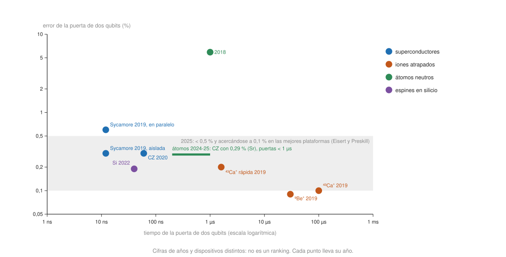

## Profesional {#layer-3}

Este concepto reúne lo que has visto plataforma a plataforma ([superconductores](superconducting-qubits.md), [iones](trapped-ion-qubits.md), [átomos neutros](neutral-atom-qubits.md), [espines](spin-qubits.md), [fotónicos](photonic-qubits.md), [topológicos](topological-qubits.md)) y te enseña a **compararlas sin engañarte**. Antes de la tabla, tres avisos:

1. **Las cifras envejecen rápido.** Toda cifra va con su año y su dispositivo, y las de 2019 no describen el hardware de hoy. Las fuentes de este ámbito llegan a la primavera de 2026 (la revisión de Eisert y Preskill, versión de mayo de 2026), pero la mayoría de las cifras de dispositivos son de 2019-2025. Esta página es una instantánea; para decidir algo hoy, busca las fichas más recientes.
2. **Muchas cifras vienen de quien vende o construye el dispositivo.** Quantinuum (iones), Pasqal, Infleqtion y QuEra (átomos), PsiQuantum (fotónica, solo simulación), Microsoft (topológicos) y Google (superconductores) son empresas, y los autores de los experimentos de USTC informan de los suyos. Cuando se pueda se contrasta con revisiones independientes (MIT Lincoln Laboratory para superconductores e iones; Burkard y Stano para espines, aunque la revisión de Burkard incluye autores de HRL Laboratories).
3. **Ninguna fuente dice qué plataforma ganará.** Bruzewicz y colaboradores: "la modalidad ganadora… sigue lejos de ser segura" (2019) [@bruzewicz-2019, p. 5]; Burkard y colaboradores consideran prematuro decirlo [@burkard-2023, §VIII, pp. 51-52]; Eisert y Preskill escriben que está lejos de estar claro qué modalidad llegará a máquinas ampliamente útiles, y que los átomos de Rydberg, que hace unos años no se veían tan prometedores, lideran ahora las primeras demostraciones tolerantes a fallos tempranas [@eisert-2025, Sec. III, p. 5].

### Instantánea por plataforma (con año y fuente)

Cada celda indica el dato y de quién es. Las celdas vacías significan que las fuentes consultadas no lo dan.

| | Superconductores | Iones atrapados | Átomos neutros | Espines en semiconductor | Fotónicos |
|---|---|---|---|---|---|
| **Escala demostrada** | 53 qubits, Sycamore (2019, Google) [@arute-2019, II, p. 2]; procesador de 105 qubits (2024, Google) [@google-2025, p. 1]; RCS con más de 100 qubits [@eisert-2025, Sec. IV, p. 6] | 20 iones totalmente controlados (2019) [@bruzewicz-2019, pp. 2-3]; 32 qubits, H2 (2023, Quantinuum) [@moses-2023, abstract, p. 1]; más de 50 en circuitos aleatorios [@eisert-2025, Sec. IV, p. 6] | cientos de qubits en 2D; 6100 átomos cargados de media en 12 000 sitios y 2000 reordenados (2025, Saffman, Infleqtion) [@saffman-2025, pp. 5-6]; 280 átomos (2023, Harvard/QuEra) [@bluvstein-2024, p. 1] | dispositivos de hasta 12 qubits (2024); operación de "procesador" con 3 qubits [@stano-2022, Tabla V, pp. 36-37] | 100 modos y 76 clics en una máquina de muestreo de propósito especial (2020, USTC) [@zhong-2020, p. 1] |
| **Error de puerta de 2 qubits** | 0,30 % aislada y 0,60 % en paralelo, mediana (2019) [@arute-2019, Tabla II, p. 22]; 0,3 % (CZ en 60 ns, 2020) [@kjaergaard-2020, Tabla 1, p. 8] | 0,09 % en 30 µs (2019) [@bruzewicz-2019, pp. 18-19]; 1,84·10⁻³ de RB y 2,6·10⁻³ efectivo (H2, 2023, fabricante) [@moses-2023, abstract; Tabla III, p. 8] | 5,9 % (experimento de 2018 citado en 2020) [@henriet-2020, p. 11]; 99,5 % (citado en 2023) [@bluvstein-2024, p. 4]; mejor 0,9971 en Sr (2025) [@saffman-2025, p. 9] | 99,81 % en Si (abril de 2022); 99,3 % en Ge (julio de 2024) [@stano-2022, Tabla III, pp. 30-31] | |
| **Tiempo de puerta de 2 qubits** | 12 ns (2019) [@arute-2019, VI C 1, p. 15]; decenas de ns (2025) [@eisert-2025, Box 1, p. 3] | 10-100 µs típico (2019) [@bruzewicz-2019, p. 3] | ~1 µs (2020) [@henriet-2020, p. 11]; de µs a menos de 1 µs (2025) [@saffman-2025, p. 5] | 40 ns en Si (abril de 2022) [@stano-2022, Tabla II, p. 28] | |
| **Coherencia** | T1 mediana 15,5 µs (2019) [@arute-2019, Tabla II, p. 22]; T1 media 68 µs, T2 (CPMG) 89 µs (2024) [@google-2025, p. 2] | hasta 50 s sin eco (2019) [@bruzewicz-2019, pp. 3-4] | segundos (2025); T2 > 1 s [@saffman-2025, p. 5; @bluvstein-2024, p. 2] | T2\* hasta 2,4 ms en un donante (2016); ~0,12 ms en puntos con puerta de Si/SiO₂ [@stano-2022, Tabla I, pp. 17-20] | |
| **Conectividad** | vecinos próximos en rejilla [@eisert-2025, Box 1, p. 3] | cadena con conectividad total; arbitraria con transporte (H2) [@bruzewicz-2019, pp. 25-26; @moses-2023, §I, p. 2] | reconfigurable (bloqueo de largo alcance y transporte) [@saffman-2025, p. 2] | vecinos próximos; largo alcance por transporte de espín o cavidades [@burkard-2023, §IV.F, pp. 24-25] | no necesita ser local en FBQC (simulación) [@bartolucci-2023, §VII.C, p. 17] |
| **Velocidad por disparo** | 1 millón de muestras en ~200 s (2019) [@arute-2019, X H, p. 59] | 0,72-1,23 s por disparo en benchmarks de 32 qubits (2023) [@moses-2023, Tabla I, p. 5] | ciclo de ~200 ms (5 Hz) (2020) [@henriet-2020, p. 6; p. 12] | | |
| **Cuello de botella citado** | cableado y calibración; correlaciones de error [@kjaergaard-2020, §5.3, p. 23; @google-2025, p. 4] | velocidad y escala del control óptico y electrónico [@bruzewicz-2019, p. 5] | medida y movimiento lentos, pérdida de átomos [@eisert-2025, Box 1, p. 3; @saffman-2025, p. 22] | fabricación y cableado [@burkard-2023, §VIII, p. 51] | pérdida, fuentes y detectores [@slussarenko-2019, pp. 3, 8] |

**Los topológicos** no tienen fila: en las fuentes consultadas no hay un qubit topológico demostrado, solo una medida de paridad en un prototipo y una discusión sobre si es topológica (ver [qubits topológicos](topological-qubits.md)).

**Cómo leer la tabla.**

- *Velocidad y fidelidad no van juntas.* Los superconductores son los más rápidos (decenas de ns frente a decenas de µs de los iones, un factor de ~1000, como ya apuntaba Preskill en 2018 [@preskill-2018, §4.2, p. 5]) y los iones los más fieles en 2019. Los átomos y los espines se acercan en fidelidad con el tiempo.
- *Las cifras por plataforma no son comparables 1 a 1.* Cada fila mezcla medianas, mejores resultados, RB, XEB y errores efectivos (ver [coherencia y fidelidad](coherence-and-fidelity.md#layer-3)). Stano y colaboradores avisan de que las suyas son valores "representativos" elegidos por los autores [@stano-2022, p. 2].
- *La tendencia importa más que el valor.* Con las mismas fuentes, la progresión del error de dos qubits es:

| Plataforma | Progresión citada |
|---|---|
| Superconductores | 99,4 % en 40 ns (CZ, 2014) → errores medianos de 0,60 % (en paralelo) y 0,30 % (aislada) en un chip de 53 qubits (2019, métricas distintas) → 99,7 % en 60 ns (CZ adiabática, 2020) [@kjaergaard-2020, §2.2, p. 8; Tabla 1, p. 8; @arute-2019, Tabla II, p. 22] |
| Átomos neutros | 94,1 % (2018) → 99,5 % (citada en 2023) → > 99 % en cuatro elementos, el mejor 99,71 % en Sr (2025) [@henriet-2020, p. 11; @bluvstein-2024, p. 4; @saffman-2025, p. 5; p. 9] |
| Espines (Si) | 92-98 % (2019) → > 99 % (2021) → 99,81 % (2022) [@burkard-2023, §V.A.4, p. 29; @stano-2022, Tabla III, p. 30] |
| Iones | 99,9 % (mejor valor, 2019) → 99,82 % por RB en el H2 (2023, promedio de las zonas de puerta) y 99,74 % de error efectivo en 32 qubits; no son el mismo tipo de dato, así que no indican retroceso [@bruzewicz-2019, p. 4; @moses-2023, abstract; Tabla III, p. 8] |

  Para el cuadro de conjunto de 2025-26, Eisert y Preskill dicen que, entre iones, superconductores y átomos neutros, hay decenas a centenares de qubits demostrados con error de puertas de dos qubits por debajo del 0,5 % y cerca del 0,1 % en algunos casos [@eisert-2025, Box 1, p. 3], y los autores de Google escriben que las plataformas con muchos qubits solo habían mostrado hace poco puertas de entrelazamiento del 99,9 % [@google-2025, p. 1].

### La corrección de errores como segunda vara de medir

Una vez que los errores bajan, la prueba es si la corrección de errores mejora el qubit. Resumen de lo que las fuentes dicen, **con la letra pequeña de cada una** (el desarrollo está en [experimentos con qubits lógicos](../../error-correction/concepts/logical-qubit-experiments.md)):

- *Superconductores:* una memoria de código de superficie de distancia 7 con 101 qubits, `Λ = 2,14` y vida lógica 2,4 veces la del mejor qubit físico (preprint de 2024, autores de Google); es solo una memoria, sin puertas lógicas [@google-2025, pp. 1-3, 7]. Eisert y Preskill llaman Willow a ese procesador [@eisert-2025, Sec. III, p. 4].
- *Átomos neutros:* hasta 48 qubits lógicos en 280 átomos (2023, Harvard/QuEra), con detección de errores y poselección; faltan rondas repetidas de corrección [@bluvstein-2024, pp. 3-8; @eisert-2025, Sec. III, p. 4].
- *Iones:* 12 qubits lógicos en una trampa de 56 qubits, con pocas rondas de síndrome y poselección [@eisert-2025, Sec. III, p. 4]. En 2019 solo había demostraciones pequeñas [@bruzewicz-2019, pp. 32-33]; el H2 ejecutó un código de repetición de distancia 31 [@moses-2023, §V C, pp. 13-14].
- *Espines:* una demostración de corrección de errores con una puerta de 3 qubits (agosto de 2022) [@stano-2022, p. 13]; las estimaciones estándar de umbral suponen una geometría que no coincide con los dispositivos actuales [@burkard-2023, §VIII, p. 52].
- *Fotónicos:* umbrales en simulación; no hay demostración experimental en las fuentes [@bartolucci-2023, nota de acceso].

Eisert y Preskill ponen el listón de aplicaciones: las máquinas NISQ más capaces ejecutan menos de ~10⁴ operaciones de dos qubits, y una máquina tolerante a fallos de escala de aplicación puede necesitar ~10¹² (un "teraquop"), con regímenes intermedios megaquop (~10⁶) y gigaquop (~10⁹) [@eisert-2025, Sec. I, p. 2].

### Cómo leer la ficha técnica de un proveedor

Lista de comprobación, de arriba abajo:

1. **Fecha y dispositivo.** ¿Año de la medida y versión del chip? Una cifra de un artículo puede describir un chip que ya no se ofrece.
2. **Qubits: cuántos y cuáles.** Cargados, reordenados, conectados, utilizables; en átomos hay varias cifras (6100 cargados frente a 2000 reordenados) [@saffman-2025, pp. 5-6]. Un número de qubits dice poco: cuentan la precisión de puertas, la velocidad, la medida, la conectividad y el rendimiento de fabricación [@preskill-2018, §4.2, p. 5].
3. **Error de dos qubits: ¿métrica, estadístico y condiciones?** Pauli, infidelidad de RB, Clifford, error efectivo; mediana, media o mejor; aislada o en paralelo (0,30 % → 0,60 %) [@arute-2019, Tabla II, p. 22; V, pp. 10-11; @stano-2022, p. 2, p. 10 nota 13]. Google recomienda informar del error de Pauli [@arute-2019, V, pp. 10-11].
4. **Error de lectura y de preparación (SPAM).** En un circuito pequeño puede dominar: 2,83-3,50 % en Sycamore frente a 1,6·10⁻³ de SPAM por qubit en el H2 [@arute-2019, Tabla II, p. 22; @moses-2023, Tabla II, p. 6]. En un dispositivo IBM de tipo Eagle, el error de lectura suele superar al de dos qubits [@ibm-quantum-learning, "Hardware"].
5. **Tiempo de puerta y coherencia en el mismo estado.** El cociente, no los valores sueltos (ver el cuadro de [coherencia y fidelidad](coherence-and-fidelity.md#layer-3)) [@divincenzo-2000, p. 4]. Cuidado con el estado en el que se hace la puerta (Rydberg) [@saffman-2025, pp. 10-11].
6. **Conectividad y coste de usarla.** Vecinos próximos (SWAP en el [transpilador](../../qiskit-programming/concepts/transpilation.md)), total en cadena de iones, o por transporte con coste de tiempo (60 % del circuito en el H2) [@moses-2023, §II E, p. 4].
7. **Disparos por segundo y ciclo de trabajo.** El tiempo por disparo difiere en un factor de miles entre plataformas; Sycamore tuvo un ciclo de trabajo de hasta el 2 % [@arute-2019, X H, p. 59].
8. **Benchmarks de sistema, no solo de componentes.** Los de componentes pueden dar una imagen engañosa si hay diafonía o ruido no markoviano [@moses-2023, §IV, p. 7]; y la fidelidad de RB no es el parámetro del teorema del umbral [@stano-2022, p. 9, nota 8].
9. **Calibración y deriva.** ¿Cuándo se calibró? La fidelidad de un parche de Sycamore derivó durante 17,4 h [@arute-2019, VIII H, pp. 40-42].
10. **"Qubit lógico".** ¿Distancia, número de rondas, memoria o puertas, y se descartan ejecuciones? [@google-2025, p. 3; @bluvstein-2024, p. 4].
11. **Autoría y estado.** Fabricante, grupo académico, preprint o artículo revisado; réplica independiente.

**Señales de alarma frecuentes** (cada una con un ejemplo de las fuentes): un titular de "número de qubits" sin error ni conectividad; "99,9 %" sin decir si es 1Q, 2Q o lectura; mejores valores presentados como medianas; fidelidades de benchmark de una sola puerta tomadas como la del sistema; ventaja cuántica basada en una cifra de años sin el algoritmo clásico ni la fidelidad (ver [experimentos de ventaja cuántica](quantum-advantage-experiments.md)); poselección presentada como corrección; fidelidad GHZ sin corregir de SPAM interpretada como más de lo que es (solo > 0,5 indica entrelazamiento multipartito) [@moses-2023, §IV D, p. 10]; y un "qubit topológico" sin operación de qubit demostrada.

### Caso resuelto: ¿qué plataforma para un circuito de 20 qubits y 200 puertas de dos qubits?

Supón un circuito de 20 qubits con 200 puertas de dos qubits y una lectura final, e interacciones entre pares arbitrarios. Con la fórmula del producto (ver [coherencia y fidelidad](coherence-and-fidelity.md#layer-3)) y los datos citados:

| Escenario | Fidelidad de puertas (`(1−e₂)²⁰⁰`) | Con lectura de 20 qubits | Fuente de las cifras |
|---|---|---|---|
| Chip superconductor de 2019 (`e₂` = 0,60 %, lectura 3,5 %) | 0,30 | 0,15 | [@arute-2019, Tabla II, p. 22] |
| Máquina de iones de 2023 (`e₂` = 1,84·10⁻³, SPAM 1,6·10⁻³) | 0,69 | 0,67 | [@moses-2023, Tabla II, p. 6] |
| Referencia 2025: error de 2 qubits 0,1 % | 0,82 | n/d | [@eisert-2025, Box 1, p. 3] |
| Referencia 2025: error de 2 qubits 0,5 % | 0,37 | n/d | [@eisert-2025, Box 1, p. 3] |

(Cálculos propios; las dos últimas filas solo tienen el término de puertas porque las fuentes no dan la lectura de 2025.)

Lectura:

- *La fidelidad por circuito favorece a los iones* en este ejemplo concreto de 2019 frente a 2023, pero la comparación no es justa: el chip superconductor es cuatro años más viejo; la referencia de 2025 muestra que el rango 0,1-0,5 % da de 0,82 a 0,37 solo en las puertas.
- *La conectividad cambia la cuenta.* El circuito pide pares arbitrarios. En un chip de vecinos próximos, el transpilador añade puertas de dos qubits; cada una multiplica la fidelidad por `(1−e₂)`: con 100 extra a 0,60 %, el factor es `0,994¹⁰⁰ ≈ 0,55` (cálculo propio). En los iones con transporte, el coste es de tiempo y de error de memoria (el efectivo sube a 2,6·10⁻³ en 32 qubits) [@moses-2023, Tabla III, p. 8].
- *La velocidad cambia la decisión.* El superconductor da del orden de 0,2 ms por muestra (2019) y la máquina de iones 0,7-1,2 s por disparo en sus benchmarks, un factor de miles [@arute-2019, X H, p. 59; @moses-2023, Tabla I, p. 5]. Si la carga es un bucle variacional con muchos disparos, esa diferencia pesa tanto o más que la de fidelidad; si es un circuito profundo que se ejecuta pocas veces, pesa la fidelidad. Cuántos disparos hacen falta depende del coste de muestreo de la mitigación para tu observable, que crece con el tamaño del circuito [@eisert-2025, Sec. II, pp. 2-3].
- *Qué decidir.* Con estos datos no hay respuesta única: depende de la fidelidad que necesites, del número de ejecuciones y de si el dispositivo está disponible para ti. Es el tipo de decisión que debes tomar con las fichas actuales de los proveedores.

### ¿Qué plataforma para qué? (criterio propio, a partir de lo anterior)

| Si tu carga es… | Mira primero… | Por qué (con fuente) |
|---|---|---|
| Muchos circuitos o muchas muestras (muestreo, bucles variacionales, mitigación) | superconductores | puertas más rápidas, muchas más muestras [@eisert-2025, Sec. II, p. 3; @arute-2019, X H, p. 59] |
| Circuitos profundos de pocos qubits con alta fidelidad y pares arbitrarios; medidas a mitad de circuito | iones | fidelidad, conectividad total, MCMR [@bruzewicz-2019, pp. 4-5; @moses-2023, §II D, p. 4] |
| Registros grandes, simulación analógica de modelos de espín, optimización tipo conjunto independiente máximo, experimentos de qubits lógicos con puertas transversales | átomos neutros | tamaño, conectividad flexible, modo analógico [@saffman-2025, pp. 5-6; @henriet-2020, pp. 13, 22; @bluvstein-2024, pp. 2-5] |
| Redes y computación distribuida; muestreo especializado | fotónicos | fotón como portador de enlace; GBS [@slussarenko-2019, §IV, p. 11; @zhong-2020, p. 10] |
| Hardware a largo plazo con fabricación industrial de silicio | espines | compatibilidad con la fabricación industrial [@stano-2022, p. 1; @burkard-2023, §I, p. 3] |
| Nada hoy | topológicos | sin operación de qubit demostrada [@aghaee-2025, p. 1; p. 8] |

Dos matices que cambian la regla:

- *No todo se puede usar.* Cuáles de estas máquinas están disponibles en la nube y con qué política de acceso no consta en las notas de este ámbito (salvo IBM, descrito en [ejecutar en hardware real](../../qiskit-programming/concepts/running-on-hardware.md)); la disponibilidad real es parte de la decisión.
- *El mismo código sirve.* El mismo código de `Sampler` funciona en un simulador y en hardware real de IBM [@ibm-quantum-learning, "Bits, gates, and circuits"]; con otro dispositivo, lo que cambia (criterio propio) es el recuento de puertas tras [transpilar](../../qiskit-programming/concepts/transpilation.md) y la [mitigación](../../qiskit-programming/concepts/error-mitigation.md) que haga falta.

### Qué vigilar en los próximos años

- *Error de dos qubits por debajo del 0,1 % en dispositivos grandes*, no solo en el mejor par [@eisert-2025, Box 1, p. 3].
- *Operaciones lógicas, no solo memorias:* el trabajo de Google de 2024 lista como retos abiertos la computación lógica y escalar la calibración, la decodificación en tiempo real y los compiladores lógicos [@google-2025, p. 7]. Ver [puertas tolerantes a fallos](../../error-correction/concepts/fault-tolerant-gates.md).
- *Ciclos lógicos rápidos:* Eisert y Preskill esperan que mayor `Λ` lleve a puertas lógicas mejores que las físicas [@eisert-2025, Sec. III, p. 4], y señalan que la plataforma de Rydberg tiene un ciclo lógico órdenes de magnitud más lento que la superconductora [@eisert-2025, Sec. III, p. 4].
- *Estimaciones de recursos que reflejen el hardware:* ver [estimación de recursos](../../error-correction/concepts/resource-estimation.md); para conectividad, Eisert y Preskill citan estimaciones de que los códigos qLDPC con conectividad no local en procesadores atómicos podrían reducir la sobrecarga en órdenes de magnitud frente a arquitecturas de vecinos próximos, aunque la medida de síndrome exige operaciones geométricamente no locales, difíciles en chips de estado sólido [@eisert-2025, Sec. III, p. 4].
- *Réplicas independientes* de resultados de empresas, sobre todo en lo topológico y lo lógico.
