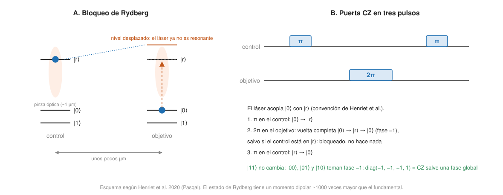

## Fundamentos {#layer-1}

**Qué son.** Un *qubit de átomo neutro (neutral-atom qubit)* es un átomo sin carga, por ejemplo de rubidio, sujeto por un haz láser muy enfocado, de aproximadamente 1 µm, llamado *pinza óptica (optical tweezer)*. Cada pinza retiene como mucho un átomo, y los dos estados del qubit son dos niveles electrónicos del átomo [@henriet-2020, pp. 4-5]. En el modo digital se usan los dos estados hiperfinos del estado fundamental (`F=1` y `F=2` en el rubidio), cuya vida es de decenas de años, de modo que no hay acoplamiento radiativo al entorno [@henriet-2020, p. 7].

**La imagen.** Piensa en un tablero de ajedrez hecho de luz, donde cada casilla sujeta un átomo con unas pinzas. Un holograma programable (un modulador espacial de luz) decide dónde hay pinzas; así se montan filas, mallas 2D o 3D [@henriet-2020, p. 5]. Como el tablero es de luz, los átomos se pueden mover cambiando las pinzas.

**Cómo entrelazan.** Dos átomos en estado fundamental, separados unos micrómetros, apenas interactúan. Para que lo hagan, se excita uno a un *estado de Rydberg (Rydberg state)*, un estado muy excitado cuyo momento dipolar es unas 1000 veces mayor [@henriet-2020, p. 10]. Entonces ocurre el *bloqueo de Rydberg (Rydberg blockade)*: si el primer átomo está excitado, la interacción desplaza el nivel del vecino y este ya no puede excitarse con el mismo láser [@henriet-2020, p. 10]. Es como un asiento para dos personas en el que, si una lo ocupa, la otra no cabe; de ese "condicional" sale la puerta de dos qubits.

**Qué las hace distintas.**

- *Qubits idénticos por naturaleza:* son átomos, no circuitos fabricados (afirmación de los autores, de Pasqal) [@henriet-2020, p. 2].
- *Geometría reconfigurable:* el registro se reconstruye en cada ciclo y las posiciones pueden elegirse [@henriet-2020, p. 4; p. 6].
- *Muchos átomos:* hay matrices 2D con cientos de átomos y la mayor, según Saffman (2025), carga unos 6100 átomos de media en 12 000 sitios, con 2000 reordenados de forma determinista en patrones sin huecos [@saffman-2025, pp. 5-6].
- *Lentos:* un ciclo completo con carga y lectura duró unos 200 ms (5 Hz) en 2020 [@henriet-2020, p. 6; p. 12].

**Quién lo dice.** Tres de las fuentes principales de este concepto tienen autores ligados a empresas de átomos neutros: Henriet y colaboradores (Pasqal, 2020), Saffman (Infleqtion y la Universidad de Wisconsin, 2025) y Bluvstein y colaboradores (Harvard, MIT, NIST y QuEra, 2023) [@henriet-2020, nota de acceso; @saffman-2025, nota de acceso; @bluvstein-2024, nota de acceso]. Lo que cuentan es lo que informan sus propios grupos; se indica en el texto cuando conviene.

## Comprensión {#layer-2}

**Preparar un registro.** Una nube fría de ~10⁶ átomos en una trampa magneto-óptica se carga en las pinzas, pero la carga es aleatoria: solo ~50 % de las pinzas se llenan, y una imagen de fluorescencia indica cuáles [@henriet-2020, p. 5]. Un algoritmo (en una GPU externa, alimentado por una FPGA) calcula en decenas de ms los movimientos, y pinzas móviles dirigidas por deflectores acusto-ópticos (AOD) reordenan los átomos hasta formar un subregistro sin defectos, con éxito superior al 99 % (2020); un movimiento individual dura menos de 1 ms [@henriet-2020, pp. 6-7]. Para reordenar `N` átomos hace falta una imagen de ocupación en la que el error y la pérdida de átomos sean ambos inferiores a `1/N`; se ha logrado una fidelidad de ocupación de 0,99991 con pérdida de ~7·10⁻⁴ [@saffman-2025, p. 6].

**Dos modos de uso.**

- *Digital:* puertas con pulsos láser sobre átomos elegidos. Los autores citan como ventajas la universalidad y la compatibilidad entre dispositivos [@henriet-2020, pp. 2, 7].
- *Analógico:* los láseres realizan directamente un hamiltoniano y los átomos evolucionan bajo la ecuación de Schrödinger [@henriet-2020, pp. 2, 7]. Con un estado fundamental y uno de Rydberg se obtiene un hamiltoniano de Ising con un término de frecuencia de Rabi, otro de detuning y una interacción de van der Waals que cae como `1/r⁶`; con dos estados de Rydberg acoplados dipolarmente sale el modelo XY, con `1/r³` [@henriet-2020, pp. 13-14]. El bloqueo hace que el modo analógico resuelva de forma natural el conjunto independiente máximo en grafos de discos unitarios [@henriet-2020, p. 22]. Eso es un problema de [optimización](../../qiskit-programming/concepts/variational-algorithms.md) con la restricción dada por la física.

**La puerta CZ con bloqueo.** Tres pulsos: π sobre el control, 2π sobre el objetivo y π sobre el control. En la convención de Henriet et al., los láseres acoplan `|0⟩` con `|r⟩`: `|11⟩` no se ve afectado por ningún pulso; `|01⟩` y `|10⟩` adquieren una fase −1 porque uno de los átomos da una vuelta completa (2π); y en `|00⟩` el bloqueo impide el pulso del objetivo, mientras los dos pulsos π del control dan también −1. El resultado, `diag(−1, −1, −1, 1)`, es una CZ salvo una fase global; una CNOT es una CZ con Hadamards antes y después sobre el objetivo [@henriet-2020, Box 1, pp. 9-10]. Una puerta Toffoli necesita 7 pulsos nativamente (una CCZ con 5 pulsos más 2 Hadamards), frente a ≥6 CNOT y más de 30 pulsos [@henriet-2020, p. 12]. Las puertas de un qubit son pulsos Raman, con direccionamiento individual posible porque los átomos están a varios micrómetros y los láseres están enfocados [@henriet-2020, pp. 7-9]. Si necesitas repasar por qué una CZ y una CNOT son equivalentes, ver [puertas de dos qubits](../../qubits-and-circuits/concepts/two-qubit-gates.md).

**Cómo ha mejorado la fidelidad.** En 2020, la referencia citada para una puerta de dos qubits era F = 94,1 % (2018), con ~1 µm y ~1 µs [@henriet-2020, p. 11]. En 2025, Saffman informa de puertas Rydberg CZ con F > 99 % en cuatro elementos (87Rb, 133Cs, 88Sr, 171Yb), con el mejor valor de 0,9971(5) en estroncio, y de rotaciones de un qubit con F > 0,9999 (globales con microondas) y > 0,999 (por sitio) [@saffman-2025, p. 5; p. 7; p. 9]. Las causas que cita Saffman son: átomos más fríos (los primeros experimentos superaban 50 µK; los recientes de alta fidelidad, menos de 10 µK), haces de Rydberg con perfil plano, menor ruido de fase del láser (sobre todo cerca de la frecuencia de Rabi) y pulsos óptimos en tiempo que minimizan el tiempo en estado de Rydberg [@saffman-2025, pp. 7-11]. Hay incluso una cota fundamental de infidelidad, `≈ 2/(V·τ_R)`, que para Cs 68p a 2,5 µm da unos 7,5·10⁻⁶; los mejores protocolos conocidos están entre un factor 2 y 19 de ella [@saffman-2025, pp. 10-11].

**Tres canales de error nuevos (HLL).** Además de los errores de puerta, los átomos añaden *calentamiento (heating)*, *fuga (leakage)* y *pérdida (loss)* [@saffman-2025, p. 21]. La pérdida viene de colisiones con gas residual, fotoionización desde estados de Rydberg y átomos que se alejan al estar en estados sin atrapar durante las puertas; con vacío criogénico se han alcanzado vidas de átomo individual de unos 6000 s [@saffman-2025, p. 22]. La fuga ocurre mucho con átomos porque tienen muchos niveles accesibles; una fuga detectada en un sitio conocido se convierte en un error de borrado, y el umbral de un código puede subir casi un orden de magnitud si los borrados dominan y están sesgados [@saffman-2025, pp. 21-22].

**Lectura y medida a mitad de circuito.** La lectura es por fluorescencia con una cámara EMCCD (|0⟩ brillante, |1⟩ oscuro), con una eficiencia de detección superior al 98,6 % citada en 2020 [@henriet-2020, p. 6]. La imagen en espacio libre tarda órdenes de magnitud más que una puerta, y medidas de alta fidelidad muy por debajo del umbral del código de superficie requieren al menos unos milisegundos [@saffman-2025, p. 17; p. 21]. Medir una ancilla por fluorescencia perturba a los átomos de datos vecinos, que son absorbentes resonantes a pocas longitudes de onda; las soluciones son mover la ancilla a una zona de lectura, esconder los datos (con errores añadidos), usar cavidades o usar dos especies [@saffman-2025, pp. 18-19]. En el experimento de Harvard/QuEra (2023), los átomos seleccionados se movían unos 100 µm a una zona de lectura donde una imagen de 500 µs daba una fidelidad de ~99,8 %, perturbando a los demás con una probabilidad de ~10⁻³ [@bluvstein-2024, Fig. 1c, p. 2].

**Conectividad.** Hay dos herramientas: interacciones de largo alcance por bloqueo, y transporte físico de átomos [@saffman-2025, abstract, p. 2]. Las puertas pueden actuar entre átomos distantes dentro del radio de bloqueo; en una simulación de enrutado de los autores de Pasqal (48 qubits, promedio de 64 circuitos aleatorios) la sobrecarga de puertas es de 5 a 10 veces menor que con conectividad de vecinos [@henriet-2020, Fig. 8, pp. 11-12]. Con el transporte, los AOD multiplexan en frecuencia y dan una rejilla de luz programable con una sola forma de onda por eje [@bluvstein-2024, p. 2]. El movimiento está limitado por el calentamiento: perfiles de mínimo "jerk" son mejores y el tiempo de movimiento escala como `distancia^(1/3)` [@saffman-2025, pp. 15-16]. Las pinzas necesitan pocas señales de control, a diferencia del transporte de iones, que requiere muchos electrodos y además calienta a los iones [@saffman-2025, p. 15].

**Un caso: qubits lógicos con átomos (2023).** Bluvstein y colaboradores (algunos de QuEra; los resultados son suyos) usan una arquitectura de tres zonas (almacenamiento, entrelazamiento y lectura) y hasta 280 átomos de 87Rb [@bluvstein-2024, pp. 1-2; p. 5]. El detalle de lo que demuestran y de lo que *no* (corrección frente a detección de errores) está en [experimentos con qubits lógicos](../../error-correction/concepts/logical-qubit-experiments.md) y en la sección profesional de aquí.

**Errores frecuentes.**

- *"Es una tecnología nueva sin física detrás."* Las pinzas ópticas y el bloqueo se propusieron hace décadas: la propuesta del bloqueo es de Jaksch y colaboradores (2000) [@henriet-2020, p. 10]. Saffman habla de 25 años desde la propuesta de Lukin (2001) [@saffman-2025, pp. 7-8].
- *"Los átomos son perfectamente idénticos, así que no hay variación."* Lo dicen los autores de Pasqal como ventaja frente a circuitos fabricados [@henriet-2020, p. 2]; pero los átomos añaden calentamiento, fuga y pérdida (arriba) [@saffman-2025, p. 21]. Es una afirmación de un fabricante.
- *"La coherencia larga vale para todo."* La vida del estado fundamental es larga; el estado de Rydberg donde se hace la puerta no [@henriet-2020, p. 7; @saffman-2025, pp. 10-11].

## Profesional {#layer-3}

**Qué es distinto para el programador.**

1. **El coste de una puerta es de movimiento y de láser, no de SWAP.** Con la arquitectura zonada, una puerta de dos qubits entre pares arbitrarios implica mover átomos con AOD; un pulso global de Rydberg en la zona de entrelazamiento hace una CNOT en todos los pares gemelos a la vez [@bluvstein-2024, pp. 2-3]. Eso da paralelismo gratis, pero el tiempo de ciclo lo pone el transporte (ver abajo).
2. **El tiempo.** En el análisis de Saffman (cálculo suyo, no medida) sobre un código de superficie de distancia 10 con 100 qubits lógicos: la puerta CZ lógica transversal con puertas Rydberg de largo alcance explorando secuencialmente tarda unos 90 µs, la basada en transporte (mover 64 µm con 0,1 cuantos de calentamiento) unos 270 µs (promediando sobre una matriz lógica de 10×10, unos 490 µs, o unos 530 µs con una zona común de entrelazamiento), y concluye que el ciclo de 100 qubits lógicos es de ~1 kHz en el mejor caso; la cirugía de red no compite porque la medida (ms) domina [@saffman-2025, pp. 12-18]. Eisert y Preskill resumen que los sistemas de Rydberg tienen un tiempo de ciclo lógico de órdenes de magnitud más que los superconductores por el movimiento y la lectura lentos [@eisert-2025, Sec. III, p. 4]; el ciclo del código de superficie de Google era de 1,1 µs [@google-2025, p. 5].
3. **El qubit por átomo "cuesta" láser.** Con ~1 mW de luz de trampa por sitio, 10⁶ sitios necesitarían ~1 kW, y los retos son la gestión térmica y la luz dispersa en la óptica de alta resolución [@saffman-2025, p. 6]. El número de qubits está limitado por la potencia del láser de atrapamiento y por la vida del átomo en la trampa a unos pocos miles [@henriet-2020, p. 15].
4. **Tasa de repetición.** Si tu algoritmo necesita muchas ejecuciones, 5 Hz (2020) es un obstáculo; los autores de Pasqal esperaban unas 10 veces más [@henriet-2020, p. 12; p. 15]. La velocidad actual no consta en las fuentes consultadas.

**Qubits lógicos con átomos: lo que se demostró y su letra pequeña.** Del trabajo de Bluvstein y colaboradores (Nature, 2024; versión preprint de diciembre de 2023; autores de Harvard, MIT, NIST/UMD y QuEra):

- *Resultados titulares:* la puerta CNOT lógica de código de superficie mejora de distancia 3 a 7 (26, 74 y 146 átomos por par de Bell); qubits de código de color preparados con fidelidad por encima del punto de equilibrio; GHZ lógico tolerante a fallos y teleportación con realimentación; 40 códigos de color en 280 átomos; circuitos de muestreo con bloques `[[8,3,2]]` de hasta 48 qubits lógicos, 228 puertas lógicas de dos qubits y 48 CCZ lógicas [@bluvstein-2024, abstract, p. 1; pp. 3-7].
- *Letra pequeña que hay que decir:* los resultados titulares de GHZ y XEB dependen de **detección de errores con poselección**, no de corrección completa. La fidelidad del GHZ lógico tolerante a fallos es del 72(2) % con decodificación correlacionada y sube al 99,85 % al poseleccionar sobre todos los estabilizadores lógicos, descartando datos; descartando ~50 % de los datos se llega a ~90 % [@bluvstein-2024, p. 4, Fig. 3]. El XEB lógico de 12 qubits pasa de 0,156(2) en bruto a 0,616(7) con detección completa de errores, y es de unos 0,1 con 48 qubits lógicos [@bluvstein-2024, p. 7]. La preparación del estado no es tolerante a fallos más allá de distancia 3, y el resultado de código de superficie usa una sola ronda de medida de estabilizadores; los propios autores dicen que el umbral real con síndrome repetido ruidoso será algo menor [@bluvstein-2024, pp. 3-4, 8].
- *Qué piensan otros:* Eisert y Preskill señalan que los demostradores atómicos de tolerancia a fallos tienen pocas rondas de síndrome y que la poselección descarta las ejecuciones con errores detectados, lo que no escalará [@eisert-2025, Sec. III, p. 4].
- *Lo que dicen los propios autores que falta:* corrección de errores repetida, reposición de átomos y reducir el error de espera en almacenamiento (~1 % de decoherencia lógica por ciclo extra de codificación) [@bluvstein-2024, p. 5; p. 8]. Y las puertas de dos qubits deberían bajar al 0,1 % para mejorar la eficiencia [@bluvstein-2024, p. 8].
- Para hardware: el número crítico "99,5 %" de puerta de dos qubits está citado de trabajo previo del grupo, no medido ahí [@bluvstein-2024, p. 4].

Ver [puertas tolerantes a fallos y estados mágicos](../../error-correction/concepts/fault-tolerant-gates.md) para las puertas transversales y [decodificación](../../error-correction/concepts/decoding.md) para la decodificación correlacionada.

**Cuándo elegir átomos neutros (criterio propio a partir de lo anterior).**

- *A favor:* registros grandes (cientos o miles), simulación analógica de modelos de espín y de problemas como el conjunto independiente máximo, conectividad flexible por transporte, puertas multiqubit nativas y experimentos de qubits lógicos con puertas transversales [@saffman-2025, pp. 5-6; @henriet-2020, pp. 12-13, 22; @bluvstein-2024, pp. 2-5].
- *En contra:* ciclo y medida lentos, pérdida de átomos, y cifras de puerta de dos qubits que en 2025 son mucho mejores que en 2020 pero siguen por debajo del 99,9 % (el mejor valor citado es 0,9971) [@saffman-2025, p. 5; p. 9].
- *Una frase de los autores de Pasqal que conviene leer con cuidado:* sostienen que la fidelidad o el volumen cuántico no siempre son el mejor criterio para un procesador de tarea específica [@henriet-2020, p. 22]. Puede ser cierto para el modo analógico, pero es una afirmación de un fabricante; pide el criterio concreto con el que mide.

**Cómo leer un anuncio de átomos neutros.**

1. *¿Átomos cargados, reordenados, o usados?* La cifra de Saffman (2025) distingue 6100 de media cargados en 12 000 sitios y 2000 reordenados; un titular de "miles de qubits" puede referirse a lo primero [@saffman-2025, pp. 5-6].
2. *¿Qué fidelidad y de qué puerta?* Fidelidad de CZ en el mejor par frente a promedio, o de un elemento (Sr, Yb) frente a rubidio; la cifra de 99,5 % de Harvard/QuEra se cita de otro trabajo [@saffman-2025, p. 9; @bluvstein-2024, p. 4].
3. *¿Cuánto tarda un ciclo y la medida?* Un ciclo de ms y una medida de ms ponen un techo a cuántas rondas de corrección caben [@saffman-2025, p. 17; p. 21].
4. *¿Hay poselección?* Si la mejora desaparece sin descartar datos, no es todavía corrección de errores [@bluvstein-2024, pp. 4, 6-7; @eisert-2025, Sec. III, p. 4].
5. *¿Es analógico o digital?* Un procesador analógico con cientos de átomos que los autores consideran más allá de la simulación clásica no es lo mismo que un procesador digital, que es el modo que los autores presentan como universal [@henriet-2020, pp. 2, 7, 13].
6. *¿Quién firma?* Pasqal, Infleqtion y QuEra son fabricantes; las cifras son de sus grupos (ver [comparativa](hardware-landscape.md)).

**Por qué la comunidad la sigue de cerca.** Eisert y Preskill señalan que los átomos de Rydberg no se veían hace unos años como una opción tan prometedora y ahora lideran las primeras demostraciones de tolerancia a fallos tempranas [@eisert-2025, Sec. III, p. 5]. Saffman estima que las cifras de la plataforma permitirán un objetivo "megaquop" con un código de superficie de distancia 10 y unos 19 900 qubits físicos más sobrecarga de estados mágicos para 100 qubits lógicos con error físico de 0,0008 (cálculo suyo) [@saffman-2025, p. 12]. Para las repercusiones en recursos, ver [estimación de recursos](../../error-correction/concepts/resource-estimation.md).
