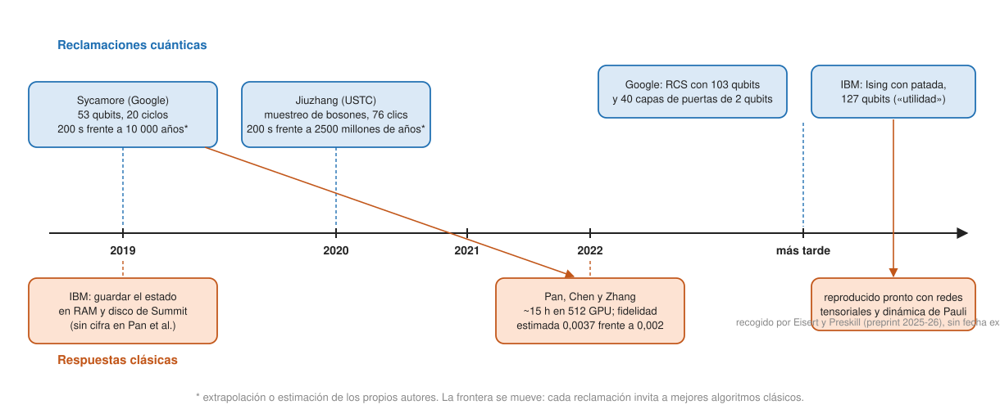

## Comprensión {#layer-2}

**Qué se intenta demostrar.** Un *experimento de ventaja cuántica (quantum advantage experiment)* busca una tarea que un dispositivo cuántico real hace y que ningún ordenador clásico puede hacer en un tiempo razonable. Preskill acuñó *supremacía cuántica (quantum supremacy)* para una tarea que un dispositivo cuántico puede hacer y ningún dispositivo clásico existente o fácilmente previsible, sea o no útil; una *ventaja (quantum speedup)* suele significar vencer al mejor hardware clásico con el mejor algoritmo clásico, y como los ordenadores clásicos siguen mejorando, lo cuántico persigue un objetivo móvil [@preskill-2018, §6, p. 7]. Zhong y colaboradores (USTC) prefieren "ventaja computacional cuántica": una aceleración tan grande que ningún ordenador clásico podría hacer la tarea en un tiempo razonable y es improbable que mejoras clásicas la deshagan [@zhong-2020, p. 2]. Los autores de Google piden además una tarea bien definida, un dispositivo programable y una brecha de tiempo que crezca con el tamaño del problema, y aceptan que la referencia clásica es una diana móvil [@arute-2019, XI, pp. 59-60].

Por qué se usan *tareas de muestreo*: ejecutar Shor requiere una máquina tolerante a fallos, un objetivo a largo plazo, mientras que el muestreo se puede hacer con dispositivos ruidosos de [la era NISQ](../../qiskit-programming/concepts/nisq-era.md) [@zhong-2020, p. 2; @kjaergaard-2020, §3, p. 10]. Su base teórica es de [complejidad](../../quantum-algorithms/concepts/quantum-complexity.md): la dureza del muestreo se apoya en suposiciones de complejidad ampliamente creídas, pero los resultados son asintóticos y exigen cercanía estricta de las distribuciones [@eisert-2025, Box 3, p. 7].

### Caso 1: Sycamore (Google, 2019; autores de Google)

**La tarea.** *Muestreo de circuitos aleatorios (random circuit sampling, RCS)*: se ejecuta un circuito aleatorio de `n` qubits y `m` ciclos y se muestrean cadenas de bits de la salida. Cada ciclo es una puerta aleatoria de un qubit por qubit (de `√X, √Y, √W`) seguida de una capa de puertas de dos qubits fijadas por el par y el ciclo [@arute-2019, VII A, C, pp. 27-28]. El circuito de la ventaja usó `n = 53` y `m = 20`, con 1113 puertas de un qubit y 430 de dos [@arute-2019, VII C, E, pp. 27-28]. La puerta de dos qubits es `fSim(θ ≈ π/2, φ ≈ π/6)`, que surge de forma natural de la interacción del transmon y es más difícil de simular que una CZ [@arute-2019, VI C 1, pp. 15-16; VII E, p. 28]. Detalles del hardware en [qubits superconductores](superconducting-qubits.md).

**Cómo se comprueba: XEB.** No se puede verificar la distribución completa de más de 2⁵⁰ salidas, así que se usa un proxy [@arute-2019, XI B, pp. 61-62]. El *benchmarking de entropía cruzada lineal (linear cross-entropy benchmarking, XEB)* simula clásicamente la probabilidad ideal `p_s(q)` de cada cadena medida y promedia `D·p_s(q) − 1` (con `D = 2ⁿ`); da 0 para cadenas uniformes aleatorias y 1 para muestreo ideal [@arute-2019, IV, pp. 5-9]. Se basa en que las probabilidades de salida de un circuito aleatorio siguen una distribución de Porter-Thomas ("speckle"), que los errores aplanan [@arute-2019, IV B, p. 8]. Como XEB necesita simular el circuito, no se puede aplicar a los más difíciles; la fidelidad de estos se estima desde circuitos más fáciles ("de parche", "elididos" y completos de hasta ~43 qubits) y se comprueba que concuerdan en torno al 5 % [@arute-2019, VII G, p. 30-31; VIII A-C, pp. 32-34].

**Resultado.** La fidelidad XEB media de diez circuitos de 53 qubits y 20 ciclos fue de `(2,24 ± 0,18 ± 0,10)·10⁻³`, es decir, un ~0,2 %, con unos 3 millones de cadenas muestreadas por circuito; la hipótesis nula `F ≤ 10⁻³` se rechaza a 6 sigmas [@arute-2019, VIII F-I, pp. 38-42]. La adquisición de un millón de muestras tardó unos 200 s [@arute-2019, X H, p. 59]. El 99,8 % de lo que sale es, por tanto, ruido, y la señal está en esa fracción mínima.

**La estimación clásica: 10 000 años.** Con un método de Schrödinger-Feynman (`qsimh`), extrapolado a 10⁶ núcleos a partir de 1000 caminos de muestra de ~246 s cada uno, el coste de muestrear a esa fidelidad crece con los ciclos: 2 horas con 12 ciclos (`F` = 1,4 %), 2 semanas con 14, ~4 años con 16, ~175 años con 18 y ~10 000 años con 20 (`F` = 0,2 %). El propio documento aclara que **la cifra de 10 000 años es una extrapolación de los autores**, no una ejecución medida [@arute-2019, X F, Tabla XI, pp. 56-57]. El coste clásico escala aproximadamente como `1/F` porque solo se suma una fracción `F` de los caminos de Feynman, y bajo supuestos de complejidad (ruido blanco global) esa escala lineal sería esencialmente óptima [@arute-2019, X D, pp. 50-53; XI, pp. 61-62]. La revisión de Kjaergaard (2019-20) presenta un rango en vez de un número: la brecha depende de las suposiciones clásicas, de unos tres a nueve órdenes de magnitud [@kjaergaard-2020, §3.1, p. 11].

### Caso 2: la respuesta clásica (Pan y colaboradores, 2022; académicos)

El grupo del Instituto de Física Teórica de la Academia China de Ciencias (no son de un fabricante) señaló que la cifra de 10 000 años descansa en un método concreto, no en una cota inferior para todos los algoritmos [@pan-2022, p. 1]. IBM ya había estimado que se podía almacenar todo el vector de estado de 53 qubits usando toda la RAM y los discos de Summit, algo que Pan y colaboradores califican de poco realista [@pan-2022, p. 1]. Su método trata el circuito como una red tensorial y cambia fidelidad por coste "agujereando" aristas: romper `K` aristas elimina `K/2` puertas de dos qubits y reduce la fidelidad en torno a `2⁻ᴷ` [@pan-2022, pp. 2-3]. Con `K = 8` y 21 aproximaciones adicionales (un factor `2⁻⁸ × 0,9565`), la fidelidad estimada es ~0,0037 [@pan-2022, p. 3]. Resultados [@pan-2022, p. 4]:

- Unos 10⁶ (2²⁰) cadenas independientes, a partir de 2²⁶ amplitudes calculadas.
- 2¹⁶ subtareas de ~427 s cada una, unas 15 horas en 512 GPU V100.
- Una fidelidad estimada de 0,0037 frente a los 0,002 de Google.

Lo que **no** significa: (1) la fidelidad de 0,0037 se estima analíticamente, **no** se mide con XEB sobre las muestras de 53 qubits, porque verificarlas costaría demasiado; se valida con circuitos más pequeños (30, 38 y 45 qubits, 14 ciclos) donde sí se pueden almacenar los estados exactos [@pan-2022, Supp., pp. 12-15]; (2) la frase "más rápido que el hardware de Google" es una **extrapolación**: unas 2,79·10¹⁹ operaciones en coma flotante que, en una máquina de exaflops ideal y eficiente, tardarían "unas pocas decenas de segundos"; no se ha ejecutado [@pan-2022, p. 4]; (3) los propios autores no presentan su trabajo como una refutación general de la ventaja cuántica, sino como la resolución clásica del problema de muestreo tal como está definido [@pan-2022, pp. 1-2, 4]. Citan además el procesador de 60 qubits y 24 ciclos Zuchongzhi, que su trabajo no trata [@pan-2022, p. 1].

**Una cuenta rápida** (cálculo propio, aproximado): 10 000 años son unos 3,2·10¹¹ s, que dividido por 200 s da una brecha de ~1,6·10⁹; 15 horas son 5,4·10⁴ s, que dividido por 200 s da ~270. La brecha, tal como la presentaba cada una de las dos partes, pasó de unas 10⁹ veces a unas 10² veces; con salvedades: las muestras, la fidelidad y el tipo de máquina no son idénticos.

### Caso 3: Jiuzhang (USTC, 2020; autores del experimento)

**Una tarea distinta.** *Muestreo de bosones gaussianos (Gaussian boson sampling, GBS)*: se envían estados de luz comprimida (que se pueden preparar de forma determinista) a un interferómetro de `m` modos y se muestrea con detectores de umbral. La distribución de salida está ligada al torontoniano, una función matricial #P-difícil [@zhong-2020, p. 3]. Los autores informan de hasta 76 clics en la salida, una dimensión del espacio de estados de ~10³⁰ y un muestreo ~10¹⁴ veces más rápido que la simulación en los supercomputadores más avanzados; estiman que Sunway TaihuLight tardaría ~8·10¹⁶ s (2500 millones de años) en generar las muestras que obtuvieron en 200 s, y Fugaku ~2·10¹⁶ s [@zhong-2020, p. 1; p. 9]. Es una máquina de **propósito especial**: ejecuta un único interferómetro fijo [@zhong-2020, p. 10]; hardware en [qubits fotónicos](photonic-qubits.md).

**Sobre la discusión de Sycamore.** Los autores señalan que la ventaja de Sycamore depende del tamaño de muestra: si se pidieran ~10¹⁰ muestras, la ventaja se invertiría, y lo comparan con los resquicios en los tests de Bell; dicen que las ventajas se juzgan en una competición larga entre simulación clásica y dispositivos, y que el muestreo de bosones evita ese resquicio [@zhong-2020, p. 2].

**Validación.** La salida completa de GBS grande no se puede certificar (se conjetura intratable); los métodos de validación se vuelven intratables por encima de ~30 clics. Los autores reúnen evidencia circunstancial descartando hipótesis alternativas (estados térmicos, fotones distinguibles, muestreo uniforme) y una versión revisada extendió la validación a 40 clics [@zhong-2020, pp. 7-9; p. 10]. Invitan a mejorar los algoritmos clásicos y argumentan por qué ciertas aceleraciones conocidas no se aplican [@zhong-2020, pp. 9-10]. Las notas no incluyen refutaciones clásicas posteriores de GBS; sin ellas no se puede decir cómo ha evolucionado esa cifra de 10¹⁴.

### Caso 4: y después

Eisert y Preskill (preprint de perspectiva, versión de mayo de 2026, **no revisado por pares** según el texto leído) resumen la situación: el muestreo de circuitos aleatorios "ha ido arguably más allá de la simulación clásica" con circuitos superconductores de más de 100 qubits y más de 40 capas de puertas de dos qubits, circuitos no locales de iones con más de 50 qubits y más de 10 capas, y una reclamación de muestreo clásicamente difícil para circuitos lógicos poseleccionados en átomos neutros [@eisert-2025, Sec. IV, p. 6]. Citan una señal de RCS con 103 qubits y 40 capas en el procesador Willow de Google [@eisert-2025, Sec. II, p. 2]. Lo califican de hito científico importante pero de utilidad práctica limitada, salvo como benchmark del rendimiento de la máquina [@eisert-2025, Sec. IV, p. 6; Box 3, p. 7]. Y recuerdan que los intentos de validar la dureza clásica del RCS han producido grandes mejoras en los métodos de simulación clásica [@eisert-2025, Box 3, p. 7]. Esos tres resultados son de los autores de cada experimento. Los autores de Quantinuum, con el H2 de 32 qubits, y de Harvard/QuEra, con sus 48 qubits lógicos, **no reclaman ventaja**: los de Quantinuum lo dicen expresamente (32 qubits está dentro de lo simulable clásicamente) [@moses-2023, §IV C, p. 9], y los de Harvard/QuEra describen sus circuitos como cercanos al límite de la simulación exacta y adecuados para explorarla [@bluvstein-2024, pp. 7-8]. Moses y colaboradores señalan además que el RCS no es un benchmark escalable, porque necesita cálculo clásico exponencial en `N`, y que a error de puerta fijo no es un camino escalable a la supremacía para `N` grande [@moses-2023, §IV C, p. 9].

**Otros casos de ida y vuelta.** El experimento de IBM de 127 qubits de Ising con patada, presentado primero como "utilidad cuántica", fue reproducido pronto con métodos clásicos de redes tensoriales y de dinámica de Pauli dispersa; y una simulación de enfriamiento brusco de un vidrio de espín en un D-Wave, presentada como inalcanzable, fue reproducida en parte con redes tensoriales [@eisert-2025, Sec. V, p. 8]. La comparación justa es sutil: las simulaciones clásicas están limitadas en tamaño y las cuánticas en exactitud, y de una simulación clásica se puede extraer más información que de una salida cuántica [@eisert-2025, Sec. V, p. 8]. Más sobre ese experimento en [era NISQ](../../qiskit-programming/concepts/nisq-era.md).

**Errores frecuentes.**

- *"Los 10 000 años se refutaron, así que no hay ventaja."* Pan y colaboradores resuelven el problema de muestreo como está definido, con una estimación analítica de fidelidad y una extrapolación; no es una refutación general [@pan-2022, pp. 1-2, 4]. Y Eisert y Preskill sostienen que hoy el RCS está arguably más allá de la simulación clásica en circuitos mayores [@eisert-2025, Sec. IV, p. 6].
- *"Hubo ventaja, así que ya sirven para algo."* El RCS carece de aplicación más allá de ser benchmark [@eisert-2025, Sec. IV, p. 6]. Eisert y Preskill piden que una aplicación cumpla tres criterios (algoritmo cuántico eficiente con recursos alcanzables, dureza clásica convincente y una respuesta útil) y dicen que el RCS solo cumple el segundo en un sentido estrecho [@eisert-2025, Sec. I, p. 1].
- *"La fidelidad XEB es la fidelidad del cálculo."* Es un proxy; hay trabajos que muestran XEB alto con fidelidad real baja [@pan-2022, p. 1].
- *"Cuantas más muestras, más ventaja."* Zhong y colaboradores señalan lo contrario para RCS: depende del tamaño de muestra [@zhong-2020, p. 2].

## Profesional {#layer-3}

### Una lista para evaluar un anuncio de ventaja

Con el patrón de los casos anteriores, estas preguntas sirven para casi cualquier reclamación. Cada una se apoya en algo concreto de las fuentes:

1. **¿Cuál es la tarea y se puede verificar la salida?** Shor se verifica fácilmente; la salida de GBS grande se conjetura intratable de certificar [@zhong-2020, pp. 7-8], y el RCS se verifica por proxy [@arute-2019, XI B, pp. 61-62].
2. **¿A qué fidelidad se hizo y se compara la referencia clásica a esa fidelidad?** El coste clásico escala ~`1/F` [@arute-2019, X D, pp. 50-53]. Pan y colaboradores ganan porque comparan a fidelidad igual o superior (0,0037 frente a 0,002) [@pan-2022, p. 2].
3. **¿La cifra clásica es medida o extrapolada?** Los 10 000 años son extrapolación [@arute-2019, Tabla XI, p. 57]; los 2500 millones de años de Jiuzhang son una estimación a partir de benchmarks de un torontoniano [@zhong-2020, p. 9]; la ejecución de Pan tuvo 15 horas medidas en GPU y una extrapolación "en exaflops" que no se corrió [@pan-2022, p. 4].
4. **¿Qué algoritmos clásicos y qué hardware se probaron?** La referencia clásica es una diana móvil [@preskill-2018, §6, p. 7; @arute-2019, XI, p. 60]. Arute y colaboradores probaron Schrödinger-Feynman, qFlex sobre Summit (12 ciclos: 1,29 h; 14 ciclos: ~68 días estimados) y eliminación de variables [@arute-2019, X B, E, pp. 45-46, 54-56]; Pan y colaboradores añadieron contracción de redes con muestras no correlacionadas.
5. **¿La brecha depende del tamaño de la muestra?** Zhong y colaboradores argumentan que sí para el RCS de Sycamore [@zhong-2020, p. 2].
6. **¿Crece la brecha con el tamaño del problema?** Es parte de la definición de Google [@arute-2019, XI, pp. 59-60]; Moses y colaboradores citan que a error de puerta fijo el RCS no escala a `N` grande [@moses-2023, §IV C, p. 9].
7. **¿La estructura del circuito se puede explotar?** Google eligió una fSim con descomposición de rango 4 y plana, más difícil que una CZ de rango 2, y patrones de acopladores sin "cuñas" [@pan-2022, p. 3; @arute-2019, VII G 2, p. 31]. Pan explotó la estructura de bajo rango [@pan-2022, p. 3].
8. **¿Se usa poselección o detección de errores?** En los resultados lógicos de átomos neutros, la poselección mejora los números pero no escala [@bluvstein-2024, pp. 4, 6-7; @eisert-2025, Sec. III, p. 4].
9. **¿Es útil la respuesta?** Los tres criterios de Eisert y Preskill [@eisert-2025, Sec. I, p. 1]; y el reconocimiento de que los algoritmos variacionales no tienen ventaja firmemente establecida por mesetas áridas y mínimos locales [@eisert-2025, Sec. IV, p. 6; Box 3, p. 7].
10. **¿Quién firma y en qué estado está?** Google (Arute, y Google Quantum AI), USTC (Zhong), PsiQuantum y Quantinuum son fabricantes o los propios grupos del experimento; Pan es un grupo académico independiente de los anteriores; Eisert y Preskill es un preprint (Preskill está afiliado a AWS; Eisert es independiente de Google) [@eisert-2025, nota de acceso].

### Un ejercicio: estimar qué fidelidad esperar antes de creer el titular

Con la regla del producto de fidelidades (ver [coherencia y fidelidad](coherence-and-fidelity.md#layer-3)) se puede comprobar si una fidelidad XEB declarada es plausible. Para Sycamore, `0,9986¹¹¹³ × 0,994⁴³⁰ × 0,965⁵³ ≈ 0,0024`, frente a `(2,24 ± 0,18 ± 0,10)·10⁻³` medido [@arute-2019, Tabla II, p. 22; VIII G-I, pp. 39-41] (cálculo propio con medianas). Saffman expresa la misma idea como `exp(−ε·V_eff)`, con `ε` la infidelidad de dos qubits y `V_eff` aproximadamente el número de puertas de dos qubits, y concluye que lo que sube el coste de simulación clásica es la fidelidad, no el número de qubits; los experimentos de "utilidad" usan `n` ≈ 100 y `ε` ≈ 0,001 [@saffman-2025, pp. 3-4]. Si una nota de prensa promete cientos de qubits con puertas de error del 1 %, la cuenta de arriba dice cuánto de la salida es señal.

### Cómo cambia la lección con la corrección de errores

El horizonte que describen Eisert y Preskill es pasar de máquinas NISQ, que ejecutan menos de ~10⁴ operaciones de dos qubits, a máquinas tolerantes a fallos de escala de aplicación (*FASQ*), que pueden necesitar ~10¹² (un "teraquop"), pasando por los regímenes "megaquop" (~10⁶) y "gigaquop" (~10⁹) [@eisert-2025, Sec. I, p. 2]. Sin corrección de errores, el coste de muestreo del ruido crece exponencialmente con el volumen del circuito [@eisert-2025, Sec. II, p. 2]. Por eso la próxima generación de reclamaciones es de ventaja con **qubits lógicos**; Bluvstein y colaboradores sugieren que sus circuitos de 48 qubits lógicos, cerca del límite de simulación exacta (unos 2 s por probabilidad de una cadena), son adecuados para explorar ventaja con corrección de errores [@bluvstein-2024, pp. 7-8]. Para lo que eso exige, ver [experimentos con qubits lógicos](../../error-correction/concepts/logical-qubit-experiments.md).

Eisert y Preskill dicen que una ventaja próxima creíble es más plausible en dinámica fuera del equilibrio que en problemas de estado fundamental, y que demostrarla para sistemas físicamente relevantes sigue abierto [@eisert-2025, Box 4, p. 9]. Dicen también que, con mitigación de errores, circuitos de 10 000 o más puertas podrían alcanzarse pronto sin mejora de hardware [@eisert-2025, Sec. II, p. 3]; ver [mitigación de errores](../../qiskit-programming/concepts/error-mitigation.md).

### Señales de alarma

- Una cifra de años o de "veces más rápido" sin decir quién la calculó, con qué algoritmo y a qué fidelidad.
- Una ventaja que desaparece al cambiar el número de muestras.
- La verificación de la salida solo por el propio proxy.
- Un benchmark que el dispositivo ha visto antes de la evaluación o un circuito elegido para que el fabricante lo supere.
- Una brecha en un régimen que ya no se puede comprobar clásicamente, sin un camino de validación escalonado (como los circuitos "de parche" de Google) [@arute-2019, VIII A-C, pp. 32-34].
- Una "ventaja" en un problema sin aplicación presentada como utilidad.
- No distinguir entre ventaja en el muestreo y ventaja en una tarea útil (Shor, simulación): ver [algoritmo de Shor](../../quantum-algorithms/concepts/shor-algorithm.md) y [simulación de hamiltonianos](../../quantum-algorithms/concepts/hamiltonian-simulation.md).

La lección que dejan 2019-2026 no es ni "ventaja confirmada" ni "ventaja refutada": es que las reclamaciones cuánticas y las simulaciones clásicas **se persiguen mutuamente**, y que para juzgar una hay que mirar la fidelidad, la referencia clásica y la verificación. Para el panorama por plataformas, ver la [comparativa](hardware-landscape.md).
