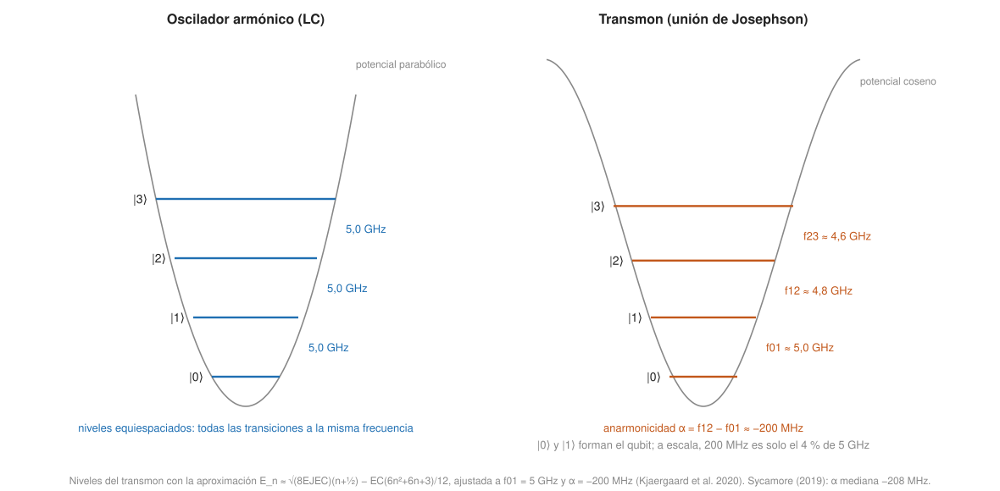

## Fundamentos {#layer-1}

### Idea clave
Un *qubit superconductor (superconducting qubit)* es un pequeño circuito eléctrico fabricado con litografía sobre un chip y enfriado a unos 10-20 milikelvin, que se comporta como un átomo artificial. Es la tecnología de las puertas más rápidas, a cambio de coherencia moderada y mucho cableado [@kjaergaard-2020, §2, pp. 3-4; @krantz-2019, p. 2; p. 14].

### Explicación
Se llaman "artificiales" porque sus niveles de energía no vienen dados por la naturaleza, como en un átomo, sino por el diseño del circuito [@krantz-2019, p. 2]. El qubit son los dos niveles de energía más bajos de ese circuito, y el chip se fabrica sobre silicio o zafiro [@kjaergaard-2020, §2.1, pp. 4-5].

Hace falta un componente especial porque un circuito LC (bobina y condensador) es un oscilador armónico: sus niveles de energía están igualmente espaciados, como los peldaños de una escalera regular. Un pulso a esa frecuencia sube por todos los peldaños y no se puede aislar un par de niveles como qubit [@krantz-2019, pp. 4-5; @kjaergaard-2020, §2.1, pp. 4-5]. La solución es la *unión Josephson (Josephson junction)*, dos superconductores separados por un aislante muy fino, que se comporta como una bobina sin pérdidas y no lineal; hace que los peldaños dejen de ser iguales y que cada transición pueda direccionarse por separado [@kjaergaard-2020, p. 4 recuadro; §2.1, pp. 4-5; @krantz-2019, p. 5].

El tipo más extendido para computación basada en puertas es el *transmon* [@kjaergaard-2020, §2.1.1, p. 7]. Es un circuito de una unión Josephson con un condensador grande en paralelo; su frecuencia típica está en 3-6 GHz y su anarmonicidad (la diferencia entre transiciones) es de unos 100-300 MHz, con signo negativo [@krantz-2019, p. 6]. Se controla con pulsos de microondas a la frecuencia del qubit [@krantz-2019, pp. 28-29]. El chip lleva también resonadores que sirven para leer y para acoplar qubits [@kjaergaard-2020, §2.3, p. 9].

Con esas cifras de 2019-2020, el perfil de la tecnología es este:

- *Puertas rápidas:* las de dos qubits duran decenas de nanosegundos (43 ns en un experimento de 2014; 12 ns en Sycamore) [@krantz-2019, p. 35; @kjaergaard-2020, §2.2, p. 8; @arute-2019, VI C 1, p. 15].
- *Coherencia moderada:* los transmons tenían tiempos de 50-100 µs a finales de 2010 [@kjaergaard-2020, §2.1.1, pp. 5-6].
- *Exigen frío y cables:* cada qubit necesita líneas de control, y los chips van dentro de un refrigerador de dilución [@kjaergaard-2020, §2, pp. 3-4; @arute-2019, III A, p. 3].
- *Conectividad local:* en la mayoría de diseños, cada qubit habla solo con sus vecinos [@eisert-2025, Box 1, p. 3].

### Ejemplo
Los dispositivos de IBM Quantum que usas en Qiskit son procesadores superconductores de transmons dispuestos en una red de tipo "heavy-hex", de más de 100 qubits en su flota [@ibm-quantum-learning, "Running quantum circuits"]. El procesador Sycamore de Google (2019) tenía 53 transmons utilizables con 86 acopladores ajustables [@kjaergaard-2020, §3.1, p. 11; @arute-2019, II, p. 2].

### Para seguir
La capa 2 explica la física del transmon, cómo se hacen las puertas y la lectura, y de dónde sale la pérdida de coherencia. Para el lado del programador, ver [ejecutar en hardware real](../../qiskit-programming/concepts/running-on-hardware.md). Otra plataforma de capa 1 con la que contrastar son los [iones atrapados](trapped-ion-qubits.md).

## Comprensión {#layer-2}

### Idea clave
La anarmonicidad débil del transmon fija el compromiso entre velocidad y fuga; las puertas de dos qubits y la lectura son la parte difícil, y la coherencia se pierde sobre todo por defectos de materiales, cuasipartículas y ruido de flujo y de carga [@krantz-2019, pp. 5-6; pp. 16-19; @arute-2019, VI A-B, pp. 11-14].

### Explicación
El hamiltoniano de un circuito con una unión Josephson es `H = 4E_C n² − E_J cos φ`: el término cuadrático es el de un condensador (energía de carga `E_C`) y el coseno es la unión, que sustituye el potencial parabólico del oscilador armónico [@krantz-2019, p. 5, Eqs. 15-16]. Según el cociente `E_J/E_C` se obtienen distintos qubits:

- *Cuando `E_J ≤ E_C` (caja de pares de Cooper, qubit de carga):* gran anarmonicidad (>10 GHz) pero mucha sensibilidad al ruido de carga y variabilidad entre dispositivos [@krantz-2019, p. 5; @kjaergaard-2020, §2.1.1, p. 5].
- *Cuando `E_J ≫ E_C` (transmon, con `E_J/E_C ≥ 50`):* un condensador grande en paralelo hace pequeño `E_C`; la sensibilidad a la carga cae exponencialmente en `E_J/E_C` y la anarmonicidad solo cae como una potencia débil [@krantz-2019, pp. 5-6]. El precio es una anarmonicidad de solo ~−200 MHz sobre unos 5 GHz de frecuencia [@kjaergaard-2020, §2.1.1, pp. 5-6]. El transmon sigue siendo un oscilador débilmente anarmónico (de tipo Duffing): los niveles superiores existen físicamente [@krantz-2019, p. 6].

Esa anarmonicidad débil tiene consecuencias. Un pulso corto tiene un ancho de banda que puede excitar la transición 1→2, la *fuga (leakage)*, y producir errores de fase; la anarmonicidad limita lo corto que puede ser un pulso [@krantz-2019, p. 5; p. 30]. La técnica **DRAG** añade un pulso con forma de derivada en la otra cuadratura que reduce ambos errores [@krantz-2019, p. 30]. Ese compromiso entre velocidad y fuga es el que fija el tiempo de puerta (ver [coherencia y fidelidad](coherence-and-fidelity.md)).

Hay variantes que cambian el equilibrio:

- *Transmon ajustable (split transmon):* se sustituye la unión por un SQUID de dos uniones y la frecuencia se sintoniza con flujo magnético, a costa de sensibilidad al ruido de flujo, que es nula solo en los "puntos dulces" [@krantz-2019, p. 6]. Las uniones asimétricas reducen esa sensibilidad a cambio de menos rango, un buen trato porque basta con ~1 GHz [@krantz-2019, pp. 7, 22].
- *Qubit de flujo y fluxonium:* mayor anarmonicidad; el fluxonium ha superado los 100 µs y alcanzado T1 de milisegundos, pero necesita muchas uniones por qubit y en 2019-20 no se usaba en circuitos grandes [@krantz-2019, pp. 7-9; @kjaergaard-2020, pp. 7, 22]. Se cita como candidato a bajo error de dos qubits [@eisert-2025, Sec. III, p. 5].
- *Qubits de gato y bosónicos:* codifican el qubit en un resonador de larga vida controlado con un transmon [@kjaergaard-2020, §2.4, pp. 9-10]. Un qubit de gato (cat code) superó el punto de equilibrio (*break-even*) en 2016: su vida corregida fue mayor que la del mejor componente [@kjaergaard-2020, §4.3, p. 21]. Los qubits de gato (suprimen los errores de inversión de bit) y los de doble raíl (hacen detectables los errores dominantes) siguen siendo líneas activas [@eisert-2025, Sec. III, p. 5].

Para entrelazar, los transmons se acoplan por condensador (o por inductancia), de forma directa, por un resonador-bus o por un acoplador ajustable, que da un amplio rango y una relación encendido/apagado alta a costa de una línea de control más [@krantz-2019, pp. 9-11]. El acoplamiento transversal es el que se usa en la mayoría de las puertas [@krantz-2019, pp. 10-11]. Hay dos grandes familias de puerta de dos qubits:

1. *Con qubits ajustables en frecuencia:* iSWAP y CPHASE (CZ). El CZ lleva el estado `|11⟩` cerca del cruce evitado `|11⟩↔|20⟩` y usa un nivel superior del transmon; una estimación heurística da un tiempo mínimo de `2π/g ≈ 50 ns` con `g/2π ≈ 20 MHz` [@krantz-2019, pp. 31-35]. Son rápidas, pero más sensibles al ruido de flujo [@kjaergaard-2020, §2.2, pp. 7-8].
2. *Todo microondas con qubits de frecuencia fija:* la **resonancia cruzada (cross-resonance, CR)** excita al qubit 1 a la frecuencia del 2. Solo necesita microondas y los qubits de frecuencia fija viven más, pero la puerta es más lenta (300-400 ns en los primeros experimentos frente a 30-60 ns de CPHASE), su duración depende de errores de fabricación de frecuencias, y el acoplamiento está siempre encendido [@krantz-2019, pp. 37-38]. Era la puerta nativa de IBM Quantum en 2019 [@krantz-2019, p. 38]; hoy los procesadores de IBM Eagle tienen base `ecr, id, rz, sx, x` y los Heron `cz, id, rz, sx, x`, lo que ves al [transpilar](../../qiskit-programming/concepts/transpilation.md) [@ibm-quantum-learning, "Hardware"].

Google resolvió el conflicto entre aislamiento y acoplamiento con un **acoplador ajustable** en cada par: el acoplamiento neto se sintoniza entre +5 y −40 MHz y se pone a cero en reposo, con una puerta de 12 ns; el precio es más cableado y más señales de control [@arute-2019, I, II, p. 2].

Las puertas de un qubit son más simples. Las rotaciones en X e Y salen de pulsos de microondas de cuadratura I y Q; las rotaciones Z se hacen "virtuales", desplazando la fase de todos los pulsos siguientes, de modo que no cuestan tiempo y son nominalmente perfectas [@krantz-2019, pp. 28-30; @kjaergaard-2020, §2.2, p. 7]. Con un X_{π/2} físico más Z virtual se tiene cualquier puerta de un qubit [@krantz-2019, p. 30]. Por eso, en el recuento de costes, `rz` es gratis y lo caro es la puerta de dos qubits.

La lectura es *dispersiva*: el estado del qubit desplaza en `χ = g²/Δ` la frecuencia de un resonador de lectura, y se infiere de la fase o amplitud de una microonda reflejada [@krantz-2019, pp. 41-42]. Hace falta un amplificador paramétrico cuántico (JPA o TWPA) para leer en un solo disparo, porque un HEMT solo añade demasiado ruido [@krantz-2019, pp. 50-53; @kjaergaard-2020, §2.3, p. 9]. El efecto *Purcell* hace que el resonador acelere la decaída del qubit, y un filtro Purcell permite lectura rápida protegiendo al qubit [@krantz-2019, pp. 48-49]. En Sycamore la lectura se agrupaba en nueve grupos de seis qubits con filtros compartidos [@arute-2019, III B, pp. 3-5]. Es la parte más ruidosa del chip: 2,83-3,50 % de error en 2019 [@arute-2019, Tabla II, p. 22].

La coherencia se pierde por varias vías. Las fuentes principales son los defectos dieléctricos de dos niveles (TLS), que hacen que T1 dependa de la frecuencia y fluctúe [@arute-2019, VI A-B, pp. 11-14]; las cuasipartículas, con densidades de 10⁻⁷-10⁻⁶ por par de Cooper observadas, mayores que las que predice la teoría BCS [@krantz-2019, p. 19]; el ruido de flujo y de carga de espectro `1/f` [@krantz-2019, pp. 16-18]; y los fotones residuales en el resonador de lectura [@krantz-2019, pp. 19, 43]. La mejora se ha conseguido con materiales y fabricación, diseño de bajo acoplamiento al ruido, desacoplamiento dinámico e ingeniería criogénica, con compromisos entre ellos [@krantz-2019, pp. 21-22].

### Ejemplo
La evolución de los datos con fechas:

| Año | Dispositivo | Dato | Fuente |
|---|---|---|---|
| 2019 | Sycamore (Google), 53 transmons | T1 mediana 15,54 µs (media 16,04 µs); error de dos qubits 0,30-0,60 %; lectura 2,83-3,50 % | [@arute-2019, Tabla II, p. 22] |
| 2024 (preprint) | procesador de 105 qubits (Google) | T1 media 68 µs, T2 (CPMG) 89 µs; ciclo de corrección de 1,1 µs | [@google-2025, p. 2; p. 5] |
| 2025-26 | revisión de Eisert y Preskill | superconductores: transmons en rejilla 2D, puertas de dos qubits en decenas de ns; error de dos qubits en las tres plataformas principales por debajo del 0,5 % y cerca del 0,1 % en algunos casos | [@eisert-2025, Box 1, p. 3] |

Las dos primeras filas son de dispositivos distintos y de fabricantes que informan de sus propios chips. El salto de unos 16 µs a unos 68 µs de T1 lo atribuyen los autores de 2024 a mejor fabricación, ingeniería de la razón de participación y optimización de parámetros del circuito [@google-2025, p. 2].

### Errores frecuentes
- *"Superconductor significa sin ruido."* La resistencia nula no elimina los defectos de materiales, cuasipartículas ni el ruido de control: son la causa de T1 y T2 finitos [@krantz-2019, pp. 18-19].
- *"El transmon es un qubit perfecto."* Es un oscilador débilmente anarmónico con niveles superiores accesibles; por eso existen DRAG, la fuga y los pasos de eliminación de fuga [@krantz-2019, p. 6; p. 30; @google-2025, p. 4].
- *"Dos qubits idénticos del chip se comportan igual."* Las frecuencias varían con la fabricación y con los ciclos térmicos, de modo que cada qubit se calibra por separado; los iones de una misma especie, en cambio, son idénticos [@bruzewicz-2019, p. 4].
- *"Más rápido siempre es mejor."* Hay un tiempo óptimo entre decoherencia y fuga [@arute-2019, VI C 1, p. 15].

### Las fuentes discrepan
En el artículo de Google de 2024 el procesador no se nombra; Eisert y Preskill lo llaman Willow [@eisert-2025, Sec. III, p. 4]. Las cifras de la tabla son de dispositivos y fechas distintos, así que no deben leerse como una serie del mismo chip.

### Para seguir
La capa 3 traduce esto a decisiones de quien programa, al problema del cableado y al experimento de corrección de errores de Google de 2024.

## Profesional {#layer-3}

### Idea clave
Para quien programa, el presupuesto de error de un chip superconductor lo marcan las puertas de dos qubits y la lectura; para quien construye, escalar es un problema de cableado y criogenia. El experimento de Google de 2024 los pone a prueba en corrección de errores [@google-2025, p. 1].

### Explicación
Lo que esto significa para quien programa:

1. *Coste en puertas de dos qubits.* Como `rz` es virtual y las de un qubit tienen errores de ~0,1 % (2019), el presupuesto de error de un circuito lo marcan las puertas de dos qubits y la lectura (ver el [caso de éxito de un circuito](coherence-and-fidelity.md#layer-3)). La conectividad es local (rejilla), así que el [transpilador](../../qiskit-programming/concepts/transpilation.md) añade SWAP cuando el algoritmo pide pares lejanos; la conectividad de vecinos más próximos es una desventaja de los superconductores [@eisert-2025, Box 1, p. 3].
2. *Velocidad.* Las puertas son rápidas, de modo que un dispositivo superconductor puede ejecutar muchos circuitos, lo que favorece la [mitigación de errores](../../qiskit-programming/concepts/error-mitigation.md), cuyo coste crece con el número de muestras [@eisert-2025, Sec. II, p. 3]. Sycamore tomó 1 millón de muestras en unos 200 s, unos 0,2 ms por muestra, con un ciclo de trabajo de hasta solo un 2 % porque dominaba la comunicación con el sistema de control [@arute-2019, X H, p. 59]. En 2018 las puertas superconductoras eran unas 1000 veces más rápidas que las de iones [@preskill-2018, §4.2, p. 5].
3. *La calibración es parte del producto.* La puesta en marcha de Sycamore tras el primer enfriamiento llevó unas 36 horas y unas 4 horas diarias de mantenimiento, con más de 100 parámetros por qubit [@arute-2019, VI A-B, pp. 11-14].

Escalar, por su parte, es un problema de cableado y de ingeniería criogénica. El control de Sycamore usaba 54 líneas de microondas, 54 de flujo de qubit, 88 de flujo de acoplador y 9 de lectura [@arute-2019, III A, p. 3]. Son unas 205 líneas para 53 qubits, es decir, casi 4 por qubit (cálculo propio). El aparato consumía unos 10 kW directos y unos 26 kW en total en el peor caso [@arute-2019, X H, p. 59].

Las técnicas actuales escalan hasta unos 1000 qubits; más allá hacen falta electrónica de control y lectura criogénica en el propio refrigerador y decodificadores en línea. Una conectividad no plana de alta fidelidad no estaba demostrada en 2020 [@kjaergaard-2020, §5.3, p. 23]. El refrigerador de dilución es un producto comercial; el cableado y el enrutado de señales a gran escala no lo son todavía, y la integración 3D y las interconexiones superconductoras atacan parte del problema [@krantz-2019, p. 54].

### Ejemplo
El experimento de Google de 2024 (preprint; todos los autores son de Google Quantum AI) pone a prueba los superconductores en lo que más importa [@google-2025, p. 1; p. 7]:

- Una memoria cuántica de distancia 7 con 101 qubits (49 de datos, 48 de medida y 4 extra para eliminar fugas) alcanza un error lógico de 0,143 % ± 0,003 % por ciclo, con `Λ = 2,14 ± 0,02` (decodificador de red neuronal) [@google-2025, p. 1; p. 2; pp. 1-3].
- La vida lógica a distancia 7 fue de 291 ± 6 µs, frente a 85 ± 7 µs de la mediana de los qubits físicos y 119 ± 13 µs del mejor: un factor de 2,4 ± 0,3 respecto al mejor, es decir, el qubit lógico supera al físico. Es solo una memoria; no demuestra puertas lógicas [@google-2025, p. 3; p. 7].
- La eliminación de fugas fue crucial: activarla en los qubits de datos subió `Λ` un 35 % a distancia 5. Las fuentes de error correlacionado (fuga e interacciones parásitas) eran ~17 % del presupuesto [@google-2025, p. 4].
- Un código de repetición de distancia 29 mostró un suelo de unos 10⁻¹⁰ por ciclo, atribuido a ráfagas de error correlacionado raras (seis en 2·10¹⁰ ciclos) cuyo origen los autores no entienden [@google-2025, pp. 4-5].
- Un decodificador en tiempo real a distancia 5 tuvo una latencia media de 63 ± 17 µs frente a un ciclo de 1,1 µs; no se hizo a distancia 7 [@google-2025, pp. 5-6].

El desarrollo está en el [código de superficie](../../error-correction/concepts/surface-code.md) y los [experimentos con qubits lógicos](../../error-correction/concepts/logical-qubit-experiments.md); aquí basta saber que *por debajo del umbral* (`Λ > 1`) significa que añadir qubits reduce el error lógico, y que la memoria es solo la primera pieza.

Para decidir si elegir superconductores (criterio propio a partir de lo anterior):

- *A favor:* cargas con muchos circuitos o muchas muestras (muestreo, bucles variacionales, mitigación), ciclos de corrección de errores muy rápidos (1,1 µs) y fabricación con técnicas de la microelectrónica [@eisert-2025, Sec. II, p. 3; @google-2025, p. 5; @kjaergaard-2020, §2, pp. 3-4].
- *En contra:* conectividad local (SWAP), calibración continua, lectura relativamente ruidosa (2019) y cableado costoso.
- *Cómo contrastarlo:* mira el error de dos qubits **en paralelo**, el error de lectura, el tamaño de la región conectada y la fecha de calibración (ver [cómo leer una ficha técnica](coherence-and-fidelity.md#layer-3) y la [comparativa](hardware-landscape.md)).

Son señales de alarma en la ficha de un chip superconductor: un "número de qubits" sin tasa de error de dos qubits en paralelo; T1 "medio" sin fecha; error de puerta medido en aislado; lectura omitida; un "qubit lógico" sin decir la distancia, el número de ciclos y si se descartan ejecuciones.

### Las fuentes discrepan
Las cifras de esta página son de 2019-2024 y envejecen. No hay cifras de error de puertas de un qubit y de dos qubits para el procesador de 105 qubits de 2024 (en el texto solo aparecen en una figura) [@google-2025, p. 2]. Para las cifras actuales de Google, IBM u otros fabricantes hay que ir a las fuentes primarias más recientes.

### Para seguir
[Iones atrapados](trapped-ion-qubits.md) ofrece el contraste: puertas más lentas pero con la mejor coherencia y fidelidad, y todos los qubits idénticos. La [comparativa](hardware-landscape.md) los pone lado a lado.
